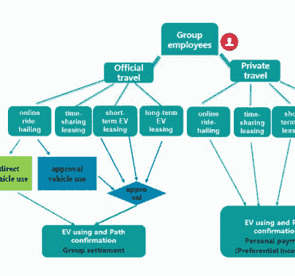
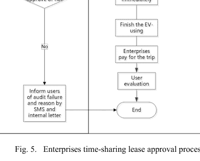

# 2020 IEEE 可持续电力与能源会议 (iSPEC)（中国成都 2020.11.23-2020.11.25） 2020 IEEE 可持续电力与能源会议 (iSPEC) ｜ 电动汽车共享与学习的研究

*摘要*——为了满足团体用户公务和私家出行的需求，提出了一种由团体、所有者和平台在内的多个实体参与的电动汽车（EV）共享租赁模式。基于对电动汽车共享租赁模式的分析，本文还考虑了基于区块链技术的团体用户公私用车场景的信任交易协议、相应的业务流程、实施方案、团体业务信用、个人成本和租赁费用，这为电动汽车租赁的建设提供了有效支持。

支出——基于市场的车辆使用（如网约车）在费用报销方面存在漏洞，有时监管可能导致过度报销；同时，也会抑制团体用户公务出行的积极性。

**关键词**——公务出行，电动汽车，区块链，电动汽车共享，租赁

## I. 引言

随着公务车辆的市场发展，传统的计划车辆模式已无法适应团体的公务用车需求，导致车辆管理上出现许多问题，突出表现为：公务用车分配成本高，给团体造成了严重的经济负担；导致过度浪费；以及公车私用这一严重问题。

在此背景下，以国有机构和私营企业为代表的团体正在探索公务管理效率，严格减少公务车辆的数量和使用，限制通过市场化出行或其他形式使用非公务车辆。这些挑战具有以下几个方面的问题：1) 车辆不足：团体拥有的车辆数量有限，几乎无法满足电动汽车的实际需求；“公车专用”可能导致某些团体公务用车效率低下；2) 车辆监管不足。

本工作得到了国家网电科技项目“运营共享模式电动汽车与电网应用研究”（SB/T 2019.11784-000）的支持。

## II. 公务出行共享的市场分析

从团体的角度来看，某些企业（尤其是国有机构）由于团体拥有的车辆数量有限且在某些时期（如周末）可能闲置，因此无法出于公共服务或紧急原因与公众共享团体车辆，这使得在组织内部甚至与公众共享团体车辆成为可能。

从使用的实现角度来看，团体车辆共享涉及管理和保险数据，此类数据的真实性和可靠性是结算车辆租赁费用和防止公车私用的关键。

从团体生态的角度来看，团体公务用车、租赁的业务范围，其车辆使用的规模和增长趋势，已不再利于形成一种多元化和利润多元的业务模式。有必要引入多用户参与的电动汽车共享平台。因此，一方面有必要建立一个广泛参与和可持续发展的车辆共享租赁平台，以满足团体公私出行的需求，并允许团体直接或公开共享电动汽车；另一方面，应将区块链技术引入业务模式，以实现基于其技术的有效结算和监管。

如图1所示，共享租赁的参与者包括平台运营方、团体和员工。运营方负责平台（app）的服务质量维护，团体和车辆。

## III. 团体电动汽车共享租赁结构

基于上述分析，提出了一种团体员工电动汽车共享租赁模式。在这种模式下，平台运营方构建应用（app），提供如网约车、时间共享、短期和长期电动汽车租赁等服务。团体员工接入电动汽车共享平台，团体根据实际情况决定是否提供共享或定向租赁。从企业行为中获得的积分可以转移给团体员工，作为公司给员工的激励。积分的获取和流通可以极大促进行业上下游生态的建立和电动企业的内部激励。对于拥有车辆的团体，也可以使用应用来享受团体共享的保障和折扣。


图1 共享租赁业务模式

### B. 区块链应用

区块链是互联网时代的一种去中心化数据库，是分布式数据存储、多点传输、共识机制、加密等技术的创新应用。技术的关键在于融合，需要将区块链技术嵌入到特定场景中。由于其具有自动执行和信誉的特点，接入平台的电动汽车的保险信息和维护记录应连接到区块链以确保透明度。对于团体公务出行，订单号、用户ID、电动汽车服务时间、行驶路径、结算地点、费用订单、充电和放电、时间放电和能量以及放电地点。

车辆共享是一个对线下具有重要意义的行业。除了目前的信息共享和评价系统外，对于恶意、损坏和侵犯用户权利的行为，社会干预成本较高。通过验证交易终端，可以明确责任、所有权和访问。通过区块链技术，增强平台对电动汽车的运营，鼓励电动汽车共享平台内的多个车辆加入行业，以避免车辆使用的缺点并提高使用效率。通过将闲置车辆放在平台上，所有者可以获得收入，这不仅车辆安全而且稳定运行。未来，在区块链技术的帮助下，可以解决身份、数据共享、安全数据、透明度和激励等核心问题。业务保险、业务金融、IT、业务汽车维修、维护和汽车美容，甚至扩展到满足行业的发展需求。

1) 成员之间建立信任

2) 公务和个人信用评分

对于信用良好的个人，个人出行可以通过信用授予而非实时支付。基于区块链的车辆信用不仅提高了汽车利用率并降低了平台的运营成本，还能产生自我约束并减少闲置使用。

3) 行业积分共享

互联网的结果是积分连接了共享世界中B端（企业）和C端（用户）的角色。通常，普通企业使用积分来标记生态系统内的各种权利和利益，以维护用户忠度和高成本使用。在电动汽车共享业务中，用户可以通过出行、车辆维护等各种行为获得积分。借助区块链，可以在共享的许多参与者中收集积分，从而实现电动工业生产消费上下游生态。从企业行为中获得的积分可以转移给团体员工，作为公司给员工的激励。积分的获取和循环可以极大促进行业上下游生态的建立和电动企业的内部激励。

## IV. 共享与租赁业务流程及实施方案

### A. 业务流程

在业务流程方面，如图2所示，依靠运营平台app，团体需要验证其身份和业务范围。根据团体资质，平台进一步进行注册和审核，批准信用额度、车辆押金和支付方式（实时账单、月度账单等）。

团体加入后，他们可以将员工信息输入平台系统并完成路线权限管理。如果团体为他们的行程选择了合适的车辆（内部订单订单或公共引导）。团体可以在平台上开展个人和私用车辆。


图2 电动汽车租赁业务流程

团体员工电动汽车使用的流程如图3所示。依靠平台app，员工选择公务出行和私家出行。借助灵活选择，行程可以分为网约车、时间共享和优惠的长期电动汽车租赁。当选择网约车时，有两种车辆使用方式：使用设定团体提供的公共固定区域车辆和批准的灵活路线车辆。所有公务行程都需要员工领导的批准，由团体经理在平台上进行管理。当员工需要使用电动汽车进行私家出行时，他/她必须选择特定的入口、参数如时间和地点，然后支付行程，如果事后错过



通过 APP 进行预约、开关门控制，自行出行，使用后将车辆还至指定地点，并在根据“时间+里程”协议支付费用后完成车辆使用。集团员工应在 APP 中提交其公用电动汽车（EV）使用申请，审批后使用车辆，相关费用由集团企业直接支付。用车流程如图 5 所示；

图3 集团员工公用与私人电动汽车使用流程

### B. 共享与租赁服务类型

具体的服务和流程如下：

### 1) 在线共享出行

共享与租赁平台为集团员工提供在线共享出行服务。集团通过 APP 订购行程订单，系统即时匹配车辆，支持支付宝、个人账户等多种支付方式。员工的公差出行可通过 APP 内的车辆费用进行报销，审批后由集团账户结算。用车流程如图 4 所示。

| 审批者 | 员工 |
| --- | --- |
| 设置企业支付审核功能 | 开始 |
| | 1. 获取电动汽车插口 |
| | 填写信息 | 2. 还接口 |
| | 提交申请及信息 | 3. 使用电动汽车时限 |
| 查看申请详情 | 4. 部门 |
| | | 已通过 |
| | 生成记录 | 5. 申请理由 |

企业共享租赁审批流程

| 审批者 | 员工 |
| --- | --- |
| 设置企业支付审核功能 | 开始 |
| | 1. 获取电动汽车插口 |
| | 填写信息 | 2. 还接口 |
| | 提交申请及信息 | 3. 使用电动汽车时限 |
| 查看申请详情 | 4. 部门 |
| | | 已通过 |
| | 生成记录 | 5. 申请理由 |



图 5. 企业共享租赁审批流程

### 3) 灵活短期与优惠长期租赁

租赁平台可为电动汽车提供短期和长期租赁服务，包括普通车辆、按日、周、月、年提供的特种车辆，以满足集团对业务和工程车辆的需求。集团员工可以通过 APP 在线订购并支付车辆，或通过线下填写申请表申请车辆。用车流程见图 6。

| 审批者 | 员工 |
| --- | --- |
| 设置企业支付审核功能 | 开始 |
| | 1. 获取电动汽车插口 |
| | 填写信息 | 2. 还接口 |
| | 提交申请及信息 | 3. 使用电动汽车时限 |
| 查看申请详情 | 4. 部门 |
| | | 已通过 |
| | 生成记录 | 5. 申请理由 |

图 4. 企业在线共享出行流程

### 2) 时段租赁

时段租赁可以为集团员工和其他个人提供电动汽车即取即用租赁服务。员工可以自由选择车辆需求，在线信用分越高，优先级越高。如果集团在重大合同中发生违约或严重拖欠租赁费，则信誉度较低，这些集团的信用系数可以降至零，如下：

- 开始
1. 租赁
2. 电动汽车类型
3. 乘客人数
4. 租赁理由

根据信用分，平台可以减少押金并增加集团的共享信用额度。押金分级制度可以有效区分不同集团的管理，并引导长期租赁信誉。例如，根据企业的信用分，平台可以决定企业是实时结算费用，还是采用根据信用协议金额结算的信誉结算方法。

- 申请电动汽车租赁
- 生成记录并提交给审批者
- 查看申请详情
- 确认电动汽车需求
- 是否批准
- 确认服务协议
- 生成服务协议
- 下单
- 取电动汽车
- 提供电动汽车
- 归电动汽车
- 确认押金
- 发布通知
- 告知用户违约并在 30 天内发具函件
- 集团账户支付
- 结束

图 6. 电动汽车租赁流程

集团的官方信誉可以通过两种方式提高：首先，集团预付费用，相应的预付款直接计入累计结算单 F。其次，平台每月运营调整集团结算，当信用分和电动汽车使用产生的信用增长时，适当增加集团的信用额度。押金和流程如图 6 所示，流程见图 7。

 (注：此处原文图片路径重复，按要求保留)

集团的官方信誉可以通过两种方式提高：首先，集团预付费用，相应的预付款直接计入累计结算单。其次，平台每月运营调整集团结算，当信用分和电动汽车使用产生的信用增长时，适当增加集团的信用额度。

（注：此处翻译部分翻译逻辑对应，文)

的信用分。如果集团在重大合同中发生违约或严重拖欠租赁费，则信誉度较低，

如下 )

例如，根据企业的信用分，平台可以决定企业是实时结算费用，还是采用根据信用协议金额结算的信誉结算方法。

```
S = T * F
```

图 7. 7. 7. 集团的信用。
