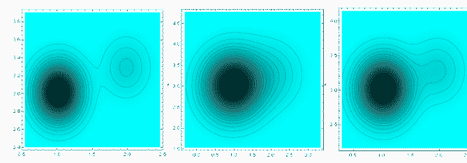
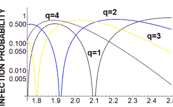
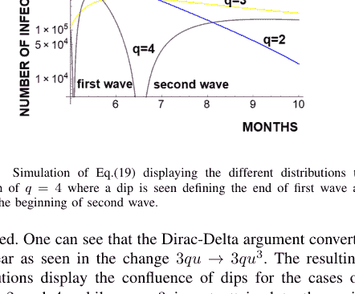

# 2020年 IEEE 第三届人工智能与知识工程国际会议 (AIKE)(美国加利福尼亚州拉古纳希尔 2020.12.9-2020.12.13)

摘要——本文提出了一种基于卷积理论并用机器学习术语表达的非线性数学模型。具体而言，峰值被假设为大型城市的感染率。以此，一旦确定了自由参数，我们就可以预测病毒的传播，从而构建算法，为开展医疗服务提供最佳估计并预测感染日期。分布通过狄拉克δδ函数（Dirac-Delta function）脉冲进行建模，并用于数值卷积。通过一个取决于自由参数的爆发案例说明该方法，模拟了检测感染新规则的实施。

# I. 引言

近期，新冠病毒（Covid-19）的迅速出现 [1] 警醒了全球卫生部门需要稳健的恢复和生存方案。此外，许多国家的流行病发生率已接近尾声，了解我们从全球数据集 [2] 中学到了什么尤为重要。事实上，正如所有受影响国家的监测系统一样，对数据的理解将揭示它们内在的差异，因为病毒到达的困难具有多性，以及在应用条件后恢复水平的差异。这些限制约束了病毒株在所有中大城市中的快速传播 [3]。本文关注新冠肺炎大流行的理论和计算研究。如图所示，病例与死亡人数之间的关系显示出强烈的波动，加强了以下假设：在更多病例（国家）中，新冠肺炎的传播动态和随后的感染被证明对随机性具有强 [4]，这种随机性遵循随机模式，并作为各种变量卷积后的基本论点 [5]。本文建议在涉及狄拉克δδ函数的卷积数学模型中识别参数。使用该函数的原因是其脉冲特性，使其成为模拟特定时期减少感染增加干预的候选模型 [6]。在流行病中，人们通常预期来自流行病学的一系列角色，如：疫情的角色：

- 识别病毒株及其主要属性。
- 估计对人类可能产生的影响。
- 识别公共卫生服务的强度 [7][8]
- 做出决策以选择正确的药物治疗。

在爆发行为主要由比率检测到的假设下，一个准真实的数学模型具有以下属性：

- 估计病毒传播速度的概率。
- 在决策前判定所有可能的情景。
- 高精度地确定前周内将使用的资源。
- 估计算法实施前后的效果。

通过这种方式，预计任何基于机器学习 [9] 的算法都能产生符合 Tom Mill' [10] 标准的结果，该标准给出 [1]、任务 (2) 和实验 [3]。我们建立了感染动态的特殊支持，特别是一旦提取了参数，它们都与流行病学的定义有关 [11]。特别关注了此类参数对短短期感染累积的影响。

具体而言，本文将卷积与非线性狄拉克δδ函数 $\delta(a, \tau)\delta(a, \tau)$ 结合，其积分可以：

$$N(t) = \sum_{l=1}^{k} \int_{0}^{t} B(\beta)\delta(a,\tau)d\tau \quad (1)$$

其中 $B(\beta)$ 为检测到的 beta 和 $\alpha$，这些是参数。本文结构如下：在第二节中介绍了机制，在第三节中实施了 Mitchell 标准。然后根据官方数据进行真实推演。最后得出了本文的结论。

# II. 数学方法

考虑由等式 (1) 给出的来自 B$(\tau, u)$ 时间相关分布的爆发开始，那么可以认为存在由以下给出的卷积操作：由于病毒株在最短时间内随机累积，分布显示出峰值形态 [13]。因此，需要实施一组模拟快速干预效果的函数 [14]。因此，可以在卷积操作中使用维纳-狄拉克数据：

$$B(\tau) = \int dB(\tau, u)H(u). \quad (2)$$

当 B$(\tau, u)$ 与 H$(u)$ 依赖于参数时，等式 (2) 符合如下：

$$B(\tau, u) = \int dB(\tau, u)H(u). \quad (3)$$

$$B(\tau, u) = \int dB(\tau, u)H(u). \quad (4)$$

$$B(\tau, u) = \int dB(\tau, u)H(u). \quad (5)$$

$$B(\tau, u) = \int dB(\tau, u)H(u). \quad (6)$$

$$B(\tau, u) = \int dB(\tau, u)H(u). \quad (7)$$

$$B(\tau, u) = \int dB(\tau, u)H(u). \quad (8)$$

$$B(\tau, u) = \int dB(\tau, u)H(u). \quad (9)$$

$$B(\tau, u) = \int dB(\tau, u)H(u). \quad (10)$$

显然的问题是：当涉及通用函数或多项式时，如何求解等式 (8) 中的狄拉克δδ方程？在 [15] 中可以评估这种类型的感染。无法以特设方式与真实数据相关的多项式，并做出符合感染形态 A 的近似。狄拉克δδ函数的脉冲在各个学科和领域表现出显著的应用，该属性与等式 (8) $f(t) = f(\tau)\delta(t-\tau)$ 连接。如等式 (10) 所示，逻辑扩展要求对等式 (8) 进行另一种解释，可以写为：$f(\tau) = \delta(\tau-\alpha) = \sum_{i=1}^{n} a_i \delta(\tau-\alpha)$，其中可以格式化通用定义 $f(\tau) = f(\tau)\delta(\tau-\alpha) = \sum_{i=1}^{n} a_i \delta(\tau-\alpha)$，对于 $\delta(t-\tau)$ 的情况——求解卷积给出形式 $f(t)t^{-1/2}$，这使得结果证明了感染的强度依赖于 $1/t$。也可以表示 $f(\tau)$ 以建议在一般情况下重写为 (1)：

$$f(\tau) = \begin{cases} \delta(\tau-\alpha) & \text{简单} \\ \sum_{i=1}^{n} a_i \delta(\tau-\alpha) & \text{多参数} \end{cases} \quad (11)$$

# III. 机器学习建模

### A. 汤姆·米尔切标准 (Tom Mitchell's Criteria)

机器学习科学提供了解决复杂问题的多种路径。在本文中，这项技术的兴趣本质上是为了实现能够以最小风险增强人类决策的智能系统。显然，这与流行病学的观点一致，即由于病菌进入后呈现的后果，流行病可能帮助我们尽快恢复出稳健的韧性。在书中，汤姆·米尔切定义，任何系统都可以被视为满足以下特征的系统：

- 所有系统都有一个**任务（task）**，反映了该系统存在的意义。翻译成流行病过程：一旦系统初始化并识别出病菌，系统或公共卫生操作人员就有主导权减少病毒在人体内的传播并实现恢复。

- 所有系统都有一个**性能（performance）**来应对任务。一旦定义了任务，系统就需要设计一种策略来成功跨越任务将经历的阶段。这种性能将在定量结果及其解释方面都将采用计算方法。在流行病学领域，可以看到性能目标是评估医疗中心的能力，以便为确诊感染者提供医疗援助。现实中，当地官员可能还会建议社会管制，如隔离、宵禁以及促进人之间的社交距离规则。

- 所有系统都会**获得性能（acquire performance）**。一旦性能被应用且系统能够评估这种应用是成功还是失败，就有机会识别导致任务解决的机制。这就是成功或失败的表现。在这些流行病中，这意味着拟议的规则与之前相比应该表现出显著差异。例如，给定某时期内的数量为 $N$，那么在实施社会规则后，预计后续一段时间的比例 $M$ 将满足 $M < N$。

通过这种方式，可以关联一个包含这些标准的数学模型，其目标是在最短时间内减少感染人数，同时不影响维持社会的常规机制。因此，可以构建一种旨在最小化感染的公式化方法，通过涉及每个具有最小目标的具体策略来实现。

### B. 机器学习形式化 (The Machine Learning Formalism)

等(10) 作为建模米尔切标准的候选。通过这种方式，可以初步提供一种均值来增强等(10)的每一项。为了实现这一点，可以将米尔切标准表述为如下卷积：

$$E(t) = \int T(s)P(s,t)ds \quad (12)$$

通过该式，函数 $P(s,t)$ 分别识别为在自由参数 $a$ 和 $b$ 上的性能。此外，对于超出限制的问题，我们期望匹配系统中的多参数问题：

$$E(t,a,b) = \int T(s,a)P(s,t,b)ds \quad (13)$$

$$EMN(t,a,b) = \sum_{m=1}^{N} T(s,a_m)P(s,t,b_m)ds \quad (14)$$

显然，我们还可以考虑那些严格限制于 $M$ 和 $N$ 取值的、没有重复求的场景。据此，根据自由参数数量设计的机器学习方法定义可以写为：

$$E = E_{(M+1)(N+1)}(a_{1,1},b_{1,1}), \dots, E_{(M+1)(N+1)}(a_{M,N},b_{M,N}) \quad (15)$$

在图 1 中，是短时间内任务函数与性能随时间的乘积。对于这项练习，采用了通过高斯过程的随机分布。它被绘制为双变量图。正如所述，根据汤姆·米尔切理论，任务与性能乘积的使用本质上与感染人数成正比，这些区域将表示感染分布的峰值。

图0 给定任务的随机行为和随时间函数的二变量分布插图。对于三个二变量值分别为 0.22（左）、0.51（中）和 0.30（右）。

## IV. 应用与仿真

考虑等.(14)。它可以被投影到完全由流行病学规则主导的领域，例如任何到达者的行为和流行率。通过这种方式，我们与等.(14) 关联起来，例如代表 Covid-19。通过知道狄拉克-δ 函数（Dirac-Delta function）的“尖峰”属性，当这些函数在其参数中包含它时，确定这些函数的零是可行的，零的多项式会将凹谷提升为狄拉克-δ 分布。因此，我们得到

$$N(t) = \int P(t(u)D[f(u,\beta_m)]du \quad (16)$$

由于 $D(t,\beta_m)$ 是狄拉克-δ 函数，假设自由参数 $\beta_m$ 被视为定义大流行阶段的参数。这些阶段可以用风险来解释。正如 [20] 所示，这是一个定义概率分布的坚实骨架。当然，细节取决于新颖性的范围：

$$N(t) = \int J_n(t,u)D[f(u,\beta_m)]du \quad (17)$$

$J_n(t,u)$ 阶贝塞尔多项式基于它们的振荡属性，这种属性在某种程度上适用于表现出起伏波的流行病演变。图1中绘制了以下概率分布：

$$P(t) = \int_{-\infty}^{\infty} |J_n(x)|^2\delta(tx-x+\beta_1-\beta_2)dx \quad (18)$$

其中狄拉克-δ 的零转换为狄拉克-δ 函数的平方。

图1 归一化为 1 的感染概率随月份（1到4之间）变化的函数。我们可以看到与狄拉克-δ 函数卷积的影响移动了贝塞尔函数的零。在感染概率随月份函数中，可以看到当 $q=1$ 时，概率在 2.1 个月达到最大值。在这个由阶主定的流行中，概率在随后的月份下降。对于 $q=2$，在 1.8 个月出现一个凹谷。实际上，在 $q=4$ 范围内出现的凹谷仅快速达到 2.5 个月。

### B. 波的结束与开始

与 (18) 不同，狄拉克-δ 函数的参数不依赖于阶 $q$。认为参数的零是由多项式形式决定的，那么内部参数 $q$ 的实施将产生完全由这些整数决定的形态。因此，在场景下，通过取决于三个变量 $x$ 和 $q$ 的狄拉克-δ 函数卷积给出：

$$P(u) = \int_{-\infty}^{\infty} |J_n(x)|^2\delta(ux+3q-10uq)dx \quad (19)$$

$$P(u) = \int_{-\infty}^{\infty} |J_n(x)|^2\delta(ux+3q-10uq)dx \quad (20)$$

其分布绘制在图 2（上）和（下）中。在 $q=4$ 的上面板中，可以看到它被解释为第一波和第二波。与 $q=1, 2$ 和 $4$ 的情况相比（它们在该范围内没有显示凹谷），我们可以认为贝塞尔函数 $J_q(x)$ 涵盖了整个流行病场景。$q=6.5$ 个月处凹谷出现与修改学习以影响感染数量有关。在图 3（等.(20) 的仿真）中是第二波。

图2 等.(20) 的仿真，显示了 $q=4$ 的异常分布，其凹谷定义了第一波的结束以及第二波的开始。

## V. 结论

在本文中，机器学习的标准是我们使用

