# 2020 IEEE/ACM 社交网络分析与挖掘进展国际会议 (ASONAM) (荷兰海格 2020.12.7-2020.12.10)

¹卡塔尔计算研究院，HBKU， 多哈，卡塔尔
²JIT Limited, 孟买，孟加拉
†{fiamlam, ofli, imranuq}@hbku.edu.qa,tanvir2.alam@gmail.com

**摘要—** 社交媒体上分享的灾害事件有助于管理者获取态势感知并评估伤亡损失等其他响应任务。计算机视觉和自然语言处理的最新进展已为灾害响应任务提供了数据集支持，包括检测危机、过滤无关图像、图像分类以及评估损害的严重性。灾害事件数据集通常是不完整的，且只有部分（已标记）可用，用以训练更稳健的深度学习模型。在这项研究中，我们为灾害类型分类和严重性评估提出了新的数据集。我们对之前的可用数据集重新应用于新任务。通过使用不重叠的数据集，我们终于对最先进的深度学习模型进行了基准测试，并取得了令人鼓舞的结果。我们发布了我们的数据集和模型，为提供更好的基准以及进一步的研究提供支持。

**索引术—** 深度学习、灾害图像分类、自然灾害、社交媒体、基准测试

引言内容（全面综述请参见 [1], [2]）。尽管许多研究工作表明，灾害事件期间在社交媒体上分享的图像可以以多种方式帮助人道主义组织。例如，用于评估基础设施和损害严重程度的图像 [4] 侧重于识别基础设施的损害以及各种环境因素。

目前可用于开发灾害响应任务分类的数据集包括用于损害评估 [5]、CrisisMD [6] 以及多模态损害识别任务 [7]。这些数据集中的注释标签包含了不同的分类任务，如 (i) 灾害类型、(ii) 人道主义影响和 (iii) 损害严重性评估。在研究这些数据集后，我们发现了几点局限性：

- 当独立考虑时，与社交媒体平台产生的海量数据（例如 Twitter 和 MS COCO [7]）相比，这些数据集相当较小，导致无法开发用于现实应用的稳健数据集，
- (ii) 它们包含精确和近乎重复的样本，由于随机的训练和测试划分，会导致误导性的性能评分
- (iii) 不同研究中使用了不一致的训练-测试划分，这使得很难比较不同工作之间的结果。过去几年中，图像处理的新网络架构也取得了显著进展；然而，它们在灾害响应任务的信息学¹背景下尚未被广泛探索。

为了解决这些局限性，我们在本研究中的贡献如下：

- 我们开发了灾害类型和有效性数据集，这对研究社区来说是全新的。
- 我们发布了用于新任务的现有数据集，显著减少了数据收集、清洗和标注的工作。我们确认了适用于不同任务的最大数据集。
- 我们将每个数据集分为训练集、开发集和测试集，并通过消除测试和训练划分中的精确和近乎重复的图像，创建不重叠的测试集。

过去几年，该领域的研究发生了激增。重点是分析社交媒体数据的有用性，并利用不同的模态开发计算模型以提取可操作的信息。在不同的模态（例如文本和图像）中，与社交媒体相比，文本内容分析得到了更多关注。社交媒体在自然或人为灾害期间被广泛使用，作为快速传播信息和获取有用见解的来源。人们在社交媒体上发布事件（通过文本、图像和视频等不同方法）以帮助和支持、识别需求或分享个人感受。如果内容质量高，信息就是有用的；如果我们有实时系统自动处理社交媒体内容以促进快速

> https://en.wikipedia.org/wiki/Disaster_informatics

我们将来自不同来源的所有特定任务的数据集整合到一个集合中用于不同的任务。

- 我们使用各种最先进的网络架构，为四个任务提供了基准结果，分别以单独或组合数据集的形式给出。这些结果为图像分类任务的危机信息学确立了新的基准。最后，我们将公开带有划分的数据集。

论文的其余部分组织结构如下：第二节简要概述了现有工作。第三节介绍了本研究中使用的数据集。第四节描述了为本研究准备的数据。第五节解释了……，而第六节介绍了结果和讨论。我们在第七节总结了论文。

与分析人道主义援助文本内容相比，危机信息学中关于图像处理的研究很少。随着深度学习在图像分类领域的近期成功，研究必须必须利用社交媒体图像进行人道主义援助。社交媒体上灾害的图像内容已在许多研究中得到过 [3], [8]–[13]。例如，[8] 中研究了对洪水的分析，作者报告了洪水和地震期间存在带有社交媒体内容的图像。显示带有地理标记信息的图像对于定位受影响区域很有用。

最近对社交媒体上分享的内容分析已使用深度学习技术进行了探索，用于灾害管理。这些研究大多数对危机期间的损害严重性进行分类 [3], [11]，而其他研究则将严重性量化为连续值索引 [14], [15]。最近提出了一种从危机期间社交媒体图像中提取意义信息的图像处理流程，该流程是使用基于深度学习的技术开发的。他们的方法包括过滤图像，最后根据严重性对其进行分类。Mouznar 等人 [4] 研究了一个多模态数据集，该数据集已用于训练损害检测模型。同样，[16] 显示带有地理标记信息的图像对于定位受影响区域很有用。

目前用于开发灾害响应任务分类的数据集包括用于损害评估 [5]、CrisisMD [6] 以及多模态损害识别任务 [7]。这些数据集中的注释标签包含了不同的分类任务，如 (i) 灾害类型、(ii) 人道主义影响和 (iii) 损害严重性评估。在研究这些数据集后，我们发现了几点局限性：

- 当独立考虑时，与社交媒体平台产生的海量数据（例如 Twitter 和 MS COCO [7]）相比，这些数据集相当较小，导致无法开发用于现实应用的稳健数据集，
- (ii) 它们包含精确和近乎重复的样本，由于随机的训练和测试划分，会导致误导性的性能评分
- (iii) 不同研究中使用了不一致的训练-测试划分，这使得很难比较不同工作之间的结果。过去几年中，图像处理的新网络架构也取得了显著进展；然而，它们在灾害响应任务的信息学¹背景下尚未被广泛探索。

为了解决这些局限性，我们在本研究中的贡献如下：

- 我们开发了灾害类型和有效性数据集，这对研究社区来说是全新的。
- 我们发布了用于新任务的现有数据集，显著减少了数据收集、清洗和标注的工作。我们确认了适用于不同任务的最大数据集。
- 我们将每个数据集分为训练集、开发集和测试集，并通过消除测试和训练划分中的精确和近乎重复的图像，创建不重叠的测试集。

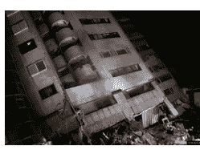
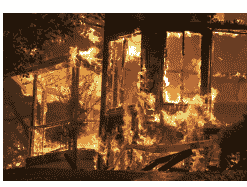
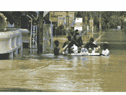
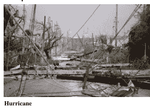
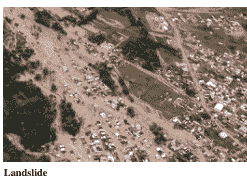
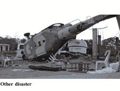

图 1：不同灾害类型的示例图像。

图 2：一张标注为 (i) 火灾事件、(ii) 密集、(iii) 基础设施和公用损坏以及 (iv) 严重损坏的图像。

公用损坏；失踪或发现人员；救援、志愿者或捐赠活动；车辆损坏 [5]。在本研究中，我们关注四类被认为对响应人员最显著且最重要的类别，如：(i) 受影响、受伤或死亡的人、(ii) 基础设施和公用损坏、(iii) 严重的志愿者或捐赠活动，以及 (iv) 非人道主义。

评估损害严重程度对于在灾害发生期间帮助受影响社区至关重要。损害的严重程度可以根据对建筑结构的物理破坏（例如桥梁、道路、建筑物和森林的破坏）进行评估。根据 [3] 中报道的工作，我们使用的分类类别为：(i) 严重损坏、(ii) 轻微损坏和 (iii) 极小或无损坏。

图 2 显示了一个说明所有四个任务标注的示例图像。

对于本研究，我们使用了公共数据集和内部标注的数据集。下面，我们提供了每个数据集的详细信息。

- 1) 损害评估数据集 (DAD)：评估数据集数据带有带有标记的图像数据严重程度级别，标记为严重、轻微和极小-损害 [3]。这些图像从两个来源收集：AIDR [24] 和 Flickr。爬虫使用了以下关键词：建筑损坏、桥梁和受损道路。来自 AIDR 的图像是在鲁比台风、尼泊尔地震、乌克兰地震等不同灾害事件期间从 Twitter 收集的。该数据集由作为志愿者的受付费人员进行标注。我们将其用于信息化任务和损害任务。对于信息化任务，我们将严重和轻微图像映射到信息化类别中，并手动筛选极小-损害的图像，以将它们分为信息化和非信息化类。对于严重损害，我们使用“极小-损害”的标签以与其他任务对齐。
- 2) CrisisMD：这是一个多（图像，文本）和多任务数据集，由 18,082 张从 AIDR 系统处理的不同事件中收集的图像组成。数据通过在 Figure-Earth 平台上完成不同任务来标注的：(i) 具有二分类标签的信息化（信息 vs 非信息），具有七个类别标签（ii. 基础设施和公用损坏，救援、志愿者或捐赠活动，或发现人员、受影响个体、失踪或相关信息和非相关），(iii) 使用这些标签进行损害评估（iv, 严重、轻微或无损坏）。
- 3) AIDR 数据集：对于灾害类型分类任务，我们根据 III-A 节提到的类别对图像进行了标注。我们从 17 场灾害事件和 3 个集合中获取了推文，所有这些都由 AIDR 系统收集。17 场灾害事件包括洪水、地震、火灾、飓风和武装冲突。通用集合包含了与自然灾害、人为引起的灾害和安全事件相关的关键词。我们为这些集合创建了图像。收集图像时，我们根据推文 ID 移除重复。然后使用 [13] 中讨论的方法移除近重复。从这些图像中，我们收集了约 3K 张用于标注。这些图像的标注分两个步骤完成：首先，将一组图像标记为地震、火灾、飓风。

然后我们收集了约 2200 张样本，在之前的步骤中被标记为非这些类别的其他灾害。选择此类图像的原因是资源有限。

对于滑坡类别，我们从 Google、Bing 和 Flick 爬取了关键词滑坡、可能的滑坡、落石、滑坡坍塌。由于我们从不同来源收集图像，导致了重复。为了考虑到这一点，我们使用了相同的重复过滤来移除精确重复和近重复。其余图像被手动标记为滑坡和非滑坡。

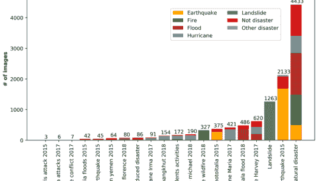

(1) 地震：显示损坏或被毁的建筑物、断裂的房屋、线路线、机场、公路和火灾；
(2) 火灾：显示人为火灾或野火（森林、草地和被毁）、损坏的森林、房屋或基础设施。
(3) 洪水：显示被淹的地区、道路、房屋和其他基础设施。
(4) 飓风：显示强风、风暴潮、暴雨、倒塌的电线杆、电网和树；
(5) 滑坡：显示滑坡、泥石流、滑坡和土地坍塌。
(6) 其他灾害：显示任何其他灾害类型，如飞机坠毁、汽车事故、爆炸和冲突。
(7) 非灾害：显示卡通、广告或无法与任何灾害类型相关的物品。

对于数据集任务，我们使用了灾害类型定义：通过调查给定测试集中的每个图像以及对应集合中已识别的图像来识别重复项：

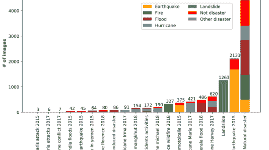

图 3：AIDR 数据集中不同灾害事件和集合中标记的灾害类型数量。

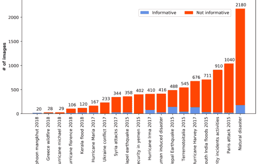

在图 4 中，我们报告了通用集合中标记为“信息化”和“非信息化”的图像分布。

- A) AIDR 信息化数据集 (AIDR-Info)：对于此数据集，我们使用 AIDR 系统收集了图像。我们使用相同的重复过滤来移除重复。然后我们用两个类别标签标记了 9,930 张图像：信息化 vs 非信息。

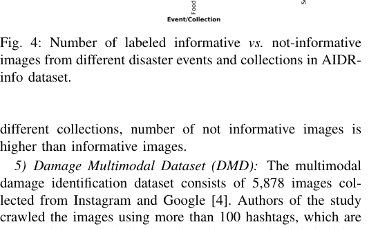
图 4：AIDR-info 数据集中不同灾害事件和集合中信息 vs 非信息的图像数量。

- B) 损害多模态数据集 (DMD)：多模态数据集由从 Google 和 Instagram 收集的 5,887 张图像组成。标记的数据集由六类标签组成，例如：火灾、洪水、自然、基础设施和非灾害。对于此，我们使用了相同的重复过滤来移除精确重复和近重复。其余图像被手动标记为。

标注由领域专家完成，确保了新数据集和重新标记数据集的标注质量。定义改编自 [5]。

在汇总数据集之前，我们将每个数据集分别分为训练集、开发集和测试集，比例为 70:10:20。目的有三：(i) 在每个任务上训练和评估单个数据集；(ii) 使每个数据集到合并数据集中的分布保持接近；(iii) 为研究社区提供独立使用划分结果的机会。数据划分后，我们识别重复图像（见 IV-D）并将它们移动到训练集以创建一个不重叠集。

为了开发机器学习模型，开发不重叠的训练集和测试集至关重要。通常做法是将数据集随机划分为训练集和测试集。这种方法会导致与社交媒体重叠的训练-测试划分。对于训练和测试集中的精确或近重复图像 [13]，我们识别重复项。由于它们已经过标注，我们不想从数据集中移除任何图像。动机是训练中存在精确和近重复图像会在训练集中产生自然的混淆。为了识别重复图像，我们训练模型寻找测试集中最近的图像。我们首先使用预训练的重复学习模型提取特征。然后，我们使用最近邻 [7] 利用相应数据集的训练集来训练模型。对于 CrisisMMD 的信息化数据集，我们使用训练集训练模型，然后用它识别测试集中每个图像的图像。

接下来，我们通过调查给定测试集中的每个图像以及四个任务和十二个数据集对应集合中识别出的图像来识别重复项。我们在测试集中识别了 5593 个精确和近重复图像。然后我们将识别出的图像移动到训练集，使用近似阈值自动识别重复图像，以创建干净的测试集。在图 5 中，我们展示了精确和近重复图像的欧几里得距离量的直方图。

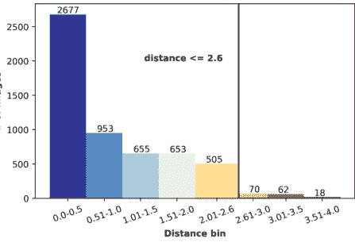

图 5：不同距离桶中的重复数量。

2.6 是自动重复检测的合理选择。从检测中发现也有更高阈值的重复图像；但与此相比数量非常小。同时注意，较高的数值会导致误报率增加。使用 ≤ 2.6 的阈值，我们自动识别测试集中的重复图像并将其移动到训练集。

原因之一是为了进行数据合并以开发具有大量数据的深度学习模型。为了这一目的，我们将所有训练、开发和测试集合并到汇总数据集中。合并多个数据集可能会导致训练和测试集中出现重复图像，合并后我们重复重复识别过程以为不同任务创建不重叠集。

表 I、II、III、IV 和 V 显示了测试集中所有重复的标签分布。表中报告了每个数据集的数量。某些类别被标记为重复集合。例如，在灾害任务（表 I）中，AIDR 数据集的“其他灾害”分布较低，而 DMD 数据集的“滑坡”分布较低。对于信息化任务，观察到“信息化”标签的分布较低。对于人道主义任务，我们在 CrisisMMD 和 DMD 数据集的损害严重程度任务“轻微”中救援志愿者或捐赠的分布较低。然而，如表 V 所示，汇总数据集在不同任务的类别之间创建了公平的平衡。

|---|---|---|---|--|
| Earth | 地震 | 1910 | 201 | 2487 |
| | 火灾 | 990 | 155 | 1105 |
| | 洪水 | 2059 | 241 | 533 |
| ADSR-Hot (11752) | 飓风 | 1188 | 272 | 1469 |
| | 非灾害 | 1507 | 415 | 2120 |
| | 其他 | 658 | 68 | 753 |
| DMD (5388) | 地震 | 130 | 17 | 385 |
| | 火灾 | 255 | 71 | 362 |
| | 洪水 | 263 | 50 | 378 |
| | 飓风 | 238 | 73 | 366 |
| | 非灾害 | 2108 | 278 | 597 |
| | 其他 | 1057 | 245 | 1489 |

| CrisisMD (11241) | 受伤或死亡人员 | 521 | 51 | 672 |
| | 基础设施和公用设施损坏 | 3307 | 206 | 3952 |
| | 救援人员或其他功能 | 1682 | 174 | 375 |
| DMD (5528) | 受伤或死亡人员 | 935 | 125 | 1340 |
| | 基础设施和公用设施损坏 | 276 | 74 | 347 |
| | 救援人员或其他功能 | 74 | 9 | 101 |

| DMD (25820) | 轻微或无 | 7811 | 1056 | 5468 |
| | 中等 | 2828 | 548 | 3462 |
| | 严重 | 9457 | 673 | 1380 |
| CrisisMD (3198) | 轻微或无 | 317 | 54 | 526 |
| | 严重 | 1624 | 149 | 2751 |
| DMD (5878) | 轻微或无 | 508 | 60 | 132 |
| | 严重 | 857 | 110 | 2195 |

| CrisisMD (25820) | 信息性 | 1529 | 590 | 2296 |
| | 非信息性 | 4950 | 1269 | 7365 |
| DMD (5878) | 信息性 | 2006 | 551 | 1621 |
| | 非信息性 | 2152 | 280 | 2972 |
| ADSR-Info (9936) | 信息性 | 627 | 162 | 865 |
| | 非信息性 | 667 | 598 | 1970 |

我们采用迁移学习来进行实验，该方法在视觉识别任务中已显示结果 [19–22]。迁移学习的目标是使用预训练模型的权重。在本研究中，我们使用了 PyTorch 库的多种神经网络。架构包括 ResNet18, ResNet50, ResNet101, AlexNet [28], VGG16 [29], DenseNet[30], SqueezingNet[31], Inception[33], MobileNet[32]。

我们使用 ImageNet 的权重 [64]。我们根据分类任务（例如 softmax 层）调整网络的最后一层，而不是原始的 1000 类分类。迁移学习允许我们将从大规模领域的网络特征和参数转移到目标领域，用于四个不同的分类任务。

我们为信息性任务设计了二分类器，为其他任务设计了多类分类器。为了衡量每个分类器的性能，我们使用了精确率 (P)、召回率 (R) 和 F1 分数 (F1)。由于样本限制，我们只报告 F1 分数。

为了确定收集的数据是否实现了更好的性能，我们使用以下集合训练模型：

目前可用的网络具有不同的计算复杂度。我们的目标之一是将模型部署到实时应用中，利用它们来理解其性能差异。另一个动机是目前的文献关注点限于使用一或两种网络架构（例如 VGG16 [16], Inception[4]），我们希望在本研究中对其进行扩展。

1) 数据集比较：使用 ResNet18 架构的不同任务和数据集的结果。不同任务的性能是不等的，因为它们具有不同的复杂度（类别标签的数量、分类难度）。

例如，信息性任务比具有更多标签的分类任务（例如灾害类型）简单。参见损坏任务的 V。类别分布较小，反映了其重要性和整体性能。轻微类别也比其他类别不重要，我们认为分类器经常会将该类别与其他混淆。在 [3] 中也有类似的发现。对于灾害任务，AID-DRT 的性能……

| 地震 | 208 | 40 | 248 |
| 火灾 | 1279 | 221 | 1500 |
| 洪水 | 2366 | 259 | 2625 |
| 飓风 | 940 | 128 | 1068 |
| 自然灾害 | 1195 | 142 | 1337 |

| ResNet18 (11.2) | 0.716 | 0.854 | 0.726 |
| ResNet50 (25.5) | 0.235 | 0.808 | 0.751 |
| MobileNet2 (5.3) | 0.220 | 0.852 | 0.746 |
| VGG16 (13.4) | 0.679 | 0.798 | 0.753 |
| VGG19 (143) | 0.470 | 0.818 | 0.739 |
| Inception (8.7) | 0.086 | 0.836 | 0.719 |
| EfficientNet (12.1) | 0.865 | 0.829 | 0.768 |
| MobileNet (20.2) | 0.835 | 0.782 | 0.771 |
| EfficientNet (25.7) | 0.778 | 0.816 | 0.785 |

| ADR | 0.726 | 0.797 | 0.720 | 0.709 |
| DAD | | | | |
| CrossMD | | | | |
| DMD | 0.591 | 0.751 | 0.636 | 0.063 |
| EfficientNet | 0.788 | 0.851 | 0.749 | 0.726 |

| Earth | 地震 | 1910 | 201 | 2487 |
| | 火灾 | 990 | 155 | 1105 |
| | 洪水 | 2059 | 241 | 533 |
| ADSR-Hot (11752) | 飓风 | 1188 | 272 | 1469 |
| | 非灾害 | 1507 | 415 | 2120 |
| | 其他 | 658 | 68 | 753 |
| DMD (5388) | 地震 | 130 | 17 | 385 |
| | 火灾 | 255 | 71 | 362 |
| | 洪水 | 263 | 50 | 378 |
| | 飓风 | 238 | 73 | 366 |
| | 非灾害 | 2108 | 278 | 597 |
| | 其他 | 1057 | 245 | 1489 |

| CrisisMD (11241) | 受伤或死亡人员 | 521 | 51 | 672 |
| | 基础设施和公用设施损坏 | 3307 | 206 | 3952 |
| | 救援人员或其他功能 | 1682 | 174 | 375 |
| DMD (5528) | 受伤或死亡人员 | 935 | 125 | 1340 |
| | 基础设施和公用设施损坏 | 276 | 74 | 347 |
| | 救援人员或其他功能 | 74 | 9 | 101

| DMD (25820) | 轻微或无 | 7811 | 1056 | 5468 |
| | 中等 | 2828 | 548 | 3462 |
| | 严重 | 9457 | 673 | 1380 |
| CrisisMD (3198) | 轻微或无 | 317 | 54 | 526 |
| | 严重 | 1624 | 149 | 2751 |
| DMD (5878) | 轻微或无 | 508 | 60 | 132 |
| | 严重 | 857 | 110 | 2195 |

| CrisisMD (25820) | 信息性 | 1529 | 590 | 2296 |
| | 非信息性 | 4950 | 1269 | 7365 |
| DMD (5878) | 信息性 | 2006 | 551 | 1621 |
| | 非信息性 | 2152 | 280 | 2972 |
| ADSR-Info (9936) | 信息性 | 627 | 162 | 865 |
| | 非信息性 | 667 | 598 | 1970 |

我们采用迁移学习来进行实验，该方法在视觉识别任务中已显示结果 [19–22]。迁移学习的目标是使用预训练模型的权重。在本研究中，我们使用了 PyTorch 库的多种神经网络。架构包括 ResNet18, ResNet50, ResNet101, AlexNet [28], VGG16 [29], DenseNet[30], SqueezingNet[31], Inception[33], MobileNet[32]。

我们使用 ImageNet 的权重 [64]。我们根据分类任务（例如 softmax 层）调整网络的最后一层，而不是原始的 1000 类分类。迁移学习允许我们将从大规模领域的网络特征和参数转移到目标领域，用于四个不同的分类任务。

我们为信息性任务设计了二分类器，为其他任务设计了多类分类器。为了衡量每个分类器的性能，我们使用了精确率 (P)、召回率 (R) 和 F1 分数 (F1)。由于样本限制，我们只报告 F1 分数。

目前可用的网络具有不同的计算复杂度。我们的目标之一是将模型部署到实时应用中，利用它们来理解其性能差异。另一个动机是目前的文献关注点限于使用一或两种网络架构（例如 VGG16 [16], Inception[4]），我们希望在本研究中对其进行扩展。

1) 数据集比较：使用 ResNet18 架构的不同任务和数据集的结果。不同任务的性能是不等的，因为它们具有不同的复杂度（类别标签的数量、分类难度）。

例如，信息性任务比具有更多标签的分类任务（例如灾害类型）简单。参见损坏任务的 V。类别分布较小，反映了其重要性和整体性能。轻微类别也比其他类别不重要，我们认为分类器经常会将该类别与其他混淆。在 [3] 中也有类似的发现。对于灾害任务，AID-DRT 的性能……

| 火灾 | 1279 | 221 | 1500 |
| 洪水 | 2366 | 259 | 2625 |
| 飓风 | 940 | 128 | 1068 |
| 自然灾害 | 1195 | 142 | 1337 |

| ResNet18 (11.2) | 0.716 | 0.854 | 0.726 |
| ResNet50 (25.5) | 0.235 | 0.808 | 0.751 |
| MobileNet2 (5.3) | 0.220 | 0.852 | 0.746 |
| VGG16 (13.4) | 0.679 | 0.798 | 0.753 |
| VGG19 (143) | 0.470 | 0.818 | 0.739 |
| Inception (8.7) | 0.086 | 0.836 | 0.719 |
| EfficientNet (12.1) | 0.865 | 0.829 | 0.768 |
| MobileNet (20.2) | 0.835 | 0.782 | 0.771 |
| EfficientNet (25.7) | 0.778 | 0.816 | 0.785 |

| ADR | 0.726 | 0.797 | 0.720 | 0.709 |
| DAD | | | | |
| CrossMD | | | | |
| DMD | 0.591 | 0.751 | 0.636 | 0.063 |
| EfficientNet | 0.788 | 0.851 | 0.749 | 0.726 |

由于数据划分的差异以及图像重复的问题，无法与之前的先进技术进行比较。在信息量和人道主义任务上，使用五折交叉验证 [16] 报告的加权 (F1) 分别为 83.2 和 76.3。在针对使用五折验证的数据集进行的规模任务准确率测试中，报告的准确率为 3.59±1.72。使用 CRISM 数据集，作者报告的人道主义任务加权 F1 分别为 82.2 和 66.6。我们在他们的研究中使用整个 CRISM 数据集的一个小子子集。由于数据划分的不同，我们的数据集和划分不进行直接比较。然而，我们提供了一个标准框架，供未来研究比较。

社交媒体上的图像包含供人道主义组织的信息。与开发深度学习模型的有限研究相比，灾害响应分类任务的工作非常有限。我们为灾害分类任务提供了新的数据集，并提供了一个构建的数据集。这包含了重复项和非重叠划分。我们处理了四种不同类型的任务，包括损害程度。这些数据集具有独特的特征，可以转换为多标签，以及用于开发新算法的学习任务。我们也旨在在未来解决这个问题。此外，我们开发了先进的深度架构，以在数据集上提供基准结果。

- [1] M. Carreras, F. Dias, and V. Viegas, "Social media messages in emergency management: A survey," ACM Computer Surveys, vol. 47, no. 6, p. 77 (2015).
- [2] N. Said, K. Ahmad, M. Riesier, K. Poegeler, L. Hassan, N. Ahmad, and M. Khan, "Social media for disaster management: a survey," Journal of Public Safety, vol. 78, no. 22, p. 31.27–31.32 (2019).
- [3] J. Chen, S. Kim, M. Imran, and M. Mitra, "Assessment from social media data for disaster detection," in Proc. of ISOC, August 2017, p. 1–8.
- [4] H. Lee, J. Kirk, and A. Mead, "Damage Identification in Social Media Posts Using Deep Learning," in Proc. of ISOC, 2019, p. 529–534.
- [5] F. Wang, D. Ge, J. Dong, S. Rock, L. Li, and L. Fei, "Identifying damage in natural disasters," in Proc. IEEE/CVF Conference on Computer Vision and Pattern Recognition (CVPR), 2009, p. 248–255.
- [6] T. Lin, M. Saari, S. Belmehdi, J. Hayes, P. Ramirez, D. Polizzi, and Y. Zhang, "Detecting damage in context," in European Conference on Computer Vision (ECCV), 2014, p. 740–755.
- [7] R. Perdomo and J. P. de Alquebasque, "Identifying images as relevant social media messengers in disaster management," in Proc. of ISRAM, 2015.
- [8] S. Daly and J. Thom, "Miniming and classifying images on social media to audio analysis fires," in Proc. of ISRAM, 2016, p. 1–14.
- [10] F. Chen, L. Liu, M.-Y. Kan, and P. Cui, "Understanding and classify events in tweets," ACM Multimedia, 2013, p. 781–784.
- [11] D. T. Nguyen, F. Alam, F. Olmi, and M. Imran, "Automated image filtering for disaster response using deep learning and perceptual hashing," in Proc. ISRAM, 2017.
- [12] F. Alam, M. Imran, and F. Olmi, "Image social media analysis for disaster response," in Proc. of ISOC, 2017, p. 1–6.
- [13] F. Alam, F. Olmi and M. Imran, "Processing social media messages for combining human and managing crises," International Journal of Human Interaction, vol. 34, no. 4, p. 311–327 (2020).
- [14] K. Kim and M. Lee, "Building automated damage assessment tool using deep learning and ground-level image classification," IEEE VIP, 2017, p. 95–100.
- [15] X. Li, D. Garcia, H. Zhang, and M. Imran, "Classifying and localizing damage in images," in Proc. IEEE CVPR, 2018, p. 1938–1947.
- [16] F. Olmi, M. Imran, "Analysis of social media data for deep disaster response," in Proc. of ISOC, 2016.
- [17] M. Weber, F. Helzer, C. Schulz, V. Srinivas, A. Dengel, and D. Booth, "Earthquake satellite damage detection," in Duaval, 2017.
- [18] H. White, F. Patrick, J. Zevny, B. J. de, and A. Damian, "The earthquake satellite damage detection method in 2018 earthquake,"
- [19] J. Cheng, L. Chen, Y. Beng, and H. Lipson, "What is the future of deep learning,"
- [20] A. Das, S. Kim, J. Sullivan, "Deep learning,"
- [21] G. Huang, Y. Ahmad, and S. Carlsson, "Learning and training multi-dimensional features," Neural Information Processing, 2021.
- [22] M. Al, and D. Delany, "Deep neural networks," 207, p. 171.
- [23] J. M. Shauf, "Disaster types," 2015.
- [24] A. Medina, F. Castillo, and S. Sivic, "Clexicon: a lexicon for collecting and filtering communications in crises," in Proc. CVPR, 2016.
- [25] K. He, X. Zhang, and J. Sun, "Deep learning for image recognition," in Proc. CVPR, 2016, p. 7770–7778.
- [26] M. Al, and D. Delany, "Deep neural classifier," Computer Applications, vol. 34, no. 8, p. 1–17 (2017).
- [27] A. Atksky, S. Sutterback, and E. Hinton, "Image-classification using deep neural networks," in International Conference on Neural Processing, 2009, pp.1097–1105.
- [28] K. Simonyan and A. Zisserman, "Very deep convolutional networks for scale recognition," in Proc. CVPR, 2014, p. 4755–4753.
- [29] G. Huang, J. Liu, D. Van Der Ma, and K. Weinberger, "Deep connected convolutional networks," in Proc. CVPR, 2017, p. 4700–4709.
- [30] A. G. Howard, M. Zhu, B. Chen, D. Kalnin, W. Tang, and M. Dean, "MobileNets: Depth separable convolutions for efficient mobile vision applications," arXiv:1704.0488, 2017.
- [31] M. Tan and Q. Y. Lee, "Efficientnet: Scaling neural networks with compound scaling," arXiv:1905.01116, 2019.
- [32] D. P. Kingma and J. Ba, "Adam: A method for stochastic optimization," in Proc. ICLR, 2015.
- [33] M. Zhou, Y. Xu, H. Fu, J. Tretteaut, and A. Adams, "Multimodal classification of crisis events in social media," in Proc. CVPR, 2020, p. 14679–14689.

