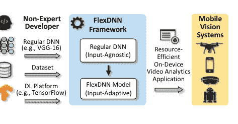
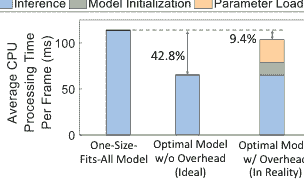
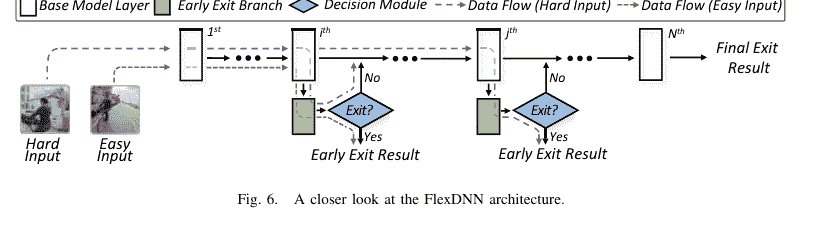
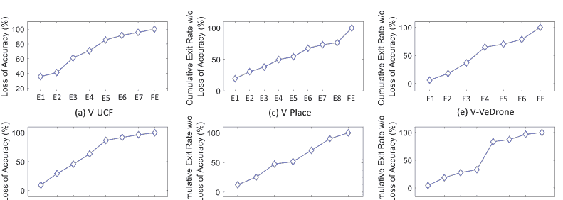
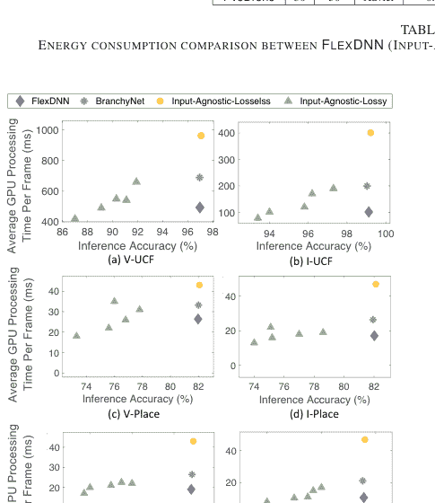
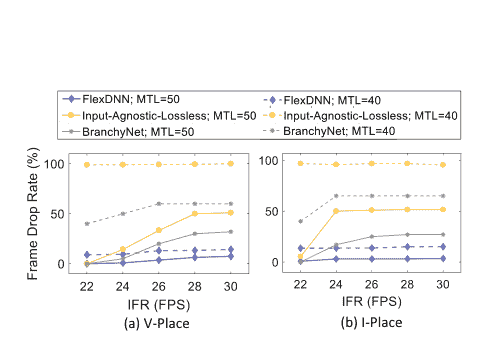

# 2020 IEEE/ACM 边缘计算研讨会 (SEC)：FlexDNN：用于高效移动视觉的输入自适应设备端深度学习

Biyi Fang†, Xiao Zheng*, Faen Zhang*, Hui Xu*, Mi Zhang†

密歇根州立大学，†Ahnovation

## 摘要

随着深度神经网络（DNN）的出现，移动视觉系统已应用于广泛的视频分析。移动系统受到资源限制，因此高效部署 DNN 至关重要。在本文中，我们提出了 FlexDNN，一种基于 DNN 的输入自适应设备端视频分析框架。与以往调整视频动态以适应计算的方法不同，FlexDNN 通过调整视频帧数来匹配计算效率。FlexDNN 解决了现有系统的主要缺点，进一步提升了移动 DNN 的水平。我们在移动 CPU 和 GPU 平台上评估了其性能，测量了每帧的 CPU/GPU 处理时间、帧率和能耗。

**关键词**—移动视觉系统、设备端 AI、深度神经网络、移动视觉

## I. 引言

### A. 动机

手机、无人机和增强现实（AR）等移动视觉系统如今已无处不在。随着深度神经网络（DNN）[19] 的近期突破以及 AI 芯片时代的到来，设备端处理实现了高质量的视频处理 [10], [15, 36]，并实现了从云端受限处理（如 MPEG）到设备端视频分析的转变。

设备端视频分析需要低延迟实时处理流式视频帧。遗憾的是，DNN 受到计算效率低下 [31] 的限制，高成本直接导致了高延迟和高能耗。在计算资源和电池容量有限的移动设备上，基于 DNN 的流水线的计算成本对于任何构建在设备端视频分析上的应用都至关重要。

为了降低成本，许多研究工作追求模型压缩技术 [8, 9]。然而，模型压缩产生的是“一刀切”的神经网络，无论每帧视频的内容如何，它们对所有视频帧提取相同的特征集。因此，当大型高容量 DNN 模型过剩时，较小的低容量 DNN 模型是不够的；另一方面，对于包含困难内容的视频帧，有必要调整处理流水线中的内容以被正确识别。这与人类视觉系统非常相似，一眼即可识别出简单的场景和感兴趣的对象，而对于复杂场景和部分或遮挡的对象则需要更多的注意力 [43]。

### B. 输入自适应视频分析的先进技术

基于这种方法，诸如 Chameleon [15] 等系统最近涌现。这些方法利用视频内容的动态，通过动态更改 DNN 模型来匹配视频帧的水平，从而调整基于 DNN 的流水线的复杂度。然而，正如我们在第 III-B 节所示，这种“模型切换”方法是受资源限制的，因为它需要将所有不同容量的模型都加载到移动系统中，这导致了巨大的内存占用。更重要的是，如果加载并执行大模型，开销将是巨大的，运行时搜索最优模型和切换模型的成本可能高得惊人，从而削弱了自适应带来的益处。

Chameleon 的局限性源于其限制：它需要多个具有不同容量的独立模型变体来适应不同水平的视频帧。为了解决这个问题，FlexAny [33] 引入了使用带有轻量级分支卷积层的单个模型的想法，这些分支在插入点退出。对于每一帧，如果提取的特征足以识别其内容，它就会在较早位置插入的早期退出处退出。

早期退出机制容易消耗计算。未能从早期退出退出的帧所消耗的计算是浪费的，并且存在早期退出机制带来的开销。遗憾的是，之前工作的早期退出架构是基于启发式的，而不依赖于数据。早期退出率会产生开销。如果不考虑这种权衡，开销可能会抵消早期退出带来的益处。

- 第二，早期工作中插入退出口的数量和位置也是基于启发式的。虽然与许多没有退出的模型相比这种方法是有效的，但在不进行详尽试错的情况下，考虑到早期退出的数量和位置所带来的指数级收益，定义一个能够利用早期退出益处的早期退出计划将是极具挑战性的。此外，开销和插入退出的数量在决定可以节省的计算量方面起着关键作用，使得导出早期退出计划变得更具挑战性。

FlexDNN 在运行时没有模型切换。在运行时，它动态调整模型容量，以实时粒度匹配输入视频帧的难度水平。

为了解决 BranchNet 的缺点，FlexDNN 采用了基于架构搜索的方法寻找最优的早期退出计划。FlexDNN 能够推导出早期退出计划，识别插入哪个退出层以最大化早期退出带来的益处。因此，FlexDNN 允许专业有限的开发者进行构建。

表 I 提供了 FlexDNN 与现有自适应框架的对比。

| 方法 | 早期退出架构 | 早期退出计划 |
| :--- | :--- | :--- |
| Chameleon [15] | 服务端 | 启发式 |
| MCDNN (10) | 设备端 | 启发式 |
| BranchNet (13) | 设备端 | 无 |
| FlexDNN | 设备端 | 有 |

### C. 提出的方法

在本文中，我们提出了 FlexDNN，一种基于 DNN 的输入自适应设备端视频分析框架。与以往调整视频动态以适应计算的方法不同，FlexDNN 通过调整视频帧数来匹配计算效率。FlexDNN 解决了现有系统的主要缺点，进一步提升了移动 DNN 的水平。我们在移动 CPU 和 GPU 平台上评估了其性能，测量了每帧的 CPU/GPU 处理时间、帧率和能耗。

FlexDNN 在运行时没有模型切换。在运行时，它动态调整模型容量，以实时粒度匹配输入视频帧的难度水平。

为了解决 BranchNet 的缺点，FlexDNN 采用了基于架构搜索的方法寻找最优的早期退出计划。FlexDNN 能够推导出早期退出计划，识别插入哪个退出层以最大化早期退出带来的益处。因此，FlexDNN 允许专业有限的开发者进行构建。

## II. 背景与动机

### A. 视频内容的动态

手机、无人机和增强现实（AR）等移动视觉系统如今已无处不在。随着深度神经网络（DNN）[19] 的近期突破以及 AI 芯片时代的到来，设备端处理实现了高质量的视频处理 [10], [15, 36]，并实现了从云端受限处理（如 MPEG）到设备端视频分析的转变。

设备端视频分析需要低延迟实时处理流式视频帧。遗憾的是，DNN 受到计算效率低下 [31] 的限制，高成本直接导致了高延迟和高能耗。在计算资源和电池容量有限的移动设备上，基于 DNN 的流水线的计算成本对于任何构建在设备端视频分析上的应用都至关重要。

视频的内在动态提供了通过匹配模型容量与每帧难度水平来减少计算的机会。为了量化可以节省多少计算，我们首先定义了识别内容所需的最小计算成本（浮点运算 GFLOPs），对于任何构建在设备端视频分析上的应用。

### B. “模型切换”方法是一种误用

计算的益处要求动态更改模型容量以适应每帧的内容。诸如 Chameleon [15] 等现有方法使用多个模型变体来实现内容自适应。然而，FlexAny [33] 引入了使用带有轻量级分支卷积层的单个模型的想法，这些分支在插入点退出。对于每一帧，如果提取的特征足以识别其内容，它就会在较早位置插入的早期退出处退出。对于困难情况，它会继续进行直到提取的特征足够好。通过这种早期退出机制，通过所有层及其计算的成本将显著降低。

早期退出机制容易消耗计算。未能从早期退出退出的帧所消耗的计算是浪费的，并且存在早期退出机制带来的开销。遗憾的是，之前工作的早期退出架构是基于启发式的，而不依赖于数据。早期退出率会产生开销。如果不考虑这种权衡，开销可能会抵消早期退出带来的益处。

图 5 显示了我们的性能分析结果。具体而言，通用模型的平均推理时间为 11.0 ms，而最优模型为 6.4 ms。两者之间的差异衡量了使用我们的最优模型而非通用模型带来的收益；我们能够降低 42% 的延迟。模型初始化和参数加载的处理时间分别为 13.3 ms 和 25.0 ms，分别增加了 21.8% 和 11.6% 的资源需求；结果，切换开销使得实际计算量仅降至 9.4%，这显著削减了自适应带来的收益。

## III. 概述与设计挑战

**概述。** 在这项工作中，我们提出了 FlexDNN，这是一种基于 DNN 的自适应设备端视频分析框架。在高级层次，FlexDNN 利用视频内容的内在属性，并能够动态改变复杂度以适应视频帧。FlexDNN 与其他方法在自适应方面的不同在于：它不是创建不同容量的变体模型，而是利用 DNN 的架构，并在整个架构中构建了多个插入出口（exits）。

一个典型的 DNN 由各种类型的层组成，包括卷积层、激活层、池化层和全连接层。其中，“特征提取器”起着重要作用，它们生成以特征图形式组织的特征集。这些卷积层是顺序连接的，使得从早期层生成的特征集是下一个卷积层的输入，从而在下一层生成一组新特征。

DNN 的复杂度取决于其深度。更复杂的 DNN 包含更多的卷积层。然而，如我们在图 2 中所示，并不是所有输入都会通过每一层卷积层。通过在常规 DNN 模型（我们称之为基础模型）的不同卷积层处插入出口，FlexDNN 提供了一种机制，让输入在特征变得足够时立即退出，允许我们根据游戏类别的输入帧水平动态地调整其模型复杂度。

**设计挑战。** 存在两个关键挑战：首先，如何设计在基础模型中添加插入的早期出口的基础模型。每个出口包含两个组件——早期退出逻辑和决策模块——它们决定了是在当前层提前退出，还是继续推理预测，或将生成的特征图传递给下一层。

虽然早期退出机制很有前景，但它也引入了关键挑战：

- 第一，早期出口本身具有开销。以游戏为例：对于这一帧，早期头部（early head）源于当前层（第 $i^{th}$ 层）的计算消耗，然而出口源于第 $i^{th}$ 层计算消耗。因此，有必要最小化出口的计算开销。在架构极其轻量化的设备上，我们可以让更少的帧退出（即低早期退出率），这使得早期退出机制的用性降低。因此，

- 第二，在基础模型的所有卷积层处进行早期退出可能不是最优选择。这是因为某些插入的早期出口，其开销实际上高于它们带来的收益。因此，确定插入的早期出口的数量和位置以验证早期退出的收益代表了另一个挑战。

解决这些挑战并非易事。之前工作的早期退出架构和开销是基于启发式的。通过仔细的设计，早期出口的开销可能会掩盖收益，除非过早使用无损帧，而这将牺牲基础模型的原始准确性。

在本文中，我们通过对输入-输出模型关键特征的总结，描述了有效解决这些挑战的技术。

### B. 早期分支的设计

早期分支的设计需要在计算开销和早期退出率之间进行权衡。为了实现这一点，FlexDNN 利用计算作为构建块，并采用架构搜索方案找到优化每个早期分支退出率和计算的最优架构。

在早期分支可能包含的各种层中，卷积层是计算密集型的。为了减少开销，我们使用深度可分离卷积作为早期分支的标准构建块。图 7 展示了标准卷积与深度可分离卷积的结构差异。

对于标准卷积层（$w_{i-1} \times h_{i-1} \times c_{i-1}$ 和 $\Theta_i \in \mathbb{R}^{k_i \times k_i \times c_{i-1} \times c_i}$），我们分别表示了两种类型的输入和输出特征图。我们使用大小为 2D 核的滤波器来生成输出特征图 $\Theta_i$。该过程消耗了 $k_i^2 w_{i-1} h_{i-1}$ 次浮点运算。在 (7) 中，通过将卷积分解为两个廉价的顺序操作（深度和逐点）来减少计算。深度可分离卷积对 $m_{i-1}$ 个输入特征图每一个应用 $k \times k \times \beta$ 滤波器，然后在深度卷积的输出上应用 $1 \times 1$ 滤波器以生成 $\Theta_i$。因此，通过分解，深度可分离卷积层的计算成本降低到 $(k_i^2 m_{i-1} + \beta)$ 次浮点运算。

通过这种方式，我们能够识别早期退出（early exits）的数量和位置，从而充分利用早期退出机制带来的收益。

使用手机摄像头拍摄的视频作为我们的数据集（UCF-15）。我们遵循原始论文 [30] 分分训练和测试视频。UCF-15 的示例视频帧如图 10 (a) 所示。

### F. FlexDNN 模型特性

通过精心设计，FlexDNN 生成的输入自适应模型表现出许多关键特性，我们总结如下：

**具有灵活复杂度的单模型**。通过插入早期退出节点，FlexDNN 能够在单个模型中提供灵活的模型复杂度。此外，由于采用了单模型设计，FlexDNN 允许在运行时进行模型调整和选择。

应用 #2：移动现实世界中的场景理解。场景理解是增强现实的能力之一。该应用旨在从手机摄像头的视频识别物体。由于缺乏经过 IRB 批准的公开数据集，在数据收集期间，我们使用 ORDO 手持式手机摄像头 [3] 在不同地点录制了视频。从标记的视频片段中，我们选取了 8 个最难识别为室内或室外场景的地方。

**无计算开销早期退出**。由于没有使用昂贵的分离卷积，早期退出分支的计算成本显著降低。这有效地最小化了早期退出带来的开销。

应用 #3：基于无人机的交通监控。由于缺乏交通监控，无人机能够以低成本对大区域流量进行追踪，这是传统的基于视频的交通监控系统无法提供的 [18]。该应用通过无人机采集。由于缺乏公开数据集，我们使用商用无人机 DJI Mavic Pro [1] 收集了经过 IRB 批准的自有交通监控视频片段。为了确保多样性，我们在不同的海拔（25m 到 90m）、高度（25.5m 到 52.1m）、速度（11.2m/s）、天气条件（多云、晴天）和道路类型（城市、高速公路）下收集了视频。在所有视频片段中，我们对数据集进行了标记：15% 用于训练和测试。使用无人机收集数据的过程以及 Place-8 的示例视频帧如图 10 (b) 所示。

**高计算削减**。通过计算高效的早期退出和高退出率，FlexDNN 模型能够提供由自适应带来的高计算削减。

## IV. 评估

基模型。我们选择 V-3 [32] 和 VGG-16 [19] 作为基模型来评估 FlexDNN 的有效性。我们选择 Inception-V3 是由于与 Mobile-Net [2] 等模型相比，它的架构计算效率更高；为了证明 FlexDNN 对资源密集型基模型的有效性，我们选择了 VGG-16 作为另一个基模型。

设备端移动应用。为了证明 FlexDNN 应用的实用性，我们使用 FlexDNN 为三个不同的移动平台构建了三个代表性的设备端应用。

应用 1：手机活动识别。标记人类活动视频正成为智能手机的一个非常有前景的功能。该应用旨在从手机摄像头捕捉的视频流中识别个人进行的活动。对于该应用，我们使用了 UCF-101 人类活动数据集 [17]，它包含环境中固定或移动摄像头的视频片段。我们选取了视频活动（例如自行车和滑雪）。

### B. 性能

在本节中，我们关注对 FlexDNN 生成的模型进行分析，目标是量化 III-F 中总结的特性。

**无精度损失的高早期退出**。由 FlexDNN 生成的模型能够在不提前损失精度的情况下实现高退出率。为了量化这一点，我们在测试集上对六个模型中的每一个进行了分析，并在保持与基模型相同精度时的累计退出率。

| 应用 | 移动平台 | 总长度 (min) | 视频片段数量 | 基模型 | FlexDNN 模型 |
|---|---|---|---|---|---|
| 活动识别 | 手机 | UCF-15 | 240 | Inception-V3 | VGG-16 |
| 场景理解 | ARset | - | 81 | Inception-V3 | VGG-16 |
| 交通监控 | 无人机 | - | 40 | Inception-V3 | VGG-16 |

FlexDNN 帧帧率 FlexDNN 输入无损 BranchyNet

| 模型 | IFN | MTL | 平台 | FlexDNN 输入无损 | BranchyNet |
|---|---|---|---|---|---|
| U-UCF | 2 | 2000 | S8 | 10.0% | 48.5% | 37.2% |
| V-Place | 30 | 50 | Xavier | 75.1% | 28.6% | 31.5% |
| I-Place | 30 | 50 | Xavier | 50.0% | 50.1% | 26.7% |
| V-Vedrone | 30 | 50 | Xavier | 37.5% | 50.6% | 30.0% |
| I-Vedrone | 30 | 50 | Xavier | 0.0% | 19.5% | 19.5% |

表 III FlexDNN（输入自适应）与输入无关及 BranchyNet 之间的帧率

| 模型 | IFN | MTL | 平台 | FlexDNN | 输入无关 | BranchyNet |
|---|---|---|---|---|---|---|
| U-UCF | 2 | 2000 | S8 | 2.36 | 4.81 | 3.19 |
| V-Place | 30 | 50 | Xavier | 0.81 | 0.63 | 0.49 |
| I-Place | 30 | 50 | Xavier | 0.48 | 0.49 | 0.49 |
| V-Vedrone | 30 | 50 | Xavier | 0.32 | 0.61 | 0.42 |
| I-Vedrone | 30 | 50 | Xavier | 0.0 | 0.71 | 0.82 |

表 IV FlexDNN（输入自适应）与输入无关及 BranchyNet 之间的能耗

图 15. 在推理-精度成本空间中 FlexDNN、输入无关与输入无关损失的对比。

帧率表 III 的降低情况比较了 FlexDNN 与输入无关以及 BranchyNet 的帧率。在我们的评估中，我们为每个应用设置了视频输入帧率 (FPS)（以帧为单位）和处理单帧的最大延迟 (ms)（以毫秒为单位）。由于 STU 远快于移动 GPU，因此 ISR 高得多，且对于 U-UCF，

所示，与输入无关方法相比，FlexDNN 能够在 U-UCF、I-UCF、V-Place、I-Place、V-Vedrone 和 I-Vedrone 上分别将帧率降低 38.1%、69.0%、42.6%、48.5% 和 50.0%。这是因为 FlexDNN 通过跳过冗余帧进行持续自适应，而输入无关的计数器则在空帧上浪费了不必要的计算。

能耗降低。FlexDNN 能够将能耗降低 27.6%、22.5%、31.3% 和 19.55%。这种降低的实现是因为 FlexDNN 在优化位置具有更早的退出点。

第三，与采用早期退出设计的 BranchNet 相比，FlexDNN 能够以较低计算成本达到相同的精度。FlexDNN 在 V-UCF、I-UCF、V-Place、I-Place、V-Vedrone 和 I-Vedrone 上分别减少了 28.4%、49.3%、20.5%、23.9% 和 40.9% 的计算成本，证明了其优于 BranchNet。

工作负载与实时性的影响。最后，我们评估了输入帧率 (FPS) 和最大延迟 (ms) 对帧率的影响。ISR 反映了

图 16. 工作负载 (IFR) 和实时性约束 (MT) 对帧率的影响。

分配给移动视觉系统的工作负载，而实时性约束要求包含多样性。我们从 22 FPS 变化到 30 FPS 以创建宽范围的工作负载，分别对应更紧和更松的实时性约束。我们没有在这个特定实验中评估移动 CNN，因为它的 IFR 较低。

图 1 显示了我们得到的结果。首先，当实时性约束较紧（MTL=50 ms）时，FlexDNN、输入无关和 BranchyNet 在负载增加时显示出相似的帧率。随着负载的增加，FlexDNN 的帧率保持较低，而其他的则增加。其次，当实时性约束更紧（MT=40 ms）时，输入无关难以满足截止日期并丢失所有帧。对于 BranchyNet，帧率仍然很高并随着负载而增加。相比之下，当负载很大时，FlexDNN 的帧率保持较低。

## V. 相关工作

**移动视觉**。我们的工作与移动视觉密切相关 [55]。在过去的几年里，已有许多方法被实现连续移动视觉 [7], [10], [14], [21–26]。这些工作的一个核心主题是提高视频分析的计算效率，这也是本文的重点。在 [25]，作者提出了一种名为 DeepEye 的框架，通过交替执行计算密集卷积层和内存密集全连接层来提高并发 DNN 的效率。在 [37]，作者提出了一种名为 MCDNN 的框架，使用压缩技术通过权衡精度来减少需求。我们的方法在 [26] 中提出，通过利用真实视频的高度倾斜分布来实现移动视觉。在 [32]，作者提出了一种移动视觉系统，确保实时视频流的“窥视”。我们的工作与它们相似，在于 FlexDNN 通过动态调整模型复杂度来匹配视频帧的计算成本。

**动态 DNN**。我们的工作也与深度学习中的 DNN 概念相关。动态 DNN 是一种根据输入调整推理行为的 DNN，它引起了广泛关注。见 [19], [38]。在 [23]，作者提出了一种由多个子网络组成的动态 DNN，并使用控制模块决定执行哪个子网络，这对于移动设备是极高需求的。我们的工作与它们相似，但 BranchyNet 是一种通过自动退出架构和实现来避免移动设备效率的的 DNN。

## VI. 结论

在本文中，我们介绍了 FlexDNN 的设计与评估，这是一种可以在移动设备上平滑运行的自适应输入深度学习。我们的结果显示 DNN 优于现状方法。我们认为我们的工作是向连续移动视觉迈出的重要一步。感谢审稿人的宝贵意见。这项工作得到了 NSF 奖励 CNS-161726, CNS-181457 和 PI-BC62350 的支持。

## 致谢

## 参考文献

- [1] Mobile Pro. https://developer.nvidia.com (2023).
- [2] NVIDIA Jetson Developer Kit. https://developer.nvidia.com/embedded/jetson-dev-kit (2018).
- [3] J. Huang, Y. Wang, and J. Huang. Mobile Vision with deep learning. http://www.artroad.com (2020).
- [4] M. Chen, Y. Sun, J. Chen, A. Zhao, M. Chen, S. Gupta, M. Ismail, and A. Tesrof: A system for large-scale mobile video understanding. In Proceedings of the IEEE Conference on Computer Vision and Recognition (CVPR), pages 12-21.
- [5] P. Bai, M. Li, and L. Jung. Vision: Cloud-powered-for-edge computing: showing the world as you want. In Proceedings of the third ACM Conference on Mobile Computing and Networking (MCOM), pages 1-8 (2020).
- [6] F. Xichtler. Deep learning with separable convolutional networks. In International Conference on Computer Vision (ICCV), 2019.
- [7] F. Bao, X. Zhang, and M. Wang. Resource-efficient multi-task neural networks for deep learning on mobile devices. In MobiCom, 2018.
- [8] S. Han and J. Du. Deep compression of deep neural networks with pruning and quantization techniques. arXiv preprint:1512.04776 (2015).
- [9] J. Han and Y. Lee. Learning for efficient and effective convolutional network architectures. In IEEE International Conference on Information Processing Technology (ICIPT), pages 1-6 (2019).
- [10] S. Han, H. Sen, M. Liu, and A. Adobesoye: Efficient convolutional networks for mobile devices: Deep learning stream processing. In Proceedings of the IEEE Conference on Computer Vision and Recognition (CVPR), pages 770-788 (2017).
- [11] K. Lee, S. Choi, J. Lee, and S. Kim: Mobile-centric deep learning for resource efficiency. In IEEE Conference on Computer Vision and Recognition (CVPR), pages 20-29.
- [12] T. Weyand, M. Andrew, and A. Mohler. Efficient convolutional networks for mobile vision. arXiv preprint:1704.0861 (2017).
- [13] Y. Zhou, X. Li, J. Fu, L. Wan, and K. Young. Multi-scale deep learning for resource efficiency. In International Conference on Computer Vision (ICCV), pages 3680-3689 (2019).
- [14] L. H. Lynch, Y. Lee, and R. Bao. Mobile-grade deep learning for continuous mobile vision. In MobiCom, 2019.
- [15] J. Gao, A. Anantharam, P. Bodik, and S. Sen. Scalable deep learning for stream processing. In Proceedings of the 2018 Conference Special Interest Group on Data Mining (SDM), pages 715-724 (2018).
- [16] S. Zhang, M. Xu, C. Wang, and Y. Liu. Hardware-aware neural learning for neural network recognition. In IEEE Conference on Computer Vision and Recognition.
- [17] ... (省略)
