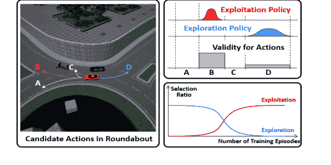
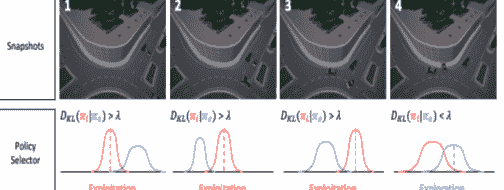
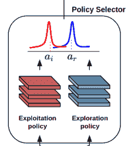
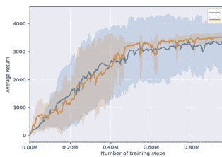
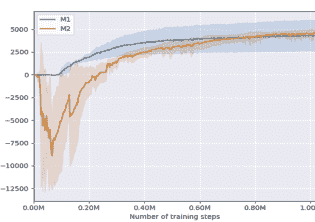
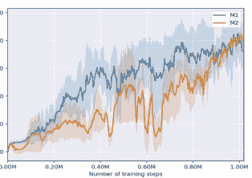
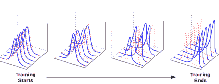

# 2020 IEEE/RSJ 智能机器人与系统国际会议 (IROS) (美国内华达州拉斯维加斯 2020.10.24-2021.1.24)

摘要——如何探索环境是强化学习中智能体最关键的因素之一。传统的探索策略如`e-greedy`算法和高斯噪声依赖于随机性。对于智能体而言，考虑其进度和长期用途以高效探索环境至关重要，这仍然是强化学习中的一个主要挑战。为了解决这个问题，我们提出了一种基于动作有效性选择的新型探索方法。我们方法的核心思想是利用冗余散度（redundant divergence）估计动作的有效性，从而全面评估探索和利用过程中的动作。我们还引入了一个框架，允许智能体在奖励稀疏或延迟的环境中进行高效探索。该框架通过将探索策略与环岛自动驾驶场景中的注意力学习相结合，利用专家演示引导智能体访问相关的状态空间。我们证明了该探索策略能够鼓励智能体访问动作有效性更高的相关状态空间，性能优于以往的方法。



图. 1：我们方法的概述。图中包含探索（蓝色）和利用（红色）策略。右下角描述了相对于训练步骤的探索与利用的使用比例。

## I. 引言

强化学习（RL）是一个通过与环境交互来学习如何操作以最大化累积奖励的框架。虽然强化学习广泛应用于游戏[1]、机器人[2]和导航[3]等多个领域并取得了成功，我们在应用强化学习解决现实问题时仍然面临困难。主要问题之一是探索（exploration）与利用（exploitation）之间的平衡：在强化学习中，智能体应该通过探索来发现新动作，以确定最优动作并减少对环境的不确定性；同时智能体也必须利用收集的信息来获取高奖励。遗憾的是，这仍然是强化学习中的一个重大挑战。

`e-greedy`算法和高斯噪声等新的探索策略仅依赖随机探索。虽然这些策略被用于许多强化学习方法，但在复杂或高维环境中进行高效探索需要引导性和全局性的探索。引导性和全局性的探索是指基于学习过程的知识和探索的长期用途来探索环境。

近年来引入了许多探索策略。Bellemare等人[4] 提出了基于密度模型的伪计数（pseudo-count）方法概念。该方法使用基于计数的探索将其推广到非表格化设置。Tab等人[5] 引入了基于前向动力模型预测误差构建的基于好奇驱动的探索策略。这些算法显著改进了探索结果，但并非所有算法都满足引导性和全局性探索的要求。此外，它们只关注一种探索策略，而没有考虑探索与利用之间的平衡。

在本文中，我们提出了一种可以执行引导性和全局性探索的方法。我们工作的核心思想是根据动作的有效性选择动作。为了公式化，我们定义了探索和利用的独立策略，并根据Kullback-Leibler（KL）散度的属性引入了KL选择器来全面评估动作的有效性。在机器学习中，有效性被用于定义损失函数以最小化真实值与预测分布之间的差异，而我们利用它来最大化探索与利用之间的差异。

例如，我们的方法如图1所示。它展示了训练完成时的情况。右上行的候选动作A和C尽管智能体已经通过高奖励进行了训练，但它们具有高有效性。候选动作B的有效性在经过足够训练后可以为其保证。因此，智能体很可能在空间B中进行利用。对于D，它可能从探索策略中选择；但该动作极有可能返回奖励，因此探索策略不太可能更新到那里。此外，在训练过程中，探索的比例减少而利用的比例增加，这意味着智能体先进行探索，然后开始利用。通过这个例子，我们可以看到探索和利用都是重要的。我们的方法在这个过程中建议了探索策略。

我们的工作引入了一个框架，允许智能体在奖励稀疏或无法定义的环境中探索和利用。我们使用实验方法，通过将探索策略与模仿（imitation）相结合引导智能体进入任务相关状态。我们在CARLA[6]的经典任务和自动驾驶任务中评估了我们的方法。与经典任务相比，自动驾驶具有包括任务奖励在内的巨大状态空间。结果表明，所提方法允许智能体以直接和全局的方式进行探索，处理探索与利用的平衡。我们工作的主要贡献总结如下：1）我们提出了解决探索与利用平衡的学习策略；2）我们引入了适用于复杂和稀疏奖励环境的学习框架；3）我们在RL街道和自动驾驶任务上与多个基准方法相比验证了我们方法的性能。

最近，许多研究正尝试用深度学习解决自动驾驶。Boarski等人[11] 提出了基于图像和动作输出的CNN端到端监督学习自动驾驶。Palisal[12] 针对CARLA中具有多智能体分类的复杂场景提出了强化学习算法。Codevilla等人[13] 也引入了基于离策略强化学习世界模型的自动驾驶。然而，这些之所以能严格成功是因为它们采用了诸如动作离散化等额外技术。我们的工作在具有真实设置的CARLA模拟器城市自动驾驶中演示。

## II. 相关工作

探索与利用之间的平衡问题已广泛研究了数十年。以前有几种方法[7],[8]可以保证探索的质量。然而，有限空间中的每个智能体都依赖于每个状态-动作对的访问次数，这在高维或连续空间中是不可行的。深度强化学习在各个领域取得了卓越成就，但许多方法在`e-greedy`等简单任务上仍然失败。为了解决复杂和高

最近的若干工作在大规模领域提出了探索方法。Belle等人[4]和Wang[7] 引入了开发大规模领域传统探索策略的高效方法。Ha等人[10] 引入了一种探索策略，通过考虑当前策略与近期策略之间的差异，允许智能体尽可能多样化探索。据我们所知，我们的方法是第一个

### 内在激励强化学习

内在奖励是对智能体的一种定性引导，它由智能体自身产生。生成内在奖励的方法有状态新颖性和信息。在我们的工作中，内在好奇心模块（ICM）[5]基于预测误差奖励。它是一个状态转换（前向动力学）模型，根据当前状态和动作预测智能体的下一个状态。真实状态与预测状态之间的预测误差被用于最小化奖励。当预测误差很高时，意味着该状态访问较少，智能体必须对该状态进行探索，从而引导智能体

## III. 预备

### A. 演示学习 (LfD)

为了解释为什么奖励会显著影响智能体的性能，在稀疏奖励环境中很难处理智能体的探索。专家演示可用于应对稀疏奖励环境中的挑战。有许多方法，如模仿强化学习。行为克隆（BC）通过专家演示的监督学习训练智能体。它是LfD的基础方法，由于基于监督学习，BC比其他方法需要更多的数据。逆强化学习（IRL）尝试从专家演示中搜索最优奖励函数，然后该奖励可以通过最小化智能体策略与真实专家演示之间的差异来训练智能体。我们的方法采用了IL框架，该框架利用了生成对抗模仿学习（GAIL）[4]，后者作为生成对抗网络（GAN）[15]的对抗概念，被证明在具有大状态空间或高维领域的复杂环境中是有效的。



图 2：展示了如何通过策略选择器（Policy Selector）从两个分布中选择代理。

下一状态 $s_{t-1}$ 的状态转移和模型误差为：

```
$$e = \frac{1}{2}\|\phi(s_{t-1}) - \phi(s_{t+1})\|^2$$
```

其中 $\phi$ 表示潜空间的预测值，$\eta$ 表示潜空间的真实值，$\eta$ 是权重参数。具体步骤将在下一节介绍。

## IV. 方法

### A. 问题定义与概述

在不知道什么能带来更高预期回报时，代理应该无偏见地探索环境以获得足够的结果。同时，代理必须收集信息以发现最优动作。强化学习（RL）的挑战之一是探索（exploration）与利用（exploitation）之间的权衡。为了解决这个问题，探索策略应该鼓励代理在定向和全局领域内进行探索。定向探索侧重于与训练相关的知识，例如代理的轨迹；而全局探索则是基于长期用性而非即时用性的探索。

大多数之前的强化学习方法依赖于朴素探索，例如高斯噪声或 `epsilon`-greedy算法。这些策略仅依赖随机性，或者无法考虑长期用性，这使得强化学习扩展到现实场景变得困难。与之前的探索策略不同，我们提出了一种有效且高效的策略，以定向和全局的方式鼓励探索。探索策略的核心思想是启发代理增加其采取动作的价值。我们还引入了一个框架，使得我们的探索方法适用于奖励稀疏或无法正确定义的的环境。关于我们的方法和所引入框架的更多细节将在接后的章节中描述。

### B. 基于动作价值的探索策略

我们的方法为探索和利用定义了独立的策略。探索策略鼓励代理探索未知环境，而具有最高收益的利用策略引导代理采取动作。与其他仅使用单一策略的方法不同，我们的方法使用独立的探索和利用策略，使代理能够更高效地进行探索。探索被训练为采取最高内在奖励（intrinsic reward）的动作，我们提取这种内在奖励来训练单一策略，并用它来平衡探索与利用的独立性。在上述设置中，我们提出了一种 KL 散度策略选择器，从两个分布中选择单个动作。首先，我们假设动作从探索的角度来看是有利的，但从利用的角度来看是不利的。这灵感源于这样观点：如果成功的探索会导致更高的预期回报。为了制定动作选择，我们的探索策略利用了 KL 散度的零属性，这防止了 KL 散度 $KL(\pi|\pi')$ 可能带来的惩罚。我们的方法使用 KL 散度 $KL(\pi|\pi')$，其中利用收益被加权以平衡探索和利用。我们的 KL 散度策略选择器根据以下公式选择动作：

```
$$(\pi(s)(x) \times (1-KL(\pi|\pi') - \lambda))$$
```

```
$$(\pi(s)(x) \times f(KL(\pi|\pi') - \lambda))$$
```

其中 $f(x)$ 是奖励 $\lambda$ 是阈值。根据方程 (1)，当策略之间的 KL 散度小于 $\lambda$ 时，代理通过探索收集信息；否则探索信息并考虑具有最高预期奖励的动作。

图 2 显示了我们的探索策略如何在回合中处理探索与利用之间的权衡。在快照 1 中，策略选择器选择了高效性环境，而在快照 4 中，代理探索了完全没有验证的环境。这表明我们提出的方法允许代理以定向和全局的方式探索环境，原因如下：1) 探索是在考虑动作价值的情况下进行的，它保留了代理以定向方式进行探索的知识；2) 它还通过考虑代理可能如何采取探索的长期用性来进行探索。

### C. 稀疏奖励环境的学习框架

强化学习算法基本上假设奖励在训练之前已经定义。然而，在自动驾驶场景等现实任务中，定义奖励函数是非常困难的。在本节中，我们引入了一个可以使探索策略适用的学习框架。



图 3：方法的整体框架。左侧介绍了方法的整体流程。右侧讨论了策略选择器的具体设计。它接收动作输入。状态通过探索和利用策略及其分布的 $KL$ 散度，最后选择单个动作。$s$ 表示真实的下一个状态，$s'$ 预测下一个状态。

**算法 1：我们提出的方法**

1: 给：阈值 $\lambda$，专家演示 $D$

2: 初始化选择器、判别器和正向动力模型

3: 当 $D_\phi(s_t, a_t)$ 不收敛时

4: 通过选择器生成通用轨迹

5: 计算外在奖励和内在奖励

6: 使用专家演示更新正向动力模型和

7 判别器

8: 使用生成的奖励更新策略

9: 

10: 返回利用策略

尽管在这个框架中，判别器和正向动力模型似乎是使用各自的损失函数分别训练的，但它们会影响彼此的学习过程。训练状态转移模型和判别器有助于代理学习哪些动作对于实现目标是有相关的或有效的。随后，训练控制器，状态转移模型和判别器就可以执行控制任务。算法 1 提供了我们整体训练过程的细节。训练重复，直到探索策略与利用策略之间的 KL 散度保持大于 (4) 6137







(a) Hopper-v2 (b) Halfetah-v2 (c) Walker-v2

图 4: MuCo 的评估结果。蓝色线表示 $M_1$，橙色线表示 $M_2$。深色线条表示平均奖励，阴影区域表示标准差。



| | M1 | M2 | M3 |
|---|---|---|---|
| ROUNDABOUTONECAR | 0% | 62% | 100% |
| ROUNDABOUTTWOCARS | 0% | 28% | 72% |

表 I: 50 次试验中自动驾驶场景的成功率。结果显示任何 $P_1$ 或 $P_2$ 都能帮助智能体在 CARLA 中高效探索中等任务。

### C. MuJo

我们的方法在 MuJo[19] 上也得到了演示，特别是 Hopper、Halfetah 和 Walker。结果如图 4 所示。我们看到在每个任务结束时，$M_3$ 获得的奖励比 $M_1$ 高。特别地，我们方法的运行可以通过训练过程中的方差变化来很好地描述。它在在初始阶段和中期训练步骤表现出高方差，而在最后一步值较低。通过我们的方法，智能体的探索与利用在初始和中期步骤表现出高方差。然后，当智能体进行了足够的探索并开始主要以高质量的利用动作进行操作时，它识别出回合奖励的低方差。简而言，我们认为 $P_1$ 引导智能体以更高效、有效的方式进行探索。

# V. 实验

### A. 实验设置

我们通过从经典任务到高维城市驾驶任务的各种任务演示了我们的方法。我们采用 PPO[18] 作为基准算法。我们从用 RL 算法训练的专家策略获取演示数据。我们试图弄明方法实际上如何以高效的方式执行。如下：$P_1$ 表示我们提出的方法使用策略选择器（Selector）在探索和利用之间进行选择，$P_2$ 表示我们的第二种方法使用专家演示来引导智能体，$M_1$ 表示基准，$M_3$ 表示 $M_1$ 和 $P_1$，$M_4$ 表示 $M_1 + P_2$。

### B. MountainCar

对于经典任务，我们的方法在 MountainCarContinuous (MCC) 上进行了演示。探索与利用策略的分布如图 5 所示。x 轴表示动作空间范围，y 轴表示动作空间概率。我们可以观察到随着训练过程的进行，两种策略的分布在移动，并在最后以高 KL 散度收敛。我们的方法智能体在初始训练步骤主要进行探索，在最后步骤主要进行利用。此外，平均奖励方面，$M_2$ 为 93.27，而 $M_1$ 为 87.13。

### D. 自动驾驶任务

对于自动驾驶任务，我们使用 CARLA 以及其他不发生任何事故的车辆。与简单的驾驶任务不同，它要求智能体考虑并理解其他车辆的意图，并在道路上与其交互。我们在训练智能体周围使用了两个场景进行评估：单车环（RoundaboutOne）和双车环（RoundaboutTwo）。我们从 CARLA 的自动驾驶功能中获取了约 1000 个回合的实验演示。我们通过 50 次试验的成功率对这些任务进行了评估，而非结果。

如预期所示，$M_1$ 表现出最佳性能，$M_2$ 紧随其后，$M_3$ 的成功率为 0；证明了通过随机探索很难在连续动作中找到任务相关状态。相反，$M_4$ 显示出高性能，意味着我们的方法通过 $P_i$ 成功且高效地探索空间。

# VI. 结论

在本文中引入了一种新的探索策略。我们工作的核心思想是考虑探索与利用之间的平衡。我们的方法对从现实世界的高维任务进行了评估。结果表明我们的方法能够处理复杂任务。未来的兴趣是将我们的方法应用于更多任务。

# VII. 致谢

本工作得到了韩国国家科学基金会（NRF）基础科学计划的支持，并资助。

# 参考文献

[1] I. Goodfellow, J. Pouget-Ward, A. Mirza, B. Xu, D. Ward-Farley, S. Courville, and J. Beng, "Generative adversarial nets," in Advances in Neural Information Systems 27, Z. Ghahmani, M. Weiss, C. Cortes, N. David, and K. Kingma, Eds., Curran Associates, Inc., 2014, 2602–2609.

[2] J. Schulman, F. Wolelski, P. Abard, A. Radford, and O. Klimov, "Policy optimization algorithms," CoRR, abs/1707.06347, 2017.

[3] E. Todorov, R. E, and Y. Tassa, "Mujoco: A physics engine for model-based control," in IROS, 2012. ISBN: 978-14673-1737-5.
