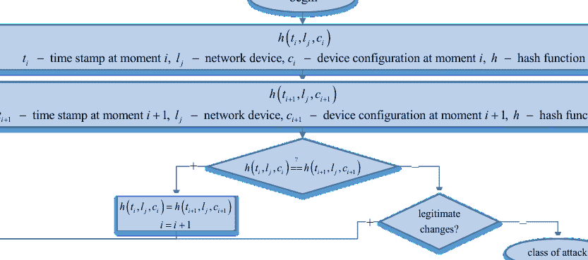
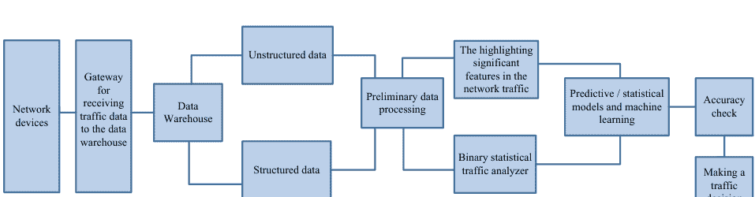
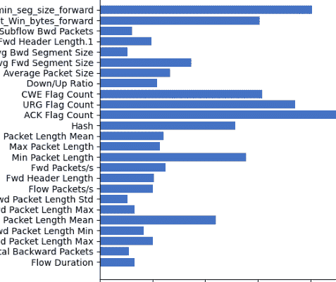
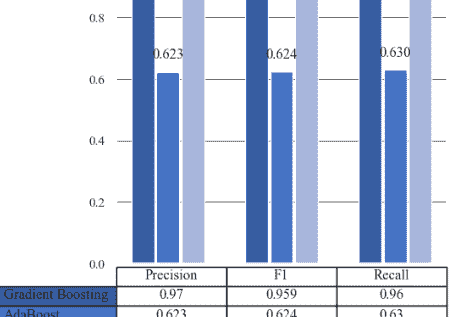
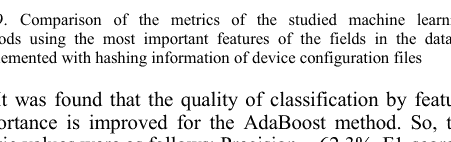

# 2020年工程与电信国际会议 (En&T) (俄罗斯多尔戈普鲁德尼 2020.11.25-2020.11.26) | 研究

**摘要** 本文探讨了网络安全问题。在识别DDoS攻击的类多问题中，提出了一种基于扩展特征集的类分类方法，该方法使用了针对网络设备配置文件的专用哈希算法。通过所提方法，我们比较了若干种机器学习方法，以确保IT网络的安全。事实证明，多分类方法在检测攻击方面是有效的，其中包括所提出的哈希算法。作为一项试点性研究，本文对这些方法进行了比较，并在首次分类中考虑了`CatBoost`，该模型在实验中的表现优于其他模型。

**关键词** DDoS，哈希，梯度提升，AdaBoost，多分类

本文针对`CICDoS2019`数据集[2]，对不同类型的DDoS攻击网络流量进行了分类。

## I. 引言

尽管物联网已经活跃应用了十多年，但其安全问题仍然存在。这是由于漏洞切入点数量的增加。网络安全领域的专家关注这些类型的攻击，因为它们可能会造成破坏和信息攻击。

在最近的情况下，网络攻击的定义及其随后的后果变得日益重要。随着人工智能（AI）的使用，计算机工具更加智能，丰富了分析知识，并缩短了威胁响应时间。

近年来，我们记录到针对物联网（IoT）的攻击稳步增长。2019年，根据当局的数据，针对IoT设备的网络攻击数量增加了300%。

本文的其余部分结构如下：第二部分提供了该主题的现有文献综述。第三部分描述了数据集并制定了多分类方法。第四部分简要描述了解决该问题所使用的机器学习方法。第五部分描述了实验研究和结果。最后部分给出了结论。

此外，`Trustsoluk`在2017年进行的物联网设备用户意识调查显示，超过一半的受访者没有对智能设备采取额外的安全措施，有35%的人在使用前没有更改密码。

## II. 相关工作

本研究是在俄罗斯联邦基金（RFBR）的资助下，在项目编号`25-07-53019`、`20-07-01065`的科学框架内进行的，并获得了俄罗斯联邦支持`2.250.2.2019`计划开展的研究资助以及俄罗斯联邦对支持俄罗斯科学家的资助赠金。

接下来，我们回顾了几篇重点关注使用`CICDoS2019`数据集进行入侵检测的科学论文。

在[3]中，作者回顾了现有的入侵检测数据集，并提出了一种针对DDoS攻击的新方法。此外，本文作者创建了一个新的数据集`CICDoS2019`，该数据集包含了基于流特征特征的11种DDoS攻击。

作者使用常用的机器学习算法（即`ID3`、随机森林（`RF`）、朴素贝叶斯和逻辑回归）对该数据集进行了研究。计算了指标：精确率（`Precision`）、召回率（`Recall`）和F值（`F-score`）。作者获得的结果如下：最佳分类算法实现的指标精确率为78%，召回率为65%，F值为69%。

优化了中央SDN控制器所应用策略的丢弃率。对比分析表明，作者选择的方法与多层感知器（`MLP`）相比，取得了较低的分类结果。

论文[24]的作者开发了一种基于能量的分类器（`EFC`），准确率为92.8%。

## III. 问题描述

这项工作的相关性在于检测SDN中的DDoS攻击。在本文中，我们利用`CICDoS2019`数据集考虑流量分类问题。所研究攻击的特征如下所示：


### 1. 物联网中的DDoS攻击

**信息** 在本研究的框架内，建议通过对设备配置文件中的信息变化进行攻击来识别受感染设备。我们的研究与其他人的主要区别在于我们展示的源数据，以及识别网络中每个设备的数据可用性。由于我们没有设备配置的完整描述，我们重点强调了变化最基础的部分：路由配置、网络配置、安全功能配置、防火墙配置。

**数据集** 注意，流量读数是按定期从所有网络设备同时采集的。每个网络的数据采集都是单独选择并记录在监控系统中的。

为了跟踪配置参数的变化，将其表示为单个哈希值非常方便，它是所考虑的每个配置参数哈希值的组合。在这种情况下，哈希化是比较配置数据的一种快速方法，而不是全文本比较。此外，时间和定量因素（总共约 84 个特征）是我们特征分析中的重要数据。

分类的思路如下：

1. 将网络设备的初始变化表示为哈希值。
2. 如果配置设置发生变化，需要替换哈希值。
3. 跟踪此配置从初始到下一次的变化（记录时间戳）。
4. 得出变化的结论：这种变化本质上是恶意的还是合法的。

网络研究中检测和分类 DDoS 攻击的机制框图如图 2 所示。



**图 2.** 网络中检测和分类 DDoS 攻击的机制框图

## IV. 机器学习方法

高质量数据是构建预测模型的前提。因此，对训练数据的数据集进行了准备和清理；检测并删除了离群值和隐含重复，并通过插值法产生了缺失数据。然而，排除了一些离群值：`ID`、`目标端口`、`SimHarp`、`源端口`、`目标端口`、`时间戳`、`源 IP`、`入站`。此外，之前对数据集应用了数据平衡（`ADASYN` 采样方法 [11]）。数据集增加了 80% 用于训练和验证，20% 用于……

为了检测异常流量，我们建议使用以下机器学习方法：

1. **梯度提升（Gradient Boosting）** 是一种机器学习方法，它使用决策树以弱预测集成的形式创建至关重要的预测模型。它顺序构建模型，将新模型添加到之前的模型中，以纠正之前预测器所犯的错误 [12]。
2. **自适应提升法（AdaBoost）** 通常使用弱分类器。在每次调用后，根据训练集中每个对象对分类的重要性来调整权重分布。在每次迭代中，被分类错误的对象权重会增加，因此基础分类器的性能集中在这些对象上 [13]。
3. **CatBoost** 是一种基于决策树的提升机器学习方法。在训练期间，构建的决策树数量比之前的要少。树的数量由初始参数控制。该算法的特殊之处在于它非常适合处理异构数据。此外，它还可以考虑类别特征 [14]。

## V. 实验

大数据机器学习处理来自在线源（应用程序、设备、用户）的持续信息流，这些源不断发送数据并在数据到达时进行处理。此类示例如图 3 所示。



**图 3.** 用于网络流量大数据分析的机器学习系统原型

大数据机器学习系统的输入数据来自网络设备。该系统包含以下内容：

- **“接收流量数据到数据的网关”** 允许我们与现有传感器和物联网设备交互，并在本地通信网络、云计算能力和可视化设备之间建立桥梁。
- **“数据仓库”** 是原始数据的存储位置。
- 结构化和非结构化形式的原始数据被发送到进一步的初步统计处理，使用适当的方法为机器学习有效使用准备数据。在此阶段，每个记录对应单个网络设备的配置。
- **“突出网络流量中的显著特征”** 将原始数据集缩小到可管理的组（函数）以便进行进一步处理，这有助于解决高速网络上的性能问题，而不会显著影响攻击识别的准确性。
- 使用**“二进制统计流量分析器”**模块监控入流量以检测异常活动，并将流量进行合法和异常的二分类。
- **“预测统计和机器学习”**模型使用侧重于预测对象和主体未来行为以做出决策的方法来定义流量类别。
- **“准确性检查”**使用多种方法评估流量分类的准确性。

为了评估梯度提升、`AdaBoost` 和 `CatBoost` 分类器的有效性，为此对分类结果进行了对比分析，并计算了以下指标：

```
Recall = \frac{tp}{tp + fn}
```

```
Precision = \frac{tp}{tp + fp}
```

```
F1 = 2 \times \frac{(Precision \times Recall)}{(Precision + Recall)}
```

其中 `tp` 是真阳性数量，`fp` 是假阳性数量，`fn` 是假阴性数量。所有计算均使用 `Python` 通过梯度提升、`AdaBoost` 和 `CatBoost` 实现。为了做到这一点，我们重新编码……（自注：OCR 提供的文本存在重复和伪影，我将根据提供的文本流提供干净的版本）。



**图 8.** 随机森林分类器的特征重要性

因此，特征重要性的特征值如图9所示。



| 方法 | 精确率 (Precision) | 召回率 (Recall) | F1 |
| :--- | :--- | :--- | :--- |
| I. Sharafaddin, A. H., Lashkati, S., Sakaei, and A. Ghorbani | ID3 | 78% | 65% | 69% |
| M. P. Novaes, L. Carvalho, J. Loeb, and M. Prost | LSTM 和 RNN 方法 + 模糊逻辑 | 97.9% | 93.1% | |
| Y. Jia, F. Zhang, Alrawais, B. Gong, and S. Choi | LSTM + CNN | 99.47% | 93.91% | 99.35% |
| CatBoost | 96.7% | 96.8% | 97.0% |

结果的准确率，同时，它提高了在计算资源方面的识别效率，这在高强度的 DDoS 攻击下是非常宝贵的。

### 表 II 多分类分类指标对比

表 II 显示了使用 `CatBoost` 获得的精确率、召回率和 F1 分数指标的数值，与在文献 [3]、[6] 和 [7] 中获得的指标的对比。



| 方法 | 精确率 (Precision) | 召回率 (Recall) | F1 |
| :--- | :--- | :--- | :--- |
| 梯度提升 (Gradient Boosting) | 0.97 | 0.95 | 0.96 |
| 随机森林 (Random Forest) | 0.96 | 0.92 | 0.93 |
| CatBoost | 0.97 | 0.98 | 0.97 |

**图 9.** 使用具有不同设备硬件配置的数据集中最重要特征的机器学习方法的指标对比。

根据该表，以下结论使我们能够获得更好的结果，但文献 [7] 的作者观察到分类准确率高出 2.7%，精确率高出 2%，召回率和 F1 分数高出 2.35%。同样注意在文献 [6] 中，精确率指标的值比使用的值高出 1.19%。这一结果可能是由于文章作者没有考虑到特征的冗余性，而我们通过将它们排除在考虑之外成功避免了这一点。需要注意的是，我们获得的指标值比文献 [3] 的精确率高出 10.7%，召回率高出 31.8%，F1 分数高出 28.8%，比文献 [6] 的召回率高出 36.7%。

## 结论

在本文实现了三种不同的学习模型：`Boosting`、`AdaBoosting` 和 `CatBoost`，用于使用 `CICDoS2019` 数据集检测 DDoS 攻击，以及流量数据的多分类。对于所执行的流量二分类和多分类，发现 `CatBoost` 在其他模型中是最好的，准确率为 99.1%，F1 等级为 99%，召回率为 99.3。我们还发现 `CatBoost` 的性能也优于其他方法，精确率为 96.7%，召回率为 96.8%，并且在减少的数据集上进行分类时也是如此。注意梯度提升分类器也显示了高结果，精确率 = 62.2%，召回率 = 63%，F1 分数 = 47.2%，召回率 = 52.5%。此外，在利用额外分类树方法识别的最重要特征期间，发现 `CatBoost` 和梯度提升分类器的准确率在分类的所有方面都恶化了。

发现分类质量对于所使用的方法非常重要。结果如下：精确率 = 62.2%，F1 分数 = 62.4%，召回率 = 63%。然而，其他分类器 `CatBoost` 和 Gradient Boosting 显示的结果为：精确率下降了 0.1%，召回率下降了 0%，F1 下降了 1%，而 Boosting 下降了 0.4%，召回率下降了 0.1%，F1 分数下降了 4%。在 `CatBoost` 之后，减少特征集使得在识别全特征集 DDoS 攻击期间所需的资源平均减少了 11.5%。这种性能的获得是因为哈希算法针对特定攻击类型执行了内存轨迹分类特征。因此，我们可以说，尽管提出的方法与我们之间的差异不超过 1%，但性能分析表明，减少特征使得在基于特征分析 DDoS 攻击时可以减少 11.5% 的资源消耗。因此，我们可以得出结论，我们基于网络流量特性和服务配置文件的分类数据展示提供了充分准确且可靠的结果，具有足够高的性能。进一步的工作旨在开发机器学习集成算法，以获得更准确的分类结果。

多媒体网络 (IEEE WomNet2020), CCNSP2020 Workshop, 2020

## 参考文献

- [1] "IoT Security: A Coming Crisis?", San Jose, USA, 2017 Oct. Available: https://securityblog.com/
- [2] M. Norouzi, A. Gallo, J. Lirot, "Short Term Memory and LSTM For Anomaly Detection," in IEEE Access, pp. 83765-8380, 2021.
- [3] I. Shaffadin, A. H. Lashkari, S. Hakak, and A. Ghorbani, "Developing realistic distributed denial of service (DDoS) attack dataset and taxonomy," in Proc. IEEE ICCST, vol. 8, p. 1-8, 2020.
- [4] S. Zohrab, A. Ghorbani, B. Gong, and X. Cheng, "Cloud-Based Defense for IoT," in IEEE International Conference of Information, 11, p. 5-9, 2019.
- [5] CICDoS2019), Institute for Cybersecurity, 2019.
- [6] M. L. Prenaea, J. Carillo, S. Dev, and A. Gallo, "Security system applied to IoT using convolutional neural network," in Proc. 2020 15th International Conference on Computer and Applications (ICCA), p. 1-6, September.
- [7] M. S. Elsayed, N.-A. Le-Kac, S. Dev, and A. Juret, "DDoSNet: A Deep-Learning Model for Detecting Network Attacks," in Proc. IEEE International Symposium on Wireless and Multimedia
- [8] V. Lakhova, N. Infeli, B. Bodorina, T. Vorcin, A. Zholiev, "Developing realistic dataset of cyberattacks based on the analysis of device states in the telecommunications system," in IEEE International Conference on Engineering and Information Sciences (SIHIR), pp. 67-72, 2020.
- [9] J. H. Friedman, R. Schapire, "Greedy function approximation: a gradient boosting machine," pp. 99–120, 1999.
- [10] H. He, Y. Bai, A. E. Garcia, S. Li, "ADASYN: adaptive sampling for imbalanced learning," in 2008 IEEE Third International Conference on Neural Networks and IEEE World Conference on Computational Intelligence, pp. 1322–1328, 2008.
- [11] Y. Freund, R. Schapire, "A Decision-Theoretic Generalization of Online Learning and an Application to Boosting," in Proceedings of the Second International Conference on Computational Learning Theory, Springer, Berlin, p. 23–37, 1995.
