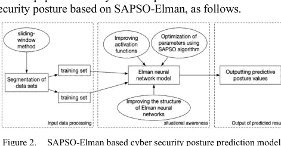

# 2020年人工智能与计算机工程国际会议 (ICAICE)(中国北京 2020.10.23-2020.10.25)


**摘要—** 随着互联网、移动互联网和物联网的日益普及，当前的网络安全形势变得越来越复杂。由于网络安全威胁的多样性和严重性不断增加，传统的网络安全防护手段已在大规模范围内基于历史数据有效预测网络的发展趋势，因此，本文提出了一种多尺度群算法来优化 Elman 神经网络，以实现网络安全的态势预测。利用网络安全态势的价值，所提方案引入了改进群算法解决了网络训练容易陷入局部最优的问题，实现了更准确的预测。将所提方案与现有方法对比表明，该方案具有良好的预测精度。

**关键词-预测：** Elman 神经网络；粒子群算法


网络安全形势预测是指通过整合当前网络环境状态数据和历史网络环境数据，预测未来某段时间内网络安全形势的变化以达到预防攻击的目的。目前国内外研究人员使用各种预测算法来预测网络安全态势，包括隐马尔可夫模型（HMM）、支持向量机和神经网络 [1]。

Wei 等人 [2] 提出了一种基于多尺度熵的隐马尔可夫模型用于网络安全预测，利用多尺度熵信息提供数据训练问题并优化 HMM 转移矩阵的训练参数，使得态势预测更加准确。You 等人 [3] 使用遗传算法优化了隐马尔可夫模型的初始参数，提高了网络安全态势的准确性。

John 等人 [4] 和 Chen 等人 [5] 分别提出了基于改进 SVM 算法的网络安全态势预测模型，丰富了利用机器学习算法进行网络安全态势预测的研究。

神经网络被用于网络安全态势预测。常用的基于神经网络的预测方法包括径向基函数（RBF）和 Elman 神经网络。

Jia 等人 [6] 将 RBF 神经网络应用于网络安全态势预测的研究。FAN 等人 [7] 引入了模拟退火（SA）算法和动态概率机制来优化 RBF 神经网络模型，通过局部搜索获取全局预测结果，避免模型陷入局部最优。

Elman 神经网络是最常用的循环神经网络之一，用于解决预测问题。Yan 等人 [8] 利用 Elman 神经网络的动态记忆特性和对历史数据的较高敏感性，实现了基于 Elman 神经网络的网络安全态势预测方法。基于遗传优化算法的 Elman 神经网络网络潜力预测模型通过初始化模型参数提高了预测的准确性。

网络安全态势随时间呈现出随机性，但也表现出一定范围的周期性 [10]，这限制了 Elman 神经网络的结构。同时，传统的 Elman 神经网络收敛速度慢且容易陷入局部最优。因此，本文构建了一种改进的传统 Elman SAPSO-Elman 网络安全态势预测模型。


## 改进 Elman 神经网络

神经结构是神经网络最基础的组件，神经模型基于 McCulloch [11] 提出的 P-M 神经元模型。

Elman 神经网络结构由输入层、隐藏层、上下文层和输出层组成。激活函数接收输入和与阈值比较的差值并处理所得神经元的输出。然而，预测速度限制了时间效率 [12]；且 sigmoid 函数在实践中存在收敛缓慢的缺点。因此，该特定函数改进了激活函数。

$f(x, a, b, c) = \frac{1}{1+e^{ax+b}}$ 是常数，其中 a 是增益因子，b 是常数因子，c 是偏移参数。其导函数为：

$f'(x) = \frac{-ae^{ax+b}}{(1+e^{ax+b})^2}$

通过学习参数值，可以使因子收敛。当 f 函数的值为 $\frac{2b+a}{4}$ 时，网络的收敛性达到最大。因此，通过选择最优参数训练可以使激活函数的收敛速度达到最优值。

本文根据网络安全态势随时间变化的周期性特征，引入了传统的 Elman 神经网络结构，并提出了一种改进的 Elman 神经网络结构。具体结构如下：


图1 Elman 神经网络结构

改进的 Elman 神经网络使用了双隐藏层结构。在传统结构中，隐藏层2在输出层和隐藏层1之间增加了一个上下文层，用于存储前时期的输出层结果，随后使用某种算法将随机选择的输出结果与输入层结果结合，输入层神经元仅用于接收来自外部到隐藏层的输入。隐藏层使用激活函数处理数据。Elman 神经网络的处理如下：

$x_i(k) = f(\dots)$ (2.1)

$x_i(k) = f(\dots)$ (2.2)

$x_i(k) = f(w_i y(k-1) + w_c x(k-1) + \dots + y(k-1))$ (2.3)

$x_i(k) = f(\dots)$ (2.4)

$y(k) = h(\dots)$ (2.5)

k 是迭代索引，x_i 是输出向量，f(*) 是隐藏层神经元的激活函数，w_i 是输入向量的权重，$w_{max}$ 和 $w_{min}$ 在公式中代表时间权重的最大值和最小值，其中参数 c 是基础因子，d 是常数因子，为了使权重趋于零，u $g = \sum w_j y_j$ 计算输出，且 u ($0 \le a < 1$) 是序列上下文层的自反馈增益。

## 改进粒子群算法

粒子群优化（PSO）是 Kennedy [13] 在 1995 年通过观察鸟群的捕食行为提出的进化算法，旨在通过搜索集合中的每个个体寻找最优解。假设存在一个粒子种群，每个粒子都有一个适应值，适应值 F 是通过适应度函数计算的。适应值的更新促进了粒子间的信息交互和连续运动，不断更新速度和


位置，寻找最优解的过程实际上是寻找最优适应值的过程。

基础二次算法具有在迭代过程中期间对全局范围的认知能力不足的缺点 [14]。因此，本文改进了粒子群算法基础值更新函数中的速度调整，并在公式中加入了惯性权重以获得新的更新公式，从而更新粒子的速度和位置。

最优解 $P_v = (v_{1}, v_{2}, \dots, v_{n})$ 的适应函数更新函数以及最优位置 $P_p = (p_{1}, p_{2}, \dots, p_{n})$ 的更新函数如下：

```
$F = \frac{\sum(y_{i}-y)^{2}}{2N}$
```

```
$P_{k} = \begin{cases} p_{k}, &if F(x_{k}) > F[p_{k}] \\ x_{k} + r_{1}v_{k} &if F(x_{k}) \leq F[p_{k}] \end{cases}$
```

```
$v_{k} = \min\{v_{max}, p_{k}, \dots, p_{n}\}$
```

在公式中，$y_{i}$ 和 $y'_{i}$ 分别是第 i 个粒子的实际输出和期望输出，$k$ 是进化层级。对于每一代，粒子的速度和位置更新如图 2.9 和 2.10 所示。

```
$v_{k} = wv_{k} + r_{1}r_{2}(p_{k}-x_{k})$
```

```
$x_{k} = (x_{k}-1) + r_{1}v_{k} + r_{1}r_{2}(p_{k}-x_{k})$
```

```
$x_{k} = x_{k} + v_{k}$
```

$r_{1}$ 和 $r_{2}$ 是 0 到 1 之间的随机数，$c_{1}$ 和 $c_{2}$ 表示速度常数，$c_{3}, k_{max}$ 表示迭代设置的最大值和最小值。

```
$c_{1} = c_{1min} + \frac{k}{k_{max}}(c_{1max}-c_{1min})$
```

```
$c_{2} = c_{2min} + \frac{k}{k_{max}}(c_{2max}-c_{2min})$
```

且 $c_{3}, k_{max}$ 是迭代设置的最大值和最小值。

惯性权重公式如图 2.13 所示。

```
$W = w_{max} - \frac{k}{k_{max}}(w_{max}-w_{min})$
```

$w_{min}$ 和 $w_{max}$ 表示惯性的极值值。

根据改进的加权迭代，权重在迭代开始时较大，使得更新更快并提高了全局搜索能力。随着迭代次数的增加，惯性权重线性减少，减慢了更新并增强了某些局部搜索能力。另一方面，为了平衡全局和局部搜索，我们改进了速度调整参数。改进的粒子群算法增强了全局动态，有效避免了粒子在搜索空间中盲目搜索的问题。


本文基于 SAPO-Elman 构建了一个网络安全预测模型，如下所示：



在本文中，使用滑动窗口方法在现有序列内产生并建模样本。输入数据采样到 Elman 神经网络中。使用 SAPO 算法进行优化以提高预测效率。最后通过预测训练模型获得网络安全预测值。

预测模型算法基于 SAPO 算法优化的 Elman 网络实现。样本 Elman 算法源于热力学理论中的固态分析原理，该原理由 Metrovitis 等人于 1953 年引入，是一种能够有效解决局部极值的随机优化算法。上一节改进的粒子群算法有效增强了种群算法的全局搜索能力，局部搜索能力也得到了提高。然而，算法跳出局部解的能力仍然不足。因此，本文引入了一种基于改进种群算法的新算法，然后使用 SAPO 算法学习并测试 Elman 神经网络的权重和自反馈增益因子。

使用 SAPO 算法优化 Elman 神经网络参数的算法步骤如下：首先，初始化改进 Elman 神经网络和 SAPSO 算法的结构；其次，将每一层的权重和自反馈因子编码并组合成粒子。确定粒子适应度公式，计算适应度值并初始化最优位置。更新粒子的速度和位置，通过计算所有粒子的适应度判断是否为优解，如果是，则使用权重和自反馈因子进行预测。最终输出粒子态值。适应度流程所示：

对应 Elman 神经网络的输入和输出神经元的样本标签，输入神经元设置为五个，输出神经元设置为一。


隐藏层 1 需要接收来自输入层和序列的信息，因此隐藏层 1 的神经元设置为六。


隐藏层 2 需要满足条件：$k_{i}$ 和 $k_{o}$ 分别是输入层和输出层的神经元数，且 $c$ 大于零。隐藏层 2 的神经元数为 9，本文通过不断尝试选择优候选。


序列层的神经元数为一。网络态数据显示网络攻击的局部特征为六，序列层神经元需要保留一个一维向量。从每天选取的剩余 90 个样本作为训练集。


本文实验数据使用真实网络数据集 (CIC-2018) 分为 120 组。此外，使用 Xianguan Li 提出的 HMP-GA-网络态算法训练样本集并生成态值。实验参数如下：

1) 输入层神经元：设置滑动窗口大小 $m=6$，结构见表 1。

| 表 1 预测样本集结构 |
| 样本编号 | 输入特征 | 输出数据 |
| :--- | :--- | :--- |
| 1 | $(x_{1}, x_{2}, x_{3}, x_{4}, x_{5})$ | $x_{6}$ |
| 2 | $(x_{2}, x_{3}, x_{4}, x_{5}, x_{6})$ | $x_{7}$ |
| 15 | $(x_{11}, x_{16}, x_{17}, x_{18}, x_{19})$ | $x_{20}$ |


从图中可以看出，基于传统 Elman 神经网络实现的预测态值大部分偏离了实际值。基于 GA-Elman 网络的模型预测仍使用绝对误差对三种算法进行了许多定量比较，如图 3 所示。

```
$E=|y-y'| \quad (3.1)$
```

$y$ 表示样本的真实值，$y'$ 表示算法的预测值。计算结果如图 5 所示。


图 5 绝对误差对比

显然，本文提出的基于 SAPO 算法优化改进 Elman 网络参数的预测值绝对误差较小且整体波动较少，模型具有鲁棒性。


本文实现了一种基于 SAPO-Elman 网络的态预测模型，能够根据连续输入序列的历史值预测时间片的值。Elman 网络的激活函数和网络结构加速了网络的收敛，改进了网络安全态预测。结合模拟退火算法和改进粒子群算法的 SAPO 算法优化了 Elman 网络的参数，进一步提出了基于 SAPO-Elman 网络的网络安全预测模型。通过实验分析和计算，该改进算法的预测结果误差远低于其他算法，具有更高的精度。


- [1] Yao J, Fan X, Cao Y. Survey of Network Security Situational Awareness/International Conference on Cybersecurity and Security, Springer, 2019: 34-44.
- [2] Liang W, Chen Y, Yuan X et al. Multivariate entropy-based weighted hidden network posture prediction model/2017 IEEE International Conference on Intelligence of Artificial Intelligence, 2017: 97-104.
- [3] Yoon M. John Holland and Genetic Algorithm for Feature Selection Methods. [Northwestern University, 2009].
- [4] Juan L, Zhang C, Luxiang J, et al. Research on the SAPSO-SVM model for network security posture prediction [Journal of Changchun University on Computer Science, 2019;6(06):120-125.
- [5] CHEN W, AO Z, TU Y et al. Network Security Awareness Prediction Method Based on Genetic Optimization Support Vector Machine/2015 IEEE International Conference on Computer and Communication Technology (CNCT). 2015.
- [6] YANG C, Li Y, et al. On network security posture prediction based on RB neural network/2017 36th Chinese Conference on Communication (CCC). IEEE, 2017: 406-403.
- [7] FANI Y, Wang P. Network security prediction based on RB neural network/Journal of University of Beijing, 2017;2(2):1-6.
- [8] Yuma Y, Liang L, Yuan J. Elman network posture prediction method[J]. Computer Science, 2012;38(06):43-76.
- [9] Fei H, He J. Method of Network Post Assessment based on Elman/The 7th International Conference on Computer Network (ICCNT), 2014: 552.
- [10] Wei Li, Yan Y. Elman network posture assessment based on logic audit and performance correction[J]. Journal of Computer Science, 2014;35(02):48-52.
- [11] Metropoulos N, Rosenbluth W, Rosenblum M, et al. Evaluation of state calculations by fast computing machines[J]. The journal of chemical engineering, 2016;31(1): 101-102.
- [12] Finoza J. Genetic algorithm of back-propagation to recurrent neural network[J]. Physical reviews, 1988;57(19):5219-5222.
- [13] Kennedy J, Eber R. A new optimizer using particle swarm for global optimization/IEEE Transactions on Evolutionary Computation and Human Systems, 1995, 43-49.
- [14] Pi J, Huang J. Aero engine fault detection based on SAPO-Elman neural network/arXiv.org/physics,2017;25[13]:3051-3058.
- [15] Metropoulos N, Rosenbluth W, Rosenblum M, et al. Evaluation of state calculations by fast computing machines[J]. The journal of chemical engineering, 2016;31(1): 101-102.
- [16] Li X, Zhao H. Network security posture assessment based on HMM-MPGA(C)/2016; 2nd International Conference on Information Management (ICIM). IEEE, 2016: 57-63.

