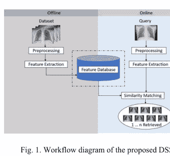
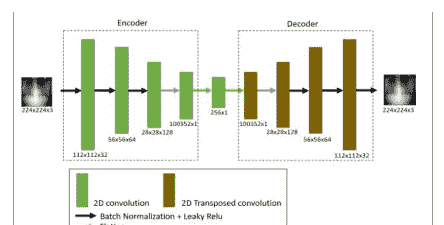
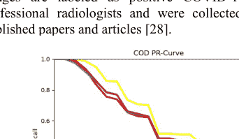
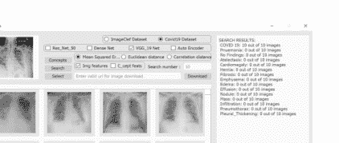

# 2020年计算科学与计算智能国际会议 (CSCI)(美国内华达州拉斯拉斯维加斯 2020.12.16-2020.12.18)


**摘要—** COVID-19 疫情是我们这个时代最具性的全球健康危机，目前正挑战着全球范围内的家庭、社区、医疗系统和政府。尽早检测并隔离阳性病例以进行及时治疗，防止病毒进一步扩散至关重要。早期研究发现，胸部放射检查中出现异常的患者是感染 COVID-19 者的特征。在当前背景下，需要一种易于获取的自动化筛选工具来进行更快的 PCR 测试，特别是在实验室和医院的 X 射线设备和专用试剂盒有限的情况下。目前已经提出了几种基于卷积神经网络（CNNs）上使用监督迁移学习技术的深度学习方法。这些方法的方法在很大程度上是非交互的，并且由于缺乏标记数据，其预测结果受到影响。本工作专注于开发一种 COVID-19 自动化系统，通过通过驱动的方法使用深度神经网络进行特征学习，并根据查询检索图像。我们的方法为实现真实比较和真实交互的目标提供了一个基准。该系统在来自两个不同资源的 1700 张胸部图像上进行了训练和测试，基于精确率召回率显示了令人鼓舞的结果。希望所提出的系统有助于减少人类操作员的视觉误差，并提高对 COVID-19 检测的灵敏度。

COVID-19 疫情是我们这个时代最具性的全球健康危机，也是自第二次世界大战以来我们面临的最大挑战。这场全球健康危机挑战着家庭、社区、医疗系统和政府。抗击 COVID-19 的关键一步是对感染患者进行筛选，以便受感染者能够接受立即治疗并减轻病毒的传播。COVID-19 检测涉及向鼻腔和口中插入 6 英寸长的签子（如棉签）持续几秒钟并旋转。随后肿胀消退，收集到足够的鼻腔样本。然后将签子放入容器并送到实验室进行逆转录聚合链反应（PCR）检测，该检测可以检测新冠冠病毒 SARS-CoV-2 呼吸道标物的 RNA。它被广泛用于有症状和无症状个体。医护人员、应急响应人员和其他服务人员，在 COVID-19 高风险地区暴露于感染患者的人员也在接受检测。检测的准确性和特异性是从采集样本到获得检测结果的耗时费力的人工过程。目前核酸检测的灵敏度（约 70%）导致许多疑似患者在得出确诊结果前需要在好几天内进行多次检测。

**关键词—** X 射线、COVID-19、计算机辅助诊断、筛选工具、深度学习、图像检索

因此，需要一种用于快速分诊、易于获取且具有便携性的自动化系统。在一些早期研究 [2-8] 中，发现患者在胸部放射检查中表现出的异常（例如 X 射线或胸部 扫描 (CT) 成像）是感染新型冠状病毒者的特征，表现为早期的双侧、多灶性玻璃样影变且呈后部分布（主要在下叶），以及晚期的肺性实变。然而，这些发现可能控制病毒传播和抗击 COVID-19 方面起着至关重要的作用。例如，CT 扫描是筛选和诊断包括肺炎在内的多种疾病最易获取的检查方法之一，可以补充 PCR 测试。然而，手动解释 CT 图像取决于放射科医的经验，尤其是大多数视觉判断对于从其他肺炎中检测出 COVID-19 是必要的。此外，即使在可用的情况下，能够读取 CT 扫描的专家也仍然短缺。因此，非常希望有一种计算机辅助诊断 (CAD) 系统，让放射科医生能够更快速、更准确地解释放射图像以检测 COVID-19。尽管机器学习结合放射学可能有助于该疾病的准确检测，并有助于解决偏远村庄缺乏专科医生的问题。

来自来自几个可用数据集的 X 射线图像，用于在 COVID-19 与其他肺炎（例如细菌性肺炎和非 COVID-19 肺炎）以及健康受试者之间进行分类。

特征有效表示图像结构和特征的描述性以及有效处理类内差异和类间相似性的能力对于实现良好的分类和检索至关重要。模式识别领域的近期研究强调了卷积神经网络（CNNs）解决分类、分割和目标检测等任务的能力，达到了顶尖性能。这归功于 CNN 学习原始数据层次化表示的能力，能够在无需手动设计的情况下捕捉内在特征。深度学习架构由线性非线性变换的组合组成，以获得数据的各种实用表示。这种数据驱动的表示丢弃了无关信息和特征，仅保留对目标任务的特征。自动特征学习或从图像中学习深度数据与手动提取内在特征有所不同，并为手工特征提供了替代方案。通过特征学习方法的多样性，可能为特定应用（如分类 [10]）定制特征。

深度学习系统潜在地可以协助临床医生在分诊和治疗高危患者时识别与 COVID-19 相关的异常，并帮助克服用于机器学习开发的 COVID-19 图像可用性方面的困难。因此，许多提出的方法在较小数据集上基于迁移学习显示出很有前景的结果。例如，使用了三个深度学习模型（ResNet50、MobileNetV2 和 Inception）从 X 射线图像（50 张 COVID-19 图像和 50 张正常 X 射线）中检测 COVID-19，评估显示 ResNet50 模型达到了最高准确率，其次是 Inception [3]。Hindi 等人 [12] 提出了 COVID-Net（一种深度 CNN 网络），在 5941 张胸部 X 射线数据上检测 COVID-19，准确率为 83.5%。CADNet 技术在 [3] 中通过微调预训练的 ResNet50 架构来提高模型性能。Haram 等人 [8] 提出了具有多个卷积层的 CADNet 模型，用于每层进行特征过滤，在大多数病例（COVID 对非 COVID）中分类准确率为 98.8%，在大多数病例（COVID 对非肺炎）中准确率为 87.02%。还有使用各种深度模型结合 CT 检测 COVID-19 的近期研究 [13–15]。

然而，这些许多系统是非交互的，且演示缺乏解释决策原因的能力。如果放射科医生能通过交互方法对决策过程感兴趣，将更有效；但疾病病例数据库中的病例数量有限，与我们的研究类似，这允许我们预测拍摄图像的质量。我们的假设是，通过提供一组病理确认病例作为计算机输出，系统可以学习预测而不是建议第二次需求。在过去几年，使用胸部 X 射线检索 (CBIR) 搜索相关图像的诊断 CAD 系统吸引了大量研究，为放射科医生提供了视觉辅助，并增强了他们对 CAD 决策结果的信心。此外，CBIR 将是学生、住院医生和经验较少的放射科医生培训的有用工具，帮助他们查看相似但病理可能不同的图像，并帮助他们观察当前病例中的模式如何与之前的病例相似。

近期研究表明，深度学习的使用可以显著提高 CAD 系统的性能，例如图像分类（病变检测）、乳腺摄影乳癌检测、肺分割以及 3D 脑图像流形的分割 [11]。胸部 X 射线上的深度学习技术用于 COVID-19 检测也越来越流行，正如最近观察到研究界存在发表热潮一样。在成像领域，大部分的研究仅使用


类别，提高了特异性。此外，与单一的分类或检索方法相比，基于分类和检索的集成系统将更加有效且稳健。为了解决计算机检测（CAD）在检测新冠肺炎方面的局限性，以及使用基于案例检索（CBR）为疾病图像提供临床决策支持的可能性，本文提出了一种集成分类与检索决策系统（DSS），具有“用户易用”的界面并在深度特征中使用了融合和集成技术。深度特征通过在预训练 CNN 和深度自动编码器中使用迁移学习提取。我们的方法通过典型相关分析（CCA）融合组合来使用深度特征。根据放射学家提交的基于图像的视觉查询，提出的系统将通过显示每个病例的图像以及将图像分类为不同类别来进行检索。尽管放射学家由于在该领域的丰富经验发挥着关键作用，但所提出的 DSS 可以帮助获得准确诊断，并消除 RT-PCR 试盒数量不足、测试次数以及测试结果受限的问题。

那些没有分类头的 CNN。此阶段之后获得的结果是将通过相似性匹配层的特征。在在线阶段（图 1 右侧），未知查询被提交到系统，并传递到特征提取网络，在该网络中计算查询与数据库特征之间的相似性距离。网络架构将查询作为输入并给出相应的特征。此外，用户还可以选择在数据库和查询的深度特征空间中选择不同的相似性和特征融合方法，以兼顾平性和有效性。




图 1 表示所系统的架构，分为离线和在线阶段。

特征提取是医学图像的关键方法。在选择有效特征时，研究重点在于捕捉图像的颜色、纹理和形状。X 射线图像特征的描述性和判别能力实现了良好的分类和可靠的性能。与其使用任何手工特征，可以使用迁移学习技术利用 CNN 模型从小数据集提取 X 射线图像的特征。迁移学习提高了特征提取的效率，因为它被证明可以用更少的数据和更少的训练需求提高模型准确性。在 ImageNet 等大规模数据集上训练的 CNN 已经在迁移学习任务中证明了自己。网络学习一组判别性特征来表示各种物体 [19]。使用预训练的 CNN 作为特征提取器而不是从头开始训练是有效的，因为它从数据更丰富的地方转移了学习成果（即滤波器），并避免了耗时的训练需求 [20]。

离线阶段（左侧）涉及为了索引之目的而对数据库图像进行预处理和特征提取。在传递给特征提取网络之前，对图像进行缩放和像素归一化处理。我们的特征是使用在卷积去噪自动编码器上训练的 CNN 在潜空间中生成的特征，以及 ImageNet 数据集上若干其他基于迁移学习的深度特征提取（不包括 CNN 的最后两个全连接层）。该系统通过缩放大小对所有数据库图像进行预处理。使用迁移学习方法，通过传递图像来提取数据库中图像的深度特征。

为了执行基于迁移学习的深度特征提取，我们使用 VGG-19、ResNet-50 [22] 和 DenseNet[69] 作为在包含 1000 个案例的 ImageNet 数据集上的预训练 CNN 模型。这些学习到的特征被用于检索可靠准确的分类结果。VGG-19 由 16 个全卷积层组成，已作为基准特征提取器使用 [21]。残差学习 ResNet 是另一种由 VGG 架构构建的神经网络。典型的 ResNet 模型使用带有三重非线性（ReLU）和批归一化的瓶颈层 [22]。跳跃连接有效率简化了网络，在初始阶段使用较少的层。这通过减少网络中传播的层数来减少梯度消失问题，从而加速了学习。然后我们逐渐更新跳跃层。传统的分层 CNN 具有 L 个连接——每层与其后续层之间有一个连接——而密集卷积网络（DenseNet）具有 L(L+1) / 2 个连接。对于每一层，所有前层的特征图都作为输入，并将其自身的特征图加到所有层 [25]。密集层是窄的 n（每层 12 个滤波器），仅向网络的“集体知识”中添加一小部分特征图，并保持特征图不变——以及基于网络中所有特征图的最终分类器。

输出层的原始数据。类似于主成分分析（PCA），自动编码器可以获得数据与代码空间方向之间的映射。

表 1. 预训练 CNN、特征提取层和维度

| 网络 | 特征提取层 | 特征维度 |
|---|---|---|
| Resnet50 | 全池化层 | 2048 x 1 |
| Densen169 | 全池化层 | 1024 x 1 |
| VGG19 | 全连接（密集）层 | 4096 x 1 |



图 2. 我们提出的自动编码器架构

去噪自动编码器是一种学习去噪图像的前馈神经网络。通过这种方式，网络在图像上学习有趣的特征。如果自动编码器已训练以编码图像，我们可以使用网络的编码器部分来学习数据集中的图像表示。通过堆叠去噪自动编码器构建的去噪自动编码器 (dda) 用于无监督学习和分类检索。我们提出的编码器-解码器架构 (2) 使用卷积层接收输入图像并尝试重建图像。编码器将输入图像 (224 x 3) 通过卷积层、批归一化和 ReLU 压缩为更小的特征图。（此处后续重复内容已省略）


基于代表每张 X 光图像的深度特征对数据集进行分类。由于深度学习将数据转换为可区分的特征，提取特征的相似性也可以推导出图像的相似性。基于内容的检索（CBIR）算法的搜索和检索取决于距离度量衡量相似性的有效性。当前的 CAD 方案在使用 CBIR 技术（如 k 近邻搜索方法）时搜索 k 个最相似的参考（图像）。差异（距离）越小，计算机对比较图像的“相似性”水平越高。查询图像（图像）特征向量与参考（图像）特征向量之间的差异使用不同的距离度量计算，例如查询图像与数据库之间的欧几里距离、曼顿距离和余弦相似性。因此，应用于特征集的距离度量的有效性至关重要。选择距离度量时还应考虑计算效率和速度。在本文中，均方误差（MSE）、相关距离（COD）和欧几里距离评估了这些度量的准确性。计算向量 X 和 Y 之间的距离为：

```
MSE = \frac{1}{n} \sum_{i=1}^{n} (X_i - Y_i)^2
```

MSE 表示点集之间回归线的距离，如下：

```
MSE = \frac{2}{n} \sum_{i=1}^{n} (X_i - Y_i)
```

较低的 MSE 表示相似性更好，反之亦然。而 COD 衡量向量之间的线性和非线性关联

```
COD = \frac{2}{n} \sum_{i=1}^{n} X_i Y_i
```

肺不张、肺炎、胸腔积液增厚、水肿、心肌病、肺气、纤维化、实变。一个图像中存在多种疾病被标记为多标签集。Covid-19 图像由专业放射科医生标记为 COVID-19 检测，并收集自近期发表的论文和文章 [28]。



图 3. COD 测量的精确率曲线 (PR)

| | MSE | EUC | COD | Average |
|---|---|---|---|---|
| ResNet50 | 0.4204 | 0.4204 | 0.3927 | 0.4112 |
| DenseNet19 | 0.4328 | 0.4327 | 0.4256 | 0.4304 |
| VGG19 | 0.4199 | 0.4198 | 0.4140 | 0.4142 |
| AutoEncoder | 0.4200 | 0.4368 | 0.4307 | 0.4302 |

表 2. 平均精确率

数据收集和评估是验证检索或分类系统有效性的最后也是最重要的步骤。由于存在具有 COVID-19 症状的新 X 光图像，这很大程度上阻碍了 AI 方法的研发。我们假设与 COVID-19 相似的其他感染可以用于训练能够识别这种新疾病的模型。对于我们的实验，我们使用了来自 NIH 数据集和公开的 COVID-19 胸闷的 1580 张组合 X 光图像 [27]。NIH 数据集包含 30,805 名唯一患者的 112,210 张正面图像。该数据集包含异常的肺部和心胸疾病，包括结节、气胸、浸润，

在我们的数据集中，图像（75% 和 25%）分别被用于训练（总共 1700 张）和图像查询（文本）检索。检索 2 显示了加权平均精确率。我们基于 DenseNet19 开发的自动编码器获得了 0.4368 的最佳结果。该值在所有应用方法中获得了最佳平均值。图 3 显示，基于 DenseNet19 的深度特征在我们的数据集上具有最高精确率。相似性度量对于 EUD 和 MSE 均获得。然而，基于 AutoEncoder 的性能优于其他方法。欧几里距离证实了表 2 中的结果。图 4 显示了检索界面的快照，顶部是查询图像，底部显示 10 张最相似的图像（使用 MSE 作为距离度量）。总体而言，界面对用户友好，可以通过不同的选择进行检索。




本文提出了一种基于学习的检索系统用于检测 COVID-19 和异常肺胸。假设这种系统将极大改进筛选过程。然而，为了更好地筛选、诊断，将此类系统与临床发现和实验室结果相结合是重要的。未来，我们将利用来自多个源的信息。


本研究受 NSF 奖项（RIA）支持，编号：16044。


- [1] Muhammad Ilyas, Hena Ahmed, Aina Nasir, (2020). 使用人工智能从 X 光图像检测 Covid-19。Vision and Image Processing, (2021); 25(4).
- [2] J. D. Apostopoulos and T. A. Mespena. (2020). 使用深度学习和卷积网络从 X 光图像检测 Covid-19。Journal of Medical Engineering & Applications, Apr, 2020.
- [3] M. Farhou, A. Charles. (2020). 基于深度学习的从胸片筛选 covid-19 的框架。arXiv:2009.14395.
- [4] Oktay, T., M. Mahmood, Y. Erdal, Balehan. (2020). 使用深度神经网络的 Covid-19病例。Computer Med Rep. 2020;31(8):102978. doi:10.1016/j.cmr.2020.102978.
- [5] Albuquerca, Ricardo, C-Draia, Valeria Potia, Bogdan Artanel, Bastiane Briz, Brito Miguel, Cristina Pires, Carlos. (2020). 用于 covid-19 诊断的深度学习：现在与未来。Scientific Reports, 2020;10(1):1-10.
- [6] Shi Wang, F Shi, L Wu, Z Wang, Q Zhang, K Ke, H Shi, Y Chen D. (2020). 图像采集、分割和 COVID-19 检测中的人工智能技术。IEEE Review Eng. 2020 Apr 16. doi:10.1109/REVE.2020.298795
- [7] Narin, A., Kaya, C., Pramuk, Z. (2020). 使用 X 光图像和深度卷积网络自动检测病毒 (Covid-19)。arXiv:2003.10849.
- [8] E.E. Hernandez, M. A. Shuman, KaraNet: 用于在 X 光图像中检测 Covid-19 的深度学习分类器。arXiv:2003.11055.
- [9] M. D. Zeler and R. Fergus, (2014). 卷积网络的可视化。In: Computer vision-CCCV 2014, pp. 818–833. Springer.
- [10] Bengio, Y., Camille, A., Vincent, P. (2012). 学习与新视角。Medical Journal, 11(1):1-11.
- [11] Litvov, G., Grendner B, et al. 医学图像分析中深度学习的综述。Medical Image Anal. 2017;42:607–618. doi:10.1016/j.mediaimage.2017.07.005
- [12] L. Wang, Wang D. (2020). Covid-Net: 用于从胸部 X 光检测 COVID-19 例的深度卷积神经网络。arXiv:2003.10990.
- [13] S. Wang, B. Wang, J. Ma, X. Meng, M. Miao, J. Bao, B. Xu. (2020). 用于胸片筛选检测 covid-19 的深度学习算法。arXiv:2003.11622.
- [15] M. Bastigan, U. Orkay, S. Ortuk. (2020). 使用机器学习方法通过 CNN 进行病毒 (COVID-19) 分类 (2020)。
- [16] H. Meller, M. Nicholas, D. Bandau, B. Elishaj. (2004). 医学应用中基于内容的检索系统综述。Int J Inf, 73, pp. 55–58.
- [17] M. Rahman, C. Desai, and S. B. Bhattacharya, 基于内容的诊断检索系统。In: 2006 IEEE Symposium on Medical Computer and Biomedical Systems (ICBC), 2009, 1–6.
- [18] Karpathy, S., et al. ImageNet 大规模分类-19
- [19] J. Domba, et al. (2021). 用于遗传病毒识别的深度卷积激活函数。Machine Learning, 32, pp. 505–518.
- [20] Gao Hua, Zhang Fei, Liu Laureens, van der Maaten K, Weinberger D. (2017). 使用卷积神经网络的深度学习。CVPR。
- [21] K. He, X. Zhang, and J. Sun. (2016). 实时目标检测。计算机视觉与模式识别会议 (CVPR), 2016.
- [22] P. Vincent, H. Larochelle, I. Lajoye, Y. Bengio, and P. A. Managual. (2010). 用于图像修复的堆叠去噪自动编码器。The Journal of Machine Learning, 11, pp. 3371–3470.
- [23] K. Arkhevitsky and A. Hunt. (2019). 使用深度学习基于内容的检索。In: ISANN 会，2019.
- [24] J. Kim, M. Lee, Tae Xu H, J. Y, Chang Ming D. 深度学习分类器对 COVID-19 胸部 X 光的泛化能力

