# 2020年计算机、控制、电气与电子工程国际会议(ICCCEEE)(苏丹喀尔图，2021.2.26-2021.3.1)

物联网（IoT）是具有不同物理属性的互联系统的重要组成部分，涵盖家用、车辆以及各种已形成并完善的设备。它被视为由传感器和执行器带来的真正成果，网络汇聚事物并驱动信息，为现实物理世界接入结构开启了大门并实现了想象中的连接，实现了效率提升、经济效益并减少了人类劳动 [4]。

## II. 前人工作

以往许多关于在农业中应用不同技术的研究已经完成，旨在提高生产力并促进农业流程。

在这项研究 [2] 中，精准农业旨在提供正确数量的资源（如水、光照和农药），以及在每个时间段内如何提供这些资源。精准农业各项功能的实现是通过从无人机感知所有资源，并做出相应的决策来控制执行器。该系统中还使用了土壤水分、温度、湿度和光强度等传感器将数据发送到云端，并开发了一个安卓应用程序。

这项研究 [5] 提出了一种基于嵌入式的土壤监测和农田灌溉系统，通过移动应用程序获取信息以帮助农民增加产量。该系统通过 WiFi 从各种传感器获取信息并实时提供，从而可以实现对适合土壤作物的自动化管理。这是一种根据土壤水分自动开启或关闭的自动灌溉系统。该系统控制作物并帮助农民管理和建议农药。该系统使用了 `Raspberry Pi 2`，配合 `MCP308` 模拟数字转换器接收来自传感器的数据并传输到 `Raspberry Pi`。

这项研究 [6] 使用 `Arduino` 构建了一个农场自动化系统，该系统使用 `DHT11` 传感器控制温度和湿度，并配合土壤水分和水位传感器来监测和控制灌溉水箱。它配合 `ESP8266` Wi-Fi 模块用于 `Arduino` 用于发送数据进行处理和可视化。

在这项研究 [7] 中，使用 GSM 技术开发了一种先进的农业系统。通过 GSM 监测温度和土壤水分等影响作物生长和健康的参数。该系统使用 `Arduino` 作为控制器来实现该功能，通过连接 GSM 模块将数据发送到其手机。

这项研究 [8] 提出了一种智能农业系统，以解决人口从农村向城市迁移导致的稀缺问题。通过使用多种功能（如基于 GPS 的远程控制监控以及感知温度、湿度、入侵者、稀缺和叶枯等参数）来控制适当的灌溉技术；通过在农场不同位置部署带有摄像头的 `PIR` 传感器节点来保护植物免受任何动物侵害。

在研究 [9] 中，使用智能灌溉系统高效灌溉农场以处理水短缺问题。该系统基于土壤水分、温度和 pH 传感器所需的 `Arduino`。`Atmega` 微控制器控制系统，系统从传感器获取数据以驱动伺服电机和泵进行灌溉。该系统具有收集数据到服务器的能力，可以通过安卓应用程序访问，根据土壤类型建议灌溉，并使用数据库上的贝叶斯算法（一种机器学习算法）进行控制。预测降雨时使用网络预报并相应调整作物。

根据上述文献，所提系统对农村地区的农民非常有用，对于那些没有耕作经验的个人，它可以提供帮助并设立。此外，该系统可以在小区域和家庭中使用。该系统具有成本效益且节省时间。

## III. 研究方法

这项工作的主要设计是为农民（特别是农村地区）设计一种实用的系统，帮助他们利用现有技术获取信息并节省时间。设计该系统使用了土壤水分、pH 值等传感器，并可以设置为获取灌溉、pH 水平和入侵者检测。`Raspberry Pi` 是主控制器，通过 `Blynk IoT` 云平台控制农田差异并进行监控。根据土壤水分值控制水泵的开启和关闭，农民添加适当的肥料并控制 pH 值。系统具有识别入侵者类型（人类、动物、鸟类）的能力。所有这些都将在手机应用程序上可视化。

### A. 所提系统

在该系统中，土壤水分传感器、`DHT11`、`PIR` 和 pH 传感器连接到 `Raspberry Pi`。发送的值通过 `Blynk IoT` 及其应用程序在农民的智能手机中收集，以便远程进行数据可视化。如果发送的值在时间测试期间超过了作物范围（40%）设置的阈值，则灌溉将由继电器电路开启/关闭，该电路连接到驱动电路，由 `Raspberry Pi` 及其家中的传感器为水泵提供所需的水。`PIR` 传感器检测农田上的运动，摄像头可以捕捉人类、动物、鸟类之间的物体类型。系统仅使用几字节即可通过互联网连接连接云端和移动应用程序。系统还监测土壤质量，因此可以轻松检测出合适的肥料并在手机应用程序中可视化。农民将通过其智能手机远程获取农田状况信息，从而节省了宝贵的时间。

## IV. 系统设计

图 1 显示了所提系统的框图。

### A. 系统概述

`Blynk` 是一个 IoT 平台，允许用户快速构建用于控制和监控 iOS 或 Android 设备硬件接口。下载 `Blynk` 应用程序后，用户可以创建项目仪表板并排列按钮、滑块和其他组件。通过组件，用户可以虚拟开启或关闭引脚或显示传感器数据。

图 1. 系统图。

### B. 系统操作

共有三种操作：

- **自动灌溉**：当系统启动时，`Raspberry Pi` 作为主控制器命令开启水泵以记录小于阈值的当前水分。控制器检查是否仍低于阈值，以命令水泵保持开启或关闭。下图显示了该操作的流程图，如图 2 所示。

图 2. 自动灌溉流程图。

- **肥料建议**：基于 pH 传感器的输出作为动态参数以及我们目标培养的特定作物，系统将为作物提供适当的肥料以获得更高的产量。正常水平在（5.8-7）以上，如果 pH 水平过低或过高，用户将根据 pH 值获得肥料建议，如图 3 所示。

图 3. 肥料建议流程图。

- **运动检测**：当房间内有运动时，`PIR` 传感器检测并信号控制器同时录制视频。然后 `Flow Lite` 机器学习算法使用这段视频对检测到的入侵者进行分类，并通知用户入侵者是人类、动物、鸟类还是未识别，如图 4 所示。

图 4. 运动检测流程图。

`Flow Lite` 基本上是一个在设备上运行机器学习推理的工具包，因此我们可以获取任何机器学习模型并使用 `Tensor Flow` 转换器将其转换为可在嵌入式或移动设备上运行的格式，然后 `Tensor Flow Lite` 解释器将在设备上运行模型和推理。使用了一种用于目标检测的卷积神经网络算法，用以检测区域内的任何入侵者，然后用户会收到入侵者类型的通知。

移动应用程序显示“如后续图所示‘泵已开启’”。

这项工作利用传感器从现场收集数据，以便控制器做出合适的决策。使用 `DHT11` 收集温度和湿度数据，还使用水分传感器检测土壤中的含水量以控制水泵，而 `PIR` 和树莓派摄像头用于目标检测，为用户提供入侵者类型，最后使用用于测量土壤酸碱度的传感器（图 5）来建议合适的肥料，如表所示。

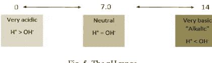

图 5. pH 范围。

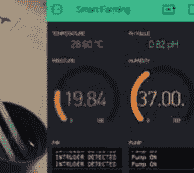

图 7. 值小于阈值（LED 开启）。

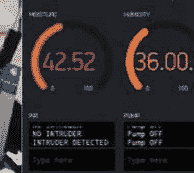

图 8. 值大于阈值（LED 关闭）。

| 肥料 | 对土壤 pH 的影响 |
|---|---|
| Ca(OH)2 & 熟石灰 | 增加 |
| 硝酸盐 | 增加 |
| 碳酸钾 | 减少 |
| 尿素 | 减少 |

表 2. 肥料种类

### C. 肥料建议

pH 值也会根据其数值、土壤类型和所需的作物显示在移动应用程序上，用户会收到关于移动应用程序适当肥料的通知。

第一次实验是针对 pH 值小于 (7) 的酸性溶液进行的，使用了橙汁，传感器给出了结果，该结果显示在移动应用程序中，用户收到了酸性的通知，并建议了合适的肥料，将一直检查 pH 直到达到合适的。

## V. 结果与讨论

### A. 系统与用户界面

在过程开始时，所有设备都给出了数值。温度、湿度、水分、pH、`PIR` 和摄像头已通过手机上的 `Blynk` 应用显示，图 6 显示了电子系统和移动应用程序。

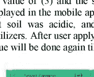

图 6. 系统和用户界面。

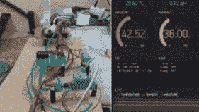

图 9. 土壤呈酸性（基于橙汁 pH 值）。

第二次实验是针对 pH 值为 (7) 的中性溶液进行的，使用了 pH 为 (7) 的饮用水，传感器给出的结果显示在移动应用程序中，用户收到了中性的通知。

### B. 自动灌溉

水分根据作物类型控制水流。当达到阈值时，泵（LED）关闭，移动应用程序向测试者显示“泵已关闭”，泵（LED）和系统将保持切换泵（LED）。

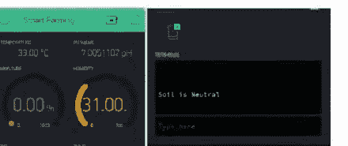

图 10. 土壤呈中性（基于饮用水 pH 值）。

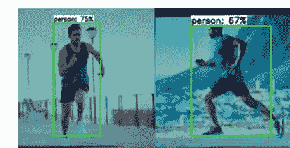

第三次实验是针对 pH 值大于 (7) 的碱性溶液进行的，使用了 pH 为 (7) 的肥皂水，传感器给出的结果显示在移动应用程序中，用户收到了碱性的通知，并建议了合适的肥料，将一直检查 pH 直到达到合适的。

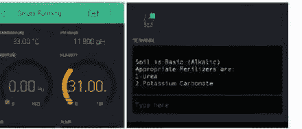

图 11. 土壤呈碱性（基于肥皂水 pH 值）。

图 12. 系统入侵。

### C. 运动检测

当检测到入侵者时，移动应用程序向测试者显示“泵已开启”，在泵（LED）中和系统将保持切换泵（LED）。

图 13. 系统检测到人类。

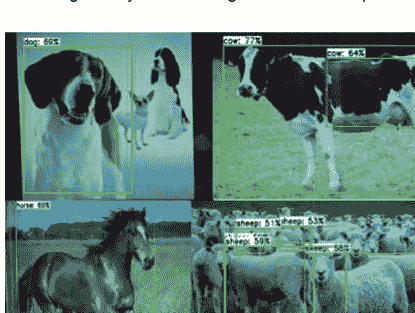

图 14. 系统检测到动物。

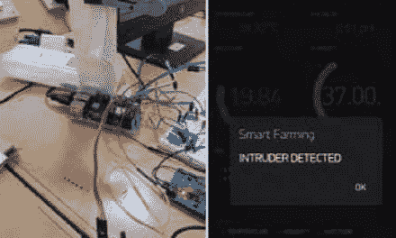

图 15. 系统检测到鸟。

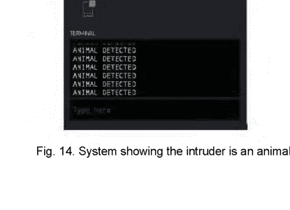

图 16. 系统检测到人。

## VII. 未来前景

这项工作提供了一个实时、易于使用、节省时间且比现有方法更有效的系统。通过传感器在家里测量多个参数，如温度、湿度、水分、pH、`PIR` 和摄像头，通过一些处理结果改进了灌溉，确保特定的作物获得所需的水分。

# 参考文献

1. Ahmed, M. E., Abdallah, K., and Elshahir, I., 2018. 基于 GSM 的智能农场。2018年国际通信与电子会议 (ICEEE)，哈尔基，1-4页，doi:10.1109/ICEEE.2018.885133
2. Arif, A., Soma, N., and Adhadari, S., 2018. 使用 GSM 技术的智能系统。2018年国际通信与信号处理会议 (ICSP)，629页。
3. Anaritha, N., Devi, J., Dya, M. and Janani, V., 2017. 物联网在农业中的应用。国际工程进展杂志，8，2731-2735。
4. Bhatt, J.P. and Narayan Hegde, 2019. 精准农业。
5. National, 2017. 农业智能滴灌系统。2017年技术融合国际会议 (I2CT)，659-662页。
6. Padala, P., Malhan, S., Dhabir, K., Kumar, S. and Jawahale, D., 2017. 基于物联网的灌溉监测系统。国际研究与计算机科学杂志，5(2)，177-181。
7. Soma, N., Samson, S. R., Saranya, S., Shanjunriya, G. and Subhashini, E., 2017. 基于物联网的灌溉监测系统。国际研究与计算机科学杂志，5(2)，177-181。
8. Hegde, N., 2020. 水安全-印度。BAIF 在印度科学大会。
9. National, 2017. 水与能源：苏丹。
10. 论文图表。https://docs.google.com/file/d/1sc8EamMwXQyQPuU7ARueBhnx/view?usp=sharing
