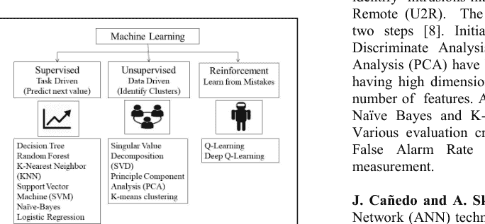

# 2020年数字世界融合国际会议 - 往何何方 (ICCDW)

**摘要—** 物联网（IoT）促进了海量设备连接到网络，以满足不断增长的应用。当前和未来的物联网有望通过各种类型的威胁，即拒绝服务（DoS）、中间人攻击欺骗、窃听和软件攻击，来提高用户的便利性和舒适度。这些威胁构成了严峻的挑战。我们讨论了物联网存在的主要安全威胁，并综述了基于监督学习的物联网系统。

收集来自不同服务的数据以执行功能。

- **网络层**（Network Layer）是一种实现数据传输和松散物联网设备连接的通信网络。
- **中间件层**（Middleware Layer）是应用层和网络层之间的连接链路。它是提供强大处理和存储能力的云。
- **应用层**（Application Layer）包括物联网上的端到端应用，如智能电网、智能家居、智能建筑 [2]。

**关键词—** 物联网安全攻击，监督学习，机器学习

所有这些最新技术都容易受到用户和安全威胁的影响。表 1 包含了物联网层存在的关键攻击的描述。

物联网（IoT）促进了海量设备连接到网络，以满足不断增长的应用。近年来，设备数量迅速增加，预计到 2022 年将达到 240 亿 [1]。物联网存在于广泛的应用领域，如智能城市、智能电网、智能农业、智能环境，触及了我们生活的生活的方面面。随着物联网应用的广泛，隐私和安全问题也随之而来。如果不保障物联网，从家庭、汽车到关键基础设施的许多生活领域将面临特殊的安全挑战。

## 表 I. 物联网层存在的关键安全攻击描述

| 物联网层存在的关键攻击 | 描述 |
|---|---|
| 拒绝服务 (DoS) | 攻击者用冗余请求淹没服务器，导致物联网设备无法获得响应 |
| 中间人攻击 (Man-in-the-Middle) | 中间攻击者通过干扰和欺骗信号，拦截或更改物联网设备之间的数据通信 |
| 欺骗 (Spoofing) | 攻击者以自私身份冒充物联网设备以获取非法访问，并通过 DoS 和中间人攻击导致服务器崩溃 |
| 干扰 (Jamming) | 一种 DoS 攻击，恶意节点发送伪信号以中断学习，造成通信干扰 |
| 窃听 (Eavesdropping) | 未经授权的感知、修改和删除传输在网络上的信息 |
| 软件攻击 (Software attacks) | 恶意软件（如恶意软件、木马和蠕虫）使用用户个人信息或造成破坏，导致物联网系统性能下降 |

机器学习是人工智能的一个分支，使系统能够从经验中学习并提高性能，无需显式编程。与传统方法相比，机器学习有望更有效地保护物联网设备免受各种安全威胁。本文描述了物联网的架构，并提供了关于影响各个物联网层的安全攻击信息。文中讨论了用于攻击预测和增强物联网安全的机器学习算法。

## II. 物联网架构与安全攻击

物联网架构的四层描述如下：

- (1) **感知层**（Sensing Layer）由连接到智能物联网设备的传感器和执行器组成，它们……

## III. 用于物联网安全的机器学习算法

适用于增强物联网安全的机器学习（ML）算法如下：

### A. 机器学习算法

- (2) 无监督学习：它使用标记数据，并根据它们之间的相似性将数据聚类成组。无监督学习的示例包括奇异值分解、多变量相关分析和 K-means 聚类。
- (3) 强化学习 (RL)：涉及对环境的观察，以便通过不断尝试不断改进。强化学习的示例有 Q-Learning 和深度学习 [4]。

24112 个正类和 24890 个负类，每个类 42 个特征 [6]。他们通过 RF 算法的树质量、每棵树的深度和特征数量等参数检查了准确性。从 5 折验证的实验结果观察到，RF 提供了高准确率和极低的均误差，我们使用了开源工具对 RF 进行时间分析。

Hyo-Sak Kim 等人（2014）研究了 Android 平台上检测恶意软件的各种方法（如基于行为和基于签名的方法），显示行为检测结合线性支持向量机（SVM）实现了高分类准确率。然而，使用学习分类器对 CPU 使用率、大小和能量等各种特征进行恶意软件分类的监测和分析 [7]。发现 SVM 在精确率、准确率和 F 值方面优于其他方法。

图 1 适用于物联网安全的机器学习分类及各种算法。

图1. 适用于增强物联网安全的机器学习算法类型

J. Canada 和 A. Skjellum（2016）利用人工神经网络（ANN）来识别物联网网关层的入侵者。这种方法包括通过创建 Arduino 设备作为边缘设备并将 Raspberry Pi 模型作为网关来实现物联网检测 [9]。使用统计语言创建了神经网络。提议的 5 层网络能够预测有效攻击和无效攻击，其假阴性率 < 1%。

### B. 深度学习算法

深度学习（DL）是人工智能的一个分支。深度学习（DL）也用于增强物联网安全。（注：提示中提供的该部分文本是重复的，我包含了所有可用句子）。

## IV. 基于机器学习的方法综述

在本节中，我们综述了现有的工作。

[8] H. Haddad Pajoush, R. Javidan, R. Khayami, D. Ali, K. K., K. R. Choo, "一种用于物联网骨干网云入侵检测的双层降维与两级分类模型," IEEE Transactions on Emerging Topics in Computing, vol. PP, no. 99, pp. 1–16,

[9] J. Cendo, A. Skylliam, "使用机器学习保障物联网系统安全," 2016 第6届国际隐私、安全与信任会议 (PST 2016), pp. 219-222.

[10] A. A, D. Chilankarni, "基于深度学习方法的物联网分布式攻击检测方案," Future Gen. Comput. Syst., vol. 82, pp. 761–768, 2018年5月.

[11] Ioannou C. and Vasiliev V., "使用深度监督学习进行物联网网络安全攻击分类," 第12 届传感器系统分布式计算国际会议 (DCOSS) 2019, pp. 652-658,

[12] M. Khan, M. M. Islam, M. I. I. Zarif, M. Hashem, "使用机器学习方法进行物联网中的攻击与异常检测," Internet of Things, vol. 7, pp. 100059, 2019.
