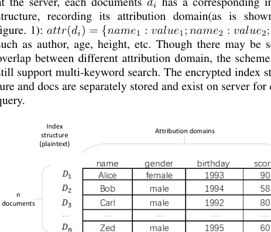
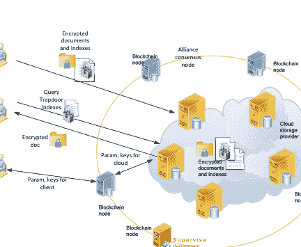
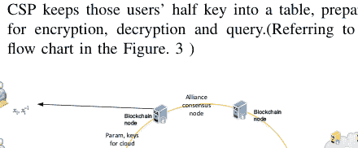
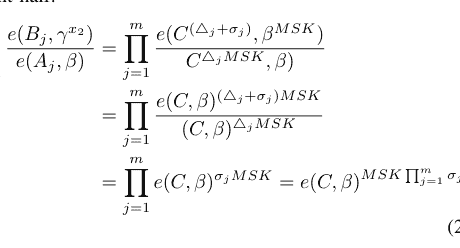
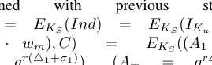

# 2020年网络赋能分布式计算与知识发现国际会议（中国重庆 2020.10.29-2020.10.30）

^1 通信安全实验室，成都市 610041，中国
2 中国电子科技集团有限公司，第30研究所，成都市 610041，中国
3 中国电子科技安全有限公司
239282759@qq.com

**摘要—** 搜索加密（SE）通过提供在线搜索功能来保护加密数据和用户查询隐私。但实际应用中面临着巨大的带宽和存储开销挑战，需要进行缓解。在本文中，我们提出了一种基于区块链的SE用户管理方案，能够去中心化带宽管理，并增强隐私安全性以防止由于信任第三方（TTP）带来的身份丢失或篡改。我们利用区块链提供安全效率，并通过理论分析验证了其可行性和安全性。进一步的实验证明了SE的有效性。

**关键词—** 搜索加密；多关键字；去中心化；加密；区块链。

动态用户管理是SE的一个重要方向。它不仅降低了客户端的计算复杂度，还实现了安全的动态组管理。TTP（代理）的使用也是大多数基于动态搜索加密方案所的策略。Li, Huang [15] 进一步设计了一种支持细粒度结果的多关键字搜索方案。

目前，如Azure和Google App Engine等服务器提供商通过身份验证和ACL（访问控制列表）保护用户隐私 [16]。然而，这些应用是构建在服务器可信的假设上的。在实际实现中，云服务提供商可以依赖用户隐私，服务器是半可信但具有好奇心的。尽管搜索加密技术解决了云端数据隐私与可用性之间的矛盾，但还没有成熟的商业应用。在加密的基础上，密文文档和搜索过程增加了带宽和经济成本；其他许多应用场景方案在功能、效率和安全性方面仍需改进。

# I. 引言

搜索加密是一种保护用户数据安全和查询隐私且不影响数据检索的技术。基本场景是：用户加密自己的数据，生成关键字并上传到云端。当他需要检索数据时，将关键字提交给云服务器。云端不知道关键字或密文，但利用关键字的陷阱（traps）来检索数据的密文，然后返回结果 [1]。

搜索加密主要分为对称和非对称。然而，根据创建者和搜索者的数量还可以进一步细分。其研究具有许多属性，如效率、安全性、正确性等 [4–7]；Jin Li [8] 提出了支持加密关键字搜索的开关。Wang [9] 提出了支持范围搜索查询的方案。B [10] 提出支持在密文中进行搜索加密。Hector [11] 提出了支持加密搜索的SQL查询。服务器不需要解密密文，而是对密文进行操作，这进一步增加了搜索加密的潜力，但目前同态加密的效率尚不可用。Yong H [13] 提出了支持多用户文件共享和多关键字高效搜索的公钥方案。Dong [14] 使用TTP（第三方）来管理和分配密钥，使用El-Gamal代理加密，这种方法不仅降低了客户端的计算复杂度……

SE中的用户管理通常由TTP实现，但TTP与用户之间存在许多问题，例如单点故障、身份泄露、在实践中难以找到所有人都信任的TTP等。这些问题与服务的可用性、效率和安全性有关。

本文中，我们提出了一种基于区块链的方案，可以实现用户组内的文件共享和无代理的动态用户管理。该场景支持不同的创建者和搜索者，即不同创建者创建的密文和关键字可以被不同的搜索者检索。基于对支持交集关键字搜索索引现有现有分析，我们的贡献总结如下：

- 一种基于区块链的方案，可以实现用户组内的文件共享和无代理的动态用户管理。
- 在支持不同创建者和搜索者的场景基础上，该方案自然具有多服务索引书的特征，带来了系统的可用性。
- 我们从理论上证明了所提方案的可行性，并在传统的可搜索系统中实现了该原理。进一步的实验表明，与传统方案相比，我们的方案在用户管理方面具有高效率和易用性的特点。

本文其余部分的结构如下：第2节介绍方案的预备知识、双线性映射和区块链。第3节提出了我们方案的模型和结构。第4节介绍了基于区块链的架构。第5节涵盖了方案的原理验证，包括理论证明、优势描述和加密可行性。第6节总结全文。

# II. 预备知识

## A. 双线性映射

对于任意具有相同素数阶的两个群 $G_1, G_2$，存在一个满足 $G_1 \times G_2 \rightarrow G_2$ 的双线性映射 $e$，它具有如下属性：

- 1) 双线性：对于群 $G_1$ 中的任意 $a_1, a_2$ 和群 $G_2$ 中的任意 $b_1, b_2，$e(a_1a_2, b_1b_2) = e(a_1, b_1)^{a_2b_2}$；
- 2) 非退化：如果 $g_1, g_2$ 是 $G_1$ 的生成器，则 $e(g_1, g_2)$ 是 $G_2$ 的生成器；
- 3) 计算性：对于群 $G_1$ 中的任意元素 $g^a, g^b$，其中a, b \in Z_p，$e(g^a, g^b)$ 可以在多项式时间内计算。

## B. 区块链与智能合约

区块链是一种使用加密技术来保证系统共识和信誉的时间有序数据结构。其优势主要包含以下方面：

- 1) 去中心化：系统的管理由多个节点执行，增加了系统的透明度和公平性。
- 2) 防篡改：基于哈希函数的数据结构可以存储信息的关联，篡改可以通过链检测。
- 3) 强容错性：共识算法和多个备份可以检测并拒绝恶意行为者和攻击者。
- 4) 无第三方：智能合约是运行在区块链上的代码，用于确保协议。它由事件触发，使得能够消除可能不可信的第三方。

在我们的方案中，我们使用区块链和智能合约来管理用户密钥的生成和分配，而不是TTP，这给了用户更大的自主权并避免了密钥被TTP破解的风险。

考虑到搜索加密中的多方关系、共识算法的效率，该方案通过区块链平台满足不同用户的需求（如联盟链、公有链）。后续工程实验也将基于区块链。

## C. 索引结构

我们方案中的加密对象是基于文本的非结构化。用户存储一个文档集 $D=\{d_1, d_2, ..., d_n\}$，每个文档都有一个对应的索引结构，以json格式记录其属性域。1: $attr(d) = \{name: value; name: value; ...\}$，例如年龄、作者、高度等。文档之间可能存在整体差异，因此索引结构和数据在服务器上分别存储和检索。

# III. 系统模型与方案流程

方案涉及区块链管理的两个参与者

- 用户：U代表一个用户组 $U_1, U_2, ...$，这些用户负责加密和查询。组中的每个用户拥有许多权限，包括加密、解密和搜索。此外，每个用户都可以搜索并解密其他用户的加密文档。
- CSP（云服务提供商）：CSP提供用户服务器存储、服务加密和密钥服务。通常，CSP是诚实的，不会违反服务合同，但可能会好奇并分析用户行为以获取隐私。区块链负责为每个组员计算、计算和分配公钥，以实现组管理，包括密钥分配和权限撤销。规则写在智能合约中以便预先共识，并由触发的事件自动执行。

图 2. 系统模型

参考图 2。

- 1) 系统启动：区块链为组员生成奇偶校验系统和密钥，然后将密钥分发给每个用户和云服务器进行存储。
- 2) 加密过程：用户使用对称密钥加密文档，然后使用其另一个密钥加密对称密钥和索引。将加密后的文档、密钥发送到服务器。服务器使用用户的另一半密钥通过代理加密，存储剩余的加密索引。
- 3) 查询过程：用户使用其密钥生成关键词的奇偶校验并发送到服务器，然后使用另一半密钥解密整个文档，并对其进行搜索。
- 4) 解密过程：对于符合搜索条件的文档，服务器将首先对文件密钥执行首次解密，在使用用户自己的密钥后，用户将能够解密该文件。

# IV. 提出的方案

## A. 初始化

- 系统启动：SystemSetup($r) \rightarrow (param, MSK)$。初始参数由 SystemSetup 生成并插入智能合约中。输入参数 $r$ 是生成群 $(G_1, G_2, p, g, h)$ 的素数位长度。$g_i$ 在 $G_1$ 中分别生成；$G_2$ 包含阶为 $p$ 的素数群 $G_1, G_2$、一个二进制映射 $g: G_i \rightarrow H$ 和一个抗冲突函数 $f \rightarrow H$。智能合约随机选择生成的 $x$ 并将其存储为主密钥(MSK)，而其他部分可以公开。
- 密钥生成与分：KeyGen(MSK) $\rightarrow (K_u, K_s)$，在我们方案中，为用户和云端分别生成两组密钥，这是动态成员管理的基础。密钥生成函数也写在智能合约中。成员管理智能合约为每个用户从 $Z_p^*$ 生成 $x_i$，该 $x_i$ 满足 $x_i^r = MSK(id)$。之后，它通过此类通道将 $(id_u, x_u^{-1})$ 发给用户 $u$，将 $(id_u, x_u)$ 发给 CSP（云服务提供商）。CSP 将用户的另一半密钥保留在表中，用于加密、解密和查询。（参考图 3。）

图 3. 方案流程

## B. 索引构建

- 用户端：$Ek_I = E_K(D)$ 用户密钥 $K_u = x_u$。对于第 $i$ 个文档 $D$ 的第 $j$ 个关键词 $w_j$，最终云服务器生成 $E_{K_c}(I(D)) = E_{K_c}(E_k(D), f^{MSK})$，即文档 $d$ 的密索引。

# V. 原理验证与可行性分析

## A. 索引理论证明与安全性分析

右侧：

方程验证：考虑方程(4)。

1. 用户搜索：用户使用关键词陷阱 $Trap \equiv (id_u, g^{\gamma_u}, g^{\sigma_u}, \sigma_{i_1}, ..., \sigma_{i_m})$，其由 $Z_u$ 生成，$y = g^{\gamma_u} = g^{\delta}$，且 $g^{\sigma_u} = y^{g_{i_2}}(I_{i_1}, ..., I_{i_m})$ 是超出关键词范围的索引，具有：

2. 客户端：当客户端发送 $Trap = (id_u, g^{\gamma_u}, g^{\sigma_u}, \sigma_{i_1}, ..., \sigma_{i_m})$ 时，如果使用 $id_u$ 首次搜索 $x_2$，则使用 $x_2$ 加密 $\gamma$ 和 $\delta$，由于 $g^{\gamma_u} = g^{\delta}$，最终陷阱将是 $Trap$，这意味着只有服务器能够搜索，有效防止了中间人攻击。

结合之前的存储

同时考虑方程(4)的左侧：

$E_{K_c,K_k}(I(D)) = E_{K_c}(E_k(D), w_1), ..., I_{d_1}, ..., I_{d_m} = g^{\sigma_{i_1}}, ..., g^{\sigma_{i_m}}, (C_m)$，检查：这些

$e(\delta^2, g^{\sigma}) = e(e(\delta,x_{x_2})^{\sum \sigma_i}, C) = e(C,x_{x_2}^2)^{\sum \sigma_i}}$

是否在云存储中，这意味着搜索成功了。根据之前的方案 $E_{K_c,K_k}(I(D)) = E_{K_c}(E_k(D), f^{MSK})$，CSP 首先使用 $x_{x_2}^2$ 计算 $f^{MSK}y^{\sigma_i}$，返回结果 $E_{K_c}(E_k(D))$。否则，返回 1。

当用户获得结果 $E_{K_c}(E_k(D))$ 时，他随后使用私钥 $x_{x_1}^{-1}$ 计算文件密钥来解密 $E_k(D)$。

基于区块链的用户管理：对于每个想要加入的用户，智能合约可以为其注册 $x_1, x_2$，并为云端注册密钥对 $(x_2, x_2')$，满足 $x_1^2 = x_2^2$，该密钥对通过区块链传输，否则无法传输。

## E. 基于区块链的成员管理

防止中间人攻击 (MITM)：据我们所知，我们是第一个利用区块链和 TTP（三重信任）实现用户管理的。攻击者监控 CSP 与注册用户之间的通信，搜索查询 $Trap \equiv (id_u, g^{\gamma_u}, g^{\sigma_u}, \sigma_{i_1}, ..., \sigma_{i_m})$ 被注册，结果为 $rs = (E_{K_c}(E_k(D)))$。由于 $x_{x_1}^{-1}$ 是离散数问题（DLP），攻击者解密 $x_1$ 的可能性不存在。

关于问题，如图 3 所示，智能合约为用户和 CSP 分离了 $x_1, x_2$MSK$ 被放入区块链，这意味着用户加入的成功。我们已经证明了该方案可以防止 MITM 攻击。除了新用户外，用户管理还可能撤销用户身份。当用户需要注销时，智能合约将发送指令，要求 CSP 删除部分存储 $(id_u, x_2^{-1})$，然后用户既无法搜索，也无法使用其私钥 $x_{x_1}^{-1}$ 区分其他用户共享的加密文档结果。

## B. 原理验证与压力测试

我们从工程角度验证了我们的方案。如表 1 所示，2500 个用户在 5000 秒内连续调用操作，直到操作重复。从图 4 可以看到成功数量波动很大。随着经过时间的结束，交易速率呈现上升趋势。

交易变得稳定，在 400 tps（每秒交易数）左右波动。至于波动，这与区块链记录机制一致。与传统系统（TTP，受信第三方）在事件发布时立即记录权威性不同，代码显示成员管理行为存在于区块中（如身份、密钥）。该理论基于区块生成，根据 fabric 策略，当满足两个条件之一时，就会触发一个新区块。

# 表 I 系统配置与实验环境

| 特性 | 值 |
|---|---|
| 操作系统 | Ubuntu Linux 版本 4.4 |
| 网络测试工具 | Apache JMeter, 通用操作 |
| Hyperledger fabric 版本 | 2 台配置相同的机器(2CPU, 32G) |
| 区块链节点状态 | 包含 1 个排序器节点和 1 个对等节点 Kafka 集群 |
| 测试命令 | chaincode |
| 线程数 | 250 |
| 启动阶段（秒） | 300 |
| 循环计数 | 300 |

交易变得稳定，在 400 tps 左右波动。至于波动，这与区块链记录机制一致。与传统系统（TTP，受信第三方）在事件发布时立即记录权威性不同，代码显示成员管理行为存在于区块中（如身份、密钥）。该理论基于区块生成，根据 fabric 策略，当满足两个条件之一时，就会触发一个新区块。首先，区块中的数量达到限制。其次，交易计数达到预设时间。在我们的模拟中，由于交易量的影响，进行了压力测试。当 tps 超过系统节点处理能力时，系统可能会变得不稳定，这就是为什么在 25 分钟后出现了故障线。问题指的是成员行为等。

## C. 优势分析

区块链具有多节点区块的特点，每个节点都有账本，这意味着它是去中心化管理，与 TTP（受信第三方）相比更安全。每个节点都可以提供基础管理服务。该方案还可以消除 TTP 的单点故障。多节点也使得监管成为可能，为此，服务部门存在，确保无人违反“预设”合约。

# VI. 结论

该方案是区块链应用搜索加密的一种有效实现。基于区块链的信任机制导致了新型非共识信任关系，为解决搜索环境中的问题开启了新方向。

# VII. 致谢

本工作感谢国家重点研发计划支持（2017YFB080230）（2017YFB080230）、四川省主要科技项目关键技术研发、部分市政府及信息产业支持（2017GTZ20002）、四川省应用基础研究计划“大规模敏感数据安全存储技术”（2020YFG00298）。

# 参考文献

[1] Lu Y, Tsudik G. Enhancing data privacy in the blockchain[J]. Trust Management V. 2011:117-132.

| 标签 | 样本数 | 平均值 | 最小值 | 最大值 | 90%线 | 标准差 | 错误率 | 吞吐量 | 接收量 | 平均字节 |
| :--- | :--- | :--- | :--- | :--- | :--- | :--- | :--- | :--- | :--- | :--- |
| 指标 | | 802775 | 315 | | 9401 | 1064 | 530.5 | 10.75% | | 1324 | 958.4 |
| 总计 | | 802775 | 315 | 4 | 9401 | 1064 | 520.3 | 10.75% | | 1324 | 958.5 |

图 5. 每次搜索的位置索引

| 标签 | 样本数 | 平均值 | 最小值 | 最大值 | 90%线 | 标准差 | 错误率 | 吞吐量 | 接收量 | 平均字节 |
| :--- | :--- | :--- | :--- | :--- | :--- | :--- | :--- | :--- | :--- | :--- |
| 指标 | | 821784 | 2784 | 397 | 11657 | 1058 | 321.5 | | 456.7 | 383 | 794.1 |
| 总计 | | 821784 | 2784 | 3 | 11657 | 1058 | 321.5 | | 456.7 | 383 | 794.1 |

图 6. 每次搜索的位置索引

- [2] D. Practical Searches for Data: Proceedings of IEEE 2000 Symposium on Privacy and Security. IEEE, 2000:44-55.
- [3] Chang Y, M Munchver P. Searching Keywords in Remote Data: International Conference on Applied Connectivity and Network Security. Springer, Berlin, 2014:361-369.
- [4] Cash, David, et al. "Fast, scalable highly searchable keyword search with boolean queries." In CRYPTO 2013. Springer, Berlin, 2013:251-268.
- [5] Boyd, Steven F. "Forward Searchable Encryption." Proceedings of the 2016 ACM SIGSAC Conference on Computer and Communications Security. ACM, 2016.
- [6] Li, Hongkai. "Enabling granular multi-keyword search by partitioned sub-domains over encrypted cloud data." IEEE Transactions on Database and Knowledge Systems 33(2016):312-325.
- [7] Boyd, Raphael, Bryce Rice, and Olga Olshansky. "Forward and backward searchable encodings from constrained primitives." Proceedings of the 2017 ACM SIGSAC Conference on Computer and Communications Security. ACM, 2017.
- [8] Lu, Qi, Cong W, et al. Keyword Search over Encrypted Cloud Data: INFOCOM 2010, IEEE 2010:1-4-15.
- [9] Wang, C, N, Li, J, et al. Ranked Keyword Search over Encrypted Cloud Data: International Conference on Distributed Computing (ICDC), 2010, IEEE, Genoa, Italy, July 21-25, 2010:253-266.
- [10] Hor B, Meredith S, Treidais G. A privacy-preserving index for encrypted data. Tenth International Conference on Large Data Bases. VLDB Endowment, 2004:720-731.
- [11] Hagan, Aaron Yi, et al. Encryptable SQL over an encrypted server-provider-model: Proceedings of the ACM SIGMOD International Conference on Data Management. 2002:216-227.
- [12] Gentry. A fully homomorphic encryption scheme. Stanford University, 2009.
- [13] Yong H, Lee J C, Lee I. Public Key Encryption with Conjunctive Keyword Search with Attention to a Multi-user Setting/International Conference on Pairing-based Cryptography. 2007:2-22.
- [14] Doug C, Russello G, Gully N. Sharded and Searchable Encrypted Data for Queries: Proceedings of the IEEE 113 Working Conference on Data and Applications Science. 2008:127-143.
- [15] Li, Hongkai, et al. "Enabling fine-grained multi-keyword search sporty by partitioned sub-domains over encrypted cloud data." IEEE Transactions on Database and Knowledge Systems 33(2016):312-325.
- [16] Agado, Guido N, Giumazato G, et al. Cryptography Goes to the Cloud/C/FTRA International Conference on Security and Trust, Data Management, and Application. Springer Berlin Heidelberg, 2011:1-8.
- [17] Hyperledger Project. Charles Ledger. https://hyperledger.org/character. 最后访问于 4 April 2018.
- [18] Tsai, W, Yu, Wang, R, Li, N, et al. Blockchain application for healthcare. IEEE International Conference on Information Processing, IEEE 2018:1477-1487.
- [19] Yuan, Yong, Wang-Fei. Blockchain: the state of the art and future directions. Automata and Systems 52(4),2019:481-494.
- [20] Cloud Computing and Application Development White Paper, http://www.stanford.edu/index/rub-6.html. 最后访问于 4 April 2018.

