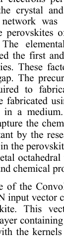

# 2020 商业与工业数据分析国际会议：通向可持续经济之路 (ICDABI) (萨基尔，巴林 2020.10.26-2020.10.27)

## 用于预测钙钛矿太阳能电池光电性的机器学习

**Maniel Wolk**  
电气与计算机工程系  
肯塔基大学  
列克辛顿，肯塔基州  
`mwe265@uky.edu`

**David Chen**  
电气与计算机工程系  
肯塔基大学  
列克辛顿，肯塔基州  
`Zhi.Chen@uky.edu`

**Sarhan M. Musa, Senior Mehreb, IEEE**  
电气与计算机工程系  
Prairie View A&M 大学  
Prairie View, 德克萨斯州  
`smmusa@pvamnu.edu`

**摘要** 钙钛矿技术因其替代化石燃料再生能源的潜力在近年来引起了广泛关注。传统太阳能电池的效率在几年内从 38% 显著提升到 24%。钙钛矿太阳能电池因其制造和生产成本低而吸引了研究界的关注。目前的硅光伏设备比化石燃料昂贵。利用机器学习（ML）通过支持向量回归（SVR）和人工神经网络（ANN）等技术研究并预测钙钛矿电池的光电性能，可以极大改进化学工艺和制造技术。这些工具被用于从国家范围内提高太阳能的影响。在本文中，我们探索了利用机器学习技术开发钙钛矿太阳能电池的现状。此外，我们考虑了其局限性和潜在的研究领域。

**关键词** 机器学习，钙钛矿太阳能电池，人工神经网络，支持向量回归，有机电子

## I. 引言

由于硅光伏技术的挑战，太阳能的广泛利用得到了促进。传统太阳能电池比化石燃料昂贵，这是由于制造和安装这些电池所需的材料成本造成的。创建一种廉价且负担得起的替代能源是必要的。钙钛矿太阳能电池技术具有扩大太阳能广泛使用的潜力。钙钛矿太阳能电池可以使用相对廉价的材料制造，使总成本与其他能源相当。它们可以使用多种工艺制造。使用溶液沉积法，可以通过旋涂、狭缝涂布到卷对卷制造，以及喷涂来轻松地创建钙钛矿 [1]。作为能源生产候选的钙钛矿太阳能电池的主要因素是其属性改变的易易性。识别如带隙、晶格常数等适用因素，

### A. 背景

机器学习将人工智能（AI）的概念应用于数据处理。机器学习是一种算法或一组算法，允许计算机进行自动学习和预测。这种自我改进的方法不需要繁琐的重新编程即可变得更加准确和精确。机器学习通过观察数据和数据中的模式进行学习。通过模式，可以分析趋势以进行预测。有许多学习方法，如支持向量回归、人工神经网络和随机森林。这些学习机制目前正用于高效率钙钛矿太阳能电池的开发、材料科学分析以及钙钛矿晶体中量子力学的建模。

### B. 在钙钛矿研究中的应用

机器学习在太阳能电池研究中有许多有用应用。机器学习目前用于预测尚未在实验室实验过的金属卤化物钙钛矿的电学光学性能 [3]。通过这种发现和缩小用于太阳能电池板应用的钙钛矿范围的技术，对有前景材料投入集中精力将加速该技术的发展。

## II. 机器学习

## III. 机器学习技术

### A. 人工神经网络 (ANN)

神经网络是机器学习中强大的工具。通过使用变量和约束，机器可以根据网络对输入数据的输出来识别趋势、行为并预测属性。[3] 中使用分层卷积神经网络研究了金属卤化物网络的机器学习结构和属性。他们使用神经网络根据分为不同类别的预设参数预测钙钛矿的电学性能。组描述符、元素和基础选择了钙钛矿电池质量中的重要因素。以这些描述符作为输入，训练了神经网络以获得准确的结果。该工作将电池的化学和物理属性与电学和有机属性联系起来以捕捉模式。论文的重点是改变组件。有机电子由于其良好的热稳定性、湿度耐受性在某些复杂的阻抗表面而变得重要 [4]。通过改变钙钛矿的属性，可以预测哪些材料尚未经过测试。从而将研究工作集中在成本效益和高效性上。



### B. 器件物理与机器学习

钙钛矿的内部器件对整个电池的发电有深远影响。[5] 研究了从机器学习中学到的预测和策略，以开发高性能的钙钛矿电池。从器件层面分析了功率转换效率的因素。钙钛矿电荷和电子传输层之间的差异对于器件的功率转换效率至关重要。

在这种方法中，我们保持钙钛矿的情况不变，以理解电池的基本属性。晶格结构、钙钛矿和纳米结构分别决定了电池的额属性，并使预测准确。网络能够正确计算具有有机和无机组件的钙钛矿带隙。元素组由第一、第二电离能和电子亲力的网络组成。这些因素对于晶体的带隙至关重要。所提出的基于小组的模拟。例如，`MAPHI` 可用于钙钛矿溶液 `MA` 和 `PhI` 介质。所提小组重点在于捕捉钙钛矿的化学性质，并被研究团队认为很重要。这些元素在钙钛矿中的配置（如晶格和金属-卤化物-八面体角）对材料属性有深远影响。

卷积神经网络（CNN）方案采用包含钙钛矿特征数量的 `N` 输入向量。该向量首先通过带有 64 个过滤器的 1D 卷积层。通过用每个过滤器的卷积核处理数据进行过滤。输出随后被过滤成包含 128 个过滤器的 2D 结构。每个 2D 过滤器由与特征数量匹配的五行五列组成。这些层中的每一层处理与输入相同的向量。100 个神经元执行逐元素线性激活。网络的输出是该材料的带隙计算值。为了减轻可能的误差和偏差，随机选择 80% 的数据作为输入。图显示了 Saidi 及其研究使用的神经网络布局。

这项工作使用各种机器学习方法将太阳能电池的属性、晶体属性和功率转换效率相关起来。研究人员使用了不同类型的机器学习，并以均方根误差判断哪种方法最准确。误差使用公式 (1) 计算。他们的结果显示人工神经网络在预测钙钛矿时留下的均方误差最小。相关系数通过 (2) 计算。

为人工网络显示出相关性；然而，人工神经网络（ANN）并没有这种相关性。K近邻（NN）和随机森林（RF）算法在数据与预测之间存在相关性。这表明不同的技术各有优劣。我们删除了重复数据，以避免对钙钛矿太阳能电池复杂过程进行冗余分析。这些结果可用于进一步研究与钙钛矿电池能量对齐的问题。能带之间的巨大差异是误差来源，限制了整体光电效率（PCE）。其他技术能够学习性质并设计出预测的新材料。图 2 展示了算法预测结果的准确性。

但还包括了未输入到系统的未知材料。随机森林算法也能准确地预测材料的带隙。

在 Li 的工作中，还实现了随机森林机器学习，用以测试该算法通过分层树中相互连接的模式学习和预测带隙的准确性。这些树从最外层向最内层分支构建。这种树是从底部向上生长的。方法 [6] 也能预测不在数据集中的新材料。由于随机森林算法的局限性，人工神经网络在该应用中表现最好。

这些算法尝试考虑太阳能电池的重要因素，如注入电流、开路电压、功率点和填充因子。ANN 和 RF 的结果相关系数均小于 0.5。结果不准确，且与测量结果显示出较大的偏散。两种模型都没有考虑金属导电性和反传导。这些因素未被纳入模型参数中。这些结果还导致了结果较大的均方误差。这进一步证明了这些设备参数对于优化太阳能电池的性能至关重要。

![图 2：机器学习预测的 PCE 与实际 PCE 的对比 [5]](img/79d6bf50bde61e9fc616b4daf8215295_2_0.png)

这项研究具有许多潜在收益。钙钛矿太阳能电池对于研究人员探索有许多应用。太阳能电池的关键方面如填充因子、光电效率、开路电压、短路电压和最大功率可以精确预测和模拟，而不需要昂贵的设备和迭代制造过程。

### C. 支持向量回归 (SVR)

SVR 是一种将一组数据点泛化为连续多元函数的线性技术。支持向量机处理更多数据点输入 [7]；但稀疏矩阵通过 sigma 管道处理以匹配数据点。算法的训练和测试数据与数据独立且同分布，根据这一假设，多元函数形成了一个需要最小化的损失函数。当该函数被最小化时，被认为是对数据的最佳近似。

```
f(x) = wT \sum_{i=1}^{n} w_i x_i + b
```

该模型通过设计一组新的钙钛矿材料构建，并利用其化学性质和成分预测其带隙。这种预测的带隙是通过合成钙钛矿并比较结果得到的。所使用的钙钛矿为 `CsMAPb₃`、`Cs(MA,FA)₃` 和 `MAPbI₃`，其机器预测的带隙值各不同。带隙结果范围在 1.3-2.2 eV 之间。测得的电池实验结果分别为 1.4 eV (`CsMAPb₃`)、1.8 eV (`Cs(MA,FA)₃`) 和 1.4 - 1.8 eV (`CsMAPbI₃`)。还测试了用于非金属电极的其他钙钛矿，如 `CsSnI` 和 `FASnI`。数据集中 `MAPbSnI` 和 `FASnI` 的预测带隙分别为 1.36 eV 和 1.28 eV。制备样品显示的带隙为 1.37 eV (`MAPb₃`) 和 1.4 eV (`FASnI`)。制备的 `CsSnI` 带隙为 1.15 eV。制备样品带隙为 1.25 eV。这一结果非常显著，因为该钙钛矿不在数据集中。这表明 ANN 不仅能准确预测已知材料的光带，还显示了值通过加权求和来近似最拟合某些值 `b` 偏移数据的函数。

# 2020 年工业数据分析国际会议：迈向可持续经济 (ICABI)

算法使用一系列多项式来根据数据创建最佳函数。多项式的阶数越高，直线对数据的拟合得越好。离群值被边缘标记。损失函数 (4)

```
L(y, f(x)) = 0 if |y - f(x)| ≤ ε else factor, otherwise,
```

```
L(y, f(x)) = (y - f(x))^2 if |y - f(x)| > ε factor (4)
```

利用特定的机器学习技术具有局限性，且算法函数存在固有的缺陷。在研究学习方案中钙钛矿任何参数变化的影响时，必须满足其他约束条件 [3]。这忽略了钙钛矿在微观和宏观尺度上的复杂关系。

## V. 结论

机器学习（ML）算法为探索数据中的当前趋势和模式提供了强大的手段。人类通过计算无法处理的大型数据集可以在超乎想象的时间范围内进行收集和分析。通过这一强大的工具，可以对钙钛矿的物理和材料属性进行评估。纳米技术这一创新领域可能会增加我们对许多科学领域的兴趣。尚未通过机器学习进一步探索的钙钛矿提供了进一步发展的空间。随着制造和生产技术的进一步研究，可以创造该技术，以促进再生能源和环保能源生产的普及。

## 参考文献

- [1] F. Huang, M. Li, P. Siflovic, G. Cao, and J. Tian, "从钙钛矿膜的可扩展溶液制造到太阳能电池商品化," *Energy & Environmental Science*, vol. 12, no. 2, pp. 518-549, 2021.
- [2] Q. Xu, Z. Li, M. Li, and W-J. Yan, "机器学习和设计的钙钛矿数据合理化," *The Journal of Physical Chemistry Letters*, vol. 29, no. 24, pp. 6948-6954, 2018.
- [3] W. A. Saudi, W. Shaddad, and I. E. Castelli, "使用分层卷积神经网络对钙钛矿进行机器学习结构和电气分析," *Computational Materials*, vol. 6, no. 1, 2020.
- [4] H. Belia, R. Youssef, and M. Fatima, "使用 MATLAB 对光伏模块进行详细建模," *MNRAS Journal of Astronomy and Geophysics*, vol. 33, no. 1, pp. 53-61, 2014.
- [5] J. Li, B. Pradhan, S. Gauss, and J. Thomas, "学习的钙钛矿太阳电池预测和策略以开发高效：钙钛矿太阳电池 (Adv. Energy Mater. 46,2019)," *Advanced Energy Materials*, vol. 9, no. 46, p. 1906170.
- [6] Q. Xu, Z. Li, M. Li, and W-J. Yan, "机器学习和设计的钙钛矿数据合理化," *The Journal of Physical Chemistry Letters*, vol. 29, no. 24, pp. 6948-6954, 2018.
- [7] M. Awad and R. Kim, "对钙钛矿效率的支持," *Efficient Machine Learning*, pp. 66-80, 2015.
- [8] S. Li, Q. Zhou, Y. Ouyang, Y. Guo, and J. Wang, "通过机器学习加速发现有机-无机钙钛矿," *Nature Communications*, vol. 9, no. 1, 2018.
- [9] M. Saliba, J.-P-Correa, C. Wolff, M. Stoltterhof, N. S. Al-Ashrafi, "含钙的三元钙钛矿太阳电池：在常规 (n-i) 和黑色 (n-i 相) 中的高效钙钛矿太阳电池," *Chemistry of Materials*, vol. 30, no. 13, pp. 4193-4201, 2020.
- [10] M. Saliba, T. Matsui, I.-J. Seo, K. Domanski, J.-P Correa-Baena, M. Kazazrettini, M. Zakereddin, W. Tress, A. Abfate, H. Hagfeld, and M. Grätzel, "含钙的三元钙钛矿太阳电池：提高稳定性和效率," *Energy & Environmental Science*, vol. 9, no. 6, pp. 1989-1997, 2016.
- [11] M. Saliba, T. Matsui, K. Domanski, J.-J. Seo, A. Imadafe, M. Zakereddin, W. Tress, A. Abfate, H. Hagfeld, and M. Grätzel, "在钙钛矿太阳电池中引入铷离子提高光伏性能," *Science*, vol. 354, no. 6309, 2016.
- [12] C. Chen, S. Zhang, W. Wu, W. Zhang, H. Zhu, X. Xiong, Y. Zhang, and W. Chen, "BCP 缓冲层对消除电荷积累以提高钙钛矿太阳电池性能的影响," *RSC Advances*, vol. 7, no. 57, pp. 35819-35826, 2017.
