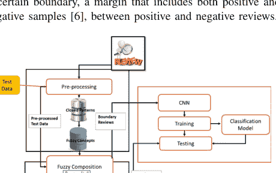

# 2020年国际数据挖掘研讨会 (ICDMW) || 模糊与深度集成

## 三分类中模糊逻辑与深度学习的集成

D.L.C.S. Subhashmi¹,,2,3,4, Yuefeng Li¹,,5, Jinglan Zhang¹6, Ajantha S. Atukorale²,,7

¹澳大利亚科技大学

²斯里兰卡科伦坡大学

³斯里兰卡斯里杰雅德登普拉大学

⁴subhashmi@sp.ac.edu.au

⁵yi.li@qt.edu.au

⁶jinglan.zhang@qt.edu.au

⁷ajasa@ucsc.cmb.lk

**摘要—**不确定性是意见挖掘中一个极具挑战性的问题。现有的使用机器学习算法的模型由于边界不确定，无法识别在线客户评论中的不确定性。许多研究人员已经开发了模糊模型来解决这个问题。然而，不定的程度仍然是不确定的。正面和负面意见之间存在巨大的不确定性。经常使用的词汇可能是不相关的。本文提出了一个集成模糊概念和深度学习的三分类框架。利用电影评论和客户数据集进行了多次实验。实验结果表明，所提方法对于识别意见是有效的，并能够在两个基准数据集上显示出高 F 测量。

**索引术—**意见挖掘，模糊逻辑，三分类，分类，深度学习

## I. 引言

使用机器学习算法分析客户评论的决策过程已成为一项挑战 [1]。今天，互联网上存在大量的意见和评论。然而，在线客户在做出决策之前，发现 *很难* 基于可靠或不可靠的客户评论来做出决策。在线评论的质量参差不齐。同时，组织利用文本挖掘技术从客户评论中产生有用信息。这一概念被称为情感分析或意见挖掘 [2]。近年来，人们为意见挖掘提出了许多模型 [3], [4]。然而，由于今天使用的广泛评论中存在不确定性和缺乏共识，这些模型在某些情况下可能会产生意外之外的结果 [5]。因此，处理不确定性的能力在意见分类模型中至关重要。

不确定性概念指的是不明确和不定的意见。处理不确定性的能力在意见分类模型中非常重要 [5]。当涉及到意见分类模型时，由于用户行为，管理这些不确定性的机制是一项挑战性任务 [6]。不确定的意见为这些技术自动处理以增强机器学习算法的性能带来了挑战。例如，一个客户对相机的决议是“音质问题没有解决”。这些频繁出现的特征可能是正面或负面意见。然而，机器学习算法不知道如何妥善地使用它们；确定相关的类别非常困难。在这种情况下，在存在不确定性的情况下确定类别是很困难。例如，如果评论是“ok”或“fine”，那么这条评论相对于“fine”来说是“不远的”。此外，不确定性是意见挖掘中的一个棘手问题，因为许多频繁词被用作是不相关的。因此，当我们使用模式或将某些特征连接起来以显示不确定性意见的可能解决方案时，可以使用其他方法，并定义一种特定方法来做出正确的决策。

模糊逻辑用于解决意见挖掘中的不确定性问题 [5], [7], [8]。它用 0 到 1 之间的模糊值表示模糊的不确定性。图 2 显示了如何使用模糊逻辑来减少噪声特征的影响。在图中，意见“fine”和“ok”经常被用作正面和负面类别。这些是噪声特征。它们也有很大的权重，对于理解正面和负面类别之间的差异没有用。通过使用模糊组合，我们可以利用大范围的噪声特征来“识别”它们是否大于1。模糊组合的优点是减少噪声特征的影响，例如图 1 和图 2 中的 OK 和 fine。模糊组合可以通过调整它们的值（例如将频率调整为 1）来减少它们的影响。

在许多实验结果之后，我们发现当两个类别的模糊值非常接近时，模糊逻辑在二分类方面存在性问题。为了解决这个研究问题，本文提出了一个识别边界的三分类框架。首先，我们将评论分为三个区域：正面、负面和不确定。然后我们将不确定的边界分为正面和负面。这种三分类框架提供了一种集成模糊逻辑和深度学习的优雅方法。许多带有深度学习的方法使用了[各种技术]。

为了解决这个研究问题，本文提出了一个识别边界的三分类框架。首先，我们将评论分为三个区域：正面、负面和不确定。然后我们将不确定的边界分为正面和负面。这种三分类框架提供了一种集成模糊逻辑和深度学习的优雅方法。

## II. 相关工作

### A. 意见挖掘

意见挖掘（也称为情感分析）是指使用自然语言处理和文本分析系统地识别、提取、量化和分析主观特征和主观意见。意见广泛用于收集客户评论和社交媒体。意见挖掘包含意见的目标（实体）、针对的目标属性以及意见的情感（极性）[11], [12]。

### B. 特征选择

在特征选择中，有如 `TF-IDF`、`bm25`、均匀性（Uniformity）和倒系频率（IC）等术方法。频率是一种排序函数，用于根据给定查询对匹配文档进行排名。Li 和 Tasa 在具有均匀性 (Uni) 和倒系频率的模型中使用了 `TF-IDF` 进行特征选择 [5]。

等 1 和等 2 分别是 Uni 和 IC 的方程。

```
$Uni(t) = \max_{ij} \begin{bmatrix} d_{ij} \ \sum_{j=1}^k d_{ij} \end{bmatrix}, k=2 \quad (1)$
```

其中 $t_i$ 是一个词，$d_{ij}$ 是 $t_i$ 出现在类别 $j$ 中的文档数量，$t_{ij}$ 表示次数。

其中 $i$ 出现在类别 $j$ 中。当公式1中的值较大时，意味着在特定类别中具有更高的确定性，Li 和 Tsai 使用 `Uni > 0.2` 作为数值选择的阈值 [5]。

```
$ICF(t_i) = \sum_{j=1}^{n} p_{ij} \log p_{ij} = \frac{d_{ij}}{d_j} $$ (2)
```

其中 $t_i$ 出现，$j$ 表示索引，$d_{ij}$ 是类别 $j$ 中包含词项 $t_i$ 的文档数量；$d_j$ 是类别 $j$ 中的评论数量。公式2中的 ICF 表示某些词在特定类别中出现的频率较高，而不是其他词。ICF 值越小，表示它在特定类别中出现的频率越低。Li 和 Tsai 使用 `ICF < [5]` 的半监督学习进行社交数据分析。在处理阶段，根据单词在极性语料库中的所有出现情况及其在负极性语料库中的跨向量，为每个词构建了一个上下文特征向量 [27], [28]。开发了一个基于 `LSTM`、`CNN` 和 `GRU` 的三个深度学习模型以及一个基于 `SVM` 的经典特征监督模型的情感和情绪强度预测集成框架 [29]。`卷积神经网络 (CNN)` 用于文本网络模型提取高显著性特征 [30]。`长短期记忆网络 (LSTM)` 采用双向变体对情感进行情感分类 [36]。`递归神经网络 (RRN)` 用于对句子的维度进行建模 [37]。`分层卷积注意力网络 (HCAN)` 用于文本分类 [38]。最近实现了一种新方法，将产品和用户信息纳入情感分类中 [39]。一种基于分析的情感分析方法编码词项的表示，并利用深度学习在考虑文本词汇、语法和语义知识的同时，通过消除噪声来应对挑战 [41], [42]。

### C. 知识发现

发现的知识可以用不同的形式呈现，例如词项、模式、短语、概念、规则或本体。其中某些知识与其他其他的结合以提高准确性。

对于基于知识发现的方法，使用了许多高水平的方法 [13]。模式挖掘可以发现客户评论中频繁共同出现的序列，以及哪些词项集可以有效地表示所发现的知识。频繁模式和闭合模式在数据集中被频繁采用和重用 [13]。选择相关的评论对于在不丢失任何项目的情况下生成特征至关重要 [15]。为了提高模式识别的效率，使用了多种技术：频繁模式挖掘 [16]、闭合模式挖掘 [17]、顶级闭合模式挖掘 [18]。闭合模式用于处理大量的频繁模式。闭合模式也是频繁模式，但其内容并不完全相同。因此，寻找闭合模式的计算时间可以减少，并且减少频繁模式的数量。

模糊逻辑可以从文本数据中提取知识，其中数据通常存在不确定性。模糊形式概念分析 (FFCA) [7] 是结合模糊逻辑和形式概念分析 (FCA) 以表示数据中不确定性的方法。一种基于格理论的技术 [20]。形式概念用于定义领域中对象和属性之间的关系。

### D. 分类

分类可以是监督学习、无监督学习或半监督学习 [21]。半监督学习处于无监督学习（无标记数据）和监督学习（仅有标记数据）之间。因此，无监督学习的成本非常高，特别是在处理大量数据时。半监督是报告工作的重要部分。

## III. 提出的模型

由于用户评论中存在所有不确定性，存在一个不确定性边界，它包含了正样本和负样本 [6]



图 3. 三分类框架

因此，二分类器很难处理传统方法。提出了一种三分类框架来解决二分类分类中的不确定性问题 [6]，如图 3 所示。

### A. 基于模糊的概念发现和三分类

它引入了转换：“从二到三”（定义区域：正、负和不确定性边界），然后通过“三到二”分类，使用向量模型找到并分类边界，将不确定性边界划分为正区域和负区域。这种用于意见挖掘的模糊框架的问题是不确定性边界非常大，因为向量模型不适用于表示如此短的评论。在本文中，我们扩展了用于意见挖掘的三分类框架。我们提出了一种基于模糊的方法来推断正、负和不确定性边界。我们将模糊模型与深度学习集成，以准确地将边界分类为正区域和负区域。当用于处理不确定评论时，基于词项的特征选择面临多义性 [46]。目前解决文本问题的一种流行方法是扩展到低级上下文。在后续章节中，我们定义了评论中的形式概念，并提供了一种对方面和所选词项特征加权重的方法。至少，我们使用了模糊复合来实现。

1. 形式概念。令 $R$ 为一组评论（训练集），$T$ 为一组属性（或词项），$I \subseteq R \times T$ 是 $R$ 和 $T$ 之间的二元关系（$r \in R, t \in T$）。形式概念为 $K = (R, I)$。对于子概念 $X$ 和词项 $Y \subseteq T$，推导操作定义如下：

```
$X' = \{t \in T \mid \forall r \in X, (r, t) \in I\}$
$Y' = \{r \in R \mid \forall t \in Y, (r, t) \in I\}$
```

一个子概念 $X$ 和一个词项 $Y \subseteq T$，如果 $Y = X'$ 且 $X = Y'$，则 $(X, Y)$ 是一个形式概念。形式概念的包含关系如下：

```
$(A_1, B_1) \subseteq (A_2, B_2) \iff A_1 \subseteq A_2 \iff B_1 \supseteq B_2$
```

闭合模式是 $A = closure(A)$。一个闭合模式也是频繁模式，但其内容并不完全相同。因此，寻找闭合模式的计算时间可以减少，并且减少频繁模式的数量。

（注：由于原文文本在某些处存在断句或重复，如 "variant to variant", "poly" 以及句子断裂，翻译时已根据上下文进行了逻辑性处理。）

在类别 $j$ 中，$i$ 的评论数以及 $c$ 是归一化方法的自由参数，其取值为 `c=0.25`。

下一个任务是定义一个阈值以减少噪声标记的数量。特征选择方法的意义在于识别出用于模式挖掘的相关特征，并定义生成克隆模式的评论大小。

克隆模式是通过在 `FPTree` 中使用频繁项目挖掘并定义最小支持度 [5] 生成的。

识别出的模式很少是相同的术语。因此，有效处理大量发现的模式是一个挑战。我们在实验中引入了最小支持度值大于 20 的克隆模式挖掘。该方法用于控制所发现模式的大小。发现的模式被聚类为模式，并使用合适的支持度作为阈值来确定最终的概念。

术语-类别关系（$I_{T-Cat}$）可以通过术语-评论关系（$I_{T-R}$）和评论-类别关系（$I_{R-Cat}$）的模糊复合获得，如公式 (6) 所示。本文中，我们分别使用 `nbm25(t_j)` 来表示术语与类别之间的相关强度。（参见公式 (7)，$I_{T-Cat}(k,j)$ 可以使用针对给定类别 $j$ 的值通过 `nbm25` 计算）。

```
$I_{T-Cat}=I_{T-R} \circ I_{R-Cat}$
```

```
$if nbm25(t_k) < 1$
otherwise
(7)
```

算法 1 展示了将用户分类为三个区域的逻辑：正区域（POS）、负区域（NEG）和不确定边界区域（UND）。

| 算法 1 二分类 |
| :--- |
| 需要：$I_{T-Cat}$, $I_{T-R}$, $I_{R-Cat}$，两个类别：$j=1$ 和 $j=0$ 以及一个高效阈值 $\epsilon$ |
| 确保：类别和三个区域：POS, NEG, UND |
| 1: 对于每个 $j$ |
| 2: 对于每个 $c \in C$ |
| 3: $I_{T-Cat}(k,j) =$ |
| 4: $max[min(I_{T-R}(t,k), I_{R-Cat}(k,j))$ |
| 5: | |
| 6: end |
| 7: 对于每个 $r \in U$ |
| 8: $C_r = \{c \in C_{int} \mid c \leq r\}$ |
| 9: 对于每个 $j$ |
| 10: $f(j) = max_{c \in C_r} I_{T-Cat}(c,j)$ |
| 11: end |
| 12: end |
| 13: 对于每个 $r \in U$ |
| 14: POS: $r \in R, f_1(r) - f_0(r) > \epsilon$ |
| 15: NEG: $r \in R, f_1(r) - f_0(r) \leq -\epsilon$ |
| 16: UND: $r \in R, |f_1(r) - f_0(r)| \leq \epsilon$ |
| 17: end |

| 表 II |
| :--- |
| 形式概念 |
| 概念 | 意图 | 原始 | 模式 |
| :--- | :--- | :--- | :--- |
| c1 | funny, pretty | p1 | p1 |
| c2 | funny, good | p2 | p2 |

3) 基于模糊的三种决策：根据上述分析，我们可以为给定的评论集 $R$ 找到一组概念，其中 $R$ 是一组正向评论或一组负向评论，我们有：

$C = \{c \mid cover(r) | p \in C, sup(p,r) \geq 0\}$

其中 $\theta$ 是术语的数量。$Sets(p)$（$p$ 中使用的术语大小）是 $c$ 的意图，$cover(r)$ 是 $c$ 的概念。

在该解决方案中，我们讨论了概念与类别之间的关系（例如，使用模糊复合进行分类的正类和负类 [5]），以便将其分为三个区域：正、负和不确定边界区域。

概念与类别之间的关系表示为 $I_{T-Cat}$，可以通过对公式 4 描述的概念与类别之间的关系（$I_{T-R}$）使用模糊复合来评估。

```
$I_{T-Cat} = I_{T-R} \circ I_{R-Cat}$
```

其中 $I_{T-R}$ 用于描述术语的不确定因子。本文中，我们使用归一化的 `nbm25(t_j)` 作为概念 $i$ 中术语 $k$ 的不确定因子（见公式 5）。

```
$I_{T-R}[i,k] = nbm25(t_k)$
```

它使用模糊复合处理第一遍（for 循环）计算 $I_{T-Cat}$（概念-类别映射）。然后它为每个类别 $j$ 的每个新评论计算一个值（见第二个循环）。最后，它根据给定集合 $U$ 的这些模糊值确定三个区域（POS、NEG 和 UND）。第一个循环的时间复杂度为 $O(|C| \times |T|)$，因为我们有两个类别。第二个循环的复杂度为 $O(|C| \times |T|)$，因为我们使用了模糊值。

基于模糊的二分类

需要：$I_{T-Cat}$, $I_{T-R}$, $I_{R-Cat}$，两个类别：$j=1$ 和 $j=0$ 以及一个高效阈值 $\epsilon$

确保：类别和三个区域：POS, NEG, UND

1: 对于每个 $j$

2: 对于每个 $c \in C$

3: $I_{T-Cat}(k,j) =$

4: $max[min(I_{T-R}(t,k), I_{R-Cat}(k,j))$

5: | |

6: end |

7: 对于每个 $r \in U$

8: $C_r = \{c \in C_{int} \mid c \leq r\}$

9: 对于每个 $j$

10: $f(j) = max_{c \in C_r} I_{T-Cat}(c,j)$ |

11: end |

12: end |

13: 对于每个 $r \in U$

14: POS: $r \in R, f_1(r) - f_0(r) > \epsilon$ |

15: NEG: $r \in R, f_1(r) - f_0(r) \leq -\epsilon$ |

16: UND: $r \in R, |f_1(r) - f_0(r)| \leq \epsilon$ |

17: end |

| 表 II |
| :--- |
| 形式概念 |
| 概念 | 意图 | 原始 | 模式 |
| :--- | :--- | :--- | :--- |
| c1 | funny, pretty | p1 | p1 |
| c2 | funny, good | p2 | p2 |

) 基于模糊的三种决策：根据上述分析，我们可以为给定的评论集 $R$ 找到一组概念，其中 $R$ 是一组正向评论或一组负向评论，我们有：

$C = \{c \mid cover(r) | p \in C, sup(p,r) \geq 0\}$

其中 $\theta$ 是术语的数量。$Sets(p)$（$p$ 中使用的术语大小）是 $c$ 的意图，$cover(r)$ 是 $c$ 的概念。

在该解决方案中，我们讨论了概念与类别之间的关系（例如，使用模糊复合进行分类的正类和负类 [5]），以便将其分为三个区域：正、负和不确定边界区域。

概念与类别之间的关系表示为 $I_{T-Cat}$，可以通过对公式 4 描述的概念与类别之间的关系（$I_{T-R}$）使用模糊复合来评估。

```
$I_{T-Cat} = I_{T-R} \circ I_{R-Cat}$
```


其中 $I_{T-R}$ 用于描述术语的不确定因子。本文中，我们使用归一化的 `nbm25(t_j)` 作为概念 $i$ 中术语 $k$ 的不确定因子（见公式 5）。

```
$I_{T-R}[i,k] = nbm25(t_k)$
```

它使用模糊复合处理第一遍（`for` 循环）计算 $I_{T-Cat}$（概念-类别映射）。然后它为每个类别 $j$ 的每个新评论计算一个值（见第二个循环）。最后，它根据给定集合 $U$ 的这些模糊值确定三个区域（POS、NEG 和 UND）。第一个循环的时间复杂度为 $O(|C| \times |T|)$，因为我们有两个类别。第二个循环的复杂度为 $O(|C| \times |T|)$，因为我们使用了模糊值。

结果。在电影数据集上显示了 76.74% 的准确率。

- 注意力网络 [56] 通过集成三种机制（例如，情感词汇、负面词、意图）通过深度神经网络来缓解该问题。

### C. 结果

为了评估所提模型的效果，我们在表 V 和 VI 中将其与现有分类方法进行了比较。结果表明，与 FFCM [55]、CNN [31]、SVM [54]、SCN [61] 以及注意力网络 [56] 相比，表 VI 中我们未包含 CNN [31] 和 SCN [61]，因为这些模型未在电子书数据集上评估。表 VI 和表 VII 的结果显示所提模型优于基准模型，且大于 0.5。

它在 F 值方面显著提升了二分类的性能。结果表明所提的三路框架实现了高准确率的二分类。

所提框架的贡献如下：

- 提出了一种创新的特征选择方法（`bmx2`、`ICF` 和 `Uni` 方法），用于检索模糊概念。
- 引入了一种有效的分类器，使用模糊概念将其分为三个区域：正面、负面和中性。

未来的一个方向是探索语义数据对相同架构的影响。语义结构可能有助于模糊概念的额外表示，并调查模糊概念中语义模式的影响。

## 感谢

本研究得到了澳大利亚技术大学 (UGC)、斯里兰卡大学委员会 (UC) 以及斯里兰卡计算大学 (USC) 的支持。

## 参考文献

## 表 V

电影评论 F 值测量

| 模型 | 精率 | 召回率 | F 值 |
|---|---|---|---|
| 所提模型 | 0.9404 | 0.9509 | 0.9456 |
| FFCM | 0.8790 | 0.8630 | 0.8715 |
| CNN | 未给出 | 未给出 | 0.8150 |
| SVM | 0.8370 | 0.8369 | 0.8369 |
| SCN | 未提及 | 未提及 | 0.8213 |
| 注意力 | 未提及 | 未提及 | 0.8450 |

## 表 VI

电子书评论 F 值测量

| 模型 | 精率 | 召回率 | F 值 |
|---|---|---|---|
| 所提模型 | 0.9710 | 0.9777 | 0.9744 |
| FFCM | 0.9598 | 0.9569 | 0.9583 |
| SVM | 0.9382 | 0.9381 | 0.9382 |

## 表 VII

双评论精率测量

| 模型 | 电影精率 | 电子书精率 |
|---|---|---|
| 所提模型 | 0.0025 | 0.0013 |
| FFCM | 0.0176 | 0.0137 |
| SVM | 0.0119 | 0.0123 |
| SCN | - | 0.0087 |
| 注意力 | - | 0.005 |

## V. 结论

本研究提出了一种集成模糊概念和深度学习的二分类三路框架。该框架解决了分类中的不确定性问题。该框架为通过识别边界区域构建意见分类器提供了一种很有前景的方法。该方法使用统计特征进行意见-

[C-H. Cho, J. Jaidar, I. Aziz, M. H. Hasan, and W. Yeh, "Algorithms for frequent item mining: a review," Artificial Intelligence Review, vol. 52, no. 4, pp. 2603–2621, 2019].

[R. J. Bayou, "Frequently finding missing patterns from databases," ACM Transactions on Data Mining, vol. 7, no. 2, pp. 1–22, 2003].

[N. Pasaquier, Y. Bastide, R. Tan, and L. Lakhal, "Disclosing frequent items for association rules," Proceedings of the International Conference on Data Mining, pp. 199–206, 2009.

[J. H. Wang, Y. Lu, and P. Petkov, "Mining top-k frequent items without minimum support," in 2003 IEEE 2nd Int. Conf. on Data Mining (ICDD), pp. 212–218, 2003.

[I. J. Ladeh, "Fuzzy sets, Fuzzy Logic, Fuzzy Sets," Computer Systems with Led Fuzzy Systems., 1996.

[T. Quan, S. Hu, and T. Cao, "Fuzzy-based approach clustering for anomaly detection," in Cybernetics and Intelligent Systems, 2014, vol. 28, pp. 145–154.

[Z. Miao, Y. Li, X. Wang, and C. Wan, "Snanip: Super frequent item mining with aggregated data," in Proceedings of the IEEE International Conference on Computer Vision (ICCV), 2021.

[I. P. Masuda, G. Goni, R. Rossi, M. Marcoci, and S. Rezeni, "An evolutionary approach for frequent pattern mining in bipartite heterogeneous networks," Journal of Information and Data Management, vol. 7, no. 1, pp. 14–27, 2011.

[B. J. Lee, Y. K. J. Liu, "Semi-supervised frequent item mining with knowledge mining," in Proceedings of the 2022 IEEE International Conference on Computer and Communications Processing, 2022.

[Y. Lu and C. Chai, "Opinion mining through semi-supervised multiple item mining," in Proceedings of the 2018 IEEE International Conference on World Wide Web, 2018, pp. 121–130.

[F. H. Khan, Q. Umar, and S. Bakht, "A semi-supervised approach to sentiment mining using reinforcement based sentiment analysis," Knowledge and Information Systems, vol. 115.

[H. Zhou, Y. Yu, and Y. Lu, "Attention-based classification for aspect mining," in Proceedings of the 2013 International Conference on Natural Language Processing, 2013, pp. 1631–1642.

[Z. Yang, Y. Chang, and E. Hovy, "Attention networks for document classification," in Proceedings of the North American Association for Computational Linguistics, 2016, pp. 1480–1486.
