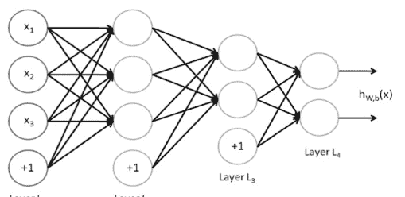
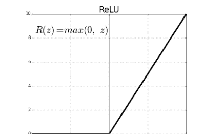
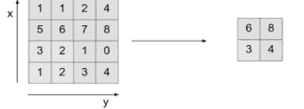
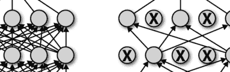
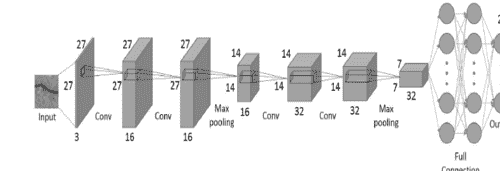
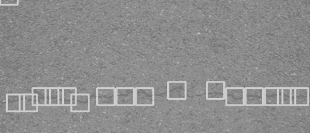
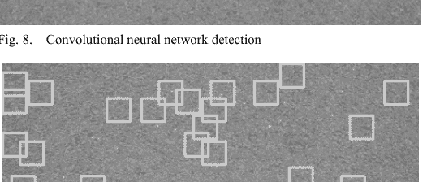

# 2020 通信与技术工程管理国际会议 (EMCTECH)(奥地利维也纳 2020.10.20-2020.10.22) 2020 通信与技术工程管理国际会议


**摘要—** 本工作致力于研究路面裂缝算法，并开发了一种基于计算机视觉和神经网络的自动缺陷检测系统。文章对缺陷进行了分类，并对形成它们的可能原因进行了分类。对该领域相关研究表明，卷积神经网络和前馈网络这些解决方案被用作裂缝分类的第一步。

*关键词—* 神经网络，裂缝检测，深度学习，裂缝分类，道路检测，卷积网络

道路系统作为基础设施的重要组成部分，发挥着至关重要的经济作用。建设新道路的成本极其昂贵，优化路面损坏阶段要效率高得多。因此，维护的目标是防止实际发生坍塌。此外，道路状况影响人身安全。如今俄罗斯面临着路面质量问题。由于路面质量较差，每年都有人死亡。根据俄罗斯联邦2017年上半年的国家报告，由于道路网络状况和布置不当，发生了60330起交通事故，其中6992人死亡，8056人受伤。道路质量影响使用周期，在过了这段时期后就会变得无法承受。覆盖状况、维修时间、车道特定区域的处理——这一切都很重要，正如俄罗斯国家统计局的数据，俄罗斯道路总长度达到166万公里，其中116万公里可行驶。2017年，俄罗斯投入使用了230公公里新建和重建的道路。根据2017年的结果，符合法规要求的联邦公路占比达到77.8%。

根据单车道道路（第一类）的维护应用标准，每年的成本为8006卢布/公里，维修费用为470万卢布/公里，然而有1200万公里道路处于严重损坏状态，这些道路中70%需要更多工作，超过50%的道路需要加固路面，并确保轮子与道路之间必要的粘附系数。

为了解决这个问题，建立了许多现代道路实验室。实验室的任务是使用高分辨率设备、三维扫描仪、陀螺仪集成定位系统和其他传感器评估道路状况。实验室捕捉图像后，检查由操作员手动进行。专家在手动模式下选择对象，例如标记长度、路边缘、路面裂缝和其他特征。结果表明，这是一个耗时的过程，该过程的自动化具有很高的现实意义。需要注意的是，由于人为因素，许多缺陷被忽略。

## II. 裂缝类型分类

裂缝有几种类型，但主要分为三类：横向裂缝、纵向裂缝和网状裂缝 [1]。路面每年以一种方式进行维修。检测裂缝并对其进行分类非常重要。横向裂缝垂直于路面中心线。它们通常由温度变化引起。其他原因是由于路基纵向力。网状裂缝由于路面疲劳形成，是沥青路面疲劳和不稳定性共同的结果。

裂缝宽度是评估路面的重要标准，大多数国家和联邦机构都使用这一指标。宽度允许您评估裂缝的类型和严重程度。表I展示了三种类型的裂缝及其特征。宽度和长度在评估裂缝时至关重要。无论是覆盖状况、维修时间还是车道特定区域的处理——这一切都很重要，正如俄罗斯国家统计局的数据，俄罗斯道路总长度达到166万公里，其中116万公里可行驶。2017年，俄罗斯投入使用了230公里新建和重建的道路。根据2017年的结果，符合法规要求的联邦公路占比达到77.8%。

根据单车道道路（第一类）的维护应用标准，每年的成本为8006卢布/公里，维修费用为470万卢布/公里，然而有1200万公里道路处于严重损坏状态，这些道路中70%需要更多工作，超过50%的道路需要加固路面，并确保轮子与道路之间必要的粘附系数。

为了解决这个问题，建立了许多现代道路实验室。实验室的任务是使用高分辨率设备、三维扫描仪、陀螺仪集成定位系统和其他传感器评估道路状况。实验室捕捉图像后，检查由操作员手动进行。专家在手动模式下选择对象，例如标记长度、路边缘、路面裂缝和其他特征。结果表明，这是一个耗时的过程，该过程的自动化具有很高的现实意义。需要注意的是，由于人为因素，许多缺陷被忽略。

裂缝有几种类型，但主要分为三类：横向裂缝、纵向裂缝和网状裂缝 [1]。路面每年以一种方式进行维修。检测裂缝并对其进行分类非常重要。横向裂缝垂直于路面中心线。它们通常由温度变化引起。其他原因是由于路基纵向力。网状裂缝由于路面疲劳形成，是沥青路面疲劳和不稳定性共同的结果。

裂缝宽度是评估路面的重要标准，大多数国家和联邦机构都使用这一指标。宽度允许您评估裂缝的类型和严重程度。表I展示了三种类型的裂缝及其特征。宽度和长度在评估裂缝时至关重要。

表 I 裂缝严重程度分类

| 裂缝类型 | 宽度 (m) | 长度 (m) |
| --- | --- | --- |
| 弱 | < 6 | 35 |
| 中 | < 6 | > 35 |
| 重 | 6-19 | 35 |
| | > 19 | < 15 |
| | > 15 | - |

纵向裂缝代表沿轴线方向的路面材料延伸断裂。裂缝破坏的分类如表II所示。宽度和长度在评估裂缝时至关重要。

表 II 路面破坏分类

| 裂缝类型 | 宽度 (m) | 长度 (m) |
| --- | --- | --- |
| 弱 | < 6 | 35 |
| 中 | < 6 | > 35 |
| 重 | 6-19 | 35 |
| | > 19 | < 15 |
| | > 15 | - |

斜向交叉裂缝（网状裂缝）是相对于轴线成角的路面连续破坏。

## III. 非结构化缺陷检测方法

需要使用自动系统来识别裂缝类型，并评估其严重程度内容。每种裂缝在形状、尺寸和方向上都可能不同。此外，路面的不同特征会导致背景发生显著变化。随机背景以及物体使得识别过程极其困难。因此，路面缺陷的识别需要计算机视觉和机器学习的发展。

另一种裂缝检测是寻找最小路径，即图中节点之间的路径。还提出了基于最小路径原理的方法，可以在不丢失拓扑结构的情况下找到最优解 [9]。通过选择裂缝端点并在全局范围内进行检测 [14]。这些方法利用裂缝的独特特征，因为它们在实际应用中计算效率很高。


## IV. 自动特征检测系统的理论方面

卷积神经网络的核心组件是卷积。卷积是在两个实数参数上的，生成第三个函数。卷积为图像的每一层开启过滤器。此外，卷积层具有一个卷积核。卷积核是一个 $N \times N$ 矩阵。以下是卷积操作公式：

```
$x_{ij}^l = \sum_{m=0}^{\infty} \sum_{n=0}^{\infty} w_{mn}^l \cdot y_{i-m,j-n}^{l-1} + b_{ij}^l$
```

```
$i \in (0, \dots, N), j \in (0, \dots, M)$
```

这里下标 $i, j, b$ 是矩阵中元素的索引，$l$ 是步长（stride）的值。上标 1 和 -1 是网络层的索引。

$x^l$ - 某个上函数的输出，或网络的输入；$y^l$ - 经过激活函数处理后的 $x^l$（例如 ReLU 或 sigmoid）；关于激活函数的内容将稍后介绍；

$w^l$ - 卷积核；$b^l$ - 偏置；$x^l$ - 卷积操作的结果。

也就是说，操作是对维度为 $(N, M)$ 的矩阵 $x$ 的每个元素 $i, j$ 分别进行的。卷积层具有少量参数，这些参数在训练神经网络时配置。对于一个具有 3 通道的 100x100 图像，对于 6 个通道中的每个通道使用 3x3 的卷积核，将会有 $9 * 3 * 6 = 162$ 个训练参数。

输入的划分突出重要特征。平移不变性意味着如果输入很小，大多数池化输出的值不会改变。这一重要特性对于确保事实的存在及其位置是必须的。

在卷积网络之后，全连接层作为下一层的连接。通常，全连接网络是多层感知器。在大多数情况下，在这种网络中，每个神经元都连接到下一层的所有神经元。如图2所示。



图 2. 前馈网络

对于此类网络，激活函数的计算如下所示。

```
$net_i = \sum_{i=0}^{n} w_i x_i\ny_i = f(net_i)$
```

在深度和卷积网络中，激活函数至关重要。如果模型的行为接近线性，则更容易训练。在隐藏层和卷积层使用的此类激活函数是 ReLU（修正线性单元）。



图 3. ReLU 激活函数



图 1. 池化操作

池化层是特征图的非线性变形，一组像素被压缩成一个像素，并发生非线性变换。池化创建了不相交的区域，每个区域被压缩成一个像素，然后选择最大值的像素。池化层通常放置在卷积层之后、下一个卷积层之前。池化使得相对较小的表示具有不变性成为可能。

ReLU 在除 $x=0$ 外的所有点上都是可微的。ReLU 的特征是：易于优化，因为它非常类似于线性函数。线性单元与修正单元之间的唯一区别是，修正单元在某些区域产生零。

梯度并不很大，但它是永久的。除 $x=0$ 以外的所有点，ReLU 都是可微的。在激活的情况下，二阶导数几乎处处为 0。修正单元的缺点之一是它们无法利用激活为零的示例进行训练。修正单元的另一种泛化是漏性线性单元（Leaky ReLU），允许它们在激活为零的情况下使用。有使用 $max(0,x)$ 的修正单元，在某些情况下是有用的。Max 是另一种泛化，其中向量 $x$ 被分为几个值，并从中选择最大值。

激活的收缩，丢弃的神经元的梯度也变为零。



图 4. Dropout $F(x) = \max(x)$

这种类型的网络具有优点，它减少了训练所需的参数数量，带来了灵活性。带符号的过滤器可以在不丢失信息的情况下泛化，这是在训练过程中。

在梯度下降的每一步中随机选择丢弃的神经元。基本原理是网络将被强制避免“协同适应”。简而言之，我们将解释什么是协同适应以及它如何在深度网络中产生。深度网络有很多神经元。然后网络中的其他神经元将快速依赖于特定的神经元。这使得网络对该神经元学习的函数不敏感，而不是通用规则。

另一个重要函数是 softmax。

```
$out = \frac{e^{net_i}}{\sum e^{net_j}}$
```

softmax 压缩输出使其处于 0 和 1 的范围内，就像 sigmoid，但输出被转换了。数学上所示了 softmax 函数，其中 $i$ 是输出（如果你有 10 个类）。softmax 用于神经网络表示预测类别的概率分布。

Dropout 防止了这种协同适应，因为它在训练期间不再可能依赖于特定神经元的存在。这样，其他神经元将被强制“放松”并学习有用的想法。理论依据是这种做法不会允许网络记忆数据；对于深度网络，Dropout 允许网络在宽泛范围内良好地泛化，这是 Dropout 发明的强大原因之一，它使其产生更多噪声因此更有用。我们将解释如何正确地训练 Dropout。还引入了方法直到值高于训练。

## V. 正则化方法

正则化是限制过拟合的数学操作的通称。有许多不同类型的正则化，我们将在后面的章节中考虑。

Dropout 是正则化的一种形式，丢弃输入全连接层的节点（图 4），丢弃神经元意味着其相应的激活设置为 0。由于我们考虑使用 Dropout 的正则化方法，正则化是机器学习训练中非常重要的技术。正则化有两种类型 L1 和 L2，它们之间的在于 L2（岭回归）是权重平方和，而 L1（Lasso 回归）只是权重的和。这是简单但有效分类的基础，减少了模型的复杂性。

| 层名称 | 结构 |
|---|---|
| F.C. | 2 |

该神经网络代表了 VGG-Net 拓扑，并基于 [13] 中提出的模型。以下是该网络的图形表示。

```
$L2: ||\omega||^2 = \sum \omega^2$
```

```
$L1: ||\omega|| = \sum |\omega|$
```



图 5. 提议卷积网络的架构。

L1 正则化是对影响结果的最重要因素的选择。为了简单起见，假设对最终结果影响较小的因素在训练期间预测不重要。L2 正则化通过不比例的权重防止模型重新训练。对于二次多项式，你越接近零，导数越小，所以当你的权重值已经很小时，进一步的梯度下降不会改变它。在绝对值的情况下，导数是一个常数。因此，在 L1 的情况下它也等于零。通过 L1 正则化，梯度下降将以恒定的速率趋于零，并在到达后保持。L2 正则化贡献于权重系数的值，而 L1 正则化有助于它们等于零，提供了稀疏性。

神经网络包含卷积层、池化和前馈网络。提议的网络有 4 个卷积层，每层 2 层，池化有 3 层前馈网络。所有卷积层都具有 3x3 的卷积核且步长为 1，其中这些已通过 VGG-Net 进行测试。每个前馈网络有两个神经元用于确定检测 True（真）和 False（假）的准确性。激活函数是 softmax。隐藏层使用修正线性激活函数（ReLU）处理非线性。为了训练交叉熵损失，使用 L2 正则化来微调网络。

## VI. 使用深度学习的重构

## VII. 训练过程的数据收集与处理

在该工作中，展示了基于卷积神经网络的检测器的可能性。下表 1 为层的结构。

| 层名称 | 结构 |
|---|---|
| Conv16 | 3x3,1 |
| Conv16 | 3x3,1 |
| maxpool | 3x3,1 |
| Conv32 | 2x2 |
| Conv32 | 2x2 |
| Conv64 | 3x3,1 |
| maxpool | 2x2 |
| F.C. | 64 |
| F.C. | 64 |

表 III. 使用检测器的神经架构

在该工作中，我们使用了包含 118 张大小为 32x480 像素的 RGB 图像数据库。所有图像均在俄罗斯俄罗斯拍摄。这些图像不包含阴影、云和水渍，训练时使用 1 通道层作为网络输入，这是由于 Theuma 的限制。原始数据缩放


下方展示了不同分类器的检测结果。

图 7. 负样本图像示例



在本项目中，我们使用了基于 VGG 拓扑结构的混合网络。
3x3 的卷积步感受野能够检测图像中细微的细节。在 VGG 网络中，三个 3x3 卷积连续进行，而不进行下采样。
特征图的数量逐渐增加，形成一个现象级的向量，以供全连接网络进行进一步训练。神经网络的深度为 16 层或 19 层，这使其具有良好的泛化能力。

图 8. 卷积神经网络检测

### III. 替代识别方法

还应该考虑一种使用 LBP（局部二值模式）预处理的多层感知器检测方法。为此，我们使用了 Sklearn 库，其中隐藏层设置了 50 个神经元，输出层设置了 2 个神经元，训练的最大迭代次数设置为 1000 次。训练基于上述图像进行，并由 LBP 算子进行预处理。LBP 是一种根据图像像素强度以二进制数形式进行操作的算子。它一个重要的特点是对于各种条件下的图像亮度具有不变性。不同的图像在绝对值、颜色、亮度和纹理元素上会有各种变化，但邻近值之间的初始关系不受变化影响。其工作原理是以中心像素为阈值，将其亮度与邻域内的值进行比较。如果值大于阈值，则结果设为1，否则为0。



图 9. 使用带有 LBP 算子的前馈传播网络进行检测的结果。

## IX. 结论

通过分析，我们发现大多数基于图像特征的裂缝检测算法在准确性和速度方面未能达到最佳性能，这可以从以下两个方面进行解释：首先，LBP 特征不适用于复杂背景，且像素的多层提取是高效的，这会导致跳过缺陷。对于大量的图像区域数据，传统的分类计算开销大且对噪声非常敏感。为了解决上述问题，我们开发了模型和检测方法，使用局部二值模式 LBP 算子与 VGG-net 进行比较，从而提取精细的纹理细节。结果，识别出了以下缺点：

```
s(x) = \begin{cases} x \ge 0 \\ 0, x < 0 \end{cases}
LBP_{pq} = \sum_{p=0}^{L-1} s(g_p - g_q) \cdot 2^p$
```

生成的数值取决于像素的邻域，可以创建出8位二进制码。进一步基于这些数据构建直方图，并在此基础上训练我们的网络。因此，假设可以提取图像的微小细节并在此基础上训练神经网络，结果如图所示。该概念基于混凝土裂缝检测的研究。

- 1. 训练图像不足，数量太少。
- 2. 图像噪声多且太暗。

提出了以下方法来改进这些模型：增加训练图像的数量以供该建议的验证，并在新数据集上进行训练。该数据集具有更复杂的纹理以及较暗的背景。

为了改进第二个模型，建议将 LBP 和 HOG（方向梯度）结合起来。这种方法允许我们突出裂缝区域的特征，以及纹理特征（允许我们选择局部模式边界）和特征（允许我们选择方向梯度的突出显示）。通过结合这些额外功能，图像的表示特征更加丰富，并进一步抑制了噪声干扰。提供的方法可用于第一步的检测，第二步进行图像分类。

## 致谢

该研究由 RFBR 资助，编号为 19-0636。

## 参考文献

- [1] Fan, Z., Wu, Y., Li, W. 基于卷积神经网络的。
- [2] Quintana, M., Torres, J., Méndez, J. 工业事务期刊上的路面检测。
- [3] Wang, Y., Wu, G., Pang, Y., & Wang, Z. 多任务学习。传感器。
- [4] Sidorov, A., Ryabov, A. 通过视觉系统检测路面缺陷。在俄罗斯计算机图形与视觉国际会议论文集上。
- [5] Sakharov, A., Borisov, A., Kinshakov, V., Krylov, A. 路面检测。
- [6] http://www.scolarly.org/
- [7] Petrov, V. I., Samorodov, A., Standrand, I. 局部模式的应用。莫斯科州大学技术期刊（工程）。
- [8] Goodfellow, I. 深度学习，Yoshua Bengadeh，David Bazariah](https://www.coursera.com/library/tensor-flow/978019544034)。
- [9] Ulyanov, A. Doroznhiaya S. Karloova 道路组织的国际会议。
- [10] Ulrich, M. L. 使用图像动力学的自动裂缝检测。2009 第17届欧洲国际信号处理。
- [11] Tanaka, K., & Kubo, A. 基于形态学的路面裂缝检测方法。
- [12] Johnson, Ann M. 沥青路面最佳实践手册。明尼苏达技术转让/交通中心。获取自明尼苏达大学数字收藏库，http://digital.umn.edu/1129/179967。
- [13] Cubero-Fernandez
- [14] Donald, 路面评估与评分 (PASER) 手册（威斯康星交通信息中心，威斯康星，2002）。
- [15] RK, Taylor. 路面状况维护手册。西北交通中心，华盛顿交通部（华盛顿，1992）。
- [16] N.E. Konstantinov, M.G. Gordichevich, R.A. Gematudin. 区块作为物联网开发平台。通信报，第12卷，第9期，63-68。
- [17] A.S. Bugaev, A. Tatashev, M.Y. Yashina, O.S. Lavrov, E.A. Nosov. 基于确定性模型和智能交通系统数据的桥梁重建。通信报，第13卷，第10期，35-44，2019。

