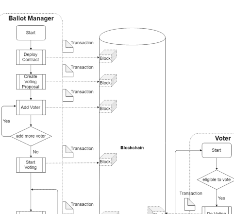
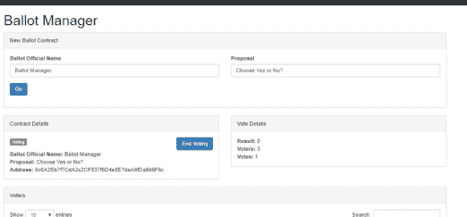
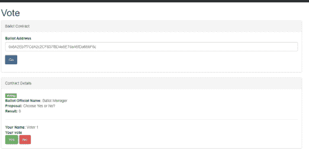

# 2020年信息学、多媒体、网络与信息系统国际会议 (ICIMCIS) (印度尼西亚雅加达 2020.11.19-2020.11.20)

**摘要—** 电子投票（`e-voting`系统）的实施已广泛应用于传统选举系统中，但在结果的可信度方面存在问题。电子投票系统非常容易受到操纵攻击，例如由于后门和黑客攻击导致的选举结果更改。在数据来自一方有权存储和管理数据存储的网络中，信任问题可以通过在系统网络中传播数据来克服。区块链是一种分布式账本，网络中的每个方都具有已知的匿名性，非常适合电子投票。本研究提出了一种基于以太坊和智能合约的电子投票系统，以确保选举过程的透明度。

由选举委员会统计并公布的合格选民人数。类似的方法也可用于其他传统选举。传统方法存在许多潜在的欺诈行为，例如伪造身份证、无效选民名单、允许每位候选人使用的选票以及选举声誉。

电子投票系统的实施是为了改进传统投票方法的许多缺点。它指的是采用技术来取代选票系统，通过在线、离线或数字电视计数来记录选举结果。互联网电子投票显然需要连接互联网，非互联网投票可以使用其他电子设备，如手机、笔记本电脑或电脑。电子投票相比于传统投票系统的主要优势是计票更快、处理负载更小，并且可以防止秘密投票纸，但电子投票系统仍有待解决的问题。

*术语—* 电子投票，区块链，智能合约，电子投票

# I. 引言

根据普通定义，选举是指通过投票为某个人或一组人选择某个职位（特别是政治职位）的过程。通常，公共选举系统被视为国家规模民主成功的标准，甚至适用于机构等规模。民主选举已在许多国家实施，包括印度尼西亚、美国和加拿大。在较小的规模上，选举也出现在学校或大学领袖或学生领选举中。

选举系统中的投票过程可以采用许多不同的方法，例如传统方法以及电子投票（`e-voting`）。传统投票方法基于选票纸并通过投票收集所有选票。在印度尼西亚大选中，选民通过其身份证进行身份验证并

> https://www.oxforddictionaries.com/definition/english/election

根据 Cory [3] 的观点，选举系统具有基本原则：秘密投票、一人一票、投票、投票准确记录和计数。另一方面，秘密投票可以防止买票，而直接（间接）、或通用的、自由、保密和公平的原则也可以适用于电子投票原则。遵循这些原则，实施良好的电子投票系统可以提高选票安全性，加快选举结果的统计（它更高效并能赢得过程中的信任 [4]）。

区块链作为一种在不丢失安全性的情况下提供交易透明度的技术，是解决电子投票现有问题的解决方案。区块链是一种分布式账本，通过分布式加密图由没有中心化权威的节点管理。这表明区块链消除了对中心化第三方验证交易的需求，就像消除了货币转账中的银行一样。通过消除第三方验证交易，区块链提供了维护交易信任的关键特性，即不可篡改的账本、安全、共享和分布式 [7]。由于以下若干优势，区块链是电子投票的良好解决方案，例如高可用性、完整性、正确性和可验证性 [8]。

在本文中提出了一种基于以太坊区块链的电子投票系统。选择以太坊是因为它是用图灵完语言编写的（与比特币不同），并支持智能合约 [9]。此外，它受到许多社区的支持，包括供实验目的免费使用的以太坊测试网络。然而，对于以太坊区块链而言，以太坊的分布式应用程序（`DApp`）仍然具有挑战性，因为它要求用户能够管理自己的密钥，这对于只想投票的新手用户来说可能是一种负担。为此，需要元交易（`meta-transaction`）。元交易是用户和区块链之间中继交易的中间层。`Metamask` 作为浏览器被用在所提的电子投票系统中。

# II. 提出的解决方案

根据 Cet [11] 的观点，电子投票系统涉及三个参与者，即选民、注册机构（`roa`）和计票机构（`toa`）。选民是有权投票的人。注册机构是确保注册选民只投一票的人或组织。计票机构是选举后收集选票的人或组织。在我们提的电子投票系统中，选民和注册机构都分别由选票管理器（`Ballot Manager`）和选民（`Voter`）代表，计票由智能合约自动执行。所提出的电子投票系统使用了智能合约和各种开发工具的可用性。我们的架构由两个系统组成，即选票管理器和选民。两者都通过浏览器形式的 `Metamask` 以太坊元交易以太坊网络通信。图1说明了系统架构的高层及其主要数据流。

## A. 选票管理器 (Ballot manager)

选票管理器在提出的电子投票系统中起着最重要的作用。它负责将智能合约部署到网络中、创建选民提议、添加选民并开始投票。选票管理器需要以以太坊账户的形式在区块链中执行所有任务。尽管名称如此，但它并不存储有关选票的信息，以满足秘密投票，且选民地址被存储在投票过程中 [3]。只有名称通过智能合约运行，而进一步的信息作为私有修饰符实现。关于此问题的更多讨论将在 IV-C 节进行。选票管理器上所有功能的细节将在后续子节中解释。

- **部署智能合约：**

在进行任何其他操作之前，必须将智能合约部署到区块链网络中。智能合约涉及所有必要的变量、数据结构、函数以及定义了电子投票机制如何工作的条件。智能合约的简要实现细节将在 III 节进一步解释。

- **创建选民提议：**

通过早先部署的智能合约激活电子投票系统。需要注意的是，选民提议只能由选票管理器（即通过地址部署合约的人）创建。因此，身份与地址绑定。智能合约中包含一条特定规则：当创建选民提议时，它将与智能合约地址绑定。

- **添加选民：**

当选民提议创建后，选票管理器可以开始向系统添加或注册选民，这类似于每次选举中使用的方法，选民在行使投票权之前必须注册。此过程可以通过逐个添加选民或批量添加完成。第一种方案需要选票管理器承担额外工作，但更容易估计执行此交易的燃气费用（`gas fee`），对于选民来说则相反。添加选民对选票管理器更好，特别是当选民人数很多时，但很难估计涉及循环的交易燃气费用。

- **开始投票与结束：**

投票期介于开始投票和结束交易存储在区块链顺序中的时间点之间。在此期间，选民可以通过向区块链发送选票来行使他们的投票权。智能合约包含一个投票状态指示器，允许选民进行投票。

## B. 智能合约设计

该智能合约由两个数据结构组成，分别用于存储选民名称和选民选择。它还包含一个枚举（`enum`）结构，用于指示投票状态：已创建（`created`）、已投票（`voted`）和已结束（`ended`）。此外，提案已创建（参见 II-A）。最后，它列出了其中实现的函数，包括管理电子投票系统中所有交易的规则，即仅允许选民在投票期的开始和结束之间投票。由于空间限制，智能合约的细节可以通过 `Router Ethereum` 地址获取，如图 2 或图 3 所示。

## C. 选民

通常情况下，任何使用过以太账户的人都可以成为选民。然而，如前所述，选民必须由选票管理器（`ballot manager`）注册，才能在电子投票系统中行使投票权。注册选民意味着其地址被注册到智能合约定义的提案中。

在投票期间，选民行使投票权意味着向智能合约地址发送交易以及将其选择发送到区块链网络。

选票（`ballot`）和选民 `DApps` 均使用 `Javascript` 实现为简单的 Web 应用。采用了一种 `Javascript` 库来简化两个 `DApp` 与以太坊的交互。基于 `web3` 驱动的 `DApp` 与智能合约之间的交互可以通过 `JSON` 格式的 `API` 实现。智能合约的执行由以太坊虚拟机（`EVM`）完成。

任何已经投过票的选民无法再次投票，以满足“一人一票”的提案。因此，需要特定的标识符来指示注册地址是否已经投票。此外，在此期间所有已注册选民的投票会被累加，以获得最终结果。

## D. 选票管理器与选民 DApps

## E. Metamask

所提出的解决方案还包含一个作为 `Metamask`² 的元交易（`meta-transaction`）组件。作为 `metamask` 的元交易实现，它为用户和开发者提供了便利。然而，它隐藏了与以太坊交互的复杂性，例如创建账户、管理密钥和钱包。同样，开发者仅需与全局可用的以太坊应用程序接口（`API`）交互。此外，`DApp` 可以在不同步全节点的情况下启动与以太坊网络的连接，例如通过 `Infura`¹ 。

# III. 原型实现

## A. 智能合约

智能合约用 `Solidity` 语言⁴编写，然后使用 `Remix` 集成开发环境（`IDE`）⁵ 将代码编译为字节码和应用程序二进制接口（`ABI`）。字节码版本随后部署到以太坊区块链网络，而 `ABI` 用于 `DApp` 与智能合约交互。使用 `Rosten` 以太坊测试网络⁶ 来部署智能合约，并执行我们电子投票原型系统完成的所有交易。

为了测试目的，电子投票原型系统的智能合约中实现了一个简单的“是否”提案示例。

> ¹https://metamask.org/
> ²https://infura.org/
> ³https://github.com/ethereum/solidity
> ⁴https://remix.ethereum.org/
> ⁵https://ropsten.etherscan.io/

图 2. 选票管理器用户界面

图 3. 选民用户界面

> ⁶https://github.com/ethereum/web3.js

管理器和选民 `Dapper` 的图形界面（`GUI`）分别如图 2 和 3 所示。注意，图中显示的 `GUI` 展示了完整的用户界面（`UI`）组件，例如面板、按钮、列表等。登录后，管理器和选民 `Dapper` 都会显示顶部菜单，而其他部分会被隐藏。作为一个原型，`Dapper` 实现为 `HTML` 页面，并带有 `HTTPS` 和用户账户访问 Web 界面，因为账户直接连接到区块链。最后，两个 `Dapper` 都通过 `URL` 部署（即 `http://voting.azurewebsites.net/dapper/index.html` 和 `http://voting.azurewebsites.net/dapper/vote.html`）。

确保了资格和投票的准确性、记录和计数，投票中的原则得到了满足，这些分别由第 4 个和第 6 个测试用例指示。注意，在第 6 个测试用例中，结果在管理器 `Dapper` 中观察到。

## 表 II

选民 `DAPP` 测试用例列表

| 编号 | 测试用例 | 预期结果 | 结果 |
|---|---|---|---|
| 1 | 开始投票过程 | 合约详情中出现投票状态，并产生选民提供的投票选项 | 通过 |
| 2 | 未注册的选民 | 给出了投票选项，因此不可用 | 通过 |
| 3 | 已注册选民投票 | 显示“已投票”状态且没有投票选项 | 通过 |
| 4 | 投票过程 | 合约详情中出现“已结束”状态 | 通过 |

# IV. 评估与分析

### A. 功能测试

进行功能测试是为了验证基于区块链的投票系统按预期运行。它包含参与系统的两个角色：管理器和选民。在 `Dapper` 上，选民可以执行实际函数，因此投票由选票管理器执行。表 II 所示的测试用例基于假设。可以得出区块链功能运行成功，当未注册用户尝试投票时（测试用例），选民可以获得投票状态提案。此外，一个

## 表 I

管理器测试用例列表

| 编号 | 测试用例 | 预期结果 | 结果 |
|---|---|---|---|
| 1 | 部署智能合约 | `Metamask` 确认无错误 | 通过 |
| 2 | `DApp` 连接到以太坊网络 | `Metamask` 账户已连接到以太坊 | 通过 |
| 3 | 创建投票提案 | 地址与智能合约对应 | 通过 |
| 4 | 添加到合格列表 | 地址已添加到选民列表 | 通过 |
| 5 | 开始投票 | 提案状态变为“投票中” | 通过 |
| 6 | 选民投票 | 投票池中的选票已计数。选民状态变为“已投票” | 通过 |
| 7 | 结束投票 | 结束投票消失。票数不变 | 通过 |

### B. 性能评估

性能评估侧重于电子投票系统直到单元在区块链网络中确认或验证所需的执行时间。此外，`Metamask` 提供了 `Gas` 费用选项，即：快速、中等和慢速。快速 `Gas` 费用比其他选项更昂贵，但速度更快。“已执行”意味着足够，尽管预估时间并不总是准确。

# 2020 年多媒体、网络安全与网络工程国际会议 (ICIMCIS)

## 表 III

## `METAMASK` 中不同 `Gas` 价格下的交易成本与电子投票系统

| 用户 | 交易 | Gas 价格 | 预估 | 实际时间 | Gas 价格 | 中等 | 实际时间 | Gas 价格 | 慢速预估 | 实际时间 |
|---|---|---|---|---|---|---|---|---|---|---|
| 创建选票 | 选票 | 0.000832 | 20 | 30 sec | 0.004416 | 168 | 18 sec | 0.008833 | 312 | 35 sec |
| 添加选民 | 添加选民 | 0.010387 | 24 | 47 sec | 0.000625 | 126 | 43 sec | 0.001309 | 558 | 59 sec |
| 添加管理员 | 添加管理员 | 0.000817 | 24 | 47 sec | 0.002049 | 222 | 52 sec | 0.000872 | 648 | 49 sec |
| 删除选民 | 删除选民 | 0.000168 | 24 | 47 sec | 0.000195 | 216 | 23 sec | 0.001638 | 600 | 53 sec |
| 开始投票 | 开始投票 | 0.000627 | 24 | 41 sec | 0.000402 | 120 | 80 sec | 0.000627 | 660 | 53 sec |
| 投票 1 | 投票 1 | 0.001095 | 36 | 35 sec | 0.000218 | 193 | 26 sec | 0.001638 | 690 | 52 sec |
| 投票 2 | 投票 2 | 0.001114 | 36 | 37 sec | 0.000516 | 258 | 29 sec | 0.001213 | 706 | 52 sec |
| 投票 3 | 投票 3 | 0.001114 | 24 | 21 sec | 0.000664 | 234 | 20 sec | 0.000123 | 516 | 47 sec |
| 选票管理员 | 选票结束 | 0.000175 | 27 | 34 sec | 0.000326 | 198 | 42 sec | 0.000078 | 642 | 23 sec |
| 总计 | | 0.003015 | 172 | 315 sec | 0.001864 | 1866 | 308 sec | 0.005301 | 5274 | 395 sec |

评估结果不包含我们方提供的任何资源。

选举系统的整体性能评估如表 III 所示。根据结果，实际时间总是低于预估时间，特别是在中等和低 `Gas` 价格下，实际时间比预估时间快。有趣的是与中等和低 `Gas` 价格相反，在高 `Gas` 价格场景下，实际时间比预估时间慢。时间总和的差异与每个 `Gas` 价格总和的差异并不显著，后者的差异非常显著。总之，评估结果显示，无论花费多长时间，所有交易都成功执行。这表明投票的可靠性得到了满足 [3]。

当网络流量超出 `CIA`（机密性、完整性和可用性）三个安全层面的范畴时，区块链投票系统确保了完整性和合法性。

完整性取决于区块链的不可篡改性，记录在区块链中的记录无法更改。同时，可用性可以通过分布式和公共的以太坊网络投票来确保。对于记录在区块链中的信息的机密性，很大程度上取决于智能合约。防止投票被暴露的一种方法是：

## 表 IV

## 所有 `Gas` 价格选项下所有交易的 `Gas` 价格

| 交易 | 每秒 `Gas` 价格 |
|---|---|
| 部署合约 | 0.000252433 | 9.2326e-05 |
| 创建选票 | 0.000321715 | 6.0004e-05 |
| 添加选民 | 0.002170482 | 1.6272e-04 |
| 添加管理员 | 0.003917903 | 5.4406e-05 |
| 删除选民 | 0.00135333 | 1.3611e-05 |
| 开始投票 | 0.00062744 | 4.9441e-05 |
| 投票 1 | 0.001009538 | 2.8001e-05 |
| 投票 2 | 0.000140009 | 9.9999e-06 |
| 投票 3 | 0.00111411 | 1.1111e-05 |
| 选票管理员 | 0.020949526 | 3.1999e-05 |

选取每个 `Gas` 价格场景下每笔交易的 `Gas` 价格，从表 IV 可以看出，慢速 `Gas` 价格场景下的每秒 `Gas` 价格是三者最低的。通过这一发现可以得出，低 `Gas` 价格在 `Gas` 价格和交易时间之间提供了最佳平衡。尽管如此，实验结果高度取决于所使用的以太坊网络，当网络流量较高时，`Gas` 价格可能会升高，而使用价格类型会带有相关信息。然而，拥有价格类型并不能完全防止第三方过滤选民的投票信息。采取了以下步骤来控制投票系统的交易内容：

1. 在以太坊网络中追踪投票：通过 `Etherscan`，每一票投票都可以追踪任何公共网络中的任何笔交易。如所述，投票系统部署在健壮的网络中，因此任何选民都可以通过其选民地址追踪任何笔交易。

2. 通过智能合约分析投票函数：在投票期间，`DApp` 与以 `ABI` 形式实现在区块链上的智能合约之间存在交互。一是捕获选民发送的交易及其内容，另一个是了解在该交易中执行了哪个智能合约。这两条信息对于确定选民身份至关重要，因为每笔交易都是以哈希记录的形式发送的。原则上，由于每笔交易对所有节点可见，如果已知交易，就可以提供相应的结果。

- 要获取选民使用的精确函数，需要通过反编译以太坊上的智能合约字节码来获取 `ABI`，假设没有源代码。通过反编译方法提取字节码中的信息，并通过 `EVM` 将其转换为人类可读的格式。`ABI` 反编译的结果与获得的 `ABI` 具有高度相似性。最重要的一点是知道如何进行投票（`bool`）。顺带提，字节码反编译并不容易部署和发布。在这种情况下，源代码可以供任何以太坊用户公开。

- 读取选民发送的交易数据：可以通过查看交易哈希访问交易数据。交易包含哈希、交易状态、发送者和接收者的地址数据。在这种情况下，存在交易数据。我们实验的一个示例数据为 `0x87caaa78000000000000000000000000000000000000000000000000000000000000`。我们将后回来获取此交易数据。

- 获取选民的 `(bool)` 函数的值：这是以太坊使用 SHA-256 编码的获取 `(bool)` 值的函数。

- 获取投票结果：根据第 3 点和第 4 点的结果，可以看到交易数据的前四个字节与 `(bool)` 的哈希相同，即 `0x87caaa78`。交易数据的前四个字节指的是签名 `(bool)`。在调用函数时，交易数据指的是方法，用填充为 32 字节的十六进制值表示。由于交易预期只有两个值，即真或假，分别表示为 `0x1` 或 `0x0`（32 字节）。
