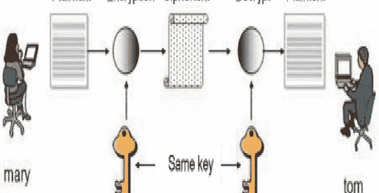

# 2020年智能计算与人机交互国际会议 (ICHCI) (中国三亚 2020.12.4-2020.12.6)

摘要：在技术飞速发展的过程中，计算机通信技术的发展越来越快。目前，应用网络通信的人数不断增加。为了确保计算机通信为人们的生产生活服务，我们必须关注计算机网络通信技术的安全应用，防止机密信息泄露等问题。因此，信息的安全性对于未来网络通信技术的应用和发展非常重要。有必要研究网络通信安全，提高当前网络通信的防护水平，确保信息安全。

关键词：数据加密技术；网络通信；安全管理

## 影响计算机网络安全的因素

### 计算机网络安全概述

#### 计算机网络安全的特征

计算机网络安全是指通过有效的网络管理和技术控制，确保网络资源的效率和安全。计算机网络通信安全的主要特征是计算机网络通信链路存在不安全因素。在信息传递过程中，容易发生信息被截获和泄露的情况。这将对计算机网络通信安全造成威胁。网络威胁本身无处不在，增加了网络通信防护技术的难度。网络通信安全是复杂的；网络中的用户越多，管理整个网络系统中的用户就越困难。随着互联网技术和资源共享的快速发展，目前攻击网络的手段越来越多。由于网络本身的匿名性，犯罪行为将增加网络通信安全环境的危险性。此外，网络安全本身是相对的，无法建立绝对的网络安全，我们也无法通过网络技术和技术措施确保计算机网络通信系统的平衡。为了确保信息在传输中的安全。

在大数据的背景下，影响计算机网络通信安全的主要因素如下：
1.  **外部灾害的影响**。随着数据存储中使用外部数据硬件设备日益增多，虽然设备具有一定的抵抗外部攻击和其他环境变化的能力，但设备容易受到损坏，导致安全问题。在发生自然灾害时，数据可能会丢失其物理属性，导致重要数据的丢失。
2.  **网络本身的原因**。互联网是开放且多样化的，任何人都可以通过某种方式连接。互联网上的信息很容易被其他用户获取，每个用户的计算机具有一定的抵抗外部攻击的能力。但由于网络是开放的，任何人都可以利用互联网和各种工具进行计算机入侵。一方面，互联网的开放特性可以促进和提高信息传输的效率。另一方面，计算机网络安全系统也处于前端。在未来计算机网络通信安全的发展中，我们必须关注数据加密技术的应用，以保护信息安全。
3.  **恶意攻击**。在互联网应用过程中，黑客会攻击人的计算机并使用病毒入侵他人计算机。这些黑客具有恶意和目的性，窃取秘密或获取信息。恶意攻击主要包括黑客的有目的行为，而被动的受害者是受害者的计算机以此获取他们。此类攻击会导致受害者遭受经济损失。此外，黑客可能使用某些网络病毒干扰其他计算机的正常运行，这将对计算机系统的稳定性产生巨大影响[13]。

### 数据加密技术在计算机网络通信中的应用价值

大数据时代，随着计算机网络技术的不断发展，大数据技术水平越来越高，特别是计算机网络过程中产生的数据量非常大。在某种程度上，网络技术的形成和发展越来越快，大数据概念受到了越来越多的关注。在大数据的背景下，网络中的信息价值变得越来越重要，尤其是随着网络数据量的增加。在万物互联的背景下，大数据技术涵盖了人类社会的许多方面。在这种背景下，存在许多相关的应用。计算机网络技术的特征是信息量巨大，信息内容非常多样，特别是包括语言、图片、视频、声音等。这些信息涉及大量内容。此外，信息本身复杂，处理困难，尤其是会与大量无用信息混合。因此，挖掘信息的真实应用价值是大数据技术在应用过程中必须扮演的角色。在大数据时代，信息安全非常重要，近期信息被非法窃取和泄露。信息保护的技术要求日益提高。在数据的背景下，我们必须关注数据加密技术的全面应用，尽可能提高计算机网络通信的安全防护，以确保信息安全[1]。

图1 数据加密的基本原理

在计算机网络通信安全应用过程中，数据加密技术需要使用特定的算法。这些算法主要包括：
1.  **DES算法**。在应用数据加密技术时，`DES` 操作方法可以生成 16 个密钥。在密码中，数字 0 和 1 代表不同的含义，其组合对应于相应的信息，这有助于提高数据加密的有效性。在 `DES` 的应用中，会重复迭代操作，有助于防止信息破解并确保信息安全。
2.  **RSA算法**。在应用 `RSA` 算法时，需要一些数学知识，因为其加密应用非常好。通常情况下，随着合数的增大，编解码过程的时间会越长，这导致了更强的安全性。此外，`RSA` 算法在数据加密应用中需要完成随机生成的质数选择，然后进行预算。这是 `RSA` 算法在应用过程中的局限性。如果无法实现这一点，信息将无法传输。这种方法可以提高数据加密的安全性[1]。

用于大多数大型网络通信系统的加密技术，可以有效保护信息的传输过程。由于加密和破解的难度很高，可以确保信息的安全。该技术主要用于实际应用中的加密方法，这些方法具有安全环境，即使系统遇到某些问题，未应用这些问题的加密模块仍然可以妥善确保数据的完整性和安全性。端到端加密的应用覆盖范围较小，整体识别能力……

## 数据加密在网络通信系统中的应用

### 应用技术分析

在数据加密技术的应用中，不同的加密可以提高网络通信的安全性。有必要根据安全性选择不同的加密方法。

首先，在计算机网络通信过程中，数据加密技术的应用已经导致了大规模和广泛的应用。在链路加密的应用中，网络通信仍需传输，然后是信息。当信息在不同节点传输时，加密信息仍需解密以提高信息获取的有效性，链路加密模式会在信息传输过程中对信息进行加密，并进行信息查询。

在计算机网络安全中，数据加密技术的应用体现在计算机应用领域。在计算机技术快速发展的过程中，通信软件的种类越来越多，极大影响了人们的日常生活。然而，某些系统会使用破解方法从软件中窃取信息，这将对公共和网络环境造成威胁。在当前的数据加密技术应用中，有必要在软件特定条件下应用于每种类型的软件通信中，以确保数据加密技术的差异。只有这样才能有效提高网络软件用户的安全性。在局域网的应用中，`LAN` 是一种计算机网络环境，链路加密可以有效保护公司的信息安全，避免公司经济利益损失。

其次，在实际应用过程中，节点加密和链路加密之间存在一定的相似性。根据其操作过程，信息在应用过程中加密一次，同时数据信息被加密两次。然而，节点加密更实用。此外，其显示形式为明文，数据信息由每个模块获取。因此，破解难度相对低于链路加密模式，加密文件的安全性不高。

第三，端到端加密模式是……

### 结论

简而言之，在计算机网络通信技术的发展过程中，使用安全有效的加密技术可以在很大程度上确保计算机网络通信的安全。随着信息技术的发展，计算机通信领域日益扩大，对信息传输的安全要求越来越高。因此，我们应该关注数据加密技术在计算机网络通信安全中的有效应用。有必要加强数据加密技术的研究创新，根据现有的数据加密技术，考虑计算机网络安全的特定应用需求，根据应用对象考虑合理快速的加密方案。有利于提高数据加密技术在计算机网络通信安全中的积极作用。此外，我们应该加强数据加密技术性能的优化，解决各种信息泄露问题，营造良好安全的流量环境[1]。

## 参考文献

[1] 高长宏. 数据加密在计算机网络中的应用：通信安全[J]. 通信世界，2018,05(02): 23-25.

[2] 徐力. 数据加密在计算机网络通信安全中的应用[J]. 数字通信研究世界，2019,No.7(11): 22-25.

[3] 谢勇. 数据加密技术在计算机网络通信安全中的应用[J]. 电子技术与软件工程，No.128(02): 236-2019.

[4] 王军. 数据加密技术在计算机网络通信安全中的应用[J]. 中国战略新兴信息，2018(07):8-7.

[5] 叶金荣. 数据加密技术在计算机网络通信安全中的应用[J]. 信息与通信，2018(06):70-71.
