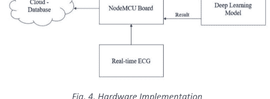

# 2020年跨学科信息物理系统国际会议 (ICPS) (印度金奈纳 2020.12.28-2020.12.29)

**Sayak Banerjee**  
电子工程学院  
韦洛尔理工学院  
印度，韦洛尔  

**Arin Paul**  
电子工程学院  
韦洛尔理工学院  
印度，韦洛尔  

**Amshika Agarwal**  
电子工程学院  
韦洛尔理工学院  
印度，韦洛尔  

**Sumit Kumar**  
电子工程学院  
韦洛尔理工学院  
印度，韦洛尔  
sumijindi08@gmail.com  

## 摘要

心律失常是目前最常见的心血管疾病。它导致心脏跳动节奏不齐；要么太快，要么太慢。房颤是一种广为人知的心律失常形式，发生于心脏上腔（心房）经历混乱的电信号时，并导致心率过快。尽管在使用心电图（ECG）来发现患者是否患有房颤时，最初可能没有任何症状，但 ECG 有助于诊断心律失常。在这项工作中，我们使用 1-D 卷积神经网络深度学习模型进行信号预处理，将单导心电图分类为不同的类别。该模型以高精度区分窦性心律、房颤、噪声心电图和其他类别，显示结果并通知用户可能与心律失常有关的情况。这种方法对于心律失常的早期诊断快速且可靠，患者借此遵循适当的方案以避免并发症。

由于人们不健康的生活方式，患有房颤的 3350 万人正在呈指数级增长。这项工作的主要目的是区分房颤——心脏心律失常最常见的原因，也是最严重且增长最快的原因。

**关键词** - ECG 心律失常；房颤；心电图；可穿戴技术；深度学习；代码

## I. 引言

心电图（ECG）是用于诊断房颤的常用检查。传统的心电图使用方法是由医生或心脏病学家在没有监测的情况下做出决策。因此，最后需要持续监测和自便携式设备。在过去的几十年里，许多许多工作来实现自动心电图分析和分类。传统方法已经使用了医院中常用的各种机器学习方法。

如今，基于深度学习的神经网络已用于计算机视觉和信号处理。心脏心律失常是一种心脏跳动节奏不正常的状况。它可能由组织变化引起心过慢或心过速、室性颤动或房颤引起。根据欧洲心脏学学会（ESC），心律失常占所有心血管脑血管疾病（如与心力衰竭常见的缺血性中风）的 15-20%。室性心速是心脏心律失常最常见的原因。

房颤是一种医学状况而非疾病，它会导致心脏混乱跳动，从而导致中风或心力衰竭，导致永久瘫痪或死亡。室性心速引起源自心室的不稳定电信号的快速、不可预测的节奏。

在并行性方面，对于分类，许多工作通过选择正确的特征完成。然而，它是通过高维还原构建的。

另一方面，使用小波变换或高阶统计提取输入特征，由于这些复杂的统计和信号处理这些算法导致准确率低或中等，误差较高。

具有显著深层的深度学习在颤动检测方面的表现优于机器学习。在这里，使用基于深度学习的分类算法进行心电图和心律失常检测。

在这项工作中，作者提出了一种使用四层深度学习模型的新颖观点，该模型由提取表示特征的 1-D 卷积神经网络（CNN）和提取序列特征的长短期记忆网络（LSTM）组成，然后通过全连接层将心电图结果处理为 4 类。分类结果随后……

连同它们的波峰。通过带通滤波器处理 ECG 信号可以减少噪声，有助于波峰检测，检测通过 `Pan-Tompkins` 算法实现。抽象特征包括 `RR` 间期、`QQ` 间期、`IP` 间期等。提取的特征是时间序列数据，并通过如 `RNN` 或 `LSTM` 等时间序列预测。由于 `LSTM` 层是预定义的特征，且在所需任务中具有高准确性，此类模型显著缩短了训练时间 [9]。

分类表示不均的非平衡数据集是导致结果不充分或具有误导性的障碍之一。研究人员已付诸许多努力解决这一问题。关于下采样或过采样技术的工作较少。`SHINKRY` 系统的出现区分了不同聚类的区域。此后的工作使用了下采样技术和合成少数类过采样技术（SMOTE），这是一种独特的方法，通过通过填充人工数据点来对少数类进行过采样。这使得这些类别的样本数量与最大样本类相同。因此，与其他方法相比，`SMOTE` 提供了更好的召回率和精确率。[9] [10]

## III. 系统模型

整个系统架构如图 1 所示的流程图描述。

| ECG 信号 | ECG 信号的训练与填充 | ECG 信号的归一化 |
|---|---|---|
| 结果 | 模型训练 | SMOTE |
| NodeJS 板 | 云端数据库 | 移动应用程序 |

图 1. 所提系统的框图

### B. 信号的绑定与调整

ECG 是连续且非确定性的信号，因此任何类型的分类都是可能的。因此，ECG 以每秒 300 样的速率进行采样。数据集包含持续时间从 9 秒到 60 秒不等的 ECG 信号。为了统一，每个信号中提取了 750 个样本，持续时间为 25 秒。持续时间短的信号用零填充。裁剪后的数据提供了良好的结果并确保数据不丢失。

### C. ECG 信号的归一化

ECG 的采样值产生宽范围的值，这可能会将一个实例的导联绝对值误导所有实例。为了防止这种情况，增加了数据归一化，将其添加到公共比例尺上。为了获得更高的准确性，通过减去原始值并除以其最大绝对值来调整数据的均值。因此，归一化后的数据位于 `[-1, 1]` 范围内。

### D. SMOTE

我们可以观察到患者数据集是不平衡的。有 5154 个样本属于正窦心律类，而只有 46 个样本属于噪声 ECG 类。因此，为了平衡，使用了 `SMOTE` 算法。该技术通过填充与正窦心律类数量相似的人工数据点来对少数类进行过采样，即该技术不仅应用于训练数据集，还将提高准确性和性能。在以 1 到 4 的比例因子应用 `SMOTE` 后，每个类包含从 1765 到 18400 不等的样本，最终每个类有 4620 个样本。作者提出了在应用此情况之前和后的模型，在此情况下，测试数据集在测试集上给出了远更好的性能和准确性。

### F. 深度学习模型架构

在这项工作中，作者提出了一种独特的深度学习模型。该 DL 模型具有 14 层。使用了 1D 卷积层。这些 1D 卷积层用于从经过预处理的 ECG 信号中提取特征。对于每个卷积层，都配有一个步长为 2 像素的 1D 最大池化层（`MaxPooling`）。最大池化层通过沿其步长选择最大值来显示 CNN 操作的特征图，这减少了特征图中的冗余数据并最大化了冗余信息。CNN 层的卷积核尺寸分别为 10、6、5、3。在卷积层 CNN 之后开始使用值为 0.05、0.10、0.15 的 `Dropout` 层以进行正则化。正则化确保模型不会过拟合训练数据。使用了 `logit uniform` 类作为层的权重初始化器。

提取的特征被输入到两个各具有 64 个输出的 `LSTM` 层。`LSTM` 层与传统的/常规 `RNN`（循环神经网络）层不同，后者具有阻塞性且无法学习长期依赖关系。如果有足够的数据，`LSTM` 在序列预测数据上的表现更好，这对于本文是成立。`LSTM` 相比传统网络的主要优势是 `LSTM` 层内部带有记忆单元的循环。它们允许信息持久。`LSTM` 层还具有像 `RNN` 一样的隐藏结构。`RNN` 在不使用单个 `NN` 层的情况下，拥有四层，并以灵活的方式与数据交互。最后，反应神经元的输出层由 `Soft` 激活函数激活。每个神经元给出一个信号属于该类的概率值。分类器给出最大概率的类被分配给该信号的类标签。

模型使用 `Keras functional API` 执行。`Keras` 由 `TensorFlow` 后端支持。使用 `Adam` 优化器、`categorical cross` 损失函数和 `['accuracy']` 指标来编译模型。

### H. 硬件实现

所提智能应用程序的硬件实现流程图如图 4 所示。

### G. DL 的训练

在应用 `SMOTE` 过采样技术后，有 18400 个样本。所提智能应用程序的硬件实现流程图如图 4 所示。

## VI. 结论

本文实现了一种真实的心律失常检测，能够从心电图（ECG）信号中检测此类问题。我们还可以持续监测用户的心脏健康状况，从而避免心律失常的发展。

因此，作者们成功构建了一个轻量级可穿戴心律律检测器的原型，它可以对心电信号进行分类。它也可以与其他提供用户心电信号的手环配合。此外，本工作中卷积神经网络（CNN）和长短期记忆（LSTM）的使用将提高准确性并使应用程序对患者更加方便。

建议的模型可以使用更好的心电信号记录方法进行升级，由于其低噪声和准确性可以提高准确性。此外，在移动应用程序中使用聊天机器人进一步增强了对于难以操作智能手机的人群的功能，并提供了不同语言的版本。

# 参考文献

- [1] J. Sun, G. Wang, and C. Yan, Multi-Label ECG Signal Classification Based on Ensemble, in IEEE Access, vol. 8, pp. 117996–117996, 2020, doi: 10.1109/ACCESS.2020.300490
- [2] R. Silipo and C. Marquez, Artificial neural networks for automatic ECG analysis, in IEEE Transactions on Signal Processing, vol. 46, no. 5, pp. 1415–1427, 1998, May, doi:10.1109/76.6883
- [3] N. K. Dewan and S. P. Shikila, “ECG arrhythmia classification using wavelet transform and artificial neural networks,” in 2016 IEEE International Conference on Electronics, Information & Communication Technology (RETICT), 2016, pp. 1892–1896, doi: 10.1109/RETICT.2016.708164
- [4] A. Gacek and D. Weyner, “A Grammar Detection of ECG Signals,” in IEEE Transactions on Biomedical Engineering, vol. 50, no. 5, pp. 1982–1982, 2003, doi:10.1109/TBME.288172
- [5] X. Chen, J. Li, K. Loparo and P. Li, “Real-time personalized arrhythmia detection and diagnosis: A cloud computing architecture,” 2017 IEEE International Conference on Biomedical & Health Informatics (BHI), Orlando, FL, 2017, pp. 201–214, doi:10.1109/BHI.2017.89722
- [6] M. Linam and F. Preioso, “Atrial fibrillation detection and classification using recurrent neural network,” 2017 Computing in Cardiology (CinC), Rennes, 2017, pp. 1–4, doi: 10.22489/CinC.2017.171-325
- [7] S. Kiranyaz, T. Ince and M. Gubboi, “Real-Time Patient-Specific ECG Classification by 1-D Convolutional Neural Networks,” in IEEE Transactions on Biomedical Engineering, vol. 63, no. 3, pp. 664–675, 2016, doi:10.1109/TBME.2015.246858
- [8] V. Maknickas and A Makinas, “Atrial fibrillation classification using QR features and LSTM,” 2017 Computing in Cardiology (CinC), Rennes, 2017, pp. 1–4, doi:10.2249/CinC.2017.350.114
- [9] N. V. Chava, L. O. Hall, K. W. Boyer, and W. P. Keyes. Smote: Minority oversampling technique. Journal of Artificial Intelligence Research, (16):321–357, 2002.
- [10] C. Seifert, T. M. Ghoshajar, J. Vanse and A. Napolit, “RUSBOOST: Improving classification performance when data is skewed,” 2008 International Conference on Pattern Recognition, Tampa, FL, 2008, pp. 1–14, doi:10.1109/ICPR.2008.476297
- [11] M. Soliski, A. Perka, J. Rosinski, M. Lepek and J. Rymko, “Atrial fibrillation classification in short ECG using machine learning and hybrid algorithms,” 2017 Computing in Cardiology (CinC), Rennes, 2017, pp. 1–4, doi: 10.22489/CinC.2017.337
- [12] E. E. Copola, P. K. Kowyala, N. Djaima, D. Glaime and L. Wang, “Atrial fibrillation classification from short ECG recording using hierarchical classification,” 2017 Computing in Cardiology (CinC), Rennes, 2017, pp. 1–4, doi:10.22489/CinC.2017.354-425
- [13] F. Piesler, P. Neijedly, I. Viscor, J. Halamek and P. Jurak, “Automatic detection of atrial fibrillation and arrhythmias holter eclectic using rhythm features and neural networks,” 2017 Computing in Cardiology (CinC), Rennes, 2017, pp. 1–4, doi:10.22489/CinC.2017.364
