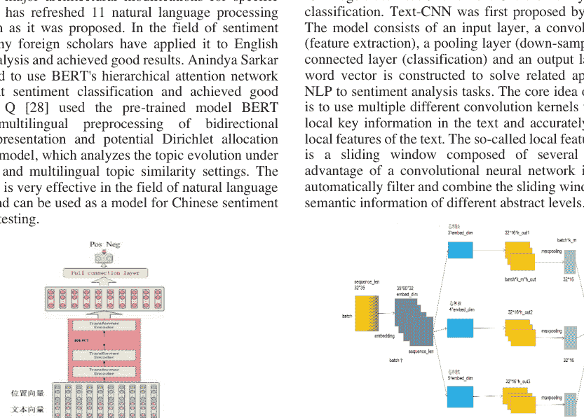
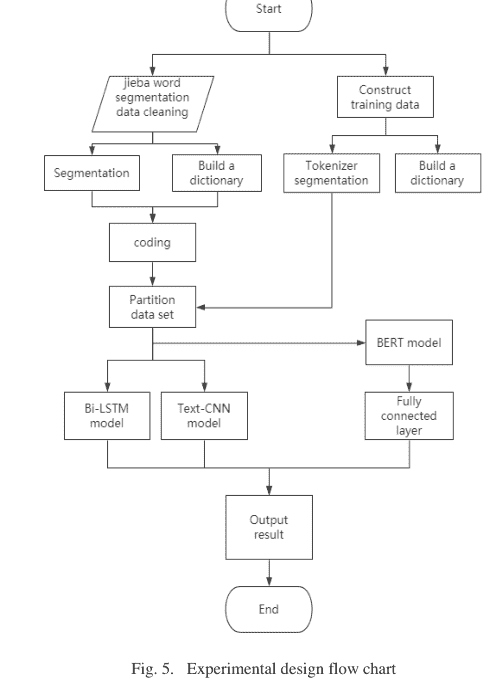

# 2020年物联网与智能应用国际会议 (ITIA)(中国镇江 2020.11.27-2020.11.29) 2020年物联网与智能应用国际会议


农业信息化研究所

农业信息化研究所

中国农业科学院

中国农业科学院

中国农业科学院

农业信息化研究所
中国农业科学院

**摘要。** 电商平台平台上关于农产品的相关评论文本包含了消费者多样且复杂的感情，反映了客户对这些产品的体验和观点。在复杂语境下进行情感分析对深度学习具有重要意义。本文通过构建 CNN、BI-LSTM 和 BERT 对深度学习模型进行微调，探索了农产品情感分析问题。研究目标是分析电商平台上的农产品评论数据。结果显示，消费者情感趋势已从正向转向负面，三种模型生成的分类方法之间的差异为 8%。Text-CNN 卷积神经网络的准确率达到了 99.2%。结果证实，Text-CNN 在处理农产品电商评论数据时对于极性分类具有高准确率和良好的性能，情感评论数据为厂家准确区分用户反馈和增强市场竞争力提供了重要参考。

通过大量数据进行准确且全面的评估。

在农产品电商网站领域，关注点一直是消费者的情感表达。例如，“包装盒有几个破损，非常好，多汁且甜美”反映了情感分析的不同侧维度。如图 1 所示，“非常好”指的是产品质量。基于方面的情感分析（ABSA）可以帮助用户根据上下文和情感信息理解情感表达。

**关键词：** 情感分析；深度学习；Text-CNN；BERT；BI-LSTM

# I. 引言

随着中国农业电商网络的逐步加速和发展，大量农业企业开始入驻电商平台或建立自己的电商网站。在线情感的趋势导致了电商平台上产生了大量的消费者评论数据。有必要分析农产品在线情感的趋势。用户反馈是农业生产经营增加市场竞争力的重要考虑因素。然而，情感对产品策略非常敏感，因此为了提高产品销售策略、市场竞争力并在优化农产品消费者市场环境中，仅依赖传统的评分方法作为整体产品评估结果是不准确的。特别需要获得

| 第一个方面框： | 其他方面： |
| :--- | :--- |
| 情感：负面 | 情感：正向 |

| 整体情感的情感：正向 |

| 包装有几个破损，包装非常好，甜美、多汁。
尽管盒子有几个破损，但非常好，多汁且甜美，

图 1. 基于方面的情感分析示例

# II. 相关工作

情感分析是自然语言处理（NLP）的一种应用。其主要目的是从大量文本中分析文本本身的情感极性，判断情感是正向还是负面。近年来，情感分析系统已应用于许多不同类型的文本，包括评论数据 [1–6], [7] 以及 Twitter 和微博帖子上的推文 [8]。情感分析的研究方法大多分为以下几类：

## A. 基于情感词典的方法

S. Zhang [11] 提出了基于程度反义词、负面词典和其他相关词典的词词典提取和构建，以扩展情感词典并改进基于权值的情感词典分析。Tan, Chang Feng [12] 基于 NKI 词典构建了微博情感词典，用于改进微博情感和 Sina API 访问数据，并分析了中文微博情感信息。Wanghan 针对电商数据构建了情感词典，并分析了农产品情感信息。

## B. 基于机器学习的算法

## C. 基于深度学习的方法

## D. 数据获取的方法

[注：原文此处对应参考文献 10, 11, 12, 13, 14, 15, 16, 17, 18, 19, 20, 21, 22, 23, 24, 25]


选取香蕉、桃子、龙果、番茄、土豆、黄瓜、蔬菜等农产品构建了一个包含 23,418 个分类和测试集，其中包含 14,888 个正情感、8,530 个负情感，总数的 80% 用于训练，20% 用于测试数据。数据结构如表 2 所示：

本文中的农产品评论数据经过切分和短句补充处理成长度为 35 的文本。文本通过 BERT 的分词函数处理为 35 个 token 加上 [cls] token。分词化。向量化对每个 token 进行随机洗牌或替换数据中随机擦除 15% 的 token（字符）。恢复的文本允许模型基于上下文语义。提取 [cls] 向量，然后将其映射为一个值并使用 sigmoid 函数进行编码。通过随机映射预测和句子检测的函数训练，任务让特征向量通过 BERT 模型。

## 表 II
农产品评论数据组成

| 数据集 (Dataset) | 正 (Pos) | 负 (Neg) |
|---|---|---|
| 训练集 (Train) | 11910(80%) | 2978(20%) |
| 测试集 (Test) | 2978(80%) | 1706(20%) |
| 总计 (Total) | 14888(68%) | 8530(36%) |

## B. 基于预训练的 BERT 微调分类模型

BERT（Bidirectional Encoder Representations from Transformers）是由 Devlin [226] 开发的预训练语言模型，BERT 是基于 Transformer 实现的多层双向模型。与其他语言表示模型不同，BERT 旨在预训练深度双向表示并针对特定任务进行调整。预训练的 BERT 意味着可以通过输出层进行微调，适用于构建各种任务的最先进模型，而无需从头设计新架构。BERT 用于自然语言处理任务。在情感分析领域，许多学者已将其应用于情感分类，[27] 提出使用 BERT 的层次注意力网络进行文档分类并取得了结果。Xie [28] 使用预训练的 BERT 进行隐含狄利克分布分配 (LDA) 主题模型，允许单语言和多语言主题相似性的设置。BERT 在自然语言处理领域非常有效，可以用于中文情感分析和测试的模型。

```
sigmoid(x) = e^x / (1 + e^x)
```

在该模型中，初始学习率为 1e-5，并将 transformer 全连接层添加到 BERT 模型的输出中进行微调。模型的结果为输出损失 (Output-Loss test loss)=0.1629，测试准确率 (Test Acc)=0.9539。

## C. 卷积神经网络-CNN 模型

作为学习领域最重要的工具之一，卷积神经网络是一种包含卷积层池化层的前馈神经网络。卷积神经网络 (CNN) 是一种利用卷积网络提取视觉特征的算法。CNN 主要用于图像分类、目标检测和图像识别。这里我们使用 CNN 进行文本分类。提出的 CNN 模型由输入层、卷积层（特征提取）、池化层（下采样）、全连接层组成，并将词向量转换以解决 NLP 在情感分析任务中的应用。CNN 的核心思想是使用不同的卷积层提取文本的局部特征。文本中所谓的局部特征是不同尺寸的滑动窗口。卷积神经网络的优势是它可以自动过滤并组合滑动窗口以获取不同层次的语义信息。



图 3. CNN-卷积神经网络

图 2. BERT-微调分类模型

分词工具 Jieba 的准确率可达到近 97%，在本文的 text-CNN 数据预处理阶段，使用了分词，并通过停用词操作删除无意义内容。本文构建的 Text-CNN 模型使用三层卷积层和 dropout（负对数似然损失函数）来增强网络的返回能力。


数据，以及带有情感的预处理数据本身。Tokenizer 分为 BasicTokenizer 和 WordpieceTokenizer。首先，执行 BasicTokenizer 分词以获得一种自然对齐的粗粒度分词效果，然后使用 WordpieceTokenizer 处理每个 token 以获得最终的 token 结果。数据用于 80% 的训练集和 20% 的测试集。性能和测试使用 pytorch（一种基于深度学习框架的预训练模型）对文本进行分段和编码，然后 BERT 输出结果在全连接层中输出预测。

分类器正确分类的。召回率（Recall）报告了原始数据中分类器正确分类数量占的比例。准确率（Accuracy）指的是正确分类（无论正还是负）的比例以及精确率和召回率的调和平均值。这两个指标的计算如下：此处索引值越大，分类效果越好。FP、TP 和 FN 分别代表假阳性案例、假阴性案例、真实案例和真例。

```
Accuracy = (TP + TN) / (TP + TN + FP + FN)
```

```
Precision = TP / (TP + FP)
```

```
Recall = TP / (TP + FN)
```

```
F1 = 2 * Precision * Recall / (Precision + Recall)
```

从表中结果来看，Text-CNN 卷积神经网络的准确率达到了 99.2%，显著高于 BERT 微调细分类模型的 95.39% 准确率以及 Bi-LSTM 双向长短期记忆网络的 93.60% 准确率。在数据集结果中，Bi-LSTM（双层双向长短期记忆网络）的准确率为 93.6%，与其他模型相比也表现优异。从准确率、精确率、召回率和 F1 值来看，可以看出 Text-CNN 分类模型比另外两个高出约 3 个百分点。三个模型之间的分类差异是阶梯性的。Text-CNN 模型明显优于 BERT 微调分类模型和 Bi-LSTM 分类模型。总之，基于 Text-CNN 卷积神经网络的农业电商评论数据情感分类效果更好。虽然 CNN 没有像 LSTM 模型那样可以捕捉长距离依赖的结构，也不具备基于 BERT 微调模型的词嵌入特征，但其卷积层捕捉局部信息的能力和池化层提取局部信息的能力恰恰证明了 Text-CNN 卷积神经网络模型对于 35 字的农产品评论文本集具有良好的情感分类效果。



# V. 结果分析

Bi-LSTM 双向短期记忆网络、基于 BERT 的微调分类模型和 Text-CNN 卷积神经网络使用了预处理数据和 Neg 集进行分类实验。表 5 显示了每个分类器的实验结果。精确率是准确率的指标，意味着分类器正确分类的数量占


表 IV

| 指标(%) | 类型 | 准确率/% | 精确率/ | 召回率/ | F1分数 % |
|---|---|---|---|---|---|
| BERT | 正类 | 95.39 | 94.02 | 96.77 | 95.38 |
| | 负类 | 96.79 | 94.05 | 95.40 | |
| Text-CNN | 正类 | 99.92 | 99.90 | 99.95 | 99.92 |
| | 负类 | 99.95 | 99.99 | 99.93 | |
| Bi-LSTM | 正类 | 91.70 | 95.62 | 93.62 | |
| | 负类 | 93.60 | 95.59 | 91.65 | 93.58 |

# VI. 结论

与传统分析方法相比，本文使用了三种主流深度学习模型来探索农业电商平台数据进行情感分类。为了获得科学可靠的结果，本文使用 R 语言构建了网络爬虫，并收集了网上商店的消费者意见数据。Text-CNN 卷积神经网络获得了意外之外的结果：分类准确率达到了 99.2%，优于 Bi-LSTM 模型，而 BERT 分类模型高出约 4%，这证明了其卓越的情感分类性能。本文的结果为管理领域提供了极具价值和实践性的参考，提高了提高市场竞争力。

# 参考文献

[1] Zhao H, Wu Q, “基于深度学习的电子商务情感分析研究,” 物理学报, 2012, 127(1).
[2] Xiao Jun, Wang Kai, Donghuang, and Wang, “构建基于短文本评论的情感模型,” Neurocomputing, 2009, 278-283.
[3] Liu Jiao, Ma Xue, Jiaonan Ma, Hu Liu, “基于注意力机制的电商评论情感分析,” 上海交通大学（学报）, 2017, vol.1, no.3, pp. 37-42.
[4] Li Zhen, Wang Han, Han Shi, Zhi Lei, “电商评论的通用领域情感分析,” 上海交通大学（学报）, 2017, vol.1, no.3, pp. 37-42.
[5] Veni Amili, Rahatree, and Mohammad, “基于注意力机制的电商情感分析,” Decision Tree and Random Forest, 2019, no.41.
[6] Su, Yi-Wen, Hu-Qi, “一种基于领域情感词典的中文情感分析,” Soft Computing, 2019, no.4.
[7] Liu Janda, and Si Lee, “基于注意力机制的博客情感分析,” Generation Computer Systems, 2019.
[8] Xiao, Li, Pei, Zheng, and Wang Yi, “利用注意力机制进行产品帖子的情感分析,” IEEE Access, 2020, 8.
[9] Li Wei, Liao, and Gao, and Cambria, “基于注意力机制和 lstm 的情感分析,” Knowledge-Based Systems, 2020, 9, pp. 10635.
[10] Tianwei, Yi Li, and Yong Wang, “基于注意力机制嵌入的中文情感分析深度学习,” IEEE Access, 2020, 8, pp. 23646-23657.
[11] Tan and Tang, “基于领域情感词典的句子级情感分析,” Applied Mechanics and Systems, 2016, vol.333, pp. 795-798.
[12] Liu Sisi, and Si Lee, “多标签支持向量回归邮件情感分析,” Cybersecurity and Cybernetics, 2019, vol.4, pp. 181-198.
[13] Zheng, Lei, and Wang, “深度学习情感分析综述,” Computers and Electrical Engineering, 2018, vol.69.
[14] Liu Jiao, and Wang, “基于注意力-LSTM 的电商情感分析,” Decision Tree and Random Forest, 2019, no.41.
[15] Xu Jin, Chen, and Xie, “一种基于注意力机制的情感分析算法,” Soft Computing, 2023, pp. 5745-5752.
[16] Su, Hu, and Jian-Shi, “一种基于注意力机制的新型 LSTM-CNN 中文情感分析,” Soft Computing, 2023, pp. 5757-5766.
[17] Tianwei, and Wang, “基于注意力机制嵌入的中文情感分析深度学习,” IEEE Access, 2020, 8, pp. 42824-42836.
[18] Xiao, Li, and Wang Yi, “利用注意力机制进行产品帖子的情感分析,” IEEE Access, 2020, 8.
[19] Li Wei, and, and Cambria, “基于注意力机制和 lstm 的情感分析,” Knowledge-Based Systems, 2020, 9, pp. 10635.
[20] Zhang, Lei, and Chen, “卷积神经网络的情感分类：农业评论语料库的实验研究,” 2016, 12th International Conference on Computational Intelligence and Security (CIS), 2016.
[21] Zheng, Lei, and Wang, “深度学习情感分析综述,” Wiley Interdisciplinary Reviews: Data Mining and Discovery, 2018, e12533.


Li, Da and Rezga, Rafal and Puszynski, Michal and Araki, Kenji, "HEMOSOS: 一基于深度学习的社交媒体情感分析细粒度幽默检测器", vol. 57, no. 102290, 2020.

[23] Li, Fang-fang and Wang, Huan-and and Zhao, Rong-chang, "基于新型深度学习模型的中文微微博情感分类", pp. 2352–2360, 2017.

[24] Xu, Hongyang and Lu, Hui and Guwei, Zhang and Gong, Cong, "使用 SVM & RNN 的中文版本情感分析", 2019, pp. 15.

[26] Jacob Devlin and Ming-(Wei) Wei Chang and Kenton Lee and Kristina Toutavsky, "用于语言理解的深度双向表示训练", CoRR, abs/1810.04805, 2018.

[27] Satish Kumar Boddy Reddy, Sujeeth and Ihyagar, Raghu Seshu, "使用层次注意力网络和 BERT 的零样本多语言情感分析", 2019 33rd International Conference on Cyber Systems, pp. 40–45.

[28] Xie, Qing and Xinyuan and Ding, Ying and Song, Min, "基于 LDA 和 BERT 嵌入的单/多语言主题分析", Journal of Informometrics, vol. 14, no. 3, pp. 101055, 2020.

[29] Kim, Yoon, "用于句子分类的卷积神经网络", Arprint arXiv, 2014.

[30] Hochreiter, Sepp and Jürgen A Schmidhuber, "长短期记忆", Neural Computation, 1997.

[31] Pasquier, Grérien and Makolov, Thomas and Bengio, Yoshua, "论循环神经网络训练的困难性", In International Conference on Machine Learning, 2012.

