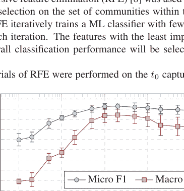
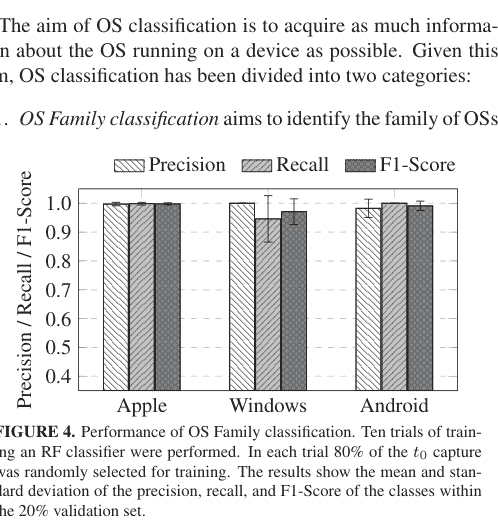
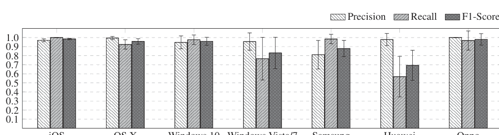
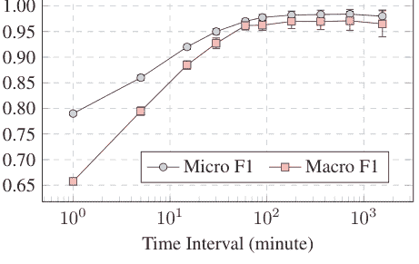

# 2020年机器学习与网络控制国际会议 (ICMLC) (澳大利亚阿德莱德 2020.12.2-2020.12.2)

¹澳大利亚，阿德莱德大学，电气与电子工程学院
²澳大利亚，国防科学与技术集团，网络与电子战部

邮箱：<kyle.millar, adriel.cheng, hongchun, cheng.lim>@adelaide.edu.au, adriel.cheng@dst.defence.gov.au

## 摘要

操作系统（OS）分类对于网络管理员以及实现更佳的网络设备组成质量变得越来越重要。此外，它还可用于识别对网络构成安全风险的设备。然而，操作系统的巨大数量和多样性使得分类变得日益困难。我们利用了社会不变性操作系统分类技术，该技术在各种网络配置中均可快速训练和部署。我们展示了如何将关联图（affiliation graph）作为机器学习分类器的输入，仅通过社交特征即可预测设备的操作系统。

随着操作系统数量的增加，在实践中实现全面的操作系统分类技术变得日益困难。

目前的操作系统分类技术通常依赖于大量的设备来提取特征（例如，网络协议标识（IP）的单调性和时钟频率）或其子集 [7]。现代网络中存在的多种类型使得在大规模应用时分类失效。此外，加密标准的广泛应用限制了从数据包数据中提取这些丰富特征集的能力。因此，操作系统分类技术依赖其他特征已成为必要。

我们通过对大学无线网络上的499台设备进行分析，研究了我们方法的有效性。我们证明了该方法可以以 99.3% 的准确率分类不同的操作系统族（即 Apple、Windows 和 Android）。我们通过以下方面扩展了研究：1) 检查不同的操作系统（iOS、OS X 和 Windows 10）；2) 调查做出准确预测所需的时间；3) 确定我们的方法在六个月内的有效性。

本文的目标是产生一种仅使用网络管理员可用的最少信息的分类器。为了实现这一目标，我们建议使用关联图，通过设备通信的 IP 地址来构建设备的行为特征。通过这种方式，我们创建了一个加密不变性图，该图构建快且所需样本少。图 1 显示了从 IP 地址构建关联图的示例。

关联图是一种社交网络技术，通过个体所属的社区来研究个体（用“参与者”表示）的特征 [6]。社交社区在成员关系上同时形成隐式和显式社区，例如共同兴趣、职业或血缘 [14]。通过这种机制，可以揭示成员集内部的共同亲缘关系。例如，Facebook 仅根据用户所属的小组即可识别用户的潜在亲缘关系 [11]。

## 关键词

网络安全；机器学习；关联图；操作系统分类；被动监控

## 1. 引言

操作系统分类允许我们仅通过观察网络流量来识别设备的操作系统（例如 iOS、Android 或 Windows 10）[2]。识别操作系统有助于提供更优的服务质量（QoS），并协助网络安全部门识别易受攻击的设备 [4]。然而，

关联图的优势在于当观测到参与者与其社区之间的关联关系时 [5]。通过理解为什么产生这些关联，可以在不需要对参与者有先验知识的情况下对参与者做出推断。这一观点的公理是：设备（参与者）的操作系统可以通过该设备所属的 IP 地址（社区）来确定。例如，设备操作系统的更新可能会揭示其为 Windows 系统 [7]。如果已知参与者所属的社区，就可以构建出不同操作系统的通用行为特征。我们工作的主要贡献是：

1. 我们证明了关联图上的随机森林（RF）分类器可以对操作系统族（如 Apple、Windows 和 Android）达到 99.3% 的分类准确率。此外，还达到了 94.6% 的准确率。
2. 我们发现基于 IP 地址构建代表性特征的图大约需要一小时。
3. 我们研究了该方法在六个月后的性能下降。对于 Apple 和 Android 操作系统，分别下降了 3% 和 7%，这种下降可以通过每六个月重新训练分类器来缓解。

本文的其余部分结构如下：第 2 节简述相关工作并介绍数据集概述；第 4 节介绍特征选择过程；第 5 节介绍操作系统分类；第 6 节调查所需的时间；第 7 节检查方法在六个月后的性能；第 8 节总结全文并对结果和未来工作提出建议。

## 2. 相关工作

由于维护网络安全和功能的紧迫性，对设备管理策略兴趣日益增加。操作系统分类是设备管理的一个主要领域，因此在过去几年受到了广泛关注。

最常用的操作系统分类技术是数据包检测。数据包检测揭示了不同操作系统数据包创建的差异。例如，数据包的存活时间（TTL）可用于识别操作系统（Windows 的 TTL 为 128，而 Apple 和 Android 则为 64）。数据包检测还可以提取更显著的特征。例如，HTTP User-Agent 字段可识别操作系统的版本和版本。加密降低了仅依赖载荷细节检测技术的有效性。

有几种著名的利用数据包检测的工具（例如 Nmap [9]、Probe [2] 和 p0 [16]）。这些技术实现了高分类性能，并能够识别操作系统的版本。Nmap 和 Probe 要求在分析期间设备连接到网络。此外，这些工具无法对已不在网络的设备进行调查；在有足够数据包数据的情况下，p0 可以对设备的操作系统进行追溯分析；然而，

如果对数据包进行清洗不充分，存储和处理可能会导致安全和隐私问题。

通过观察设备网络流量随时间的变化，可以预测其操作系统（OS）。例如，设备在网络中发送数据包的频率可用于识别操作系统 [13, 10]。此类方法的挑战在于，由于设备上活动程度的不同，设备的网络特征可能会存在显著差异。当设备处于高负载时，通常能观察到最佳结果。此外，这些技术对于大型网络有效，且不会增加构建特征集所需的处理时间。

每个网络流¹仅需要源IP和目的IP地址。这使得该技术填充速度快且所需的存储空间少。此外，由于大多数网络管理员都能访问流记录，该技术具有广泛的可部署性。

图 2 显示了26小时网络流量的关联关系图。可以看出，在26小时跨度内关联的大多数设备归其操作系统制造商所有。

为了向机器学习（ML）分类器表示关联关系图，对每个设备所属的设备进行独热编码（……

本文的目标是产生一种操作系统分类器，该分类器使用对网络管理员有用的最少信息。将我们的分析限制在足以创建一个适用于任何TCP/IP网络的关联关系图的范围内。在之前的工作 [12] 中，我们展示了关联关系图用于操作系统分类的可行性。

在本文中我们展示了这项工作的扩展，通过利用机器学习（ML）识别用于操作系统分类的相关特征。此外，我们通过以下方式对方法进行了首次评估：1) 检查心跳所需的长度，以确保对操作系统做出准确预测；以及；2) 研究了我们提出的方法在六个月内的纵向特征。

需要一个大型真实数据集来分析不同操作系统的行为特征。为了提供这一数据集，从阿德莱德大学的一个网络中进行了采集。该网络的创建允许员工和学生将其无线设备连接到大学的企业网络中。它为分析当前操作系统的真实行为提供了见解。

### 3.1. 数据集 – 大学校园

分析的无线网络是一个 /23 子网，允许在任何时候分配高达510个IP地址一次。一个IP地址可以在采集期间重新分配给多个设备。为了解释这种IP地址的重新分配，使用了地址解析协议（ARP）日志来识别设备分配到特定IP地址。网络上每个操作系统的流量通过动态配置协议（DHCP）指纹进行采集。DHCP指纹允许识别主机在其DHCP握手期间请求的参数。无法通过DHCP指纹识别的操作系统标记为“未知”并从分析中排除。在3月1日（$t_0$）、8月（$t_1$）和11月（$t_2$）进行了三次采集。这三个月的时间允许对我们的方法进行评估。所有分析将针对$t_0$采集进行，第7节（纵向分析）。无线网络中操作系统的分布还被分为具有相似基础代码或共享功能的操作系统族。因此，分类……

| 操作系统族 | 操作系统 | $t_0$ | $t_1$ | $t_2$ |
| :--- | :--- | :--- | :--- | :--- |
| 苹果 (Apple) | iOS | 240 | 217 | 234 |
| Windows | OS X | 91 | 77 | 84 |
| Windows | Windows 8.1 | 26 | 22 | 2 |
| Windows | Windows/7 | 17 | 15 | 14 |
| Android | Samsung (One UI) | 37 | 26 | 31 |
| Android | Huawei (EMUI) | 19 | 16 | 16 |
| Android | Oppo (ColorOS) | 10 | 10 | 8 |
| Android | Google (Stock) | 1 | 2 | 2 |
| Android | Xiaomi (MIUI) | 3 | 2 | 2 |
| 其他 | Other | 51 | 50 | 50 |
| 其他 | Printer | 1 | 1 | 1 |
| 其他 | Unknown | 181 | 151 | 172 |
| 总计 | | 681 | 598 | 632 |

表 I. 无线网络上操作系统的分布。采集是在3月1日（$t_0$）、8月（$t_1$）和11月（$t_2$）进行的。

## 4. 用于操作系统分类的社区

$t_0$采集集总包含19,222个社区。但并非所有这些社区都适用于操作系统分类。必须使用特征选择过程来减少冗余社区。在训练操作系统分类器之前实施特征选择过程证明可以提高整体性能 [11]。减少冗余社区有助于操作系统分类的进一步研究。

递归特征消除（RFE）用于$t_0$采集集社区。RFE在每次迭代后运行特征较少的机器学习分类器。对整体性能重要性最低的特征被选中用于重……

在$t_0$采集上进行了十次RFE试验，以识别操作系统分类中最重要的社区。

对于每种情况，随机选择类别的80%来使用RFE训练RF分类器。在训练分类器后，在剩余的20%类别上评估了Macro和Micro F1分数 [15]，以提供分类性能的概述。提供了RF测试结果的总结。当使用前200个社区进行分类时，分类性能很高。社区较少会导致分类器无法区分不同的操作系统，额外的社区增加了寻找每个设备正确操作系统的难度。

从操作系统分类的前200个社区列表中，发现75个（72.5%）由苹果、微软或谷歌所有。考虑到这些是这三个操作系统的制造商，这一结果并不意外。该集合中的社区需要管理和更新各自的操作系统。例如，微软在$t_0$中为所有设备提供了Windows更新。对社区集提供信息的进一步分析可以在我们的工作 [12] 中找到。

本文中的前200个社区被用于后续分析的特征。

## 5. 操作系统分类

操作系统分类的目标是获取关于运行在设备上的操作系统的更多信息。于此，操作系统分类分为两类：

1. 操作系统族分类，识别目标操作系统所属的操作系统族（例如苹果、Windows或Android）。设备的操作系统族通常决定了应对该设备实施的管理和安全实践。操作系统分类旨在对获取网络操作的概述有益。
2. 操作系统分类，识别设备上特定的操作系统。操作系统分类允许对设备进行更深入的见解。因此，当需要对一组设备进行更多分析时使用。

为了检查我们的方法，在$t_0$采集上进行了RF分类器试验。对于每次，随机选择80%用于训练，20%作为验证集。操作系统族和分类的处理结果见图4和图5。

操作系统族和操作系统分类的平均准确率分别为99.3%和94.6%。这突显了可以使用易获取数据集对设备操作系统做出预测。因此，该方法适用于共享相同包空间的大型网络。

## 6. 时间间隔

便携设备（如笔记本电脑、手机和平板电脑）的流行缩短了设备连接到给定网络的时间。研究设备在网络上需要监控多久是可靠的。

第4节和第5节介绍的结果是在整个$t_0$采集上进行的。因此，每个设备可以使用最多26小时的活动来进行操作系统分类。但并非所有设备在整个期间都是活跃的。在$t_0$采集内，设备在网络上的平均活跃间隔为5.67 $\pm$ 6.80小时。时间间隔的巨大差异表明

前几节中的分类并不严重依赖于捕获长度。然而，这些结果对于那些在网络上存在时间较短（例如小于一小时）的设备，并没有提供良好的分类性能指示。

捕获中设备的网络活动设置了较短的时间间隔，以确保捕获长度对分类性能的影响。对于每个时间间隔，使用 80% 的数据训练 RF 分类器，并使用 20% 的数据验证其性能。结果见图 6。

图 6 展示了在一小时或两小时时间间隔内相对稳定的分类性能。捕获数据中的 490 个 (98.4%) 设备超过了这一时间阈值。因此，结果支持分类并不严重依赖于捕获长度。然而，对于小于一小时的时间间隔，分类性能并未表现出下降趋势。因此，我们假设通过仅监控设备通信的 IP 地址，平均大约需要一小时来构建设备的 OS 特征配置文件。

## 7. 纵向分析

预计 OS 的行为会随着时间而变化。例如，OS 可能会接收更新以修改其通信的在线服务（以及相应的社区 IP 地址）。相反，在线服务可能会修改其用于与客户端设备通信的 IP 地址。在两种情况下，随着对 OS 生态系统修改的增加，该方法的分类性能将会退化。

在同一大学网络上进行了纵向分析，以检查该方法的分类性能有效的持续时间。在捕获数据后进行了两次捕获（间隔为 t1 和 t2 个月）。这些捕获使我们能够洞察六个月内 OS 在线环境的变化。RF 分类器在 80% 的数据上训练，并在 20% 的数据上测试。表 2 总结了所有三次捕获数据的 OS 族和 OS 分类性能。

表格指示了分类性能以及训练与测试获之间的时间段。这支持了预期：OS 环境随时间变化，从而导致该方法的分类性能退化。然而，六个月后，OS 族和 OS 分类的整体分类性能（Micro F1 分数）下降幅度均小于 10%。分类性能的退化对于获取网络上 OS 组成的初步概览仍然是可以接受的。

在工作中，我们对利用关联图进行设备表征提供了更广泛的分析。特别地，我们的目标是利用非个性化机器学习来识别网络上具有相似行为特征的设备集群。

在六个月期间，各个类别的分类性能之间存在巨大差异。Android 和 iOS 的 F1 分数下降相对较小（分别为 5% 和 2%）。然而，同一时期 Windows 的 F1 分数下降了 29%。有多个因素可能影响了该方法在 Windows 上的性能。例如在 t1 和 t2 之间发布了 Windows 更新。

## 致谢

本研究受澳大利亚政府研究计划（KTP）奖学金和国防部的支持。

## 参考文献

- [1] Nikunj Malik, Jayanarayanan Chandamouli, Pralad Suresh, Kevin Fairbanks, and William H. Robinson. Using network traffic to verify mobile device. In 2017 IEEE 14th Annual Communications & Networking Conference (CCNC), pages 114–119.
- [2] Jeremy Merrill. Liberal, moderate or conservative? see how Facebook labels you, 2016. [Online]. Available: https://www.nytimes.com/2016/08/24/us/politics/facebook-ads.html. [Accessed: September 2019].
- [3] Kip Miller, Adrian Cheng, Hong Guin Chew, and Cheng-Chew Tian. Characterizing smart devices using affiliation graphs. 2020 IEEE/FIP Network Operations and Management Symposium, 2020.

### References

- [4] Nicholas Ruffing, Ye Zhu, Rudy Libertini, Yong Guan, and Riccardo Bettatti. Smartphone reconnaissance: Operating system identification. In 2016 IEEE 13th Annual Consumer Communications & Networking Conference (CCNC), pages 1086–1091, 2016.

- [5] Jaewon Yang and Jure Lesovec. Community-affiliation graph model for overlapping network community detection. IEEE 12th International Conference on Data Mining, pages 1170–1175, 2012.

- [6] Michal Zalewski. p0f v3, 2014. [Online]. Available: `https://lcamutf.cooredump.cx/p0f3/`. [Accessed: March 2020].

### Table 2. OS 和分类性能的纵向分析

| F1-Score | t0 | t1 | t2 |
|---|---|---|---|
| **OS Family** | | | |
| Micro | 01/2019 | 08/2019 | 01/2019 |
| Macro | 0.98 | 0.94 | 0.92 |
| **OS Classification** | | | |
| Micro | 0.90 | 0.83 | 0.81 |
| Macro | 0.78 | 0.64 | 0.61 |
