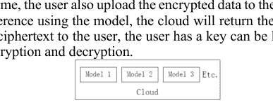

# 2020年网络与网络应用国际会议 (NaNA) (中国海口 2020.12.10-2020.12.13) 2020年网络与网络应用国际会议 (NaNA) ｜｜ D


Hei Xinhong¹
计算机科学与工程学院
西安科技大学
中国西安
heixong@xaut.edu.cn

Liang Xiaoling², Wang Yichuan², Ji Wenjiang²
Zhu Lei²
²计算机科学与工程学院
西安科技大学
中国西安
chuan@xaut.edu.cn

**摘要—** 随着4G/5G网络技术的普及以及物联网（IoT）的发展，越来越多的个人和企业开始利用其强大的计算和技术运行深度神经网络，以帮助完成分类、回归、识别、自然语言处理（NLP）等任务。这不仅给人们带来了便利，但也导致了用户隐私数据的泄露。在本文中，我们提出了一种基于安全多方计算（MPC）的深度学习模型设计方法。在此过程中，我们实现了模型仅存在于用户加密数据上。在实验部分，，加密模型的分类准确率达到了99.21%，接近未加密的结果。该分类准确率低于测试结果，但优于现有的实现数据隐私的深度学习网络模型。

*关键词：* 网络；同态加密；物联网；深度学习；MPC

**引言.** 人工智能的概念已被推向历史的新高度，而深度学习是人工智能的一个分支。根据报告，包括Google、Facebook、百度和阿里巴巴在内的许多公司也受益于这一专注于这些目标和技术的领域。近期，深度学习取得了显著进展。随着云服务的快速发展，这些企业在云端提供相应的深度学习模型，根据用户的不同需求提供服务。一方面，它为用户提供了强大的服务；另一方面，用户将照片、视频等数据上传到云计算后，将面临因后续使用导致的隐私泄露风险。在这种情况下，我们知道神经网络模型会随着数据集的增加和多样化而变得更好。在金融和健康等领域，法律或法规不允许个人数据，因此我们可能无法有限数据获得良好的深度学习模型 [1]。随着现代社会对隐私的日益关注，确保数据隐私以及学习过程中算法的有效性已成为机器学习领域的一个大问题。

同态加密的出现使得在学习领域应用加密成为可能。Rivest在1978年首次提出了同态加密的概念 [8]。同态加密是加密的一种，允许人们对密文进行代数运算以获得加密结果。密文将被解密以获得结果。目前有许多同态加密算法可用，大多数是加性的，例如Bacon和Paillier [3]，以及支持同态加密的RSA [4]和ElGamal。2009年，[5] Gentry Li提出了一种基于理想格的同态加密算法，这成为一个可以实现同态加密所有属性的解决方案。尽管它在机器学习中被广泛使用，但它不能应用于方案本身的过程，具有计算模型和高安全性。

虽然同态加密理论可以进行计算，但在实践中，我们应该注意加密的特性：仅支持输入数据；计算深度需要固定，且无法无限进行加法。同态加密不支持乘法和比较。因此，同态加密无法应用于深度学习。

在接下来的段落中，我们将讨论这些问题并提供解决方案。我们的贡献如下：

- 我们将深度学习与同态加密算法以及基于安全多方计算（MPC）的深度学习网络模型相结合，以确保用户在使用代码深度学习模型时的数据隐私。

我们使用卷积神经网络的实验结果显示，加密Mist数据集的分类率可以达到99.21%，非常接近明文结果，也接近最先进模型的准确率。cipher-10加密数据集的分类率可以达到98.5%，高于明文结果，并优于现有的可以实现数据隐私的深度学习网络，且每个样本平均需要11秒在云端完成推理。

## II. 同态加密

本质上，同态加密指的是在环上进行加法和乘法，然后对结果进行加密。下面我们介绍了Paillier算法的工作步骤。

### A. 密钥生成

取两个大素数p和q，计算它们的乘积N以及p-1和q-1的最小公倍数 $\lambda$：

$N = pq$
$\lambda = \text{lcm}(p-1, q-1)$

如果随机选择一个整数 $g \in Z_N^*$，$Z_{N^2}$代表所有小于 $N^2$ 的集合，其中 $\lambda$ 是私钥，$(N, g)$ 是公钥。

### B. 加密过程

如果 $m \in Z_N$ 是待加密的明文，加密算法如下：

$c = E[m,r] = g^m r^n \pmod{N^2}$

其中：$m \in Z_N^*$ 是随机选择的整数，c是加密数据。对于相同的明文 $c$，会由不同的密文 $c$ 生成，但在解密后可以恢复。

### 解密过程

如果 $c \in Z_{N^2}$ 是待解密的密文，解密算法如下：

$L(u) = \frac{u-1}{N}$
$L(c^\lambda \mod N^2) = L(g^m \mod N^2) \mod N$

其中，$L(\cdot)$ 定义为：

$L(u) = \frac{u-1}{N} \quad (5)$

$D[E[m_i,r_i]E[m_j,r_j]] = m_i + m_j \pmod N \quad (7)$

### D. 数字处理

同态加密仅定义小于N的非负整数。由于我们需要带符号整数和浮点数，加密前应将值编码为有效值。负数和浮点数的预处理如下：

- 带符号整数相对简单：我们利用同态加密的模运算特性。我们选择表示-N/3到N/3之间的整数来解码结果。并且我们可以通过除以它来检测负值。
- 表示浮点数是一项困难的任务。我们使用固定精度算术的变体，通过将因子乘以大数（例如$10^6$）并对结果进行四舍五入。

数字的完整方案可以在data6.esiro.au获取。

## III. 卷积神经网络

CNN（卷积神经网络）是一种包含卷积计算和深层结构的前馈神经网络，是深度学习的代表之一 [7-8]。卷积神经网络具有表示能力，并根据其层次结构对输入进行平移不变分类。它也被称为平移不变人工神经网络（SIANNN）[9]。下面我们分别介绍了CNN的各层：


1) 输入层：输入层是整个神经网络的基础。在用于图像处理的卷积网络中，它生成图像的像素矩阵。

2) 卷积层：卷积层通常使用卷积核（过滤器）来提取抽象特征。卷积核的前向传播是计算输出层输入矩阵节点的过程。通常卷积核使用 3x3 或 5x5。让我们向您展示一个 2x2*3 节点是如何变成一个 1x1 输出单元的。在公式 (8) 中，输出单元节点第一个节点的权重代表第一个对应的元素。在公式 (9) 中，是激活函数。因此，第一个节点的值是恒等的。最后，卷积层的前向传播是将卷积核从当前层的左上角移动到右下，并在移动过程中计算每个对应的恒等。

```
$y = \sum w_{ij}x_{ij} + b$
```

```
$g(t) = f(y)$
```

3) 池化层：池化层的作用是缩小激活矩阵尺寸。有效的池化通常使用平均池化和最大池化。由于我们对 CNN 应用了同态加密属性，但不支持取最大值的操作，因此后续模型的池化层将使用所有的平均池化。

4) 全连接层：此处的每个节点都连接到下一层的所有节点。我们可以将上述卷积层和池化层作为图像特征提取的过程。特征提取后，需要全连接层来完成分类。

5) 激活层：激活函数用于实现非线性。有多种激活函数，如 $ReLU(x) = max(0,x)$，$Tanh(2x-1)$。我们的模型中使用了激活函数 [1-12]。

根据上述对 CNN 概念的介绍，我们发现 CNN 网络的前向传播执行了两种操作：加权和以及用于同态加密的加法标量乘法。在加权和中，它与上一节介绍的 Paillier 属性非常相似。根据第三节的描述，我们使用代码进行封装，使得密文可以直接相加，最终结果与执行相同操作的结果相同。由于激活函数是非线性的，它不符合上述同态加密属性。接下来，我们针对这个问题提出了一个解决方案。

## IV. 实际应用

### A. MPC

为了将 Paillier 算法与 CNN 结合，我们必须解决非线性激活函数无法满足加法同态和标量乘法同态属性的问题。

因此，我们引入安全多方计算（Secure Multi-party Computation，简称 MPC）。MPC 的根在于姚 [13-14]，属于数百万想在不透露金额的情况下找出谁更有钱的人。从术上来说，安全多方计算是密码学的一个子领域，它允许多个方在不信任的情况下处理数据，且任何一方都无法获得其权利之外的他人信息。

基于上述实际应用场景的考虑，我们设计了自己的交互结构。图 1 中的结构展示了 A 方和 B 方的架构 [12]。模型所有者可以将模型上传到云端，同时，用户可以将加密数据上传到云端使用模型进行推理，我们将密文结果返回给用户，用户拥有加密解密密钥。



图 1 数据传输架构。

### B. 激活函数处理

我们定义 E(x) 和 D(x) 分别为加密和解密，并定义 A(x) 为：

```
$A(x) = \begin{cases} D(x) & 1 \\ D(x) & 0 \end{cases} (10)
```

在下一个模型中，我们可以移除激活函数，当云端返回密文时，卷积层的计算包含公式 (8) 或者全连接层的 $A(x)$ 返回到云端，直到最后一层生成并解密它。

## V. 实验

在本节中，我们介绍了我们的实验。我们使用 Python3.6 在带有 Intel(R) i7、32G 内存和 Nvidia 2080 GPU 的服务器上实现了该方案。为了方便分析，这里必须确保加密数字[0,255]，我们可以对密图进行解密，但 Paillier 加密在密文中变得很大，因此我们在这里对密文进行 8 位操作，保证图像中的每个像素值都在[0,255]之间。攻击者无法从图像中获取信息。

### A. 模型训练

如图 2 所示，我们使用了 MNIST 数据集，它包含 60000 个手写字符。每幅图像为 28*28。在训练过程中，batchsize=128，学习率=0.001，卷积大小为 (3,3)，步长为 (2,2)。测试集的准确率可以达到 99.62%，如图 3 所示。最后，我们在云服务处训练了模型。

### B. 模型推理过程

决定模型推理时间的因素是加密解密的数据量以及执行次数。根据我们的算法，数据数量指的是层的数据维度以及模型本身的偏置参数。如图 5 所示，我们列出了移除激活层后每一层的数据大小。在 MNIST 样本中，我们使用 Paillier 同态加密对每个像素进行一次处理，然后输入模型进行推理。如图 4 所示，第一列是我们的原始手写字符，第二列是密文样本。


接下来，我们讨论加密解密效率的优化。为了提高加解密时间，我们使用 GMPY 来优化同态算法代码。GMPY 相比支持多精度算术的 C 代码 Python 实现更为优。GMPY 增加了对 MR（修正实浮点运算）和 MPC（复数浮点库）的支持，同时更新了 API 和命名规范以保持一致性，并支持额外的功能。

我们比较了使用和不使用 GMPY 加密样本所需的时间。表 I 显示了 keylength=302 时同态加密的结果。可以看出，在不影响 CPU 和 RAM 内存的情况下，加解密时间存在显著差异。在实验中，我们使用 GMPY 优化库进行加解密工作。

## 表 I。当 KEYLENGTH=302 时，GMPY 对样本加密时间的影响

| 库 | RAM | 时间 |
|---|---|---|
| 未使用 GMPY | 10.6% | 166MB | 233.5s |
| 使用 GMPY | 10.6% | 166MB | 24.37s |

## 表 II。密钥长度对样本加解密效率的影响

| 密钥长度 | 512 | 768 | 1024 | 2048 |
|---|---|---|---|---|---|
| 1 样本/s | 0.281 | 0.589 | 1.167 | 2.707 | 24.39 |
| 64 样本 | 13.175 | 37.506 | 72.286 | 146.562 | 529.103 |

我们注意到，目前的非对称加密主要基于大质数分解，且加解密时间随着密钥长度的增加而迅速增加，相应的安全性也之提高。此外，密钥长度不宜过大，以保持明文的效率。根据上述内容，样本的灰度值在进入模型之前会被处理为 [0,1]，因此在模型处理过程中，值的生成更为重要。为了安全，实验中的密钥长度设置为 512 位。在工业生产环境中，根据安全需求适当增加密钥长度。

## 表 III。不同层的数据维度、参数、解密时间

| 层 (类型) | 输出形状 | 参数 | 解密时间 (秒) |
|---|---|---|---|
| 输入层 | (28, 28) | 1 | 0 |
| 卷积层 | (26, 26) | 200 | 2.073 |
| 激活层 | (26, 26) | | |
| 池化层 | (25, 25) | | 2.511 |
| 卷积层 | (23, 23) | 9050 | 5.291 |
| 激活层 | (23, 23) | | |
| 池化层 | (11, 11) | | |
| 展平层 | (6050,) | | |
| 全连接层 | (256,) | 149056 | 0.055 |
| 激活层 | (256,) | | |
| 全连接层 | (10,) | | 0.002 |
| 激活层 | (10,) | | |
| 总样本数：1,580,776 | 总时间：11.143 | | |

## 表 IV。模型准确率对比

| 模型 | 本文 | CryptoNet |
|---|---|---|
| 最小准确率 | 99.21% | 98.95% |
| 密文准确率 | 91.35% | 未提供 | |

我们使用测试集进行模型分类，结果准确率为 99.2%。如前所述，明文状态下的模型精度可以达到 99.6%。为了验证系统方法可行性，我们还使用了数据集 [17] 在更复杂的 CNN 结构上进行训练，明文准确率达到了 92.23%。最后，密文准确率可达 91.35%。

在工作中，我们将我们的方法与现有方法进行了比较。可以看出，我们的方法效率更高并保持了高准确率。结果表明所提系统在实际应用中是可行的。

## 六. 结论

