# 2020年电力、能量、控制与输电系统国际会议 (ICPECTS)(印度钦奈 2020.12.10-2020.12.11) 2020年电力、能量、控制与输电系统国际会议

SHEELA A,
计算机科学与系副教授，
Sri Saikram Engineering College, West Tambaram, Chennai-44.

# 摘要：

磁共振（MR）成像对于在早期发现脑肿瘤以提供适当治疗至关重要。MR成像的准确分割需要大量的高质量记录以便对脑肿瘤进行快速分析，并在科学图像分析中证明了显著的优势。

分割使用了许多分类策略，包括支持向量机工具和随机森林分类器。PET图像和MRI图像通过小波变换处理进行合并。在当前设备中，使用了平稳小波变换（SWT）。目前的机器会导致滞后、准确性低和噪声过多。因此，我们提倡一种利用离散小波变换（DWT）和深度神经网络（DBN）的设备来增强能力，通过应用移动，我们通过调整灰度（GN）区域的统计数据和白质（WM）位置的特定数据获得了一种极佳的组合。为了测试，我们使用了三个数据集：日常轴位、标准冠状位、阿尔茨海默病脑图像。总体而言，我们的方法在光谱差异（SD）和平均梯度（AG）方面的表现在每个视觉和定量上均达到了更高水平。

被动策略已成为解决上述危机的一种可能方法。图像处理的基本概念是，大多数（如果不是所有）图像处理设备在处理过程中都会留下（几乎无法察觉的）痕迹，因此，可以通过调查这些痕迹的存在来确定照片是否经过了某种类型的处理。在过去的几年里，提出了许多算法，大多数精确地使用了一组从图像开始的特征，并使用它们将内容分类为显示痕迹或未显示。

临床图像的计算机评估每天变得越来越重要，因为它对分析的物质能量具有极高的敏感性。因此，对这些不同的图像进行了分析，并使用了许多策略对不同疾病进行计算识别。检测疾病演出了多种方法。这些包括基于全连接技术的检测和边缘检测、基于FCM的技术（如灰度变体类技术）、基于多层感知的全连接技术。在检测方法的早期，必须检测并分割视盘，因为视盘经常由于渗出物而具有较大或较小的等亮度评估差异。

# I 引言

图像配准旨在使用……研究任何照片的记录

所以，如果视盘在早期阶段被分割，技术可能会产生错误结果。在本文中，我们计划了一种方法，将动态计算第一个阈值以发现眼底照片中的渗出物。本文分为四个部分。第1节是引言。第2节是所提方法的信息。第3节和第4节指示结果，而根据固定诊断工具的输出检查图像的真实性并不总是一项简单的任务，这证明了专门针对这种情况设计合适的选择融合技术的必要性。其中初始的修改可能是经验性的。它由许多解剖结构组成，这些指向许多疾病，如高血压、糖尿病和各种眼病。

流向视网膜血液减少。这些颗粒被称为渗出物。

针对渗出物演出了多种方法。这些包括基于全连接技术的阈值和边缘检测、主要基于FCM的技术（如灰变体类技术）、基于多层感知的全连接技术。在检测方法的早期，必须检测并分割视盘，因为视盘经常由于渗出物而具有较大或较小的等亮度评估差异。

应对这些疾病最简单的方法是对视网膜眼底图像进行常规筛查。糖尿病视网膜病是糖尿病最严重的问题之一，也是失盲的主要原因。它是专门为30岁至69岁的人群失盲而设计的。

所以，如果视盘在早期阶段没有分割，技术可能会产生结果。在本文中，我们计划了一种方法，将动态计算第一个阈值以发现眼底照片中的渗出物。本文分为四个部分。第1节是引言。第2节是所提方法的信息。第3节和第4节指示结果，而根据固定诊断工具的输出检查图像的真实性并不总是一项简单的任务，这证明了专门针对这种情况设计合适的选择融合技术的必要性。

五分之一的糖尿病患者在诊断时患有视网膜病。1型糖尿病，糖尿病视网膜病在预后方面绝不是不可忽视的。但在15年后，所有患者中大多数没有方法。由于这些原因，对那些有糖尿病视网膜病史的2型糖尿病做出最终选择。

## 现有系统

图像处理是使用被动过程分析图像记录，并已成为解决危机的可能可能方法。图像处理的基本概念是，如果不是所有，图像处理设备都会在处理后的图像中留下一些（通常不可察觉的）痕迹，因此，可以通过调查这些痕迹的存在来识别照片是否经过了某种类型的处理。在糖尿病视网膜病病例中，血管受损导致蛋白质和脂肪性泄漏到视网膜旁破裂的血管

# II 提议系统

视网膜是眼睛最深、最重要的层，在这里可以观察到最初的病理变化。

所提的方案主要将MRI和PET图像分解为小波的低频和高频。然后根据定义的条件分步合并高低频。得到高频和低频方面的标准融合图像。低频融合是一项重要且艰巨的任务。各种方案对低频融合使用了特殊的标准。例如，一个愿望是完全丢弃低频；任何其他选择是每个频率的平均或加权平均等。然而，由于这些方案没有捕捉图像的空间特征，其性能有限。它由几个关键的解剖系统组成，这意味着疾病包括高血压、糖尿病和各种眼病。在糖尿病视网膜病病例中，血管产生的蛋白质和脂肪碎片从破裂的血管渗出，碎片流向视网膜。这些碎片被称为渗出物。在检测系统的早期需要检测并感知视盘，因为视盘经常由于渗出物的影响产生多或少的等亮度评估。所以，如果视盘在系统早期没有被感知，也会产生错误结果。所提方案首先将MRI和PET图像分解为小波的低频和高频。然后根据定义的标准分步融合高低频。得到高频和低频方面的标准融合图像。在PET和MRI图像中，应用了HIS变换使得PET照片分解为深度、色调和饱和度分量。在PET照片中，高低活动区域之间存在颜色差异，在这里可以区分它们。感兴趣区域（ROI）是从PET和MRI图像中提取的。离散小波（DWT）允许以不同的形式对图像进行分解并保留少量信息。来自此类图像的系数通过混合来获得正确的统计数据。

一旦系数合并，将使用逆离散小波变换完成最终图像。图像融合在视觉处理领域具有许多优势。通过将冗余信息分组到不需要的图像中，图像融合提高了后续图像的可靠性。通过融合图像内部的互补信息可以增强图像的功能。

# 2020年第二届电力、能量、控制与传输系统国际会议分别提供了结构事实和光谱统计。对高频频率感兴趣区域进行小波变换以实现右侧重构。然后，我们将 PET 和 MRI 中过度和低牧草区域照片的小波共绿色相结合，并应用逆小波变换。

# III 系统架构与实现

在这一步中，拍摄 PET 和 MRI 图片，应用 HIS 变换使 PET 照片分解为深度、色调和饱和度加分量。在 PET 照片中，高活动和低活动区域之间存在差异，因此可以采用相应的方法对其进行区分。使用区域映射法从 PET 和 MRI 图片中提取感兴趣区域 (ROI)。PET 图像是灰度图，其中高兴趣和偶发活动区域分别提供了结构事实和光谱统计。

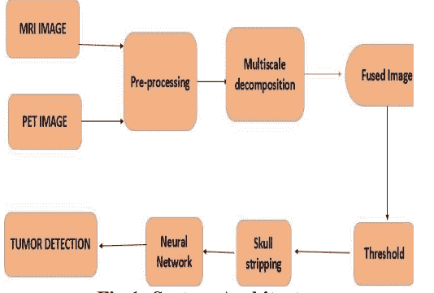

图 1 - 系统架构

## 模块 1

在开始任何视频或图像处理之前，必须通过相机捕捉图像并转换为可管理的实体。这种技术被称为图像采集。图像采集技术由三步组成：来自爱好物体反射的电、聚焦能量的光学系统，以及随后测量电量的传感器。

当我们把 PET 和 MRI 过度和低牧草区域照片的小波共绿色相结合，并应用逆小波变换来寻找脑肿瘤。取医设备并不总是一项轻而易举的事业，因此针对这种情况设计合适的选择融合技术显地证明了其合理性。

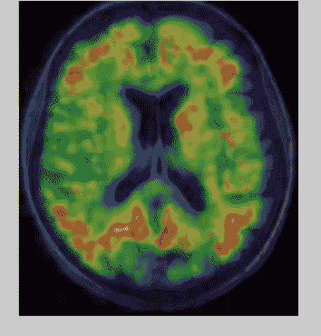

图 2 - 图像处理

如今，脑瘤是一种非常有影响的设计，它是大脑或中脊髓内细胞的异常生长。

因此，我们提出了一种方法，使用离散小波变换和深度信念神经网络来去除颅骨剥离并避免高噪声和重叠。

## 模块 2

降噪和去除是 MR 图像处理结构的重要部分。MR 图像首先可能会出现拍摄故障，使用噪声消除来去除不需要的模糊。通过去除噪声，我们可以提高 MRI 和 PET 图像的质量，并且很容易转换为灰度。阈值值将根据噪声值进行调整。

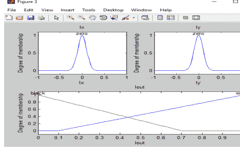

图 5 - 灰度转换图

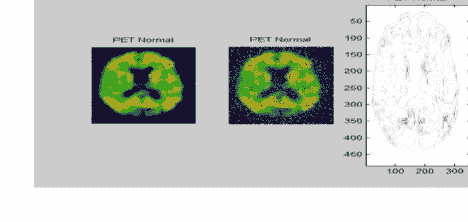

图 6 - 未去噪的 MRI 和 PET

## 模块 3：

图像分割将图片划分为多个部分的方法。这通常用于识别数字像素中的设备或其他相关记录。

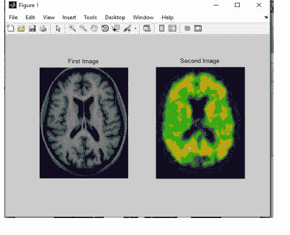

图 3 - MRI 和 PET

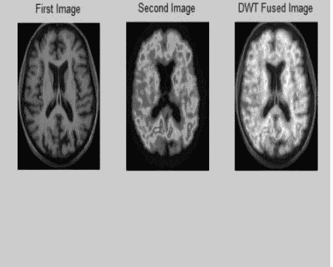

图 7 - DWT 融合图像

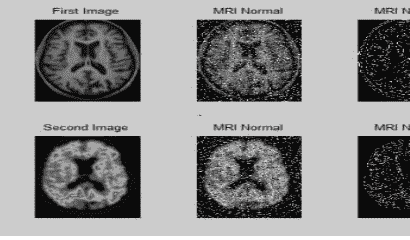

图 4 - 去了噪的 MRI 和 PET

## 模块 4：

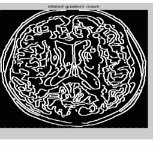

图 8 - MRI 图像

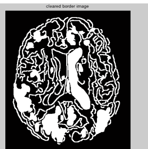

图 11 - MRI 图像

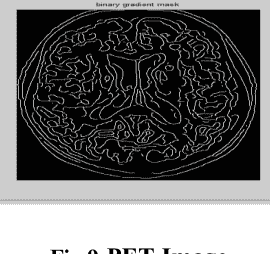

图 9 - PET 图像

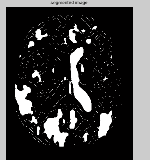

图 12 - MRI 扫描

## 模块 5：

信噪比是用于评估的指标。阈值值将根据噪声值进行调整。决定 MRI 和 PET 的质量。

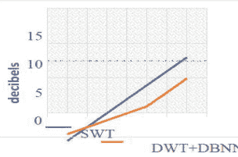

图 13 - DWT 图表

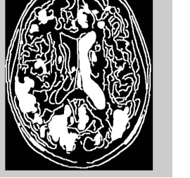

图 10 - MRI

# V 未来增强

未来，该项目可以通过提高 MRI 和 PET 的质量来扩展。

# VI 结论

图像融合从单张图片获得了有益事实。所提技术产生了更高的分辨率。在使用我们所提方法时，照片的空间分辨率更好。

