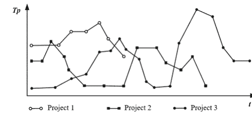
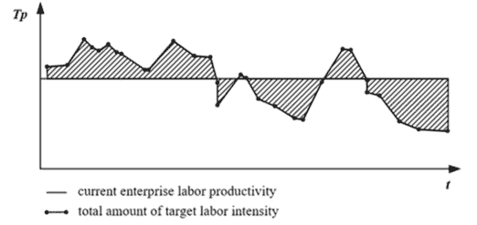
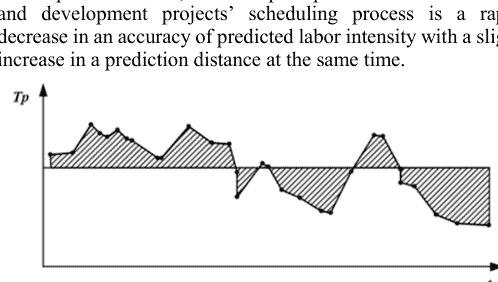

# 2020年质量管理、运输与信息安全、信息技术国际会议 (IT&QM&IS)（俄罗斯雅斯拉夫尔，2020.9.7-2020.9.11）

**摘要**——本文描述了非螺线化飞机生产领域的质量控制与管理问题。通常，许多项目会同时执行。这些项目共享资源，往往会增加质量管理领域项目规划的风险。项目规划系统的主要目标是管理由合同条款引起的冲突。第一个问题是执行项目调度，第二个问题是识别和评估风险。解决这些问题的合理方法是减少由于项目相互影响产生的学习效应。建议的方法可能会提高准确性，并使用此类回归函数来识别和评估风险。

在保持企业资源稳定使用并满足产品质量要求的同时，控制各阶段的成本。

大多数情况下，企业和项目管理的矩阵形式将任务划分为：

- 符合项目所有阶段的时间和工时限制。
- 保持企业所有资源的稳定分配。

*关键词*——数字技术；企业资源；机器学习；非螺线化生产；项目调度；质量管理；回归函数；研究与开发。

## 1. 引言

第一个项目的结果是一个任务进度表，其中包含了根据项目活动和阶段对资源分配的初步分布。图1展示了几个项目资源分配初步分布的示例。

质量控制与管理领域的现代研究对于飞机制造具有特殊性。

非螺线化飞机生产领域的质量控制与管理问题是复杂的，由多个元素组成。其中之一是为具有许多阶段的分配冲突创建新模型，这些阶段具有独特的要求，且大量项目同时执行并相互影响。另一个原因是项目使用企业的共享资源，这导致了进度冲突。

所有这些原因都会增加质量管理领域规划的风险。同时，每个生产阶段的规划过程以及试点项目具有特定的特征。

**图 1.** 几个项目资源分配初步分布的示例

初始项目调度在不考虑其他项目的情况下执行。然而，这些项目共享资源分配，可能会发生进度冲突。

规划系统的主要目标是确保研发阶段在指定的时间内完成，并满足以下限制条件：

为了评估每个项目在限制下的可行性，有必要评估目标工时投入的总数。这需要考虑企业的所有现有及未来项目，并分析资源分配分布（图2）。

## 2. 工时投入与研发项目特点

`Tp` 工时投入。考虑到前述讨论的研发项目特点 [1]，这是一项非同寻常的任务。

在实践中，研发项目调度最易察觉的特征是预测劳动强度的准确性迅速下降，同时预测值略微增加。

**图 2.** 目标劳动强度总额相对于当前企业劳动生产率的示例。

阴影所示区域揭示了目标劳动强度总额与当前企业生产率之间的偏差。这种不规则性有助于解决三重限制（时间、成本和质量），同时形成企业的生产计划：

- 超过时间限制的风险。
- 由于执行模式增加导致总成本下降。
- 超过生产阈值导致质量下降。

**图 3.** 准确性与预测距离的关系示例

重要的是，项目投入的减少可能会导致资金和生产率的下降。

高科技飞机生产的一个特点是对执行人员的依赖。从这里来说，通过经常更换执行人员来解决问题并不有效，因为市场无法提供必要的动态。

图2展示了一个简化示例，它考虑了执行人员、活动规范以及开发过程中人员生产率的情况。资源分配的不规则性增加了。为了解决这个问题并减少上述负面影响，可以采取以下步骤：

- 将部分转移给相关公司执行。
- 相关公司参与项目。
- 在储备中执行额外活动。
- 修订关于时间限制或范围的条款。
- 修改项目进度以反映优先事项。

## 3. 数字技术在质量管理中的应用

目前，研究之一是在质量管理领域应用数字技术 [2]。考虑到生产和开发过程的概率性质，证据表明 [9-12] 可以：

- 准备训练集。
- 选择代表性集合。
- 迭代训练集。
- 分析训练集。
- 自动化训练集。

（注：OCR文本包含大量的重复以及[第1页]与[第2页]之间的乱码片段。我已根据提供的片段清理了重复并恢复了逻辑流。）
