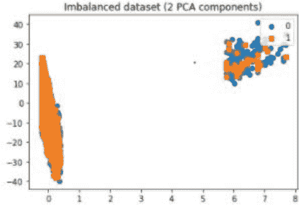

# 2020 电子、信息、通信与技术最新趋势国际会议 (RTEICT) (印度班加罗尔 2020.11.12-2020.11.13)

## 作者信息

**Anusha Garlapapati**  
电子与通信工程系，Amrita Vishwa Vidyyapeatham, Amritpur  
`amrita.edu`

**Dorella Radha Krishna**  
电子与通信工程系，Amrita Vishwa Vidyyapeatham, Amritpur  
`dradhakrishna@am.students.edu`

**Kavi Garlapapati**  
电子与通信工程系，Amrita Vishwa Vidyyapeatham, Amritpur  
`garglapapati@am.students.edu`

**Gayathri Narayanan**  
电子与通信工程系，Amrita Vishwa, Vidyyapeatham, Amritpur  
`gayathri@am.students.a.cedu`

## I. 引言

**关键词**—数据可视化、机器学习算法、员工、分析、压力

2020年3月11日，世界卫生组织（WHO）宣布冠状病毒（COVID-19）为大流行，标志着一场威胁整个世界的全球性流行威胁。“冠状病毒”是一类受病毒影响的疾病家族，引起从流感到其他呼吸道症状的疾病。根据世卫组织的数据，病毒病例已超过200例。由于这一冲击，股市、市场和行业增长出现严重下滑。在此期间，也影响了员工，他们在居家办公以应对压力时感到压力。将机器学习和智能应用于该领域被认为非常有前景。[11] 中分析了员工的行为模式。

相应，除了头痛外，他们由于长时间工作而感到不满意。此外，其后果是对员工表现产生压力。此外，这会影响生理疾病和对工作的投入。在目前的情况下，COVID-19 让世界处于前所未有的地位。通过这项工作，我们打算分析压力水平——

在持续的 COVID-19 疫情背景下，企业和机构已经适应了不可见且不同的工作方式，例如居家办公以及办公室员工人数减少。在新常态下，员工也适应了不同的工作环境和条件，这导致了许多人的心理压力和疲倦。在这项工作中，我们使用了数据可视化技术和机器学习算法来预测员工的压力水平。根据数据，我们可以开发一个模型来预测员工是否承受压力。使用 `XGB` 分类器进行预测，结果显示该方法非常有效。我们还发现工作时间、年龄和角色模糊性对员工表现具有显著意义和影响。结论认为，在所有情况下，增加工作时间并不会减少员工的代表性。

员工正受到如目前疫情等现象的影响。因此，使用机器学习算法来预测员工是否承受压力。

## II. 文献综述

职场压力是资源经理等员工关注的问题。尽管多年来学术界和实务工作一直致力于压力管理，但现在是需要不同视角了。从新兴的组织绩效领域提取，这项研究分析包含了对职业压力的影响。

具体而言，从来自多种行业和组织的大量工作员工样本中，通过建立针对压力表现的应对策略，可以维持积极的效能资源和韧性。过去几年里，已经进行了大量的调查和实验，在努力预防和管理职场压力的国家进行了研究。然而，压力是最广泛的“职业病”之一，过去影响着职场，并定期影响着他们的整体工作表现。

## III. 数据集

数据集中的每行详细属于一个个体。这里的数据包含如员工 ID、年龄、平均小时等参数。数据为 `CSV`（逗号分隔值）格式。数据集分为两个部分：训练数据集输入到我们的机器学习算法中以测试模型，第二个测试数据集用于测试我们的模型性能。包括样本行的数据结构如下：

### 表 1：数据集

| 员工 ID | 年龄 | 日均平均小时 |
| :--- | :--- | :--- |
| 100001 | 0 | 36.0 |
| 100002 | 24 | 8.8 | 6.45 |

### 表 2：数据集

| 部门 | 教育程度 | 性别 | 职位角色 |
| :--- | :--- | :--- | :--- |
| 销售部 | 技术学位 | 男性 | 制造总监 |
| 销售部 | 技术学位 | 男性 | 销售代表 |

### 表 3：数据集

| 工作时间 | 灵活时间 | 工作负载水平 |
| :--- | :--- | :--- |
| 8.0 | 否 | 低 |
| 1.0 | 否 | 高 |

### 表 4：数据集

| 工作满意度 | 在公司年限 | 月收入 |
| :--- | :--- | :--- |
| 中等 | 8.0 | 175000 |
| 非常高 | 0.0 | 16667 |

### 表 5：数据集

| 绩效评分 | 加薪涨幅百分比 | 过的公司数量 |
| :--- | :--- | :--- |
| 3 | 21 | 4 |
| | 1 | 1 |

### 表 6：数据集

| 工作生活平衡 | 去年培训次数 | 工作中的微管理程度 |
| :--- | :--- | :--- |
| 2 | 2 | 3.0 |
| 2 | 5 | 4.0 |

### 表 7：数据集

| 是否为个人贡献者 | 现任经理年限 | 婚姻状况 |
| :--- | :--- | :--- |
| 是 | 8.0 | 离婚 |
| 是 | 0.0 | 已婚 |

### 表 8：数据集

| 教育程度 | 上次晋升年限 | 动力 |
| :--- | :--- | :--- |
| 5 | 1.0 | 3 |
| 5 | 0.0 | 2 |

### 表 9：数据集

| 类别 | 计数 |
| :--- | :--- |
| 类别 0 | 13180 |
| 类别 1 | 2820 |



在处理分类数据时，应用标签编码（`label encoder`）或独热编码（`one-hot encoding`）的前决取决于数据。该集合由随机维度形成。

```
array[[-1.73194526,-0.24459007,-0.72815323,0.593154,-0.468274,2.4760241],[-1.73172065,-1.2402768,0.3892227,-0.7853377,-1.0642219,0.83526561],[-1.73150955,0.49744813,-0.4591369,2.143959,1.31952005,0.3407145]]
```

这是一个数据帧示例。使用合并技术对标准化的数值数据和标签编码数据进行整合，然后清洗数据以进行训练和测试。除了 `OLS` 还有一种技术称为普通最小二乘法（Ordinary least square method），它将给出观测数据与预测数据之间的误差平方和。这是一种统计分析方法，用于估计一个或多个独立变量之间的关系。因此，通过使用各种技术获得了上述数据。

将算法应用于模型后得到的结果如下：

## XGBClassifier

### XGBClassifier 测试得分

81.68

### 混淆矩阵

| | | |
|---|---|---|
| 0 | 6524 | |
| 1 | 1406 | 1410 |

### 表 10：分类报告

| 精确率 (Precision) | 召回率 (Recall) | F1-分数 | 支持数 (Support) |
|---|---|---|---|
| 0 | 0.82 | 0.99 | 0.90 | 6584 |
| 1 | 0.14 | 0.01 | 0.01 | 1416 |
| 准确率 (Accuracy) | | | 0.82 | 8000 |
| 宏平均 (Macro Avg) | 0.48 | 0.50 | 0.46 | 8000 |
| 加权平均 (Weighted avg) | 0.70 | 0.82 | 0.74 | 8000 |

下述表 11 和表 12 中提到的 `OLS` 结果。

在 `OLS` 中我们有 `R²`，称为 `R-Squared`，这是一个表示模型优度的统计度量。

`R-Squared = (RSS - RSS) / TSS`，`TSS` = 总平方和，`RSS` = 残差平方和。

`P` 值（`P-Value`）用于确定在假设零假设真的情况下，出现特定结果的概率。它是当零假设正确时获得其他样本示例的概率。

### 表 11：OLS 结果

| 因变量 (Dep.) | 目标 (Target) | R-Squared |
|---|---|---|
| 模型 (Model) | OLS | 0.002 |
| 方法 (Method) | 调整后 R 平 | |
| 最小二乘法 (Least square) | F-统计量 15.511 | |
| 日期 (Date) | 8月29日 | 统计量概率 2.78e-07 |
| 时间 (Time) | 19:51:44 | 对数似然估计值 (Log-Likelihood) -8801.9 |
| 观测值 (observations) | 1600 | AIC 1.761e+04 |
| 自由度结果 (DF.Results) | 15998 | BIC 1.762e+04 |
| 模型 (DModel) | 2 | |
| 协方差类型 (Covariance type) | 非稳健 (Nonrobust) | |
| 联合 (Omnibus) | | Durbin-Watson 4.14 |
| 联合概率 (Prob(Omnibus)) | | Jarque-Bera 统计量 Prob(JB) |
| 偏度 (Skew) | | Prob(JB) 0.00 |
| 峰度 (Kurtosis) | | 3.84 |

### 表 12：OLS 结果

| 系数 (Coef) | 标准误 (Std err) | t 值 |
|---|---|---|
| X1 | | |
| X2 | | |
