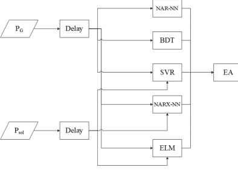

# 2020 智能电网与能源系统国际会议 (SGES) (澳大利亚珀斯 2020.11.23-2020.11.26)

## 混合机器学习集成回归模型用于太阳能发电预测

**Anchit Nayak**  
电气工程系  
Pandit Deendayal 石油大学 (DPDU)  
印度，甘迪纳格  
`anchit.neet17@iot.pdpu.ac.in`

**Leena Christine**  
电气工程系  
Pandit Deendayal 石油大学 (DPDU)  
印度，甘迪纳格  
`leena.santos@iot.pdpu.ac.in`

**摘要**— 通过光伏技术进行太阳能发电是最具再生性的能源来源之一。由于其清洁的特性，太阳能发电正在快速增长。从系统运行的角度来看，在这一新的机器学习方法中，提出了一种基于模型集成的模型：混合集成回归，该模型利用了不同机器学习算法的优势并将其整合到单一模型中。数据集中的缺失值已通过回归进行处理。集成平均是一种包含许多独立模型的经过验证的方法，即：非线性自回归神经网络、带有外生信号的自回归神经网络（NARX）、最小二乘法决策树、带随机森林（RF）的支持向量回归，并针对印度古吉拉特的一个 1 MW 太阳能电站（23°15'11"N, 72°40'00"E）的数据集进行了测试。提出的模型随后用于预测太阳能发电量。

**索引术语**— 技术智能、人工智能、太阳能发电预测、集成学习、支持向量机、神经网络

---

## I. 引言

本文其余部分的结构大纲如下：第一节为引言，随后是第二节的文献综述。所提出的方法在第三节中进行了详细解释，每个算法均在各自的小节中进行了讨论。第四节讨论了使用所提模型获得的数值结果，最后在第五节给出了结论，总结了本文介绍的工作。

## II. 文献综述

对许多论文进行了文献综述，以确定研究空白。已有许多论文关于太阳能辐射和太阳能发电量的预测。正如 III-A 节所确定的，各种论文中使用的技术侧重于太阳能发电量的预测。在调查中，观察到三类工作：第一类是非混合式技术的模型，第二类是仅含神经网络（NN）的混合模型，第三类是使用混合模型的技术。“混合”一词指的是如本文所示，结合使用一种或多种技术。

参考文献 [1]、[2] 和 [4] 用于基于计算智能的非混合模型。Piazza 等人使用基于人工神经网络（ANN）的架构，根据温度和辐射预测太阳能发电。类似地，Do [2] 使用了不同的模型并改进了它们的性能。他们使用了缩放性能、基于 ANN 的基础和多元回归。Power [4] 使用机器学习技术预测森林，并预测了太阳能发电量（SPG）。Person 等人使用了太阳能发电和地理条件的增强决策树，利用天气预报数据（NWP）进行短期预测。

为了由于环境影响而在政策层面增加电力系统的可再生能源，过去十年中太阳能的使用大幅增加。许多国家现在的目标是实现大规模的太阳能能源供应。然而，作为清洁能源的太阳能取决于太阳辐射，并且具有本质的随机性。太阳能的不确定性可以使用适当的技术来处理，以便对太阳能进行规划和调度，确保效用最大化。

Gandelli 在 [5] 中使用了物理模型和 ANN 方法预测 SPG。利用水域地理坐标和数据细节预测区域。Fillipe 等人于 [6] 中使用了带有电气模型的自回归模型进行极短期预测。Dolara 在 [7] 中使用了带有 ANN 的物理模型。Gradit 在 [8] 中使用了带有实时数据采集系统的 ANN。使用的模型包括多层感知器（MLP）ANN。Wolter 等人使用了 ANN 模糊推理系统（ANNFS）和物理模型。

参考文献 [9]、[10]、[11] 和 [12]：Zhang 等人在 [9] 中使用了混合的神经网络来预测预测值。Wang 等人在 [10] 中使用了集成回归模型。Cicero 等人在 [11] 中使用了混合的神经网络。Bourzad 等人在 [12] 中使用了自回归平均（ARMA）。Haque 等人在 [14] 中使用了小波变换。[15] 使用了自回归映射（ARTMAP）。[16] 使用了自回归平均系统。[17] [18] 使用了混合的 ANN。[19] 使用了 MLP。[20] 使用了 SVR、深度神经网络（DNN）和随机森林。

综述显示，以下技术用于混合预测：

- 最小二乘决策树
- 基于的支持向量回归
- 极端学习
- NAR

在下一节中提出了一个集成平均模型。

## III. 方法论

### A. 预处理

大多数时间序列预测模型很大程度上依赖历史数据的准确性和完整性。本文考虑了两类历史数据，包括总功率。由于事件因素，强度测量容易受到离群值影响。

原始数据用于训练和测试。通过插值法对缺失数据进行估计。数学模型如下：

```
$P_t = \beta_0 + \beta_1 P_t$
```

在这里，$P_t$ 代表辐射（强度），而 $P_t$ 代表发电量。该模型用于填充缺失数据。

预处理阶段后的数据被称为数据集。

如所述，所提方法的第一步是通过预处理清理历史数据。随后的阶段（在本节的 III-B、III-C、III-D、III-E、III-F 中进一步讨论）如下：

- (i) 使用数据集单独训练机器学习算法
- (ii) 获取每个算法的预测误差
- (iii) 使用集成平均（EA）模型处理系统中产生的预测误差
- (iv) EA 作为所提方法的特征，EA 的输出将反映最终的预测结果。

### B. 非线性自回归神经网络（NAR-NN）

自回归（NAR）模型是指输出 $k$ 依赖于其过去值 $k-1, k-2, ..., k-l$ 的模型。自回归模型被用于预测应用。在本节中，自回归被用于非线性场景。

神经网络（NN）是输入与输出之间的非线性映射。NAR-NN 已用于填充输出与其过去值之间的非线性映射。如果 $P_c[k]$ 是 $k$ 刻生成的功率，且 $f$ 是代表神经网络的函数，那么：

```
$P_c[k] = f(P_c[k-1], P_c[k-2], P_c[k-3], ..., P_c[k-l])$
```

神经网络（NN）由多个神经元组成，神经元是复杂架构的基本单元。神经元由线性组合组成，然后输入非线性函数。在 NAR（特别是 NARX 和 ELM 情况）中，使用了激活函数引入非线性。如果 $x$ 是神经元的输入向量且 $w$ 是该向量中每个元素的权重，那么神经元本质上就是函数 $g(x)$。

### C. 带有外部输入的非线性自回归神经网络 (NARX-NN)

与之前的模型相比，NARX 网络是输出到其输入的非线性映射。然而，与之前的情况不同，该模型具有外生输入。它类似于我们使用的：

$F$ 是一个针对向量 $x$ 的函数，递归构建直到实现一个与实例 $\{x_1, ..., x_t\}$ 匹配的 $F$。通过平方损失实现：

```
$P_C[k] = f(P_C[k-1], ..., P_C[k-l], P_O[k-1], ..., P_O[k-l])$
```

在此处，通过测试架构使用试错法评估了延迟和隐藏层。权重也通过 Levenberg-Marquardt 算法学习。

### D. 极端学习机 (ELM)

极端学习机是前馈神经网络，其权重不经过调整。这些权重被视为随机值，或者从其架构中继承。本质上，它们是正则化的神经网络，其中输出隐藏层没有正则化。这允许反转并将隐藏层处理为：

当 $T$ 是目标网络时，$H$ 是单层前馈神经网络（SLFN）的输出。目标是寻找输出权重向量 $\beta$。优化问题给出：

```
$arg\min_{\beta}||\beta||^2 + C||H-T\beta||^2$
```

基于 $p_1, p_2, \sigma$ 的值以及许多情况。在本文中，使用了一个具有 20 个神经元和 ReLU 激活函数的隐藏层 ELM 来解决一个回归问题。ReLU 函数给出：

```
$g(x) = \max(0, x)$
```

输出 $y$ 被馈到另一层的头部。神经网络的层数和每层的神经元数量决定了神经网络的架构。所有非输入和输出的部分都是隐藏神经元。神经网络中的每个连接都是加权的（使用权重 $w$），核心元素是使用学习算法更新这些权重。在本文中，使用了 Levenberg-Marquardt 算法进行训练。

### E. 最小二乘提升决策树 (LSBDT)

构建了一个最初用于分类的决策树。它可以被转换为回归问题并用于应用。在这种情况下，我们使用了一种集成技术——提升（Boosting），结合多个弱（或弱学习器）决策树。在各种可用的提升方法中，本文的最小二乘提升用于回归和预测。一种最小二乘损失函数：

```
$L(y, F) = \frac{(y-F)^2}{2}$
```

$F$ 是一个针对向量 $x$ 的函数，递归构建直到实现一个与实例 $\{x_1, ..., x_t\}$ 匹配的 $F$。

通过 $P_C$ 和过去值，使用了适当的延迟来训练 LSBDT 模型。

通过测试架构使用试错法评估了延迟和隐藏层。权重也通过 Levenberg-Marquardt 算法学习。找到了适用于 NAR-NN 和 NARX-NN 的适当延迟。使用了 $l=10$ 的延迟，总共 10 个隐藏神经元。这种结构被发现适用于 NARX-NN 情况。

### F. 基于径向基函数的支持向量回归

支持向量机是一类非常通用的监督学习算法。作为一种分类算法，在本文背景下，支持向量回归被用于处理非线性时间序列。主要思想是使用 SVM 来最小化分类误差。

然而，上述内容对于线性系统有效。为了引入非线性，那里使用了核函数基变换或高斯核。

```
$argmin_{\beta}||\beta||^2 + C\sum(\xi_i + \xi_i)^2$
```

这些在我们的应用中证明是有益的，如果它们是有帮助的（使得相对）结果受限于：

```
$$\begin{cases} w_i^T x_i - b \le \xi_i \\ -w_i^T x_i - b \le \xi_i \\ \xi_i \ge 0 \end{cases}$$
```

ELM 的数学公式与其所经历的回归神经网络部分相似。在他们的工作中，Huang 等人 [21] 将单层前馈神经网络 (SLFN) 的输出写为：

```
$H\beta = T$
```

```
$k(x, x') = e^{-\frac{||x-x'||^2}{2\sigma^2}}$
```



使用 RBF 核是因为它在其他核中实现了较小的误差。为了本文的目的，所提方法在自回归意义上被使用，通过 RBF 核来学习函数 $f(x) = w^Tx + b$。

### G. 集成平均器 (EA)

在训练模型后，定义了一个集成平均器，它是所有算法输出的加权平均。所有权重都是使用线性模型学习的，如图 1 所示。如果 $Y_i$ 是第 $i$ 个模型的输出，$c_i$ 是第 $i$ 个模型的代价，则集成输出给出：

```
$Y_{net} = \sum_{i=1}^{n}\alpha_i Y_i$
```

方程 (12) 给出了最终预测。为了学习 $\alpha_i$，使用了多元回归技术。

## IV. 数值结果

所提模型在属于教育机构 Pandit Deendayal Petroleum University, Gujarat 的真实数据集上进行了验证。用于训练、测试和验证模型的历史数据集包含了关于太阳能发电的三个年度数据点。该数据集的缺失数据在第三节中讨论。正如第三节所述，所提模型的第一步是使用带有 Intel i5-CPU 和 8GB RAM 的系统通过 MATLAB 工具进行训练。

通过测试架构使用试错法评估了延迟和隐藏层。权重也通过 Levenberg-Marquardt 算法学习。这些模型与历史数据集的对比预测显示，这些模型的拟合程度在图 2、图 3 (NAR-NN) 和图 4 (ELM) 所示。

在图 5 中绘制了 NAR-NN 和 ELM 的预测输出。观察发现，尽管单个算法受到其固有特征的限制，但它们的适当组合可以抵消每个模型的不准确性。由平均器完成的如图所示。为了显示所提模型的正确性，将这些算法的均方根误差 (RMSE) 和平均绝对误差 (MAE) 与所提模型的误差进行了比较。

### 表 I 分析

| 算法 | RMSE | MAE |
|---|---|---|
| NAR-NN | 0.5087 | 0.6823 |
| NARX-NN | 0.5105 | 0.6907 |
| ELM | 0.4139 | 0.6424 |
| RBF SVR | 0.4578 | 0.6449 |
| LSBDT | 0.3100 | 0.1936 |

## V. 结论

在本文中对多个模型进行了广泛分析，混合模型优于这些模型。结果是令人满意的并有助于其他模型寻求可能的结果。作者感谢石油大学 (DPDU) 太阳研究中心 (SRDC) 的 Mukadhyay 博士和 Abjit Rai 博士为我们提供了三年的数据集。

## 参考文献

1. A. D. Piazza, M. C. Diaz, and G. Viola, “Solar and wind forecasting,” Energy and Environmental Sustainability, vol 1, p. 39 (2016). [Online]. Available: https://doi.org/10.1016/j.esenv.2016.03.01
2. M.-T. Du and B. Roberts, “A study on importance of training duration to provide a high accuracy forecast for solar power,” Solar Energy, vol. 85, p. 959–964, Jun.(2016). [Online]. Available: https://doi.org/10.1016/j.solener.2015.07.055
3. C. Petersen, F. Bauer, and H. Madsen, “Multi-site solar power forecasting using gated regression trees,” Solar Energy, vol. 122, p. 46–53, 2017. [Online]. Available: https://doi.org/10.1016/j.solener.2017.10.046
4. L. Oneto, F. Lauer, M. Rocha, and J. Arroyo, “Solar wind power prediction using neural networks with polycentric connections,” IEEE Systems Journal, vol. 6, p.2842–2853, 2018.
5. A. Gallizzi, G. Serena, S. M. Mesa, and E. Ejiano, “Hybrid model analysis and validation for energy production forecasting,” in 2014 5th International Joint Conference on Neural Networks (IJNN), p. 1957–1962.
6. M. J. Filho, R. S. Saia, J. Romato, and T. J. Nosa, “A hybrid approach-based short-term solar power forecasting using artificial networks and ensemble learning,” Solar Energy, vol. 108, p. 274–286, Aug.(2017). [Online]. Available: https://doi.org/10.1016/j.solener.2017.05.017
7. A. Dolara, F. Girmac, S. Serena, S. M. Mesa, and E. Ejiano, “A neural network for short-term forecasting,” Solar Energy, vol. 153, p. 1142–1153, 2018. [Online]. Available: https://doi.org/10.1016/j.solener.2018.02.011
8. G. Gradin, F. Ferrari, G. Gintina, M. Ta, “A hybrid model (SARIMA-WNN) for short-term power forecasting of a small-scale grid-connected photovoltaic system,” Solar Energy, vol. 76, p. 217–223, Dec.(2013). [Online]. Available: https://doi.org/10.1016/j.solener.2013.10.002
9. N. Zhang, P. K. Behera, and C. Williams, “Solar power forecasting based on deconstructed ensemble learning using recurrent neural networks,” in 2013 International Systems Conference (ISSC), 2013, p. 142–147.
10. J. Wang, H. Jung, and Y. Wu, “Solar direction forecasting using an optimized cloud search algorithm,” Solar Energy, vol. 89, p. 200–205, Mar.(2015). [Online]. Available: https://doi.org/10.1016/j.solener.2015.01.010
11. M. Rana, I. Kopitnaka, and G. Yagis, “Solar power forecasting using deep learning and ensemble methods,” in 2016 International Joint Conference on Neural Networks (IJNN), 2016.


### 参考文献

[15] U. Haque, M. H. Nezir, and P. Mandal, "使用混合智能方法进行太阳能发电预测," 于 2013 IEEE Power Energy Society General Meeting, 2013, p. 1.

[16] Z. Dong, T. Remi, and W. M. Wah, "一种基于自组织映射、支持向量回归和群优化算法的预测太阳辐射的新型混合方法," IEEE Energy, vol. 82, pp. 530–577, May. 2015. [Online]. Available: `https://doi.org/10.1016/j.energy.2015.01.006`

[17] Y.-K. Wu, C.-R. Chen, and A. Rahman, "一种用于光伏发电短期预测的新型混合模型," International Journal of Photovoltaics, vol. 2014, pp. 1–9, 2014. [Online]. Available: `https://doi.org/10.1155/2014/8659249`

[18] R. Sharifi, and M. Ghofrani, "一种基于新型聚类技术和多层神经网络的太阳辐射预测混合方法," Energy Conversion and Management, vol. 118, pp. 331–344, Jun. 2016. [Online]. Available: `https://doi.org/10.1016/j.energycon.2016.06.009`

[19] Z.-L. Li, X.-Y. Wu, J.-J. Liu, and L. P. Peng, "砂岩源岩在页岩油提取中的应用及案例研究," Organic Geosciences, vol. 22, pp. 55–62, 2015. [Online]. Available: `https://doi.org/10.1016/j.orggea.2015.12.009`

[20] J. Antonaarz, R. Utraca, A. Peña-Espinoza, A. Aldama, F. Fernandez, and J. M. de Pinto, "用于光伏光伏预测的神经网络和备份模型," 于 Notes in Computer Science. Springer International Publishing, 2017, pp. 427–436. [Online]. Available: `https://doi.org/10.1007/978-3-319-59963-3`

[21] G.-B. Huang, Q.-Y. Zhu, and C.-K. Siew, "极端学习机及其应用," Softcomputing, vol. 70, no. 1–3, pp. 489–501, Dec. 2006. [Online]. Available: `https://doi.org/10.1016/j.neusocom.2005.12.026`
