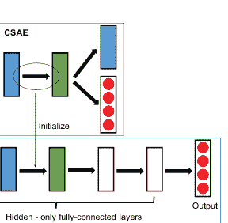
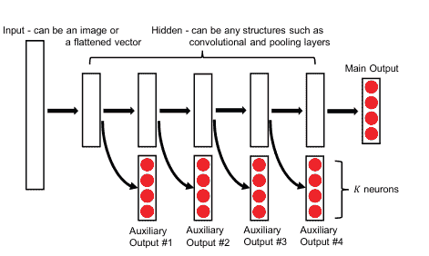
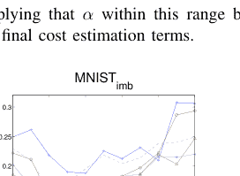
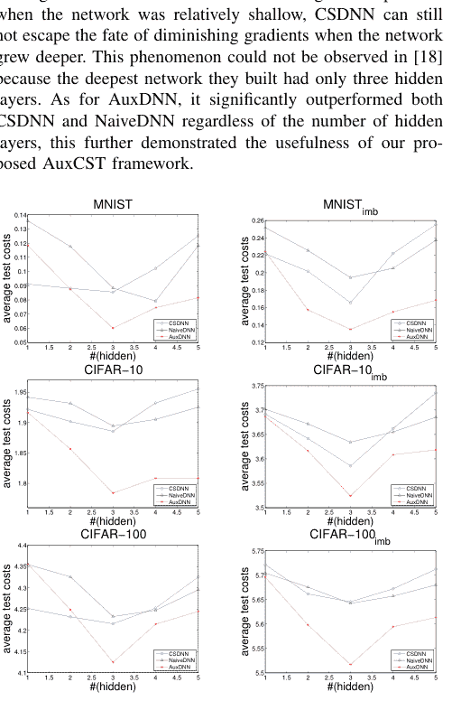

# 2020人工智能技术与应用国际会议 (TAAI)（台湾台北 2020.12.3-2020.12.5）

**摘要—** 尽管深度网络在图像分类、目标检测和语音识别等多个领域取得了成功，但当应用对不同类型的分类错误和分类误差有成本要求时，要达到极高精度是非常困难的。目前的成本敏感分类深度网络模型受其架构和深度。在本文，我们提出了一种新的框架，该框架可以应用于任何结构的深度网络，以促进其学习成本敏感问题。该框架允许深度网络的端到端训练。在具有两种成本设置的基准数据集上的实验结果表明，我们的框架优于最先进的成本敏感深度学习方法。

**索引术—** 成本敏感分类，深度学习，成本估计

## I. 引言

深度学习在许多应用中取得了巨大成功，例如图像分类 [1, 2, 3, 4] 和语音识别 [5]。在这些属于每种分类错误受惩罚相同的的大类分类应用中，其性能是有限的。

然而，使用准确率作为所有情况的指标并不总是能产生最成本敏感的系统。事实上，现实应用如 [6, 7, 8, 9, 10] 对不同类型的分类错误有不同的成本。例如，在构建真实的脸部识别系统 [9, 11, 12] 中，将政府工作人员误识别为冒充者只会导致轻微的不便；然而，分类错误的人可能会导致严重的损害。

人们在研究成本敏感分类算法方面已经付出了大量努力。在 [14, 15, 16] 的工作中，研究人员提出更方便地考虑具有需求成本的概率分类器。我们遵循了许多早期的成本敏感工作 [14, 15, 27, 18]，在进行基准实验时采用了成本敏感设置。

贝叶斯理论使分类器能够在预测期间考虑成本信息。其他研究将现有的成本敏感分类算法扩展到成本敏感领域，例如支持机 [17]。深度神经网络（DNN）已在广泛的机器学习中成为最先进的 [5, 3, 4]，研究人员正尝试通过 [18] 中所谓的成本敏感 DNN (CSDN) 使 DNN 具有成本敏感性。第一步是通过成本敏感版本的传统自动编码器 [19] 逐层初始化 DNN。第二步涉及训练一个成本敏感损失函数，以最小化最终成本。

CSSDN 的设计基于带有 ReLU 激活函数的全连接 DNN，并面临两个问题。首先，该设计限制了其对如卷积层 [20] 和池化层等更多结构的适用性。其次，sigmoid 函数来自深度网络中的梯度消失问题，即使在许多个 epoch 之后也是如此。

在本文中，我们提出构建一个用于成本敏感深度学习的新框架。对于一个 K 类成本敏感分类问题，所提出的框架将逐层成本估计替换为成本估计单元。在每层的输出处增加了 K 个神经元。K 个神经单元作为辅助，帮助 DNN 学习向单元的有意义的表示。通过求解与这些单元相关的加权损失函数上的联合优化问题来训练 DNN。在具有两种成本设置的基准数据集上进行的实验验证了所提出的框架优于 DNN。所提出的框架可以轻松且有效地应用于如 ReLU [AlexNet] 这样的深度网络，正如这项工作的完整版本 [22] 所示。性能和通用性使得所提出的框架成为一个可信的选择。

使用额外神经元作为辅助单元的思想已被几项深度学习工作研究过，例如著名的 GoogleLeNet [3]，它将选定隐藏层中的神经元作为中间分类器作为调节器。深层监督网络 [23] 为所有层添加了额外的神经元作为中间分类器，并报告这些节点不仅是调节器，还改善了收敛收益。BehaviorNet [24] 考虑了预测的各个点的隐藏层进行测试。然而，所有之前的工作都侧重于使用常规（成本敏感）分类器作为辅助单元。据我们所知，所提出的框架是第一个通过逐层辅助单元解决成本敏感深度学习的框架。

本文的其余部分组织如下。在 II 节中，我们正式定义了成本敏感分类问题并引入了相关工作。然后，我们在 III 节中提出了我们的框架，并在 IV 节中使用真实数据集验证了性能。最后，我们在 V 节中得出结论。

## II. 准备知识

### A. 成本敏感分类

在 K 类分类问题中，大小为 N 的集合 $S = \{(x_i, y_i)\}_{i=1}^N$，其中每个输入向量 $x_i$ 属于输入空间 $x_i \in \mathcal{X}$，每个标签 $y_i$ 属于标签空间 $\mathcal{Y} = \{1, ..., K\}$。常规分类使用 $S$ 来训练分类器 $g: \mathcal{X} \to \mathcal{Y}$，以使测试样本 $(x, y)$ 上的期望误差 $[y \neq g(x)]$ 最小。也就是说，每种分类错误带有相同的惩罚。

我们在设计所提出的框架时，考虑了成本向量的成本敏感分类 [14, 17]。成本向量设置通过为每个样本 $(x, y)$ 添加一个额外的成本向量 $c \in \{0, ..., \infty\}^K$ 来表示信息，其中 $c$ 的第 $j$ 分量 $c_j$ 表示将类 $j$ 预测为类 $k$ 的成本。

成本敏感设置的一个特殊情况是使用 $K \times K$ 成本矩阵。每个元素 $C_{ij}$ 表示将类 $j$ 预测为类 $i$ 的成本。通过将 $(x, y)$ 中的成本向量定义为成本矩阵 $C$ 的第 $y$ 行，可以将成本矩阵中的信息简单地转换为成本向量。考虑 $S = \{(x_i, y_i, c_i)\}_{i=1}^N$，使用 $S_i$ 训练分类器 $g: \mathcal{X} \to \mathcal{Y}$ 以使测试样本 $(x, y)$ 上的期望成本 $[c_{y_i, g(x_i)}]$ 最小。

### B. 成本敏感分类的学习

如今的 DNN 设计用于解决常规分类问题 [3, 4]。这些 DNN 通常在末尾使用带有 $K$ 个神经元的 softmax 层。每个输入 $x$ 经过不同的隐藏层并转换为不同的潜在表示。softmax 层将最后的表示转换为每类的概率，概率最高的类别即为网络的预测类别。

另一方面，很少有工作使用深度网络或神经网络探索成本敏感分类。在通过采样和重阈值处理使神经网络具有成本敏感性之前；[26] 这些每项都探索了用于成本敏感性的神经网络。[18] 尝试通过产生成本敏感深度学习算法 CDNN 来使神经网络具有成本敏感性。

在这些结构中，我们在成本估计层上使用成本敏感损失函数 $L_{cost}$。[18] 发现通过仔细训练可以提高网络性能，并提出了成本敏感自动编码器 (CAE)。CAE 的运行类似于传统的自动编码器 [19]，后者是一种将任何输入 $x$ 映射到输出 $x$ 为输入图像重构的网络。

重构误差通过交叉熵损失衡量，但这并不意味着网络是成本敏感的。我们证明了具有用于成本估计的额外神经元的网络是成本敏感的。也就是说，CAE 尝试尝试估计成本 $c$。该尝试通过混合层 $L = \alpha L_{rec} + (1-\alpha) L_{cost}$ 来实现，其中 $L$ 是 CAE 的损失层。当 $\alpha = 0$ 时，CAE 转换为通用自动编码器。

图 1 显示了如何使用 CAE 展示 CDNN。通过初始化，CDNN 的每一层都承担估计成本的任务。也就是说，它练习了潜在表示。报告称这种初始化允许 CDNN 收敛到比最先进方法更好的选择。

> ¹ 术语 $L_{cost}$ 代表单敏感回归，源于一项敏感 SVM 工作 [17]。由于空间限制，此处省略了细节。

图 1. 用于 DNN 的 CSAE 训练 [18]

## III. 框架

虽然 CSNN 是目前最先进的，但其设计基于带有 sigmoid 激活函数的全连接层，并存在一些问题。我们在第 III-A 节中讨论了促使我们提出更好框架的 CSNN 问题，并在第 III-B 节中介绍该框架。

### A. 动机

CSNN 中的核心思想可能是 CSAE。这是为了理解深度学习中预训练的必要性。在早期，网络使用 sigmoid 或双曲正激活函数进行层间的非线性变换 [27, 28, 29]。这两个函数在曲线的部分区域都表现出平坦性，这可能导致梯度变小。随着网络规模扩大，网络后层较小的梯度使得网络前层在反向传播过程中遭受影响，这种现象被称为梯度消失。[29] 和 [19] 的早期工作通过提出一种贪心逐层策略来解决梯度消失问题。然而，在某种程度上，如果使用相同的激活函数，随着网络加深，问题仍然会存在。

近年来，解决梯度消失问题的另一种途径是通过使用其他激活函数，例如 ReLU，它不像 sigmoid 或双曲激活函数那样受到梯度消失问题的影响，这并非必须的 [30]。ReLU 及其许多变体 [31, 32] 仍然是深度学习研究中的主流激活函数 [33, 44]。引入 CSNN 是通过模拟 [19] 对普通深度学习所做的来处理成本敏感深度学习：使用 sigmoid 激活函数，并采用贪心逐层预训练。正如我们在 IV 节的实验结果所示，CSNN 在网络加深时会带有梯度消失的问题。为了使成本敏感深度学习与现代深度学习接轨，有必要进行成本敏感深度学习

图 2. 一个使用辅助成本敏感目标（AuxCost）框架设计的带有隐藏层的 DNN。

尽管如此，直接移除 CSNN 中的预训练阶段将失去 CSAE 在使最新表示具有成本感知能力的一个重要优势。接下来，我们提出了我们的框架来挽救这一优势。

### B. 逐层成本估计

我们的目标是构建一个能够同时从成本感知表示估计（类似于 CSAE 使用的）和任何结构的灵活性中受益的 DNN。CSAE 通过在自动编码器中使用 $K$ 个辅助神经元进行成本估计，实现了成本感知表示。我们的核心思想是在自动编码器中使用与 DNN 分的 $K$ 个额外神经元，我们建议通过“合并” DNN 的内部神经元与所提神经元来替换 CSAE。所提出的结构如图 2 所示。每一层的原始 DNN 都有一个辅助隐表示输出以估计成本，从而轻而易举地实现了成本感知估计。

如图 2 所示，通过向 DNN 的每一层添加 K 个辅助神经元，我们遵循 CSAE 的方法，使 DNN 的输出层具有成本估计。唯一的任务是使用更好的损失函数训练“升级”的 DNN。我们将 $L_{OSR}^{(i)}$ 定义为第 $i$ 隐藏隐藏层输出的辅助损失函数，并将 $L_{OSR}^{(i)}$ 定义为该层的平均值，我们通过以下公式训练升级的 DNN：

$$\sum_{i=1}^{H} a_{i} \cdot (L_{OSR}^{(i)} + L_{OSR}^{(i)})$$

$H$ 是 DNN 中的隐藏层数，$\alpha_i$ 是 $L_{OSR}^{(i)}$ 的平衡系数。

凭借所提出的结构改进和损失函数，我们现在准备在算法 1 中给出完整的框架。该框架将命名为成本敏感目标（AusCT）。新框架看起来简单，具有许多优点。通过它，我们现在可以使用 ReLU 或其他激活函数并避免梯度消失问题。我们还可以构建任意层数的成本敏感 DNN。此外，我们可以直接将此框架应用于 ResNet [4] 等先进的 DNN 结构。

尽管如此，直接移除 CSNN 中的预训练阶段将失去 CSAE 在使最新表示具有成本感知能力的一个重要优势。接下来，我们提出了我们的框架来挽救这一优势。

（注：原文中后续存在大量重复段落，译文已按要求去重，仅保留核心逻辑翻译）

为了获得最佳性能，但为了进一步研究 AuCST，我们选择仅使用全连接层来构建 DNN，以减少参数的数量。

结果如图 3 所示。我们绘制了 5 条曲线（测试了 5 种隐藏层数量），x 轴为 α 值，y 轴为对应的平均测试成本。注意，当 $\alpha = 0$ 时，意味着 DNN 不使用 AuCST。从图中可以看出，无论隐藏层有多少，都能观察到形状良好的曲线，且当 $\alpha$ 落在 0.2 ~ 0.5 范围内实现了最低平均测试成本，这意味着该范围内的 $\alpha$ 对层级表现最佳，且对于最终成本估计最为理想。

因为 CSAE 的成本感知特征提取相对良好，根据 [18] 中的实验结果，当隐藏层数超过十二层时，三个模型都开始出现过拟合现象。观察 CDNN 和 NaiveDNN，有趣的是，两个模型的平均测试成本都增加了，其中 CDNN 的增幅远大于 NaiveDNN。我们推断这种现象是由深层函数引起的，当网络相对较慢时，CSAE 很好地缓解了这一问题；而当网络变得更深时，CDNN 无法避免梯度消失的命运。这种现象在 [18] 中并未观察到，因为我们最深的网络只有三层隐藏层。无论隐藏层数量如何，CDNN 和 NaiveDNN 的表现都进一步证明了我们提出的 AuCST 框架的可用性。

图 3 描述了 AuCST 框架中 $\alpha$ 的选择与 MNIST 上实现性能之间的曲线关系。数字代表隐藏层的数量，每个数字对应一条曲线。

## B. 与先进技术的对比

在本次实验中，我们使用了两个不带 AuCST 框架的 DNN，并将它们与最先进的成本敏感深度神经网络 (DNN) [18] 进行了比较。我们强调了 CDNN 的两个主要缺点：

- 1) CDNN 使用 sigmoid 函数进行非变换，导致网络在增长时出现梯度消失。
- 2) CDNN 仅适用于由全连接层组成的 DNN，这限制了它通过添加更多需要卷积和注意力层等现代函数的层来扩展的潜力。

为了给 CDNN 提供公平的比较，所使用的两个 DNN 也包含全连接层，并使用 ReLU 作为激活函数。第一个 DNN 通过设置 $\alpha = 0.2$ 装备了 AuCST，因为在 IV 中发现 0.2 是比较的最佳值；而第二个 DNN（称为 NaiveDNN）没有使用任何 AuCST，直接通过 $L_{out}$ 进行优化，这等同于在公式 (2) 中设置 $\alpha = 0$。

实验结果如图 4 所示。x 轴是隐藏层数，y 轴是对应的平均测试成本。从图 4 可以看出，当隐藏层数少于或等于三层时，CDNN 优于 NaiveDNN。

图 4。六幅图显示了三个 DNN 在 MNIST、CIFAR-10、MNIST_imb、CIFAR-100 上的性能，每条曲线对应一个数据集。

## V. 结论与展望

我们提出了一种新颖的辅助敏感目标 (AuCST) 框架，用于端到端的成本敏感 DNN 学习。与以往的方法相比，该框架可以应用于任何结构的 DNN，以解决挑战性的成本敏感分类问题。实验结果证明了所提框架在使任何 DNN 模型具有成本敏感性方面的有效性。未来，我们将使用 AuCost 框架构建更深的网络，以应对 ImageNet 敏感的分类问题。

## 致谢

感谢台政大学计算实验室的成员以及匿名评审员提供的宝贵意见。本工作得到了国家科技部的资助（MOST 107-2628-E-002-008-MY 和 108-2119-M-007-010）。

## 参考文献

- [1] A. Krizhevsky, I. Sutskever, and G. Hinton, "Imageet classification with deep convolutional neural networks," in NeurIPS, 2012.
- [2] D. Uirean, J. Jaeger, and J. Schmidhuber, "Multiclass deep convolutional neural network for image classification," in CVPR, 2012.
- [3] S. Zegedy, W. Liu, Y. Jia, P. Setnet, S. Reed, D. Angskdev, E. Erhan, V. Vanochek, and A. Rabinikov, "Deep learning with convolutions," in CVPR, 2015.
- [4] K. H. Zhang, S. Ren, and J. Sun, "Deep learning for image recognition," in CVPR, 2016.
- [5] G. Dahl, D. Yu, L. Deng, and A. Cheng, "Context-dependent pretrained deep neural networks for vocabulary speech recognition," TASLP, vol. 20, no. 1, pp. 30–42, 2021.
- [6] M. Tan, "Cost-sensitive learning of classification knowledge and applications," Machine Learning, vol. 13, no. 3, pp. 77–73, 1993.
- [7] P. K. Sun and S. J. Stoloff, "Toward scalable learning with non-uniform cost and distributions: A study in credit fraud detection," in KDD, 1998.
- [8] W. Wan, F. Stello, and M. Miller, "Multiple cost-sensitive inductive approach for detection," in ECML, 2000.
- [9] Y. Zhang and W. Lu, "Cost-sensitive face recognition," TPAMI, vol. 32, no. 10, pp. 1758–1769, 2020.
