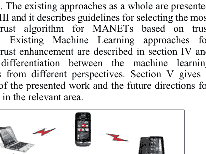
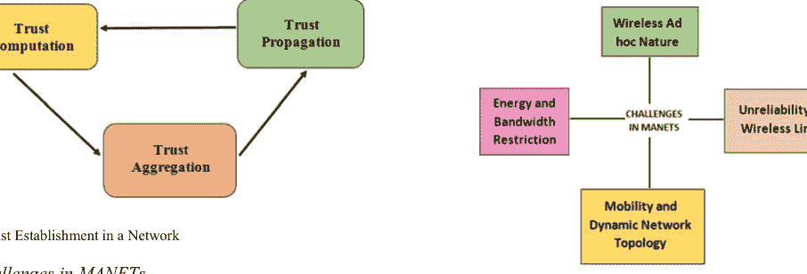

# 2020 智能计算与系统工程国际研究会议 (SCSE) (斯里兰卡科伦坡 2020.9.24-2020.9.24) 2020 智能计算与系统国际研究会议

**摘要：** 移动自组织网络（MANETs）在日益网络化的世界中起着至关重要的作用，在许多领域都有广泛应用，包括军事、社会、车载自组织网络（VANETs）和其他智能系统。由于移动自组织网络的动态特性，它们经常面临各种恶意攻击。多年来，人们开发了各种信任机制以确保 MANET 环境中的可靠性和信任。在所提出的解决方案中，机器学习的应用取得了成效。基于此，本文介绍了移动自组织网络基于信任的方法综述。本研究的重点在于分类和评估现有的信任机制，并为该领域的未来研究提供指导。

**关键词：** 机器学习、恶意攻击、移动自组织网络（MANET）、信任、车载自组织网络（VANET）

## I. 引言

由于移动设备、笔记本电脑、数字设备和其他物联网（IoT）的使用，无线通信机制在近几年中变得越来越流行。移动自组织网络是无线网络的一种类型，该领域的研究人员对其进行了广泛研究。

但 MANETs 中的主要问题是安全问题，由于其脆弱性，在数据传输方面面临一些挑战。由于无线线路物理保护有限、自主行为、移动性以及缺乏中心化基础设施，MANETs 的安全实现更具挑战性 [1]。

此外，信任水平取决于路由机制以及移动性模型。目前定义了一组移动性模型；随机点移动模型是 MANETs 中常用的模型。

在 MANETs 背景下定义了特定的路由协议，例如 AODV（按需自组织路由协议）、OLSR（优化链路状态路由协议）、DSDV（目的序列距离矢量路由协议）、用于移动自组织网络的 Batman 协议 [2]。

尽管有许多路由机制，但由于这些网络具有脆弱性，数据可能会丢失或被篡改，确认通过 MANET 传输数据的安全性是一个主要问题。由于信任是建立可靠通信机制的主要组成部分，已经有了许多工作来增强 MANETs 的安全性。

本文通过对 MANETs 中现有信任增强进行批判性分析，提供了一定的比较分析，并特别关注机器学习方法，为未来的研究路径提供构思路。

第二节提供了 MANETs 背景下信任的概述，以及对基础 MANETs 的描述。挑战如上所述，并提供了根据信任属性为 MANETs 选择合适信任的指南。第四节描述了用于 MANET 信任的机器学习方法，并从不同视角解释了机器学习技术之间的差异。第五节总结了所展示的工作以及该领域研究人员的未来发展方向。

## II. MANET 中的信任

信任是提供安全服务时最重要的因素之一。在 MANETs 背景下，信任可以被定义为一种特征，从其他节点的角度决定了通过特定节点接收和传输数据的准确性 [4]。因此，需要信任管理机制通过创建可靠的信任来在 MANET 中建立安全性，这可以分为几个阶段，包括信任的分类、信任的裁决、信任的聚合、信任的预测和信任的应用 [4][5]。图 2 显示了 MANETs 中建立信任的原始步骤。

图 2. 网络中的信任建立

### A. MANET 面临的挑战

在 MANETs 中建立或构建安全服务更具挑战性，因为这些自组织网络拥有与有线网络相当数量的脆弱性。

- a) 无线自组织
MANETs 没有中心化基础设施或任何其他固定基础设施。由于缺乏此类基础设施，自组织网络中的节点取代了路由器、客户端和服务器。此外，由于需要通过多跳通信，数据包需要穿过不同的移动节点才能到达目的地。这些可能导致由于移动性以及在通过恶意节点传输时数据丢失而产生等问题 [7]。

- b) 无线链路的不可靠性
由于连接基于无线链路，MANETs 更容易受到恶意攻击，如窃听、泛洪、刷新、黑洞攻击、虫洞攻击。由于带宽低于有线网络且不具备发起攻击的能力，攻击者可以利用这些特征对整个移动自组织环境造成威胁 [7]。

- c) 移动性和动态网络拓扑
MANETs 由一组自主且高移动性的节点组成，新节点可以连接，而现有节点可以加入或离开网络。其结果是，MANETs 具有变化的拓扑结构。由于这种动态性，如果发生安全问题，很难识别节点对此类恶意攻击的责任 [6][7]。

- d) 能量和带宽限制
图 3. MANETs 面临的挑战

### B. MANETs 的信任属性

以下特征可以被说明为信任属性：

- a) 动态性
MANETs 没有中心化基础设施或任何其他固定基础设施。由于缺乏此类基础设施，自组织网络中的节点取代了路由器、客户端和服务器。此外，由于需要通过多跳通信，数据包需要穿过不同的移动节点才能到达目的地。这些可能导致由于移动性以及在通过恶意节点传输时数据丢失而产生等问题 [7]。

- b) 主观性
由于连接基于无线链路，MANETs 更容易受到恶意攻击，如窃听、泛洪、刷新、黑洞攻击、虫洞攻击。由于带宽低于有线网络且不具备发起攻击的能力，攻击者可以利用这些特征对整个移动自组织环境造成威胁 [7]。

- c) 传递性
MANETs 由一组自主且高移动性的节点组成，新节点可以连接，而现有节点可以加入或离开网络。其结果是，MANETs 具有变化的拓扑结构。由于这种动态性，如果发生安全问题，很难识别节点对此类恶意攻击的责任 [6][7]。

- d) 不对称性
信任是建立可靠通信机制的主要组成部分，已经有了许多工作来增强 MANETs 的安全性。

- e) 上下文
以下特征可以被说明为信任属性：

- a) 动态性
MANETs 没有中心化基础设施或任何其他固定基础设施。由于缺乏此类基础设施，自组织网络中的节点取代了路由器、客户端和服务器。此外，由于需要通过多跳通信，数据包需要穿过不同的移动节点才能到达目的地。这些可能导致由于移动性以及在通过恶意节点传输时数据丢失而产生等问题 [7]。

- b) 主观性
MANETs 由一组自主且高移动性的节点组成，新节点可以连接，而现有节点可以加入或离开网络。其结果是，MANETs 具有变化的拓扑结构。由于这种动态性，如果发生安全问题，很难识别节点对此类恶意攻击的责任 [6][7]。

- c) 传递性
信任是建立可靠通信机制的主要组成部分，已经有了许多工作来增强 MANETs 的安全性。

- d) 不对称性
信任是建立可靠通信机制的主要组成部分，已经有了许多工作来增强 MANETs 的安全性。

- e) 上下文
信任是建立可靠通信机制的主要组成部分，已经有了许多工作来增强 MANETs 的安全性。

## III. 选择最佳算法

挑战如上所述，并提供了根据信任属性为 MANETs 选择合适信任的指南。用于 MANET 信任的机器学习方法在第四节描述，并从不同视角解释了机器学习技术之间的差异。第五节总结了所展示的工作以及该领域研究人员的未来发展方向。

196

在 MANETs 背景下定义了特定的路由协议，例如 AODV（按需自组织路由协议）、OLSR（优化链路状态路由协议）、DSDV（目的序列距离矢量路由协议）、用于移动自组织网络的 Batman 协议 [2]。

尽管有许多路由机制，但由于这些网络具有脆弱性，确认通过 MANET 传输数据的安全性是一个主要问题。由于信任是建立可靠通信机制的主要组成部分，已经有了许多工作来增强 MANETs 的安全性。

本文通过对 MANETs 中现有信任增强进行批判性分析，提供了一定的比较分析，并特别关注机器学习方法，为未来的研究路径提供构思路。

第二节提供了 MANETs 背景下信任的概述，以及对基础 MANETs 的描述。挑战如上所述，并提供了根据信任属性为 MANETs 选择合适信任的指南。机器学习机器学习方法在第四节描述，并从不同视角解释了机器学习技术之间的差异。第五节总结了所展示的工作以及该领域研究人员的未来发展方向。

## II. MANET 中的信任

信任是提供安全服务时最重要的因素之一。在 MANETs 背景下，信任可以被定义为一种特征，从其他节点的角度决定了通过特定节点接收和传输数据的准确性 [4]。因此，需要信任管理机制通过创建可靠的信任来在 MANET 中建立安全性，这可以分为几个阶段，包括信任的分类、信任的裁决、信任的聚合、信任的预测和信任的应用 [4][5]。图 2 显示了 MANETs 中建立信任的原始步骤。

图 2. 网络中的信任建立

### A. MANET 面临的挑战

在 MANETs 中建立或构建安全服务更具挑战性，因为这些自组织网络拥有与有线网络相当数量的脆弱性。

- a) 无线自组织
MANETs 没有中心基础设施或任何其他固定基础设施。由于缺乏此类基础设施，自组织网络中的节点取代了路由器、客户端和服务器。此外，由于需要通过多跳通信，数据包需要穿过不同的移动节点才能到达目的地。这些可能导致由于移动性以及在通过恶意节点传输时数据丢失而产生等问题 [7]。

- b) 无线链路的不可靠性
由于连接基于无线链路，MANETs 更容易受到恶意攻击，如窃听、泛洪、刷新、黑洞攻击、虫洞攻击。由于带宽低于有线网络且不具备发起攻击的能力，攻击者可以利用这些特征对整个移动自组织环境造成威胁 [7]。

- c) 移动性和动态网络拓扑
MANETs 由一组自主且高移动性的节点组成，新节点可以连接，而现有节点可以加入或离开网络。其结果是，MANETs 具有变化的拓扑结构。由于这种动态性，如果发生安全问题，很难识别节点对此类恶意攻击的责任 [6][7]。

- d) 能量和带宽限制
图 3. MANETs 面临的挑战

### B. MANETs 的信任属性

以下特征可以被说明为信任属性：

- a) 动态性
MANETs 没有中心基础设施或任何其他固定基础设施。由于缺乏此类基础设施，自组织网络中的节点取代了路由器、客户端和服务器。此外，由于需要通过多跳通信，数据包需要穿过不同的移动节点才能到达目的地。这些可能导致由于移动性以及在通过恶意节点传输时数据丢失而产生等问题 [7]。

- b) 主观性
由于连接基于无线链路，MANETs 更容易受到恶意攻击，如窃听、泛洪、刷新、黑洞攻击、虫洞攻击。由于带宽低于有线网络且不具备发起攻击的能力，攻击者可以利用这些特征对整个移动自组织环境造成威胁 [7]。

- c) 传递性
MANETs 由一组自主且高移动性的节点组成，新节点可以连接，而现有节点可以加入或离开网络。其结果是，MANETs 具有变化的拓扑结构。由于这种动态性，如果发生安全问题，很难识别节点对此类恶意攻击的责任 [6][7]。

- d) 不对称性
信任是建立可靠通信机制的主要组成部分，已经有了许多工作来增强 MANETs 的安全性。

- e) 上下文
信任是建立可靠通信机制的主要组成部分，已经有了许多工作来增强 MANETs 的安全性。

## III. 选择最佳算法

挑战如上所述，并提供了根据信任属性为 MANETs 选择合适信任的指南。用于 MANET 信任的机器学习方法在第四节描述，并从不同视角解释了机器学习技术之间的差异。第五节总结了所展示的工作以及该领域研究人员的未来发展方向。

196

在 MANETs 背景下定义了特定的路由协议，例如 AODV（按需自组织路由协议）、OLSR（优化链路状态路由协议）、DSDV（目的序列距离矢量路由协议）、用于移动自组织网络的 Batman 协议 [2]。

尽管有许多路由机制，但由于这些网络具有脆弱性，确认通过 MANET 传输数据的安全性是一个主要问题。由于信任是建立可靠通信机制的主要组成部分，已经有了许多工作来增强 MANETs 的安全性。

本文通过对 MANETs 中现有信任增强进行批判性分析，提供了一定的比较分析，并特别关注机器学习方法，为未来的研究路径提供构思路。

第二节提供了 MANETs 背景下信任的概述，以及对基础 MANETs 的描述。挑战如上所述，并提供了根据信任属性为 MANETs 选择合适信任的指南。机器学习机器学习方法在第四节描述，并从不同视角解释了机器学习技术之间的差异。第五节总结了所展示的工作以及该领域研究人员的未来发展方向。

[/content]

[content]
### A. 群体智能
多种学习方法被用于增强 MANETs 的能力，包括监督学习、无监督学习，用于路由的机器学习方法在早期研究中被提出，并为未来研究提供了构思路。（注：此处原文存在重复内容，已按要求处理并翻译）

### B. 概率模型
一个完全分布的信誉系统由 Song 等人提出，使用了改进的“贝叶斯”方法和第三方评分，优先考虑

### C. 移动智能体
在网络背景下，移动智能体指的是在不与环境交互的情况下可以在节点间移动的小型信息组合或数据包。

### D. 机器学习
多种学习方法被用于增强 MANETs 的能力，包括监督学习、无监督学习，用于路由的机器学习方法在早期研究中被提出，并为未来研究提供了构思路。

针对考虑 AODV 路由协议的路由安全性，我们提出了一种用于检测移动自组织网络（MANETs）中黑洞攻击的机制 [29]。Hui Xia 等人提出了一种评估 MANETs 性能的动态聚类模型，该模型基于历史行为并结合扩展的模糊逻辑来预测未来行为。

有助于作为多智能体系统工作，或仅保留网络中每个节点的相关部分。

与其他分布式技术相比，机器学习需要中等数量的计算资源。此外，结果的准确性很高，且初始成本和其他成本取决于强化学习技术的类型（表 1）。

我们通过整合他们引入的预测模型提出了一种路由机制，他们引入了一种名为基于源路由（TSR）的新路由协议，该协议优化了寻找最短和最优路径的灵活性和可行性 [30]。

## 表 1 MANET 分布式方法的属性

| 属性 | 机器学习 | 群群智能 | 移动代理 | 启发式 |
| --- | --- | --- | --- | --- |
| 内存需求 | 中 | 中等 | 低 | 低 |
| 计算需求 | | 中等 | | 低 |
| 扩展灵活性 | 高 | 高 | 中 | 中 |
| 结果准确性 | 高 | 高 | 不适用 | 中 |
| 初始成本 | 高/中 | 中等 | 低 | 高 |
| 额外成本 | 低 | 中等 | 中等 | 低 |

Seridio 等人使用了看门狗方法（watchdog）和运行在网络每个节点上的路径拦截（path-ratcher），它可以识别误行为并选择最可靠的路径来传输数据 [31]。CORE 是一种基于监视的协议推荐，通过识别节点并强制节点间协作来防止自私行为 [32]。

Pedro 等人提出了一种用于管理的扩展事项模型，可以提供关于与邻居共享数据的建议，他们提出了一种名为推荐交换协议（REP）的协议 [33]。

Papadimitros 和 Jmann Gauss 提出了一种通过提供准确数据链路防止恶意攻击的路由发现协议 [34]。

一项用于改进入侵检测系统（IDS）的工具，可以保护位置节点，其工作提出了一种用于 MANETs 的动态信任模型，该模型更新信任值并提高安全性 [35]。

此外，ART 和 CAST 是用于 VANET 的信任管理方案以及用于 MANETs 的上下文感知信任框架 [36] [37]。

SEAD（安全自组织路由车辆）是一种使用 DSDV（序列距离协议）提出的新路由协议，该协议使用单向哈希函数防止拒绝服务攻击和其他突出问题 [38]。

Y. Shang 等人为自组织网络提出了一种启发式搜索，他们提出了一种基于约束的路由方法，由一种高效的路由算法 CB-LRTA（约束反向传播 LRTA） [39]。

# IV. 机器学习在 MANETs 中的意义

本文进一步探讨了应用于增强 MANETs 的机器学习方法。由于移动自组织网络是完全分布式的系统，在选择方法时，它们也应该是分布式的。因此，上述提出的群群智能和移动代理方法非常适用于 MANETs。此外，机器学习算法最适合应用于 MANETs 中，因为它们具有分布式特性、良好的预测结果，以及协作方式的计算能力（此处此处）

### A. 监督学习方法

支持向量机是监督学习算法之一，广泛用于聚类和分类目的，已提出将自组织网络中的移动节点聚类并分类为两类（簇和成员）。首次分类通过构建 SVM 分类器来学习 WCA（加权聚类）的结果，这缩短了 VANETs 的聚类时间，特别是当移动节点增加时 [27]。

- 一项分类应用使用 SVM 向量机将自组织网络中的移动节点聚类并分类为两类（簇和成员），已提出。

- 针对移动自组织网络提出了两种名为 SMART 和 SVM 的最佳两种方法，用于信任自动化和误行为检测。其优势是表现优于该领域提出的机制，能够应对更大比例的对抗者。此外，当节点高度密集时，它们具有更强的韧性，并可以检测行为超过时间限制的移动节点 [41]。

CEAP 是一种多决策智能模型，模拟了 VANET（车载自组织网络）的性质。通过使用 SVM 分析两辆车辆之间的数据交换，将车辆分类为智能车辆和误行为车辆，并提出了一种路由协议。

### B. Q-learning 方法

Q-learning 是监督学习算法之一，广泛用于聚类和分类目的，已提出将自组织网络中的移动节点聚类并分类为两类（簇和成员）。首次分类通过构建 SVM 分类器来学习 WCA（加权聚类）的结果，这缩短了 VANETs 的聚类时间，特别是当移动节点增加时 [27]。

- 一项分类应用使用 SVM 向量机将自组织网络中的移动节点聚类并分类为两类（簇和成员），已提出。

- 针对移动自组织网络提出了两种名为 SMART 和 SVM 的最佳两种方法，用于信任自动化和误行为检测。其优势是表现优于该领域提出的机制，能够应对更大比例的对抗者。此外，当节点高度密集时，它们具有更强的韧性，并可以检测行为超过时间限制的移动节点 [41]。

CEAP 是一种多决策智能模型，模拟了 VANET（车载自组织网络）的性质。通过使用 SVM 分析两辆车辆之间的数据交换，将车辆分类为智能车辆和误行为车辆，并提出了一种路由协议。

### C. 双强化学习

双强化强化学习是监督学习算法之一，广泛用于聚类和分类目的，已提出将自组织网络中的移动节点聚类并分类为两类（簇和成员）。首次分类通过构建 SVM 分类器来学习 WCA（加权聚类）的结果，这缩短了 VANETs 的聚类时间，特别是当移动节点增加时 [27]。

- 一项分类应用使用 SVM 向量机将自组织网络中的移动节点聚类并分类为两类（簇和成员），已提出。

- 针对移动自组织网络提出了两种名为 SMART 和 SVM 的最佳两种方法，用于信任自动化和误行为检测。其优势是表现优于该领域提出的机制，能够应对更大比例的对抗者。此外，当节点高度密集时，它们具有更强的韧性，并可以检测行为超过时间限制的移动节点 [41]。

CEAP 是一种多决策智能模型，模拟了 VANET（车载自组织网络）的性质。通过使用 SVM 分析两辆车辆之间的数据交换，将车辆分类为智能车辆和误行为车辆，并提出了一种路由协议。

### D. TPOT-RL

Q-learning 是监督学习算法之一，广泛用于聚类和分类目的，已提出将自组织网络中的移动节点聚类并分类为两类（簇和成员）。首次分类通过构建 SVM 分类器来学习 WCA（加权聚类）的结果，这缩短了 VANETs 的聚类时间，特别是当移动节点增加时 [27]。

- 一项分类应用使用 SVM 向量机将自组织网络中的移动节点聚类并分类为两类（簇和成员），已提出。

- 针对移动自组织网络提出了两种名为 SMART 和 SVM 的最佳两种方法，用于信任自动化和误行为检测。其优势是表现优于该领域提出的机制，能够应对更大比例的对抗者。此外，当节点高度密集时，它们具有更强的韧性，并可以检测行为超过时间限制的移动节点 [41]。

CEAP 是一种多决策智能模型，模拟了 VANET（车载自组织网络）的性质。通过使用 SVM 分析两辆车辆之间的数据交换，将车辆分类为智能车辆和误行为车辆，并提出了一种路由协议。

### E. 协作强化学习

Q-learning 是监督学习算法之一，广泛用于聚类和分类目的，已提出将自组织网络中的移动节点聚类并分类为两类（簇和成员）。首次分类通过构建 SVM 分类器来学习 WCA（加权聚类）的结果，这缩短了 VANETs 的聚类时间，特别是当移动节点增加时 [27]。

- 一项分类应用使用 SVM 向量机将自组织网络中的移动节点聚类并分类为两类（簇和成员），已提出。

- 针对移动自组织网络提出了两种名为 SMART 和 SVM 的最佳两种方法，用于信任自动化和误行为检测。其优势是表现优于该领域提出的机制，能够应对更大比例的对抗者。此外，当节点高度密集时，它们具有更强的韧性，并可以检测行为超过时间限制的移动节点 [41]。

CEAP 是一种多决策智能模型，模拟了 VANET（车载自组织网络）的性质。通过使用 SVM 分析两辆车辆之间的数据交换，将车辆分类为智能车辆和误行为车辆，并提出了一种路由协议。

## MANETs 机器学习方法表

| 技术 | 捕捉动态性 | 额外成本 | 结果优性 |
| --- | --- | --- | --- |
| Q-Learning | 低 | 高 | 高 |
| TPOT-RL | 高 | 中 | 高 |
| Dual RL | 高 | 低 | 中 |
| Collaborative RL | 低 | 高 | |

# V. 结论

本工作对将机器学习应用于增强 MANETs 进行了批判性分析。本文本身展示了该研究领域的机器学习以及其他方法。实验表明，不同的机器学习机制优于其他机制。机器学习方法由于其非常适用于网络的动态特性，具有适应变化的灵活性。但在由于能耗限制导致在能量受限的 MANET 网络中难以应用此类智能设想时，考虑到所有可能的问题，机器学习比无监督学习更好。

## 参考文献

-   [2] L. J. Mayady, A. Madkour, and A. H. Al-Tahali, "自 hoc网络移动模型的特性," IEEE 国际通信会议, 2002, pp. 465–470. DOI:10.1109/ICC.2002.594268.
-   [3] E. Zeng and Chai-Toh Lee, "自 hoc移动网络路由协议回顾," IEEE Communications Surveys & Tutorials, Vol. 7, no. 4, 2005, pp. 50–69.
-   [4] K. Govindas and P. Mobatura, "自 hoc网络中的信任与动态性：综述," IEEE Communications Surveys & Tutorials, Vol. 9, no. 2, 2001, pp. 279–298. DOI:10.1109/LS.2001.9481113.
-   [5] R. Vijayan and N. Ejazhi, "自 hoc网络中信任管理的综述," Applied Engineering Research, Vol. 11, no. 4, 2018, pp. 2831–2843.
-   [6] A. Foster, "机器学习应用于自 hoc网络和传感器网络," 智能传感器与传感器网络国际会议, 2007.
-   [7] S. Gangwary, "自 hoc网络中的安全问题," 计算机科学与技术国际期刊, Vol. 1, no. 1, 2010, pp. 74–76.
-   [8] Cho, A. and Sun J., "移动网络信任管理综述," Mobile Computing & Tutorials, Vol. 13, no. 4, 2011, pp. 562–583. DOI:10.1109/MSST.2011.219402.
-   [9] M. El-Kifi, M. Moussi, and T. Tullah, "蚁群优化," 工程智能会议, 2006, pp. 1–6. DOI:10.1109/EIIC.2006.382.946.
-   [10] H. Zhang and J. Li, "自 hoc网络中的分布式簇管理," 国际研究期刊, Vol. 9, 2009, pp. 365–378. DOI:10.5190/ijr.2009.91.533.
-   [11] M. Ghorbani and A. Guidi, "自 hoc网络中基于机器学习的协议," 欧洲电信, Vol. 16, no. 5, 2005, pp. 397–406.
-   [12] R. Schoenwerder, O. Holland, J. Burton and L. Rothkartz, "移动网络负载均衡技术," 计算机应用国际会议, 2002, pp. 1070–1075. DOI:10.1109/ICCA.2002.1019973.
-   [13] B. Bara and J. Lung, "合作博弈、图与自 hoc网络," MANET, 2004 IEEE 决策与控制会议 (ICCD) No(No. 0761).
-   [14] S. Baucher and J. L. Bouche, "移动自 hoc网络的鲁棒信誉系统," IEEE 国际通信会议, 2002, pp. 465–470. (注：与[2]重复)
-   [15] S. Baucher and J.-Y. Lou, "CONFIDENT协议的性能分析," 第3届ACM移动与无线计算会议, 2002, pp. 185–190.
-   [16] Yan Lin, Sun Wei, Zhou Han and X. Li, "自 hoc网络路由与评估的信息论框架," IEEE 网络期刊, vol. 24, no. 2, 2004, pp. 92–98.
-   [17] E. Boubaï, S. Guirin, D. Sners, P. Kent and G. Gheral, "具有链路代理智能的移动网络路由," 2006 IEEE 电信国际会议, 德国柏林, pp. 61–68.
-   [18] S. Marshall, K. C. Tham, and D. Sivanandan, "自 hoc网络的移动代理路由," IEEE 国际电信会议, 2002, GLOBOCEE COM.
-   [19] J.A. Boyle and M.L. Pickett, "动态网络中基于信任的路由," 神经信息处理国际期刊, vol 7, 1996, pp. 671–678.
-   [20] R. Sun, S. Tatsumi, and G. Zhao, "Q-Map：一种新型移动网络路由协议," 2002 IEEE 计算机、通信、控制与电力会议 TEMCOM 20. Proceedings, 2002.
-   [21] P. Stoneone, "TRPL-root应用于路由网络," ICC, pp. 935–942.
-   [22] E. Courling, R. Cunningham and C. Vahid, "利用协作学习中的反馈优化自 hoc网络," IEEE 系统与控制学-A部分：系统与人类, vol. 50, no. 3, 2005, pp. 360–372. DOI:10.1109/TS.20046393.
-   [23] S. S. P. K and A. T. A, "利用信任检测自 hoc网络中的恶意节点," 国际网络服务与应用期刊, vol. 8, no. 3, 2016, pp. 37–46. DOI:10.1007/s12994-016-0014-y.
-   [24] C. W. Wang and K. Tao, "自 hoc网络的分布式强化学习方法," IEEE 网络期刊, 9, no. 6, 2010, pp. 6431–6442. DOI:10.1109/TN.2010.
-   [25] C. Wu, A. Ejazhi and T. Kubo, "自 hoc网络中的信任、便携与可扩展路由," IEEE 电信期刊, Vol. 59, no. 4, 2011, pp. 4251–4260. DOI:10.1109/T.
-   [26] S. Wang and D. Tang, "自 hoc网络中的信任检测," 2003, pp. 204–209.
-   [27] H. Chen, R. Da, Y. Hu, "移动网络中的SVM聚类," vol 10, pp. 595–604.
-   [28] L. Wen, A. Joshi, "基于SVM的移动网络信任管理," IEEE 国际会议, 2011, pp. 1102–1107.
-   [29] J. Liu, A. Roy, "自 hoc网络中的模糊路由," 自 hoc网络, vol. 11, no. 1, 2015, pp. 90–98.
-   [30] H. Zhang, J. Li, "动态变化网络中基于信任的路由," 自 hoc, vol. 11, no. 3, 2006, pp. 279–292.
-   [31] S. Paparamopoulos, J. Zaharia, "自 hoc网络中的攻击缓解," 自 hoc, vol. 11, 2003, pp. 199–213.
-   [32] P. Rahal, R. Molina, "用于节点选择的强化学习," 会议, 2002, pp. 245–265.
-   [33] H. Van Hasselt, A. Guez, and D. Silver, "双Q学习的深度强化学习," AAAI, vol. 2, 2016, p. 5.
-   [34] S. Wang, "SMART：一种抗攻击信任管理机制," IEEE 网络, 2017.
-   [35] W. Lee, A. Joshi, B. Johnson and A. Perri, "移动自 hoc网络中的上下文感知安全与信任框架," IEEE 网络期刊, vol. 28, no. 7, 2014, pp. 1785–1796.
-   [40] L. Wang, "支持向量机：理论与应用," Springer出版社, 2005.
-   [41] S. Kumer and R. Mikkul, "双强化学习Q路由：一种在线算法," 神经网络会议, 1997, pp. 231-238.
-   [42] O. Wahab, A. Meourad, H. Otrok and J. Bentahar, "CEAP：用于分布式车载网络的SVM智能模型," Expert Systems with Applications, vol. 50, 2016, pp. 40-54. Available:10.1016/j.eswa.2015.12.006.
-   [43] W. Lee, S. J. Kim and T. Kim, "SAT：用于移动自 hoc网络的SVM自动信任管理系统," 2011 - MILCOM 2011 军事通信会议.
-   [44] C. Sutton and P. Dayan, "Q学习," 机器学习, vol. 8, no. 3-4, 1992, pp. 279–292. Available, and 10.1007/bf0092698.

