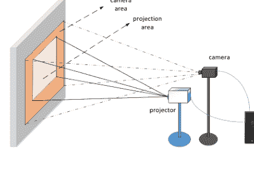
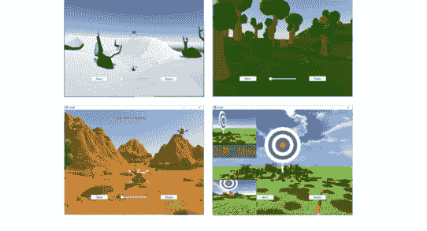
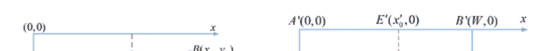

# 2020年自主系统国际研讨会 (ISAS) (中国广州 2020.12.6-2020.12.8)

## Arrow Ga 的设计与实现

**摘要**—随着投影技术的快速发展，不同场景的投影交互系统设计已取得长足进展。人类已不再满足于通过设备与计算机交互的传统方式，而是追求更自然、更自由的交互模式。因此，开发了一种基于深度学习游戏方案、涉及由 `Unity3D` 开发的各种接口的箭射游戏投影交互系统，以提升用户体验。其次，实现了现实世界中的箭到游戏场景对应位置的映射。第三，通过 `YOLOv3` 目标检测算法进行识别。最终结果表明，所提出的交互系统具有良好的实时性能和高鲁棒性。

**索引词**—目标检测，卷积神经网络，`Unity3D`，交互系统

---

## I. 引言

增强现实（AR）是一种无缝集成现实世界与虚拟世界的科技，使用户能够与虚拟现实进行交互。如今，它已融合了虚拟现实、图像处理[1]和模式识别技术。

随着日益复杂的图像处理和计算机视觉的发展，人机交互系统的应用变得越来越多。2002年，东京的 Jin Tsukimoto 开发了一种借助红外发生器映射现实世界物体位置的方法，该发生器发射一层红外光到投影平面[2]。当用户的身体或物体阻挡红外光时，图像会被相机捕捉。相机产生的亮斑使其能够找到目标的精确位置。然而，由于自然光中存在红外线，系统极易受到环境光的严重干扰，系统在使用过程中必须隔绝自然光，且精度也受到投影平面平整度的影响。

2004年，Kimura 提出了一种投影仪光着色的有效方法，该方法会影响手势的捕捉[3]。用户需要在手指上贴上对应颜色的贴纸，然后通过阈值分割算法和滤波定位，最后利用模板识别算法通过检测指定的贴纸来确定手指的位置。这种方法在某些情况下具有很高的识别率，但由于辅助设备给用户体验带来了不便，且易出错，并存在场景颜色必须与贴纸颜色不同的局限性。

2013年，意大利的 Hiroki Goto 创建了一种交互系统，该系统基于帧方法和肤色方法检测并识别手势，其中该方法通过学习手势频率来消除复杂背景的影响[4]。他提出了一种基于 HSV 和 YCbCr 空间手部颜色聚类的手势分割方法，以将手从复杂的背景中分离出来。

Duan 提出了投影键盘交互系统[5]。Firiottu 开发了一种基于可变形表面的游戏投影交互系统[6]。Raskar 提出了用于增强真实对象的着色层[7]。

在文献[2]中，相机-投影交互系统应隔绝环境光即可使用，大大改善了操作条件。然而，在文献[3]和[4]中，识别精度在很大程度上受到目标与背景差异的影响。此外，考虑到物体识别，文献[3]中的手指必须贴上特定颜色的贴纸，这极大地影响了用户体验。

在上述研究背景下，本文提出一个新的游戏交互系统，包含三个部分：
1. 设计一种将捕捉图像中箭的位置映射到游戏场景对应位置的方法，用于在游戏和场景中显示模拟箭；
2. 通过 `Unity3D`[8] 开发包含各种接口的游戏场景，以实现游戏玩法、动画和玩家体验为目的；
3. 使用基于 `YOLOv3`[9] 的目标检测算法实现物体识别，以解决投影背景和整体光线的限制。

这提升了用户对投影交互系统的兴趣和满意度。此外，为了获得用户的极大兴趣和投影效果，最重要的一步是识别相机捕捉的每一帧的准确性并快速计算目标位置。针对自然光和投影平面平整度等环境影响，提出了一种基于 `YOLOv3` 的改进物体识别算法。通过在前方贴箭，可以进行一段时间的追踪，并在箭击中时拍照。然后通过目标位置的交互交付，帮助连接现实世界与虚拟世界。投影位置应映射到游戏场景的对应位置。

---

## II. 基于深度学习的 AR 投影交互系统设计

在本文中，深度学习的箭射游戏交互系统的硬件组成包括投影仪、一个 USB 摄像头和一台电脑。连接到电脑的投影仪将场景投影到墙上。摄像头通过 USB 接口实时捕捉图像，并发送到电脑进行图像处理和定位。此外，投影仪和摄像头面向同一个方向。系统的整个结构设计如图 1 所示。



由于用户体验是人机系统的重要评价标准，通过 `Unity3D`（一种 3D 游戏开发引擎）开发了诸如目标、森林射击、雪地雪人和山等游戏场景。3D 场景中真实的飞行和生动的物体为用户创造了沉浸式体验。在某种程度上，这些独特的动画可以增强用户体验。

本文的工作：
- 通过 `Unity3D` 开发包含各种接口的箭射游戏场景；
- 基于霍夫检测[10]和同胚变换[11]实现箭位置到游戏场景对应位置的映射；
- 在不同接口中收集并标记大量数据；
- 使用基于 `YOLOv3` 的改进物体检测算法实现识别；
- 基于深度学习训练并验证目标识别网络。

---

## III. 系统实现的算法

### A. Unity3D 上的多样化游戏场景

首先，为了定义不同类型的游戏场景，如雪地、森林、山地、草地、猴子和五种组成的箭靶。其次，使用碰撞响应函数定义箭击中目标投影平面时的动作。第三，利用进度条通过增加或减少响应区域来调整游戏难度。最后，从一段时间内的文本中获取箭的坐标，在 `Unity3D` 软件中生成虚拟箭并模拟下一次飞行轨迹。游戏场景如图 2 所示。



### B. 箭头位置映射到坐标游戏场景位置

由于投影误差，投影图像与 PC 屏幕显示上的 `(x, y)` 并不完全相同。在图 3 中，ABCD 代表投影平面上的投影，点 O 代表箭头位置；A', B', C', D' 分别代表 PC 屏幕上 A、B、C、D 四个向量的对应位置。此外，W 是 PC 显示器分辨率的高度，H 是宽度。O 代表鼠标指针的位置。O(x, y) 被映射到交互系统中的 O'(x',y')，以控制软件中的箭头位置。

映射后，我们可以得到：

```
$x' = h_1x + h_2y + h_3$
$y' = h_4x + h_5y + h_6$
$y'' = h_7x + h_8y + h_9 \quad\quad\quad\quad\quad(4)$
```

也就是说，一个点对应两个位置。因此，至少需要四个点来计算相似性变换。然后实现了将对应图像中的箭头位置映射到游戏场景的方法。

首先，应该使用直线检测算法自动检测点 A、B、C、D。直线由以下方程表示：

```
$y = kx + b \quad\quad\quad(1)$
```

其中 k 是直线的斜率，b 是截距。`(x, y)` 是 x-y 空间中的点。

同时，平面上的点也可以通过距离-角度来定义，其中 $\theta$ 是从点 `(x, y)` 到原点的直线与角，$\theta$ 是 x 轴的原始角和半角。

```
$p = x\cos(\theta) + y\sin(\theta) \quad\quad\quad(2)$
```

在新距离空间中，图像变成了一条曲线。如果 x 空间中的许多点在 p 空间中相交于一点，那么这个交点就是我们要检测的直线。我们可以得到四条直线 AB、BC、CD 和 AD，以找到它们的交点 A、B、C、D。

其次，平面的相似性变换被描述为从一个平面到另一个平面的投影。我们使用相似性变换来实现图像校正。假设图像中对应点的齐次坐标为 `(x, y)` 和 `(x', y')`，相似性变换矩阵 H 定义为：

```
$H = \begin{bmatrix} h_1 & h_2 & h_3 \\ h_4 & h_5 & h_6 \\ h_7 & h_8 & h_9 \end{bmatrix} \quad\quad\quad(3)$
```

### C. 基于 YOLOv3 的目标识别算法

Girshick 在 2015 年引入的 R-CNN 算法 [12] 将 CNN 引入目标检测领域，其性能已被许多研究人员证实优于传统的检测方法。在 R-CNN 之后，出现了许多基于卷积神经网络的优秀目标检测算法，例如 SPNet [14]、Fast R-CNN [16]、YOLO [17]、SSD [18] 等。这些算法属于基于区域和卷积神经网络的目标检测算法。

在我们的方法中，采用了基于深度卷积神经网络的 `YOLOv3`。网络从整幅图像中预测位置，并通过边界框预测目标位置。它预测边界框包含对象的置信度，以及目标属于某一类别的概率。

`YOLOv3` 选择了 5 层 52 个神经元（作为全连接层），它具有大量的残差隐藏层。为了避免梯度爆炸问题，卷积层的池化有助于防止训练期间的信息丢失。

输出方面，`YOLOv3` 生成三个尺度的特征，用于检测不同尺寸的目标。特征图较小和较大的感受野分别用于检测小型和大目标。



---

## 结论

由 `Unity3D` 生成的生动场景旨在提高兴趣和体验。第二种方法是基于直线检测和线性插值对游戏场景的位置进行映射。

与那些基于嵌入生成器或特定辅助设备的系统相比，我们的投影消除了设备的束缚并增强了交互智能。此外，得益于目标检测深度学习算法，我们解决了人机交互系统易受环境影响以及受投影平面平度影响的问题。

---

## 致谢

这项工作得到了广东省重点研发计划的支持（资助号：2018B01010801）。

---

## 参考文献

[8] La Li, 基于Unity3D的应用与手柄交互[C]. 科学工程研究中心. 第20届电子、机械与材料工程国际会议论文，2019, 160–165.

[9] Redmon J, Farhad A. Yolov3: 一种增量改进. arXiv预印本 arXiv:1804.02677, 2018.

[10] Sen A, Sic O O, Andrews E. 用于分析线条识别的扩展标准手识别；国际高级计算机科学与应用期刊，2011(2): 431–438.

[11] Lingzhi, Zhao L, 等. 基于单应矩阵的未校准多视图的新型3D重建方法[J]. 计算机期刊，2014.

[12] Girshik K, Deshmukh J, Darrell T, 等. 用于准确目标检测和语义分割的丰富特征[C]. 美国俄亥俄州哥伦布斯: IEEE计算机视觉与模式识别会议论文集，2014: 598–607.

[13] Kirthevsky A, Stoskovic I, Hinton G. 深度卷积神经网络的几何解释[J]. 神经网络，2012; 1097–1106.

[14] He K, Zhang X, Ren, 等. 用于视觉识别的深度卷积网络空间金字塔池化[C]. 欧洲计算机视觉会议，2014, 346–353.

[15] Girshik R. Fast R-CNN[J]. 计算机科学，2015.

[16] Liu W, Chen Y, 等. 面向新提议方法的实时目标检测[J]. IEEE模式分析与机器智能事务，2019, 39(6): 1137–1150.

[17] Redmon J, Divick, R, 等. 实时目标检测[C]. 美国内华达州拉斯维加斯: IEEE计算机视觉与模式识别会议论文集，2016: 728–736.

[18] Liu W, Angelow D, Erhan E, 等. SSD: 单次多框检测[J]. 2015: 2–17.
