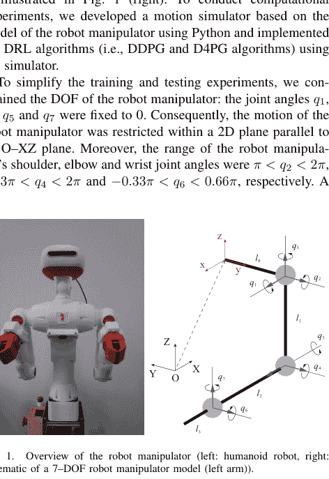
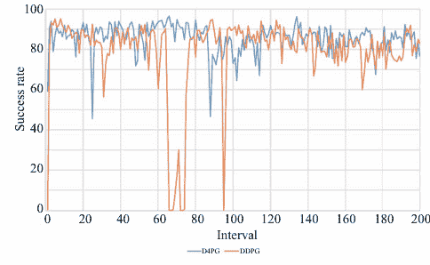
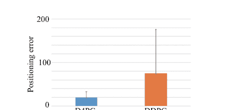
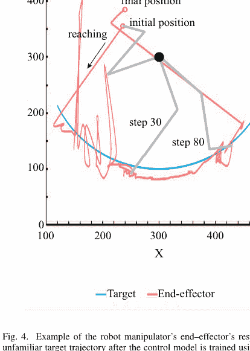
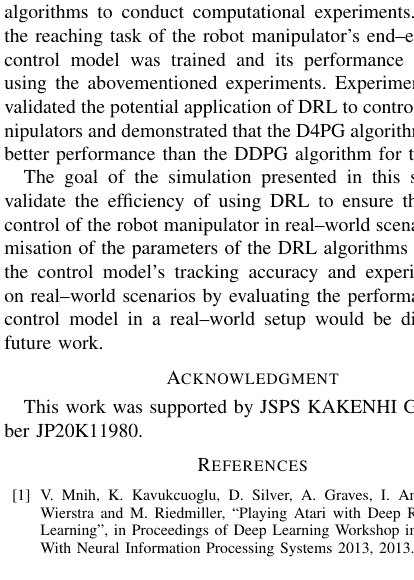

# 2020年计算机、消费者与控制国际研讨会 (IS3C)（台中市，2020.11.13-2020.11.16）2020年计算机、消费者与控制国际研讨会 (IS3C) ｜｜ 比较

Chang Chu
科学与工程研究生院
足石大学
日本，京都
ctwd0105@mail.doshita.ac.jp

Kazuhiko Takahashi
科学与工程学部
足石大学
日本，京都
katakahama@mail.doshita.ac.jp

Masafumi Hashimoto
科学与工程学部
足石大学
日本，京都
mashashimo0@mail.doshita.ac.jp

**摘要——** 在本研究中，我们将深度强化学习（DRL）应用于机器人手臂的控制，并通过比较各种 DRL 算法（即深度策略梯度（DDPG）和分布式确定性策略梯度（D4PG））的性能来研究其有效性。我们针对机器人手臂抓取的现实任务开展了训练实验。实验结果表明，D4PG 算法的成功率高于 DDPG 算法，并展示了深度强化学习在机器人控制方面的潜力。

**索引词——强化学习，机器人手臂，深度确定性策略梯度（DDPG），分布式确定性策略梯度（D4PG）**

## I. 引言

强化学习（RL）是机器学习中最的方法之一，它解决了生成智能体的问题，使智能体在环境中采取行动，并在状态或任务中获得最大奖励。强化学习具有让智能体掌握任何水平技能的潜力。强化学习有很多类型：基于值的（value-based）和基于策略（policy-based）的算法。基于值的算法通过估计到达给定状态的概率来确定智能体的控制策略，而基于策略的算法在不使用值估计的情况下直接控制智能体的策略。RL 技术的性能：神经网络（NNs）可以近似 RL 算法中的最优值函数，例如深度 Q 网络（DQNs），这是基于值的算法；深度学习技术，特别是卷积神经网络 CNN，用于操作 [1]。应用于控制策略的深度学习取得了与许多其他方法相当的性能；然而，近期成功的应用（例如在雅达利游戏和围棋中击败人类）已经引起了人们对应用深度强化学习解决许多领域现实问题的高度关注。

在控制工程中，RL 被用于控制自主智能体，尽管存在样本需求和实时性限制等许多限制，但许多研究已将 RL 用于多个机器人系统。例如，机器人手臂被广泛应用于各个领域，由于机器人机构和动力学的高度非线性特性，控制机器人手臂是一项困难的任务。此外，机器人必须适应新的且未知的环境。利用深度强化学习灵活且快速的特性来学习合适的机器人手臂控制 [4] 有时很难使用 DQNs 控制机器人手臂，因为 DQNs 只能处理离散和连续动作空间。为了解决这个问题，提出了策略梯度算法（DDPG）[5]，并将深度策略梯度算法 [6] 和 DQNs 集成到执行者-评论（actor-critic）框架中。另一方面，开发了改进的 Q 算法归一化优势（NAF）[7]，其中 Q 函数由学习过程中获得的最大值表示。这些 DRL 算法已在多项研究中应用于机器人手臂控制。

在本研究中，我们将 DRL 应用于机器人手臂方法，其中机器人手臂作为与环境交互的智能体，并使用 DDPG 或分布式确定性策略梯度（D4PG）[9]（DRL 算法的扩展）研究控制模型的特性。为了评估深度强化学习控制机器人的性能，对机器人手臂末端执行器的位置控制进行了计算实验，并比较了这些算法的性能。

## II. 深度强化学习

### A. DDPG [5]

DDPG 算法通过策略近似和值函数近似将 DPG 集成到执行者-评论框架中。执行者（actor）在环境中采取行动，利用评论者（critic）提供的值函数来优化和增强其策略。评论者接收来自环境的奖励，并增强用于策略近似的值函数。在 DDPG 算法中，使用深度神经网络将执行者表示为策略，评论者表示为值函数。因此，DDPG 算法是一种无模型的 DRL 算法。评论者网络的参数被用于最小化损失函数：

$$L = \frac{1}{M} \sum_{i=1}^{M} (y_i - Q(s_i, a_i; \theta^Q))^2$$

其中

$$y_i = r_i + \gamma Q(s_{i+1}, \mu(s_{i+1}; \theta^\mu))$$

其中执行者网络的参数使用以下梯度更新：

$$\nabla_{\theta^\mu} J \approx \sum_{i=1}^{M} \nabla_a Q(s_i, a; \theta^Q)|_{a=\mu(s_i; \theta^\mu)} \times \nabla_{\theta^\mu} \mu(s_i; \theta^\mu)$$

其中 $s_i, a_i$ 和 $r_i$ 表示智能体在第 $i$ 个时间步的状态、动作和奖励。$s_{i+1}$ 表示状态值函数；$\mu(s_{i+1})$ 表示代表当前策略的执行者函数；$\theta^\mu$ 和 $\theta^Q$ 分别表示评论者和执行者网络的权重；$\theta^\mu'$ 和 $\theta^Q'$ 分别表示目标评论者执行者网络的参数；$\gamma$ 是折扣率。

### B. D4PG [9]

DDPG 算法尝试通过引入分布方法来提高 DDPG 的准确性：多个执行者，其中独立智能体将数据收集到公共的回放缓冲区中。此外，使用了 N 步回报（N-step returns），它在计算 TD 误差时使用 N 步目标而非单步目标来捕捉更多奖励。此外，引入了经验优先化允许在正常的回放策略中进行练习。评论者网络的参数使用以下梯度更新：

$$\delta_w = \frac{1}{M} \sum_{i=1}^{M} \nabla_w(Y_i, Z_w(s_i; a_i))$$

其中

$$Y_i = \sum_{n=0}^{N-1} \gamma^n r_{i+n} + \gamma^N Z_w(s_{i+N})$$

执行者网络的参数使用以下梯度更新：

$$\delta_v = \frac{1}{M} \sum_{i=1}^{M} \nabla_\pi(s_i, a_i) E[\nabla_a Q(s_i, a)]_{a=\pi(s_i)}$$

其中 $R$ 代表回放大小，$p_i$ 表示第 $i$ 个时间步的优先级，$d$ 是两个分布之间的距离$(s_i, a_i)$ 表示参数化的分布，$\pi(s)$ 表示参数化的策略。

## III. 计算实验

为了评估 RL 技术控制机器人智能体的性能，需要机器人手臂直接与环境交互。在环境中，控制目标是到达某个任务，机器人手臂从任意初始位置移动并将其末端执行器保持在目标位置。我们使用了 7 自由手臂（Dof 来自 Scius Tech，日本，京都，如图 1 所示）。肩部、肘部和腕部关节具有 2、2 和 3 个自由度的机器人手臂模型如图 1 所示。对于计算实验，我们使用 Python 开发了运动模拟器，并实现了基于 DDPG 和 SAC 的 RL 算法来代表模拟器。

A. 图 1. 机器人手臂概述（左：人形机器人，右：7 自由机器人手臂示意图（左：手臂））。

以机器人机械臂肩关节为中心、边长为 600 的正方形被用于模拟其运动。结果是，模拟器中每个机器人机械臂的长度在几何上缩减了实际机械臂的连杆长度：$l_1 = 100$，$l_2 = 20$ 和 $l_3 = 40$。在初始过程中，关节值被随机设置。机械臂端执行器的位置随机放置在三个圆周周上，其中肩部的位置是机械臂运动的原点。目标位置位于边长为 40 的正方形中心。在实验中，我们为每组参数生成了 200,000 次实验。

表格显示了学习率。对于所有算法，端执行器越接近目标，获得的奖励越高。端执行器在目标周围正方形内停留的时间越长，奖励越高。当机械臂（智能体）移动到指定目标并在位置停留预定的步数，或者步数超过 200 时，学习过程终止。

图 2 显示了每个算法的学习率；横轴显示学习间隔，每个间隔包含 1,000 次实验，而纵轴代表每个间隔的成功率。在图 2 中，D4PG 在过程中比 DDPG 实现了更高的成功率和更好的稳定性。

接下来，我们研究了在使用两种算法训练控制模型后，位于不熟悉的圆周轨迹上的目标位置的定位误差。

表格 I
学习参数
| 学习 | 数值 |
|--- | --- |
| 学习率 | 0.001 |
| 折扣因子 | 0.9 |

图 2. DDPG 和 D4PG 算法学习成功率对比。

图 3. DDPG 和 D4PG 算法在不熟悉目标位置后的定位误差对比。

定位误差定义为目标与端执行器位置之间的欧几里得距离。测试的目标点总数为 19 个，每个点的定位误差通过使用不同关节配置值获得的 1,000 次实验结果进行评估。两种算法观察到的误差以及误差棒棒显示了标准差。在图 3 中，通过训练控制模型获得的平均误差和方差低于 DDPG。D4PG 算法实现的机器人机械臂任务精度比 DDPG 高。

最后，进行了机器人机械臂沿期望轨迹的跟踪，以作为一种实际的控制方法。图 5 展示了使用 D4PG 和 DDPG 算法完成学习过程后，不熟悉的圆周轨迹。机械臂首先将其端执行器移动到轨迹起点，在初始关节角随机设置后遵循控制指令，然后它们对于每个指定的终点点对点地跟踪轨迹。如图 4 所示，很难确保端执行器在保持 D4PG 控制模型精度的同时跟踪期望轨迹。尽管该控制模型不满足实际需求，且在期望轨迹的最终位置周围观察到较大的误差（如图 5 所示），但 D4PG 训练的模型表现得优于 DDPG 训练的模型。

# IV. 结论

本研究调查了深度强化学习（DRL）控制机器人机械臂的有效性：探索了两种类型，即 DDPG 和 D4PG 算法来训练控制模型，并比较了它们的性能。机器人机械臂的运动模拟使用了人形机器人的 7 自由手臂，并使用模拟器实现了两种

算法进行计算实验，基于机器人机械臂端执行器的到达任务，通过上述实验训练了模型并测试了其性能。实验结果验证了 DRL 在机器人机械臂控制中的应用，并证明了在该任务中取得了比 DDPG 算法更好的性能。

本研究提出的提出的仿真目标是提高机器人机械臂在复杂场景下的精度和控制。未来的工作将讨论优化 DRL 算法以提高模型的跟踪精度，并通过在真实世界设置中评估控制性能来对真实场景进行实验。

# 谢谢

这项工作由 JSPS KAKEN Grant 20.KP190 支持。

# 参考文献

- [1] V. Minh, K. Kavouci, D. Silver, A. Graves, I. Agmon, D. Wierstra and M. Riedlund, "Playing with Deep Reinforcement Learning," in Proceedings of Deep Learning Workshop in Conjunction with Neural Systems, 2013.
- [2] J. Kever, J. Bagrawal and T. Peters, "Reinforcement Learning: A Survey," The International Journal of Robotics Research, Vol. 32, 1238–1274, 2013.
- [3] H. Nguyen and M. Li, "Review of Deep Reinforcement Learning for Robotic Control," in Proceedings 2019 IEEE International Conference, pp. 590–595, 2019.
- [4] S. Bharti, A. Wienberg, Z. T. Lee and H. Ren, "Deep Reinforcement Learning for Robotic Manipulation," in IEEE Proceedings of the 24th International Conference on Robotics and Challenges, 2017.
- [5] T. P. Lillicoup, J. H. Hunt, A. Prit, N. Heess, T. Eyer, Y. Tassa, D. Silver, "Learning Deep Reinforcement Learning for Continuous Control," in 2016 IEEE International Conference on Robotics and Learning (ICRA), 2016.
- [6] D. Silver, G. Eeler, N. Heess, D. Wright, D. Vordal and M. Riedlund, "Proximal Policy Optimization," in Proceedings of the 33rd International Conference on Machine Learning (ICML), Vol. 34, 2016.
- [7] S. Amadeo, "Deep Reinforcement Learning for Robot Manipulation The State of the Art," arXiv:1701.08878, 2017.
- [8] G. B. Wang, J. Finn, A. Finnman, D. Duncan, G. TB, A. Maddal, N. Heess and T. Lillicoup, "Distributed Demographic Policy Optimization," in Proceedings of 6th International Conference on Learning Representations (ICLR), 2018.

