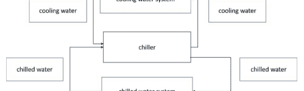
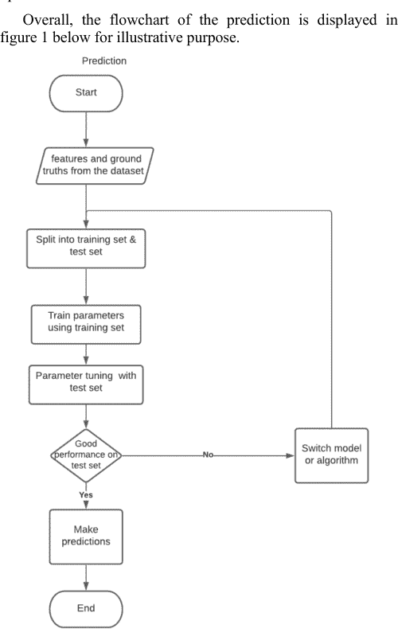
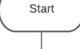
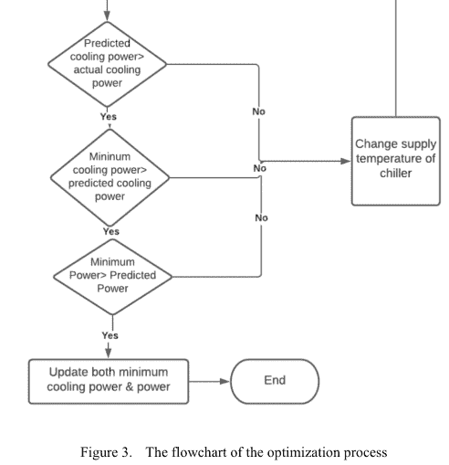
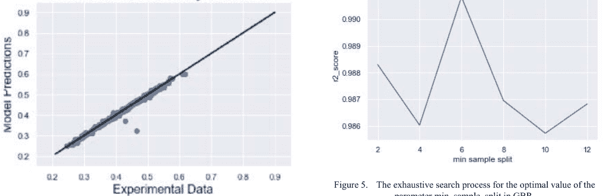
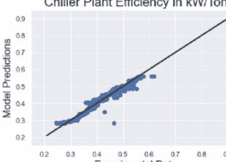
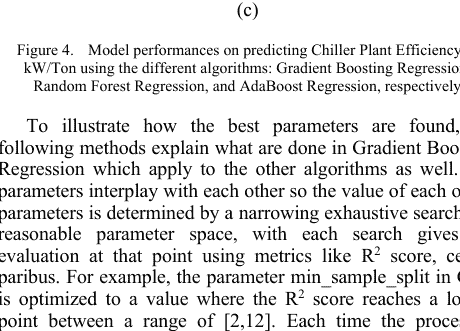

# 2020管理科学信息化与经济创新发展会议（中国广州 2020.12.18-2020.12.20）


Mofeyang Li
山西省高市第一号中学
中国，山西
1319407831@qq.com

摘要——暖、通风与空调（HVAC）系统已在中国办公场所广泛应用。然而，城市中的 24 小时运行计划往往由于额外电力消耗了不必要的能量而导致成本高昂。为了应对这一挑战并使 HVAC 运行效率最大化，本研究构建了包括聚类、回归和深度学习在内的机器学习（ML）算法预测模型，对源自中国某办公楼的数据数据进行优化。优化的目标是通过控制温度来最大限度地减少消耗较少的冷量。通过训练后的模型，优化结果显示出良好的前景：对于单栋办公楼，它能够降低能源成本、净现值（NPV）、生命周期成本分析（LCCA）以及社会碳成本（SCC）。研究发现可应用于能源领域：电力配电，通过为 HVAC 系统提出一种优化方法，本文还旨在通过先进的机器学习技术激发更多节能工作，希望通过日常生活中更强大、更好的方法来缓解波动的全球气候。

（此处）用于 HVAC 系统，但它不仅能缓解短缺，对于减少非可再生能源消耗、保护生态环境和维持空气质量具有重要意义。本文提出了一种调整建筑 HVAC 操作涉及的系统参数的方法，以实现低能耗和低成本的系统。该方法使用了建筑冷水机冷却系统和加热水的实际数据，包括从两个观测点获取的 414 个参数，并应用机器学习来优化中央空调系统的运行策略，然后基于全生命周期成本法、净现值（NPV）以及使用社会碳成本（SCC）的社会经济效益计算经济效益，实际上实现了城市节能的目标。

**关键词**——HVAC 系统、机器学习、预测、节能

# I. 引言

随着中国的快速发展、人们生活水平的提高以及人均建筑面积的持续扩大，HVAC 的应用已普及。HVAC 系统的节能挑战成为一个待解决的能源问题。2018 年，建筑总能耗占总能耗的 80 亿吨。此外，中国单位建筑的能源使用量仍是气候相似的发达国家的三倍。HVAC 领域需要更多技术创新来降低能耗。建筑 HVAC 系统的作用体现在加热、通风和空调三大主要方面。为了实现节能目的，我们可以选择合适的系统设计并加强系统控制。如果节能减耗措施

（此处缺失）

建筑运行的经典控制算法包括 PID 和模糊控制等逻辑。然而，由于 PID 或模糊控制无法确保在保持建筑正常运行的同时实现最小能耗的最优运行，研究人员已专注于开发机器学习算法，以利用建筑能源系统的历史数据实现最优预测 [1][2]。因此，优化节能是可能的，特别是 HVAC 系统，可以在保持舒适度控制等正常运行的同时节省能源。

# II. 相关工作
*（注：提供的 OCR 文本中缺少第二部分，直接从 I 跳到 III。根据源文本，我将直接进入第三部分。）*

# III. 贡献

本文提出了基于机器学习算法（梯度提升、随机森林、自适应回归）的数据驱动模型，以降低办公楼 HVAC 系统的冷水机功率和电力预测。开发了一种新框架，通过冷水机动态运行优化冷水机房，在不增加新硬件和成本的情况下降低能效和碳排放，这是通过训练好的预测模型监控并控制 HVAC 控器中的参数实现的，在不牺牲任何热舒适度或冷量的情况下将使用降至最低。通过将 LCCA（生命周期成本分析）和 SCC（社会成本）与 NPV（净现值）相结合，本文生动地连接了通过节能算法可能产生的商业效益和社会效益。机器学习是强大的，当它准确有效地处理数据时，它确实发挥作用。通过伪代码、数字表格和示例，这些算法应该易于可视化并推广到能源领域其他具有实现成就潜力的方面。

3) Adboost 回归，Adboost 级联弱学习器，并在添加它们之前对之前训练的每个学习器进行权重调优。Adboost 提供了一个不需要特征选择的相对预测模型。然而，如果噪声加剧可能会误导每一步的权重调整并增加时间。Adabo 中的参数列如下表 III 所示。

# IV. 方法论

## A. 冷功率预测和电力预测模型的开发

1) 梯度提升（Gradient Boosting, GBR）是用于训练模型以准确预测冷功率的主要算法。梯度提升是梯度下降的一种。GBR 中有几个关键参数需要注意：估计器数量、学习率、最小样本分裂、最大深度和损失函数。表 I 显示了每个参数的描述。通过对参数进行网格搜索，可以以最佳性能优化模型。

表 I 梯度提升 (GBR) 中的参数

| 参数名称 | 描述 |
| :--- | :--- |
| number of estimators | 执行的阶段数量 |
| learning rate | 每个阶段贡献的百分比 |
| minimum sample split | 分裂内部节点所需的样本数 |
| maximum depth | 每个个体（树）的最大深度 |

2) 随机森林回归，梯度随机森林由大量的决策树组成，它们在线性回归问题上运行良好且快速。对于本研究中使用的的数据集（涉及近 200 个特征），随机森林算法在不需要特征选择的情况下表现良好；它还有助于归纳哪些特征对最终结果更重要。随机森林参数列如下表 II 所示。

$R' = 1 - \frac{\sum_{i=1}^{n} (\hat{y}_i - y_i)^2}{\sum_{i=1}^{n} y_i^2}$

等等，$R' = 1 - \frac{\sum_{i=1}^{n} (\hat{y}_i - y_i)^2}{\sum_{i=1}^{n} y_i^2}$，其中 $\hat{y}$ 代表产出的预测值，$y$ 代表数据集中对应的实际值。

表 II 随机森林算法中的参数

| 参数名称 | 描述 |
| :--- | :--- |
| number of estimators | 森林中树的总数 |
| minimum sample split | 分裂内部节点所需的最小样本数 |
| maximum depth | 每棵单体树的最大深度 |

表 III ADBOOST 中的参数

| 参数名称 | 描述 |
| :--- | :--- |
| number of estimators | 执行的提升阶段数量 |
| learning rate | 每个阶段贡献的百分比 |
| Random state | 森林中使用的随机数 |

4) 指标，有五种不同的指标用于检测和监控性能：

> MAE（平均绝对误差）
$$MAE = \frac{1}{n} \sum_{i=1}^{n} |\hat{y}_i - y_i|$$

> MSE（均方误差）
$$MSE = \frac{1}{n} \sum_{i=1}^{n} (\hat{y}_i - y_i)^2$$

> RMSE（均方根误差）
$$RMSE = \sqrt{\frac{1}{n} \sum_{i=1}^{n} (\hat{y}_i - y_i)^2}$$

> WMAPE（加权绝对百分比误差）
$$WMAPE = \frac{\sum_{i=1}^{n} |\hat{y}_i - y_i|}{\sum_{i=1}^{n} y_i}$$

模型中 192 个参数的特征重要性有助于检测哪些变量影响冷功率或其他参数，从而将能源成本降低到更低的水平。其机制是随机扰动特定参数的值，并观察修改对模型性能的影响；如果有影响，完美版本应该产生较低的准确率，反之亦然。与 MAPE 相比，加权 WMAPE 更适用于数据集，因为在某些参数空间存在零。


此外，R2 分数的公式通常能对模型的真实性能提供更准确的直觉，它消除了由于其他指标中维度维度差异可能导致的计算虚假印象。所有指标在模型每次运行时都会计算，因此可以清楚地看出哪个模型在数据集上表现更好。

平衡两个水系统的流量：冷却水和被冷却水。该机制见图2。该系统包含了优化过程所涉及的几个主要因素，即供温度、回水温度、冷却水流量和冰水流量。

### 5) 使用集合进行参数调优

每个模型的调优通过网格搜索进行，其中对所有可能的组合进行实验，并将其分为三个部分：训练集、验证集和测试集。使用训练集训练模型后，通过验证集对性能进行完整验证，带有新参数的训练模型通过测试集进行评估，直到性能达到最优水平。



图2.HVAC系统中制冷机工作原理的简单示意图

总而言，预测的流程图如图1所示，用于说明目的。

影响制冷机功耗的两个变量是上述流量和供温度。为了最小化功率和冷却功率的预测（从而在现实生活中导致较低的消耗），优化过程尝试寻找此类配置，使得给定参数空间中的每个值都能产生尽可能好的预测结果。由于优化已经完成，应该包含最终的、最小的功率和冷却功率预测值，以及进行这些预测时对应的流量和供水单位。在存储了参数后，可以在保持冷却功率水平不变的同时，更新制冷机的运行策略，从而不会对热舒适度或温度产生任何影响。



此外，该优化算法的实现相当直接，通过循环在整个状态空间内反复搜索供温度。整个过程用以下伪代码进行编程：

- 初始化最小冷却功率为 1000，最小制冷机功率为 5000。此外，创建了三个列表来保存优化结果，包括冷却功率和供温度。
- 在 [6,13] 之间生成状态空间，步长为 0.1。结果是状态空间有 70 个状态，这是优化制冷机温度的搜索空间。
- 此外，每次迭代使用冷却功率模型 = f (x0, x1) 进行冷却预测，该值应大于实际冷却功率。
- 然后，使用网格搜索算法进行优化：

```
for k in range(n): (n is the total number of the datapoints)
for i in supply temp:
for j in flow rate:
```

### 6) 优化

为了在现实生活中削减并节能，优化过程旨在最小化一项收益：功率消耗。HVAC系统中的制冷机通过以下方式提供冷空气：

```
calculate cooling power prediction
if cooling power >append cooling power:
    mincooling power > pred cooling power:
        mincooling power = pred cooling power
calculate cooling power prediction
if minpower > pred power:
    minpower = pred power
```

估计燃煤发电产生的每度电至少会释放96公斤二氧化碳。碳成本（SCC）是一个美元估算值，表示向大气中排放一吨二氧化碳（CO2）所造成的损害。SCC乘以年用电量应产生净现值（NPV）中的年度正现金流。

## 优化



制冷机03/0405的供温度和其他特征

预测冷却功率和功率

- 将最新数据添加到相应的列表中。
cooling_final.append(mincooling)
power_final.append(minpower)
tupply_temp_final.append

优化过程的流程如图3所示。

### 7) 经济分析

优化完成后，之前存储的加热功率和冷却功率值可以通过实际功率使用进行预测，以估计预测模型如何降低成本并确保节能。为了论证，构建每年的相对节省和总节省额有助于为经济分析提供更全面的指标。

> 相对节省 = $\frac{P-\hat{P}}{P} \times 100\%$ (6)

> 年度节省 = $\frac{(\bar{P}-\hat{P}) \times u_{cap} \times t}{2}$ (7)



$\bar{P}$ 代表实际功率使用，$\hat{P}$ 代表预测用量，$t$ 代表HVAC系统的年运行总小时；$u_{cap}$ 代表数据集中冷却功率的平均值。年度节省的单位是kWh；为了将其转换为kWh，包含了 $u_{cap}$ 项以使单位适用于计算货币单位的节省额。由于HVAC主要在夏季和冬季运行，总节省额最终除以2得到


## 冷水机组效率 (kW/Ton)



## 随机森林回归

(b)



## 冷水机组效率 (kW/Ton)



## AdaBoost 回归

(c)

图 4- 不同算法预测冷水机组效率（kW/Ton）的模型性能，分别为：梯度提升、随机森林回归和 AdaBoost 回归。

为了说明如何找到最佳参数，可以使用以下方法：梯度提升回归也适用于其他算法。参数之间相互作用，因此每个值的值通过在合理的参数空间内进行穷举搜索来确定，每次搜索都根据平方误差参数评估模型。例如，GBR 中的最小样本分裂（min sample split）被优化到使 R 分数达到 [2,12] 范围内的某一个点的值。每次重复该过程时，参数都会更新为下一个最优值，以进一步迭代搜索另一个参数，直到参数更新到最优状态。

图 5- GBR 中参数 `min_sample_split` 优值的穷举搜索。

已知 GBR 倾向于产生最佳性能，因此对 3 台不同冷水机组的制冷功率预测是使用 GBR 实现的，因为它们是线性回归模型。在预测制冷功率时对 GBR 参数进行搜索后，最佳配置显示在表 X 中。

表 X- 冷水机组 3 制冷功率最佳模型预测下 GBR 的参数配置。

| 参数名称 | 数值 |
|---|---|
| 估计器数量 (number of estimators) | 400 |
| 学习率 (learning rate) | 0.01 |
| 最小样本分裂 (min sample split) | 4 |
| 最大估计器深度 (maximum estimator depth) | |

对于与此数据集 3 导出的实际制冷功率数据类似的数据，GBR 在数据集 3、4、5 的所有结果中均产生最佳预测。由 GBR 预测 3 台冷水机组制冷功率的结果列于表 11。这里使用 WAPE 基于 MAPE 来评估模型：3 台冷水机组的制冷功率。

表 XI- 冷水机组 3 制冷功率最佳预测下 GBR 的参数配置。

| 冷水机组 3 | 冷水机组 4 | 冷水机组 5 |
|---|---|---|
| MAE | 0.17305 | 0.03259 | 0.19587 |
| WAPE | 1.64810 | 0.9987 | 1.45014 |
| RMSE | 1.2832 | 4.4761% | 0.3081% |
| R_score | 0.9976 | 0.99933 | 0.99293 |

# B 单位

在得出所有结果后，下一步是将这些结果投入优化。预先在冷水机组效率和制冷功率上训练的优化模型在运行优化模型前已加载。然后使用数据与实际数据进行比较，以评估可以节省多少能量，之后可以根据优化结果的节省情况进行经济分析。共过滤了 1811 个数据点进行优化处理，并将预测数据与实际数据进行比较，结果如下表所示。选择了 5 天的数据来运行优化。

本文处理了由于运行中非优化设置产生的开销而导致的能源使用范式问题。特别是，HVAC 的功率输出高于建筑达到相同制冷水平所需的实际功率。通过添加调节系统的设置，可以实现节约。

## 表 XII. 优化算法生成的参数值

| 参数 | 数值 |
|---|---|
| 实际制冷功率 | 3341928 |
| 实际功率 | 1564690 |
| 预测制冷功率 | 3352724 |
| 预测功率 | 1514768 |

能源使用领域已应用于较广泛且不断扩大的范围：Google 和 Deepmind 部署了算法 DQN-Network，帮助他们在 2016 年减少了 40% 的城市冷却能。使用机器学习算法进行全球能源分析以识别技术并估计减少 20% 的碳排放。

## C. 经济分析

为了完成 NPV（净现值）计算，需要实际数据。中国的商业电价从 0.7 元/kWh 到 元/kWh。为了简单起见，我们假设平均电价为 元/kWh。2020 年 6 月更新的中国折现率以及所有参数的 NPV 公式有助于估计 50 年寿命期间的现值。对于这项投资，将算法实施到建筑的成本估计为 $40,000。同时，换句话说，预测模型可以用更少的能量产生相同的制冷功率。中国拥有巨大的风能和太阳能容量，已经开发了十年绿色技术。然而，面对化石燃料，能源利用在总能源消耗中的优先级较低。该领域的未来发展正变得越来越重要，这将在未来看到。像本文中的机器学习算法，应该是创新和创造的关键组成部分。储能和调度技术应与专家共同开发。

## 表 XIII. 预计节省金额和净现值

| 参数 | 数值 |
|---|---|
| 相对节省率 | 3.23% |
| 年度节省金额 | $26205.40 |
| 年均 SCC | $991 |
| 该项目的 NPV | 70917.64 |

如上所述，实施这种方法可以每年节省 $70917.64 且 NPV 为 $26205.40。

# VI. 结论

由于 HVAC 系统中运行设置的制约，通过方法减少能源消耗的假设在未来是得到支持的。

国际货币基金，折现率，圣路易斯储备银行 [ITDCCN193]，获取自 https://fred.louisfed.org/series/ITDCCN193, 2020 年 9 月 5 日。

论文受限于预测的准确性，即来自单一建筑的小样本，然而，通用的假设依然成立。

如前提到的清洁能源对于后代至关重要。本文中使用的简单方法可以为能源结构提供更有效、更清洁的改进。

通过为能源领域的现有问题提供详细的技术基础，希望本文能鼓励讨论并促进应对全球气候变暖。

# 致谢

我诚挚地感谢我的老师刘老师，她在整个过程中提供了持续的帮助，从论文进展建议到学术方面的专业指导。没有她的耐心和支持，这项研究是不可能的。

# 参考文献

[1] Wang, L., Lee, E. W. M., Yoon, R. K., & Feng, W. (2019). 基于制冷预测的冷水机组预测优化。Energy and Building, 292, 107033.
[2] Wang, J., Dai, K., Keating, T., Bursynnek, N., Bu, Y., Wang, K., & Zhang, Z. (2017). 设计知识驱动的数据空调能源优化。In Proceedings of the 2017 IEEE International Conference on Knowledge and Management (pp. 1-6).
[3] Rieke, D., Foster, L., Calderon, K., & Yadav, T. (2018). 县级碳成本。Nature Climate, 8(9), 895–900. doi:10.1038/s41467-018-0518-2
[4] Howertower, T. (2017). 机器学习如何提高能源消耗。2020 年 9 月 2 日，自 https://internetofthingsagenda.com/blog/Agenda-How-machine-learning-improves-energy-consumption/
