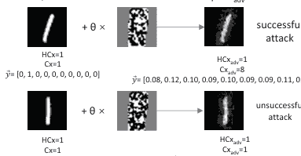
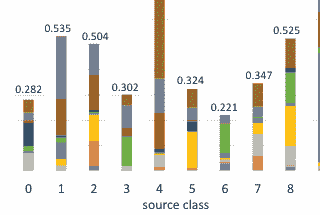
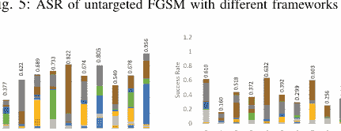
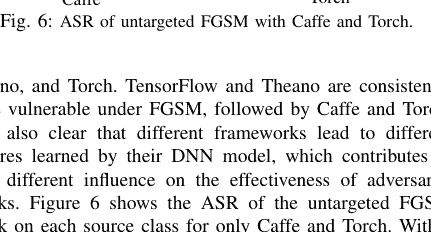
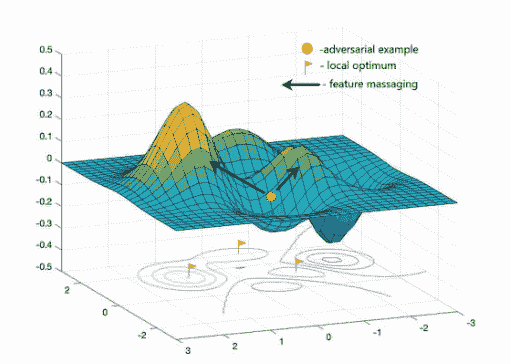

# 2020 第二届 IEEE 智能系统与应用信任、隐私与安全国际会议 (TPS-ISA)(美国佐治亚州亚特兰大 2020.10.28-2020.10.31)

Wenqi Wei*, Ling Liu*, Margaret Lopez*, Ka-Ho Chow*, Emnet Emre*, Stacey Troy*, and Yanzhao Wu*
* 美国佐治亚大学，佐治亚州亚特兰大
* 佐治理工学院研究院，佐治亚州亚特兰大

摘要— 深度学习的巨大成功由于更多任务伴随着敏感数据，引发了安全和隐私方面的关注。深度学习中的对抗性攻击已成为一系列关键任务深度学习系统和应用的主要威胁之一。本文通过研究对抗样本的散度效应，提出了一种针对深度学习对抗样本的全方位防御方法，并提出了三个原创贡献的攻击无关防御措施。首先，我们提供了对抗样本的实例级散度的通用公式。然后，我们通过多种评估指标对对抗攻击进行评估，以研究其优势和成本。最后，我们通过使用对抗样本和目标攻击的测试用例研究了对抗样本的有效性，并证明了它们跨对抗攻击的散度。我们利用散度提出了策略性输入变换防御。所提出的防御方法与攻击无关，并且能够在对抗输入上进行自动重构和自动验证。我们证明，与代表性的防御方法相比，该防御可以实现高成功率和低误报率。

**关键词—** 深度学习中的信任与可靠性，对抗攻击，缓解策略

接收者将一个受损的停止指令误解为通过性指令 [121]。

对抗样本的数量与神经网络攻击算法的资源增长趋势相似 [10]–[25]。即使仅对学习即服务（LaaS，如 Amazon、Google 或 IBM 提供的服务）的预测 API 进行黑盒访问，也可能对已训练的深层神经网络（DNN）模型发动攻击。对于可迁移性 [26–29]，来自深度学习模型的对抗样本可以转移到其他深度学习模型中。尽管许多热点尚未被理解，但盲点可以被用来生成对抗样本的伪影。此外，对抗攻击可以发生在训练阶段和推理阶段。训练阶段攻击将对抗样本注入到网络模型的原始训练集中 [30]。本文关注在预测阶段匹配的对抗攻击。

为了开发针对对抗攻击的有效策略，深入理解对抗样本的本质和散度至关重要。在本文中，我们采用全方位的方法来表征深度学习中的对抗样本，并基于该表征提出了输入变换防御。首先，我们提供了对抗样本的通用公式、对抗防御原则，并用多种负面影响和成本对其评估。我们通过使用对抗样本和目标攻击的测试用例，对对抗行为的实例级散度进行了实证评估。根据观察，我们表明防御策略可以创建与攻击无关且能够对对抗输入上的决策进行自动重构和自动验证的防御。我们在 15 种攻击上测试了所提出的防御，并证明与代表对抗噪声散度表征现有防御方法相比，我们的防御可以实现高成功率和低误报率。该研究为针对现在和未来的对抗攻击设计缓解策略和防御机制。

## I. 引言

深度学习在计算机视觉 [1] 和自然语言处理 [2] 以及其他架构映射等领域取得了巨大成功。许多深度学习应用，如人脸识别 [3]–[4]、语音识别 [5] 和恶意软件检测 [6]，都是安全关键的对抗攻击 [7–9]。我们已经证明深度学习模型在预测阶段容易受到对抗输入的影响 [10]。对抗是在是在样本的基础上添加对抗样本创建的输入。添加对抗噪声的存在会导致学习模型对输入进行错误分类。例如，攻击者可以使用对抗样本导致监控摄像头或政府实体的授权被错误分类 [11]。早期，如果视觉摄像头由于对抗扰动识别出停止标志，或者如果指令，自动驾驶汽车可能会采取意料之外的行动。

## II. 对抗攻击的公式化

### A. DNN 模型

令 $x \in X$ 为训练数据集 $X$ 中的输入样本。一个 DNN 模型 $f(x) = f_n(f_{n-1}(\dots f_1(x)))$ 由从输入到输出层的 $n$ 层连续神经元组成。每一层表示一个参数函数 $f_i(i=1, \dots, n)$，作用于激活函数，例如 $ReLU$；每一层的输出是下一层的输入，生成一个新的表示。权重向量 $\mathbf{W}_i=\{w_{ij}\}_{j=1}^{K_i}$ 和偏置向量 $\mathbf{B}_i=\{b_{ij}\}_{j=1}^{K_i}$，其中 $K_i$ 表示第 $i$ 层神经元的数量。令 $y$ 为 $x$ 的类别标签，$\hat{y} = f(x)$ 是 $m$ 维向量空间 $\mathcal{Y}$ 中输入 $x$ 的分类结果，使得 $p_i$ 表示预测类别 $y_i$ 的概率，$0 \leq p_i \leq 1$ 且 $\sum_{i=1}^m p_i = 1$。$\hat{y}$ 是概率最大的类别。

DNN 的部署包含两个阶段：训练阶段和测试阶段。在训练阶段，一组输入-标签对 $(x, y)$ 用于训练模型。在测试阶段，对未见数据进行评估。目标是最小化损失函数。然而，对抗攻击旨在引入不可察的扰动来破坏这一过程。

DNN 的部署包含两个阶段：训练阶段和测试阶段。在训练阶段，一组输入-标签对 $(x, y)$ 用于训练模型。在测试阶段，对未见数据进行评估。目标是最小化损失函数。然而，对抗攻击旨在引入不可察的扰动来破坏这一过程。

DNN 的部署包含两个阶段：训练阶段和测试阶段。在训练阶段，一组输入-标签对 $(x, y)$ 用于训练模型。在测试阶段，对未见数据进行评估。目标是最小化损失函数。然而，对抗攻击旨在引入不可察的扰动来破坏这一过程。

DNN 的部署包含两个阶段：训练阶段和测试阶段。在训练阶段，一组输入-标签对 $(x, y)$ 用于训练模型。在测试阶段，对未见数据进行评估。目标是最小化损失函数。然而，对抗攻击旨在引入不可察的扰动来破坏这一过程。

DNN 的部署包含两个阶段：训练阶段和测试阶段。在训练阶段，一组输入-标签对 $(x, y)$ 用于训练模型。在测试阶段，对未见数据进行评估。目标是最小化损失函数。然而，对抗攻击旨在引入不可察的扰动来破坏这一过程。

图1：测试阶段对抗攻击工作流

训练阶段。在训练阶段，一组输入-标签对 $(x, y)$ 用于训练模型。在测试阶段，对未见数据进行评估。目标是最小化损失函数。然而，对抗攻击旨在引入不可察的扰动来破坏这一过程。

### B. 对抗攻击的公式化

令 $x_{adv}$ 为良性输入 $x$ 的恶意构造样本。图 1 展示了基于对抗样本的攻击者攻击深度学习服务 API 的流，包含两个步骤：(1) 将良性输入发送到 API，2) 攻击者拦截模型以获取预测结果。

| 范数 | 定义 |
|---|---|
| $L_{\infty}$ | 对任意输入 $x$ 和 $x_{\delta}$ 的最大变化 |
| $L_0$ | $x$ 中发生改变的像素总数 |

分类错误率 (MR) 在无目标攻击中等同于攻击成功率 (ASR)。然而，目标攻击的失败并不意味着没有预测出正确类别。MR 定义为所有攻击中分类错误的对抗样本占总数的百分比：$MR = \frac{AEF}{AE}$

对抗输入的类别与良性输入的类别相同；$y_{\delta}$ 表示排除 $y$ 后的标签空间。对于无目标攻击，标签 $y_{\delta}$ 生成预测类别 $y_{\delta}$，且该距离衡量的是对抗输入 $x_{\delta}$ 的预测向量与 $y_{\delta}$ 之间的距离。通过最大化该距离，在成功攻击中实现对抗输入预测为 $y_{\delta}$ 的目标，从而达到不改变原始输入 $x$ 标签的目的。相应地，对抗样本预测类别与良性样本预测类别之间的距离定义为 $d(y, y_{\delta})$。

**对抗平均置信度 (MeanConf):**
MeanConf 是成功对抗样本中对抗类别的平均置信度：$MeanConf = \frac{1}{n} \sum_{i=1}^{n} d(y, y_{\delta,i})$，其中 $n$ 是无目标攻击和目标攻击中成功对抗样本的数量。

对于目标攻击，目标标签 $y^{t}$ 是某个目标函数，用于衡量对抗输入 $x_{\delta}$ 的预测向量与目标标签 $y^{t}$ 之间的距离。目标是最小化该距离，使得通过向 $x$ 注入扰动生成的对抗输入 $x_{\delta}$ 能以高置信度匹配目标标签。在无目标攻击中，我们需要最大化原始标签 $y$ 的概率置信度。因此，攻击需要在增强目标标签概率置信度的同时，最小化所有其他标签的概率置信度，使目标标签脱而出。这可以通过由扰动函数 $d(y, y_{\delta})$ 生成的 $\Delta_{\delta}$ 来。

**DiAATA:** DiAATA 衡量成功对抗样本中对抗类别与正确类别之间的平均距离：$DiAATA = \frac{1}{n} \sum_{i=1}^{n} |p - p_{\delta,i}|$，其中 $p$ 是概率置信度。

对抗样本使用多种评估指标来研究其影响和成本。这些攻击还包括 FGSM [14] 以及用于鲁棒性的 PGD [31]、C&W 和 JSMA [15]。这些攻击涉及公式中扰动距离的不同范数：$L_{\infty}$、$L_0$ 和 $L_2$。对于每个目标攻击，我们假设有两种目标攻击类型：预测向量中最可能的类别（$y^{\delta} = \arg\max_{y} p(y)$）和最不可能类别（目标攻击中的 $y^{t}$）。

**DiAOC:** DiAOC 衡量良性样本中对抗类别与真实类别之间的平均距离。给定良性样本的概率置信度，这用于比较质量。如果良性样本的概率置信度高于对抗样本，则认为攻击成功。

对抗样本的影响可以用多种成本来衡量：使用不同范数衡量的扰动成本、通过图像质量评估衡量的感知成本，以及时间成本。**扰动距离 (DistPerturb):** $Disturb = \frac{1}{n} \sum_{i=1}^{n} ||x_{\delta,i} - x_i||$，其中 $n$ 是对抗样本的数量。

# III. 攻击表征

我们提出了以下评估指标来分析和比较对抗样本的效果。AE、SAE 和 MAE 对抗样本、成功的对抗样本以及分类错误的对抗样本在有限的扰动噪声下被认为是成功的：在无目标攻击中 $y_{\delta} \neq y$，或在目标攻击中 $y_{\delta} \neq y^{t}$。

**攻击成功率 (ASR):** 所有攻击中成功的对抗样本的百分比。$ASR = \frac{AEF}{AE}$。ASR 越高，对抗攻击产生的效果越有效。

**感知距离 (Dist-SSIM):** SSIM [32] 用于衡量两幅图像之间的视觉相似性。它将图像退化视为输入中的感知结构变化，并结合了亮度掩码和对比度掩码。我们计算对抗样本的成本。如果两幅图像相似，则 SSIM 较高。

**感知距离 (Dist-PSNR):** PSNR 是人类感知质量的近似值，概念上用于衡量图像质量。从 SSIM 开始，PSNR 报告了

## MNIST

| 攻击 | UA/TA | ASR | MeanConf | DistAAB | DistAAT | DistAOC | DistPer | L_y | L_s | SSIM | time (s) |
|---|---|---|---|---|---|---|---|---|---|---|---|
| FGSM | | 46 | 0.9214 | 0.0786 | 0.8671 | 0.8571 | 0.3 | 5.935 | 0.56 | 40.9 | 0.002 |
| FGSM | | 63 | 0.7007 | 0.0469 | 0.8833 | 0.8623 | 0.3 | 6.210 | 0.54 | 48.7 | 0.002 |
| TFSM | | 10 | 0.7656 | 0.0264 | 0.7387 | 0.729 | 0.3 | 6.055 | 0.55 | 40.24 | 0.001 |
| TBIM | | 98 | 0.9906 | 0.0097 | 0.9956 | 0.9968 | 0.3 | 5.018 | 0.53 | 41.63 | 0.002 |
| CW_ | | 63 | 0.9009 | 0.0085 | 0.9985 | 0.9988 | 0.3 | 5.472 | 0.52 | 41.59 | 0.003 |
| CW_ | | 100 | 0.9996 | 0.0002 | 0.9998 | 0.9998 | 0.3 | 5.496 | 0.52 | 41.95 | 0.003 |
| CW_ | | 100 | 0.9999 | 0.0001 | 0.9999 | 0.9999 | 0.3 | 5.378 | 0.52 | 45.68 | 0.003 |
| JSMA | | 100 | 0.9999 | 0.0000 | 0.9999 | 0.9999 | 0.3 | 5.586 | 0.56 | 74.25 | 0.003 |
| JSMA | | 96 | 0.7186 | 0.2814 | 0.4845 | 0.4743 | 0.3 | 6.031 | 0.39 | 32.76 | 0.036 |
| JSMA | | 63 | 0.6663 | 0.3333 | 0.5556 | 0.5556 | 0.3 | 5.596 | 0.41 | 30.98 | 0.036 |

表 II：15 种攻击在 MNIST 和 CIFAR 上的评估。

| 攻击 | UA/TA | ASR | MeanConf | DistAAB | DistAAT | DistAOC | DistPer | L_y | L_s | SSIM | time (s) |
|---|---|---|---|---|---|---|---|---|---|---|---|
| FGSM | | 92 | 0.9065 | 0.0135 | 0.9484 | 0.9368 | 0.3 | 0.865 | 0.997 | 0.992 | 0.001 |
| FGSM | | 98 | 0.8544 | 0.1164 | 0.9259 | 0.92 | 0.3 | 0.865 | 0.929 | 05.24 | 0.015 |
| TFSM | | 52 | 0.7263 | 0.3639 | 0.5582 | 0.4114 | 0.3 | 6.411 | 0.562 | 49.74 | 0.007 |
| TBIM | | 93 | 0.9942 | 0.0174 | 0.9891 | 0.9863 | 0.3 | 0.918 | 0.971 | 99.84 | 0.006 |
| TBIM | | 86 | 0.7923 | 0.2027 | 0.7214 | 0.7158 | 0.3 | 0.528 | 0.912 | 55.26 | 0.034 |
| CW_ | | 98 | 0.7788 | 0.0238 | 0.9627 | 0.9521 | 0.3 | 0.528 | 0.911 | 55.25 | 0.018 |
| CW_ | | 100 | 0.9979 | 0.0021 | 0.9921 | 0.9902 | 0.3 | 0.451 | 0.967 | 99.21 | 0.005 |
| CW_ | | 100 | 0.9732 | 0.0258 | 0.9659 | 0.9605 | 0.3 | 0.865 | 0.999 | 44.99 | |
| JSMA | | 100 | 0.9988 | 0.0012 | 0.9996 | 0.9986 | 0.3 | 0.305 | 0.958 | |
| JSMA | | 100 | 0.9974 | 0.0025 | 0.9974 | 0.9609 | 0.3 | 0.865 | 0.999 | |
| JSMA | | 100 | 0.9833 | 0.0165 | 0.9305 | 0.9305 | 0.3 | 0.185 | 0.836 | |

**B. 攻击评估**

## 对抗性输入攻击

| X | 0 | 1 | 2 | 3 | 4 | 5 | 6 | 7 | 8 | 9 |
|---|---|---|---|---|---|---|---|---|---|---|
| 0 | 0.718 | 0.000 | 0.061 | 0.018 | 0.021 | 0.025 | 0.026 | 0.019 | 0.001 | 0.869 |
| 1 | 0.000 | 0.968 | 0.021 | 0.025 | 0.026 | 0.015 | 0.015 | 0.017 | 0.016 | 0.147 |
| 2 | 0.000 | 0.005 | 0.979 | 0.006 | 0.005 | 0.005 | 0.003 | 0.002 | 0.003 | 0.010 |

*(注：原文表格后续部分包含大量乱码/重复字符，已按要求保留格式并跳过无意义内容)*

| S | 0 | 1 | 2 | 3 | 4 | 5 | 6 | 7 | 8 | 9 |
|---|---|---|---|---|---|---|---|---|---|---|
| 0 | 0.017 | 0.957 | 0.029 | 0.068 | 0.149 | 0.037 | 0.050 | 0.017 | 0.010 | 0.54 |
| 1 | 0.001 | 0.968 | 0.036 | 0.145 | 0.012 | 0.003 | 0.018 | 0.976 | 0.039 | 0.514 |
| 2 | 0.002 | 0.005 | 0.957 | 0.043 | 0.006 | 0.008 | 0.013 | 0.025 | 0.011 | 0.911 |
| 3 | 0.002 | 0.003 | 0.003 | 0.987 | 0.002 | 0.003 | 0.006 | 0.014 | 0.011 | 0.911 |
| 4 | 0.001 | 0.004 | 0.008 | 0.007 | 0.981 | 0.000 | 0.000 | 0.003 | 0.002 | 0.994 |
| 5 | 0.000 | 0.003 | 0.004 | 0.007 | 0.006 | 0.973 | 0.000 | 0.000 | 0.000 | 0.999 |
| 6 | 0.000 | 0.002 | 0.003 | 0.003 | 0.003 | 0.003 | 0.981 | 0.000 | 0.001 | 0.981 |
| 7 | 0.000 | 0.002 | 0.002 | 0.002 | 0.002 | 0.002 | 0.001 | 0.986 | 0.002 | 0.995 |
| 8 | 0.000 | 0.001 | 0.001 | 0.001 | 0.001 | 0.001 | 0.000 | 0.001 | 0.005 | 0.993 |
| 9 | 0.000 | 0.000 | 0.000 | 0.000 | 0.000 | 0.000 | 0.000 | 0.000 | 0.005 | 0.983 |

表 III：使用高斯攻击 ($\sigma=0.3$)；每个单元格表示第 $i$ 行被误分类为第 $j$ 类的比例。

图 2：攻击中的实例级多样性。

图 3：FGSM 中的实例级多样性（梯度项）。

| S | 0 | 1 | 2 | 3 | 4 | 5 | 6 | 7 | 8 | 9 |
|---|---|---|---|---|---|---|---|---|---|---|
| 0 | 0.017 | 0.957 | 0.029 | 0.068 | 0.149 | 0.037 | 0.050 | 0.017 | 0.010 | 0.54 |
| 1 | 0.001 | 0.968 | 0.036 | 0.145 | 0.012 | 0.003 | 0.018 | 0.976 | 0.039 | 0.514 |
| 2 | 0.002 | 0.005 | 0.957 | 0.043 | 0.006 | 0.008 | 0.013 | 0.025 | 0.011 | 0.911 |
| 3 | 0.002 | 0.003 | 0.003 | 0.987 | 0.002 | 0.003 | 0.006 | 0.014 | 0.011 | 0.911 |
| 4 | 0.001 | 0.004 | 0.008 | 0.007 | 0.981 | 0.000 | 0.000 | 0.003 | 0.002 | 0.994 |
| 5 | 0.000 | 0.003 | 0.004 | 0.007 | 0.006 | 0.973 | 0.000 | 0.000 | 0.000 | 0.999 |
| 6 | 0.000 | 0.002 | 0.003 | 0.003 | 0.003 | 0.003 | 0.981 | 0.000 | 0.001 | 0.981 |
| 7 | 0.000 | 0.002 | 0.002 | 0.002 | 0.002 | 0.002 | 0.001 | 0.986 | 0.002 | 0.995 |
| 8 | 0.000 | 0.001 | 0.001 | 0.001 | 0.001 | 0.001 | 0.000 | 0.001 | 0.005 | 0.993 |
| 9 | 0.000 | 0.000 | 0.000 | 0.000 | 0.000 | 0.000 | 0.000 | 0.000 | 0.005 | 0.983 |

表 IV：JSMA 攻击的所有选择攻击。

## IV. 案例研究：实例级多样性

### A. 无目标攻击

对抗样本的特征促使我们对单个样本的行为进行深入理解。在本节中，我们展示了两种代表性攻击：FGSM 和 JSMA，并进行分类攻击以展示有效性和多样性。

FGSM 设计如下：
$$x_{adv} = x + \epsilon \cdot \text{sign}(\nabla_x J(\theta, y))$$

表 III 显示了 FGSM 攻击 ($\sigma=0.3$) 的易难情况统计特征。目标是攻击失败的百分比。从源类别 (S) 和目标类别 (D) 两个方面考虑难度：数字 9 的攻击性最高 (0.752)，而数字 6 的攻击性最低 (0.221)，这表明有 22.1% 的数字 6 图像被成功误分类。

我们可视化了实例级多样性：条形图的不同大小代表攻击特定类的概率。对于图 2，我们检查了相对于源类别 (S) 和目标类别 (D) 的攻击难度。对于源类别，我们使用的目标类别 4、7 和 8 的成功率分别为 0.574、0.186 和 $(0.140/0.752=0.186)$，目标类别的多样性显著。

**观察 1.1**：无目标攻击的多样性不是随机的。同类的对抗样本的方向可能不同。

为了进一步说明实例级多样性，我们可视化了图 3 所示的攻击。在图像 3 中，同类图像的攻击扰动也是不同的。

**观察 1.2**：虽然两个输入都可以正确分类，但它们的对抗行为不同。它可以保持分类，也可以被误分类为不同的类别。

### B. 目标攻击散性

我们使用分类 JSMA 并作为研究目标对抗样本实例级散性的示例。表 IV 展示了攻击结果。每行表示每个目标类的成功率。每列表示每个源类的成功率。数字 1 匹配目标 0、2、6 和 8 的 ASR 分别为 15%、56.6%、3% 和 97%。数字 1 误分类为目标 0 的 ASR 远高于目标 8 或 2。例如，目标攻击的有效性是非对称的，7 → 9 的攻击 ASR 远低 (0.208)，反之 9 → 7 的 ASR 高达 0.984。最后一列和最后一行是同类和每个目标的平均 ASR。这些值表明，统计上数字 1、6 和9 是容易的源类别，而数字 2、3、8 是容易的目标。

为了更好地理解为什么 (1) 给定类别和目标标签的攻击成功不是 100%，(2) 给定源的攻击率差异很大，我们在图 4 中可视化了对抗显著图。对抗显著图的值很大，这是为了说明多样性的重要性。可视化显示 (1) 相同类别和同一目标的两个输入之间的显著图不同。图 4 证明同类的不同输入具有不同的显著图，因此在固定攻击下的行为不同。我们还为每个攻击目标提供了示例。不同的显著图信息将收敛到扰动方面的有效性散性。

图 5：不同框架下目标 FGSM 的 ASR。

Caffe Torch

| 攻击标签 | 0 | 1 | 2 | 3 | 4 | 5 | 6 | 7 | 8 | 9 |
|---|---|---|---|---|---|---|---|---|---|---|
| 对抗显著图 | 0.035 | 0.027 | 0.031 | 0.046 | 0.052 | 0.019 | 0.036 | 0.025 | | |
| 成功 (Y/N) | N | 0.019 | 0.022 | 0.038 | 0.085 | N | 0.049 | 0.012 | 0.061 | |

# V. 策略性输入组合防御

## A. 输入变换技术

对抗攻击在像素级上对图像进行攻击；它们很容易在计算出的位置引入噪声，使得扰动后的输入在不被人类察觉的情况下欺骗分类器。我们引入了输入变换技术来清除噪声或减轻噪声的影响。前者表示为移除扰动，后者则通过映射函数增强数据。尽管这些技术没有移除注入的噪声，但它们利用了实例的不准确性并延长了惩罚时间。对处理量和计算机计算能力没有限制，我们只研究一类对防御可能所有用的技术：颜色红色检测、图像平滑（中值滤波和非局部均值），

有两种输入变换策略：仅检测和带检测。我们将模糊（fuzzing）[13] 作为前者，并认为合法示例及其测量的版本应该是相似的；而对抗示例及其引起的实例的预测结果则明显不同。输入与其变换后的版本之间预测向量的差异足以建立并区分对抗样本和良性输入。当存在多种输入变换技术时，图 7 提供了输入变换防御的说明。不同的输入变换技术可以将对抗样本推向决策空间中不同的次优解以实现正确预测。我们在表 V 中评估了对抗样本的防御成功率，并证明了简单的输入变换可以通过预测这些示例的正确标签来显著增强模型的鲁棒性

| | bit | medfilter | rotation |
|---|---|---|---|---|
| Input image | CW, most | depth 1 | 3*3 | -12 |
| TM | 5 (1) | 3 (1) | 5 (0.994) | 3 (0.991) | 3 (1) |
| Input image | TM (0.959) | bird (0.985) | dog (0.996) | example (0.921) |

图. 8：策略性输入变换组合的说明。MNIST 示例无法通过 CIFAR-10 示例提供正确预测。

对抗示例。同时，输入变换对分类器在合法示例上的性能没有显著影响。在表中，bit 表示原始编码从 8-bit 到 1-bit（1 ≤ k ≤ 8）；k 表示内核为 k 的中值滤波器，a-b-c 表示滑动窗口大小为 a、块大小为 b、高斯滤波器宽度为 c 的非局部平滑。

有多种方法组合不同的输入变换技术。目标是排除传入噪声或增强防御精度。通过高级组合，我们可以确保防御不依赖于任何数据集或攻击算法。我们可以选择不同的技术来处理每种噪声并将它们组合起来。局部滤波器擅长移除 L2 噪声，我们可以将其与非局部滤波器组合进行过滤。我们还依靠多样性能力来增强防御。具体来说，我们将处理不同类型噪声的技术进行分组。在每个组内，我们选择一种技术，并通过在测试集上准确率较低的方法进行过滤来选择参数。我们还为策略性防御建立了一个排名系统，通过聚合每个单一变换方法的投票来确定最佳组合。我们证明了三种不同的技术就足以有效防御对抗示例。虽然本文中仅探索了一种单一策略，但我们认为还有其他类型的变换也是有效的。输入变换方法的未来是开放的。我们可以结合任何输入变换技术来实现动态化。图 8 提供了策略性输入变换组合的说明。

## B. 防御指标与评估

防御成功率 (PSR)：被目标模型修正并分类的对抗样本百分比。对于防御测试集，PSR 表示测试准确率。

表 V：针对 MNIST 和 CIFAR-10 的输入变换技术平均防御

检测成功率 (RSR)：可以被防御机制拒绝但被正确分类为攻击的对抗示例百分比。
**防御成功率 (DSR)：** DSR = PSR + RSR。
**误报率 (FPR)：** 被拒绝或（修复）但标记为对抗的对抗示例百分比。对于良性集，FPR 代表正确分类的示例被标记为对抗的百分比。

策略性防御不依赖于任何特定攻击。相反，我们使用输入变换技术的多个独立决策，并结合基于置信度和 $L_1$ 距离的排名。对于大多数输入变换方法一致的决策，我们将每个技术的预测向量平均作为输出。对于 $L_1$ 距离内变换产生的（近）完全决策集，不使用加权一致得分。

对于少数情况（变换数量 ≤ 2，或 > 1/3），我们进行置信度和 $L_1$ 距离排名。例如，如果我们考虑此实验中三个决策中的两个，当两个决策认为相同标签时，我们认为该标签处于 $L_1$ 距离内。在任何位置，两个一致示例的 $L_1$ 距离可以接近 0。如果输入是对抗的，且一致变换的 $L_1$ 距离接近 2，意味着大多数转换的使得产生了正确的预测。当这些一致决策的 $L_1$ 距离接近 0 时，其中一个变换犯了错误。在这种情况下，我们输出在所有标签上具有更高置信度的预测向量。基于置信度的策略基于以下假设：对输入进行均匀变换会导致对抗示例被正确分类为攻击，或者攻击必须被检测到。

## C. 对比研究

我们在表 VI 中提供了对比：对抗训练 (AdvTrain)、防御蒸馏 (DefDist) 和输入变换 (EnTrans)。对于对抗训练，我们使用随机噪声 $[0, 0.016]$ 生成对抗示例。对于蒸馏，MNIST 和 CIFAR-10 的温度设置为 5。两个数据集的输入变换组合如表 I 所示。

| | bit | medfilter | rotation |
|---|---|---|---|---|
| Input image | CW, most | depth 1 | 3*3 | -12 |
| TM | 5 (1) | 3 (1) | 5 (0.994) | 3 (0.991) | 3 (1) |
| Input image | TM (0.959) | bird (0.985) | dog (0.996) | example (0.921) |

表 I：MNIST 和 CIFAR-10 的输入变换组合防御

| | TM | FISM | IIM | DFW | CW₁ | CW₂ | CW₃ | JSMA |
|---|---|---|---|---|---|---|---|---|
| Attack | most | most | most | most | most | most | most | |
| input training | | | | | | | | |
| PSR | 0.562 | 0.376 | 0.529 | 0.540 | 0.618 | 0.624 | 0.77 | 0.69 | 0.71 | 0.74 | 0.585 |
| TSR | 0.067 | 0.006 | 0.001 | 0.012 | 0.028 | 0.033 | 0.017 | 0.05 | 0.03 | 0.07 | 0.14 | 0.092 |
| DFN | 0.001 | 0.000 | 0.000 | 0.000 | 0.000 | 0.000 | 0 | 0.000 | 0.00 | 0.000 | 0.000 |
| DWR | 0.892 | 0.352 | 0.378 | 0.626 | 0.622 | 0.642 | 0.860 | 0.72 | 0.80 | 0.79 | 0.82 | 0.71 | 0.767 |

表 II：对抗攻击的策略性防御、对抗训练 (Defensillation) 和输入变换 (EnTrans)。

| | TGOSM | FISM | IIM | DFW | CW₁ | CW₂ | CW₃ | JSMA | average |
|---|---|---|---|---|---|---|---|---|
| Attack | most | most | most | most | most | most | most | | |
| input training | | | | | | | | | |
| PSR | 0.986 | 0.76 | 0.642 | 0.641 | 0.756 | 0.784 | 0.91 | 0.70 | 0.86 | 0.32 | 0.29 | 0.74 | 0.651 |
| TSR | 0.005 | 0.030 | 0.011 | 0.019 | 0.018 | 0.012 | 0 | 0.14 | 0.23 | 0.04 | 0.19 | 0.104 |
| DFN | 0.001 | 0.000 | 0.000 | 0.000 | 0.000 | 0.000 | 0 | 0.000 | 0.00 | 0.000 | 0.000 |
| DWR | 0.986 | 0.79 | 0.741 | 0.761 | 0.859 | 0.812 | 0.97 | 0.94 | 0.84 | 0.36 | 0.32 | 0.57 | 0.78 | 0.755 |

表 III：MNIST 和 CIFAR-10 的输入变换技术平均防御

| | TGOSM | FISM | IIM | DFW | CW₁ | CW₂ | CW₃ | JSMA | average |
|---|---|---|---|---|---|---|---|---|
| Attack | most | most | most | most | most | most | most | most | | |
| input training | | | | | | | | | |
| PSR | 0.8014 | 0.224 | 0.25 | 0.37 | 0.407 | 0.468 | 0.56 | 0.551 | 0.57 | 0.61 | 0.69 | 0.743 |
| TSR | 0.9118 | 0.606 | 0.615 | 0.686 | 0.774 | 0.904 | 0.789 | 0.78 | 0.86 | 0.69 | 0.67 | 0.47 | 0.723 |
| DFN | 0.001 | 0.000 | 0.000 | 0.000 | 0.000 | 0.000 | 0 | 0.000 | 0.00 | 0.000 | 0.000 |
| DWR | | | | | | | | | | | | | |

# 致谢。作者感谢国家科学基金资助项目 SF150497.203829 的支持，以及 IBM 博士奖学金（Stacey Truex）。

## 参考文献

- 1. A. Krizhevsky, I. Sutskever, and G. Hinton, “深度卷积神经网络的图像分类，”发表于 *Advances in Neural Information Processing Systems*, 2012, pp. 1097–1105.
- 2. R. Colbert and J. Vos, “一种通用的自然语言处理无监督框架：基于多任务学习的深度神经网络，”*International Conference on Machine Learning*, 2018, pp. 672–681.
- 3. Y. Taigan, M. Yang, R. Santos, and L. Wolf, “Deepface：缩小人脸识别与人类水平之间的差距，”发表于 *IEEE Conference on Computer Vision and Pattern Recognition*, 2015, pp. 1701–1708.
- 4. J. Kim and S. Park, “用于自动驾驶汽车的端到端车道标记估计，”发表于 *IEEE Conference on Computer Vision and Pattern Recognition (CVPR)*, 2017, pp. 1194–1203.
- 5. G. Hinton, L. Deng, D. G. Yu, A. Ba-Dean, M. Mohajdi, J. Tao, A. Vlasov, R. Pascanua, and J. N. Lee, “深度学习：四个前沿领域的述，”*Nature Machine Intelligence*, vol. 2, no. 10, pp. 475–488, 2020.
- 6. G. E. Hall, J. Stokes, and J. Yu, “使用排序方法和神经网络的大规模机器学习，”发表于 *IEEE Conference on Computer Vision and Pattern Recognition*, 2015, pp. 3422–3430.
- 7. N. Nicholson, K. Reas, A. D. Sears, and J. D. Tygar, “机器学习可以安全化吗？”发表于 *ACM Symposium on Computer and Communications Security*, 2016, pp. 16–25.
- 8. N. Papernot, M. Wagner, and S. Jordan, “走向机器学习的安全与隐私，”*arXiv preprint arXiv:1611.03814*, 2016.
- 9. F. C. Liao, Xiao, and Jun, “使用查询和重试策略的自动机器优化，”发表于 *Proceedings of the AAAI Conference on Artificial Intelligence Research*, 2019, pp. 4943–4950.
- 10. C. Szegedy, W. Warem, I. Sutskever, J. Fergus, and I. Courville, “神经网络的欺骗示例，”*arXiv preprint arXiv:1312.0333*, 2013.
- 11. M. Shwartz, A. Bhagwani, and M. Red, “攻击机器学习：如何创建对抗样本，”发表于 *ACM SIGSAC Conference on Computer and Communications Security*, 2017, pp. 871–880.
- 12. N. Carlini, P. Miller, F. Taïdi, Y. Zhang, M. Sher, C. Wagner, and W. Horn, “深度神经网络的隐藏漏洞，”发表于 *IEEE International Conference on Computer Vision and Security*, 2017, pp. 4745–4754.
- 13. A. Madry, L. Makdiss, C. Chen, and N. Jordan, “对抗训练使深度学习模型对对抗攻击具有鲁棒性，”发表于 *International Conference on Machine Learning*, 2018, pp. 2960–2968.
- 14. A. Kurakin, G. Goodfellow, and S. Bengio, “物理世界中的对抗样本，”发表于 *International Conference on Representations*, 2017, pp. 2019–2020.
- 15. N. Papernot, M. Smith, J. Jordan, and A. Wagner, “防御对抗样本的局限，”发表于 *IEEE Symposium on Security and Privacy*, 2016, pp. 372–385.
- 16. K. Ekhoyot, F. Ermon, T. G. Koh, Y. Tran, and D. Song, “对深度神经网络的物理攻击，”发表于 *IEEE Conference on Computer Vision and Pattern Recognition*, 2018, pp. 1625–1634.
- 17. N. Carlini and J. Wagner, “解释并利用对抗样本，”*arXiv preprint:1412.0572*, 2014.
- 18. N. Jordan and D. Wagner, “评估神经网络对对抗样本的鲁棒性，”发表于 *International Conference on Machine Learning*, 2017, pp. 39–47.
- 19. A. Kurakin, G. Goodfellow, and S. Bengio, “物理世界中的对抗样本，”发表于 *International Conference on Representations*, 2017.
- 20. C. C., C. J. Wang, Z. Zhang, Y. Zhou, L. Xu, and A. Yuille, “用于语义分割和目标检测的对抗样本，”发表于 *IEEE International Conference on Computer Vision*, 2017, pp. 1378–1387.
- 21. S. M., C. J. Wang, Z. Zhang, Y. Zhou, L. Xu, and A. Yuille, “用于语义分割和目标检测的对抗样本，”发表于 *IEEE International Conference on Computer Vision*, 2017, pp. 1378–1387.
- 22. S. M., C. J. Wang, Z. Zhang, Y. Zhou, L. Xu, and A. Yuille, “用于语义分割和目标检测的对抗样本，”发表于 *IEEE International Conference on Computer Vision*, 2017, pp. 1378–1387.
- 23. S. M., C. J. Wang, Z. Zhang, Y. Zhou, L. Xu, and A. Yuille, “用于语义分割和目标检测的对抗样本，”发表于 *IEEE International Conference on Computer Vision*, 2017, pp. 1378–1387.
- 24. S. M., C. J. Wang, Z. Zhang, Y. Zhou, L. Xu, and A. Yuille, “用于语义分割和目标检测的对抗样本，”发表于 *IEEE International Conference on Computer Vision*, 2017, pp. 1378–1387.

（注：OCR文本在第 21 项后包含重复/碎片条。根据提供的列表结构：）

1. A. Krizhevsky, I. Sutskever, and G. Hinton, “深度卷积神经网络的图像分类，”发表于 *Advances in Neural Information Processing Systems*, 2012, pp. 1097–1105.
2. R. Colbert and J. Vos, “一种通用的自然语言处理无监督框架：基于多任务学习的深度神经网络，”发表于 *International Conference on Machine Learning*, 2018, pp. 672–681.
3. Y. Taigan, M. Yang, R. Santos, and L. Wolf, “Deepface：缩小人脸识别与人类水平之间的差距，”发表于 *IEEE Conference on Computer Vision and Pattern Recognition*, 2015, pp. 1701–1708.
4. J. Kim and S. Park, “用于自动驾驶汽车的端到端车道标记估计，”发表于 *IEEE Conference on Computer Vision and Pattern Recognition (CVPR)*, 2017, pp. 1194–1203.
5. G. Hinton, L. Deng, D. G. Yu, A. Ba-Dean, M. Mohajdi, J. Tao, A. Vlasov, R. Pascanua, and J. N. Lee, “深度学习：四个前沿领域的述，”*Nature Machine Intelligence*, vol. 2, no. 10, pp. 475–488, 2020.
6. G. E. Hall, J. Stokes, and J. Yu, “使用排序方法和神经网络的大规模机器学习，”发表于 *IEEE Conference on Computer Vision and Pattern Recognition*, 2015, pp. 3422–3430.
7. N. Nicholson, K. Reas, A. D. Sears, and J. D. Tygar, “机器学习可以安全化吗？”发表于 *ACM Symposium on Computer and Communications Security*, 2016, pp. 16–25.
8. N. Papernot, M. Wagner, and S. Jordan, “走向机器学习的安全与隐私，”*arXiv preprint arXiv:1611.03814*, 2016.
9. F. C. Liao, Xiao, and Jun, “使用查询和重试策略的自动机器优化，”发表于 *Proceedings of the AAAI Conference on Artificial Intelligence Research*, 2019, pp. 4943–4950.
10. C. Szegedy, W. Warem, I. Sutskever, J. Fergus, and I. Courville, “神经网络的欺骗示例，”*arXiv preprint arXiv:1312.0333*, 2013.
11. M. Shwartz, A. Bhagwani, and M. Red, “攻击机器学习：如何创建对抗样本，”发表于 *ACM SIGSAC Conference on Computer and Communications Security*, 2017, pp. 871–880.
12. N. Carlini, P. Miller, F. Taïdi, Y. Zhang, M. Sher, C. Wagner, and W. Horn, “深度神经网络的隐藏漏洞，”发表于 *IEEE International Conference on Computer Vision and Security*, 2017, pp. 4745–4754.
13. A. Madry, L. Makdiss, C. Chen, and N. Jordan, “对抗训练使深度学习模型对对抗攻击具有鲁棒性，”发表于 *International Conference on Machine Learning*, 2018, pp. 2960–2968.
14. A. Kurakin, G. Goodfellow, and S. Bengio, “物理世界中的对抗样本，”发表于 *International Conference on Representations*, 2017, pp. 2019–2020.
15. N. Papernot, M. Smith, J. Jordan, and A. Wagner, “防御对抗样本的局限，”发表于 *IEEE Symposium on Security and Privacy*, 2016, pp. 372–385.
16. K. Ekhoyot, F. Ermon, T. G. Koh, Y. Tran, and D. Song, “对深度神经网络的物理攻击，”发表于 *IEEE Conference on Computer Vision and Pattern Recognition*, 2018, pp. 1625–1634.
17. N. Carlini and J. Wagner, “解释并利用对抗样本，”*arXiv preprint:1412.0572*, 2014.
18. N. Jordan and D. Wagner, “评估神经网络对对抗样本的鲁棒性，”发表于 *International Conference on Machine Learning*, 2017, pp. 39–47.
19. A. Kurakin, G. Goodfellow, and S. Bengio, “物理世界中的对抗样本，”发表于 *International Conference on Representations*, 2017.
20. C. C., C. J. Wang, Z. Zhang, Y. Zhou, L. Xu, and A. Yuille, “用于语义分割和目标检测的对抗样本，”发表于 *IEEE International Conference on Computer Vision*, 2017, pp. 1378–1387.

