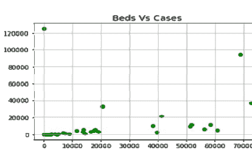
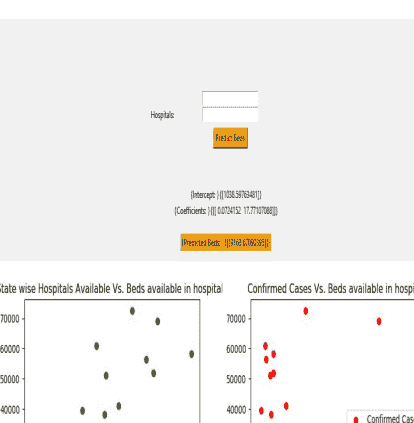

# 2020 第六届并行、分布式与网格计算国际会议 (PDGC) (印度瓦克纳哈特 2020.11.6-2020.11.8)

**Shakti Nagraj**  
计算机科学与工程系  
Panipat Institute of Engineering & Technology  
Panipat, 印度  

**Vijay Anand Aashwale**  
计算机科学与工程系  
Panipat Institute of Engineering & Technology  
Panipat, 印度  

**Ashwini Kumar Sani**  
Govind Bajaj Patel Institute of Engineering & Technology  
Pat Gwalior  

**Ravindra Sharma**  
Swami Rama Himalayanan University  
Dehradun, 印度  

**全球性**研究团队宣布，应对 COVID-19 需要卫生管理系统的水平。在处理 COVID-19 的工作时，已进行统计分析以检查不同国家的应对准备情况，并考虑了这些应对措施。还需要人口统计趋势以进一步补充 COVID-19 案例准备工作的内容。这场大疫情对不同国家的经济构成了重大挑战。各国之间的床位可用性差异巨大。澳大利亚每千人拥有 2.6 张床，而英国每千人拥有 2.5 张床。人均支出为。

印度医疗系统不够稳健，无法为数百万公民提供优质的基础设施和其他资源。COVID-19 造成了紧急状态，需要尽快修复所有瓶颈，病毒已在许多发达国家爆发。印度正处于一个令人震惊的阶段，就像安在在头上的定时炸弹。由于医疗保健服务不足，对 COVID-19 病例的检测非常低。因此，印度的数字可能无法代表印度 COVID-19 病例的真实数字。在最初几个月里，印度医学研究委员会提供了截至 3 月 27 日的报告统计数据，随后病例改为每日报告。

**关键词**—机器学习、回归、医院、COVID-19、医疗支出

## 引言

由于 COVID-19，全球卫生系统都受到了影响，或者当我们能够向医疗服务部门发出警报时，各国正在尝试为此制定策略。为了构建这些，需要考虑每千人的可用床位数量、总人口的床位数量、不同国家的人口减少情况，以及某些发达国家超过 60 年的情况。在发达国家中已经做好了准备并能够应对 COVID-19 案例。在本文中，我们提出了一种机器学习模型来预测患者所需的床位数量。可用床位数量从古吉拉特邦的人口中获取，患者数量根据健康和家族史确定。使用多元线性回归模型进行机器学习，并应用于数据集以预测患者所需的床位数量。设计了一个自动化模型，可以对任何数量的患者提供床位预测预测。

**表 I. 医疗服务资源计数（单位：每千人）[来源-WWW.HEALTHAFIRS.ORG]**

| | 澳大利亚 | 英国 | 德国 | 加拿大 | 美国 |
| --- | --- | --- | --- | --- | --- |
| 床位 | 2.4 | 2.24 | 4.24 | 3.01 | 2.6 |
| 医生 | 3.4 | 2.8 | 4.3 | | |
| 护士 | 1.9 | 2.5 | 6 | 8 | 2 |
| 其他 | 4 | 21.4 | 28.8 | 27.2 | 37 |

根据 2019 年国家概况数据，印度每千人可用 0.55 张床。这些邦，即比哈尔邦、贾坎德邦、古吉拉特邦、北方邦、安得拉邦邦、恰加特斯尔邦、中央邦、哈里亚纳邦、马哈哈施拉邦、奥萨邦、阿萨姆邦和曼尼普邦的可用床位方面低于国家水平（0.55），尽管只有德里、泰米尔纳德邦和喀拉等少数邦健康状况较，每人拥有 1.05 张床。这是因为印度人均可用床位数量较低。表 1 显示了一些国家的医疗保健服务。

表 2 提到了不同国家的 HAQ（医疗保健获取与质量）指数，该指数于 2016 年审查并发表在 2020 年 4 月的《时报》报告中。印度排名第 145 位，报告基于疾病负担涵盖了大约 32 个州，其中通过有效的医疗护理是可以预防和治愈的。

新冠病毒肺炎的突然爆发使问题变得复杂，全球范围内医疗保健的优先事项发生了变化。资源有限和医疗保健系统效率下的问题成倍增加。

印度的两个邦果尔邦和喀拉拉邦已达到 60 分，而北方邦得分较低，即低于 40 分。

医疗服务的需求突然增加。COVID-19 患者正挣扎获取医疗设施和医院床位。印度有大量患者，可用 5-10 张 ICU 床位。只有 50% 的 ICU 床位配备呼吸机，其他医疗保健服务可用。根据《印度时报》的报道，全国有 17,850 到 25,555 台呼吸机。

在本文中，我们开发了机器学习来预测 COVID-19 患者所需的床位数量。2020 年 7 月 5 日，印度有 68,300 例病例，增长速度非常快。COVID-19 阳性比为 6.7%。政府和医院有责任采取预防措施来管理局面。预测模型将动态地提供护理所需的医院和床位数量。使用机器学习的线性回归模型来实现该模型。它是连续数据的最佳机器学习模型，并在模型经过适当训练后可提供预测准确性。这是一个监督学习模型，将不同医院的状态、不同邦的人口以及 COVID-19 患者的人口作为输入。数据集分为训练数据和测试数据。

## II. 方法论

印度医疗服务的总支出为人均 2.5，医疗占 GDP 的百分比为 4.8%，而印度人的预期寿命为 69.1 岁。图 1. 医疗支出显示了各国的。

根据 2019 年国家概况数据，印度每千人可用 0.55 张床。这些邦，即比哈尔邦、贾坎德邦、古吉拉特邦、北方邦、安得拉邦、恰加特斯尔邦、中央邦、哈里亚纳邦、马哈哈施拉邦、奥萨邦、阿萨姆邦和曼尼普邦的可用床位方面低于国家水平（0.55），尽管这些邦占有 70% 的印度人口。只有德里、泰米尔纳德邦和喀拉等少数邦的健康状况较，每人拥有 1.05 张床。这是因为印度人均可用床位数量较低。表 1 显示了一些国家的医疗保健服务。

在表 2 中提到了不同国家的 HAQ（医疗保健获取与质量）指数，该指数于 2016 年审查并发表在 2020 年 4 月的《时报》报告中。印度排名第 145 位，报告基于疾病负担涵盖了大约 32 个州，其中通过有效的医疗护理是可以预防和治愈的。

新冠病毒肺炎的突然爆发使问题变得复杂，全球范围内医疗保健的优先事项发生了变化。资源有限和医疗保健系统效率下的问题成倍增加。

印度的两个邦果尔邦和喀拉拉邦已达到 60 分，而北方邦得分较低，即低于 40 分。

医疗服务的需求突然增加。COVID-19 患者正挣扎获取医疗设施和医院床位。印度有大量患者，可用 5-10 张 ICU 床位。只有 50% 的 ICU 床位配备呼吸机，其他医疗保健服务可用。根据《印度时报》的报道，全国有 17,850 到 25,555 台呼吸机。

在本文中，我们开发了机器学习来预测 COVID-19 患者所需的床位数量。2020 年 7 月 5 日，印度有 68,300 例病例，增长速度非常快。COVID-19 阳性比为 6.7%。政府和医院有责任采取预防措施来管理局面。预测模型将动态地提供护理所需的医院和床位数量。使用机器学习的线性回归模型来实现该模型。它是连续数据的最佳机器学习模型，并在模型经过适当训练后可提供预测准确性。这是一个监督学习模型，将不同医院的状态、不同邦的人口以及 COVID-19 患者的人口作为输入。数据集分为训练数据和测试数据。

## III. 多元线性回归

### A. 数据集

### B. 数据分析

### C. 相关性

所有关于特征重要性和目标值的关键信息都从特征之间的相关性中获取。特定时段床位数量与病例总数之间的相关性如图 1 所示，以及如图 1 和图 2 所示的病例对应的医院数量，显示了床位与病例以及医院之间存在强相关性和正相关关系，正如所





### D. 数据预处理

数据集包含多种数据类型的列，如字符串和数值（`Numeric`）。在机器学习中，这些方法均应用于列的分类数据，通过为数据中的每个类别分配一个唯一的数字。

对数据集进行了数据清洗（`Data wr`），以用平均值填充缺失值；在某些缺失医院信息但为数值的状态下，用可用床位数量进行填充。对于数据类型无法直接处理的列，则对特定列应用了特征工程处理。数据集被分为训练和测试两个阶段：70% 的数据集用于训练模型，30% 的数据集用于测试数据。

### E. 评估

评估指标的目标是准确预测所需的床位数量。病例数量的准确性有所提高。结果的准确性如图 6 所示。值为正，误差为 0.0724，预测接受度为 0.629，大于 0.5，证明所提模型是可以接受的。数据集包含正负数据点。所提模型可以通过数据点总数除以正确预测总数（正/负）来计算。在准确性的帮助下，可以使用公式计算改进模型的准确率：

```
accuracy = 数据点 / 总正确预测数
0.0 < Accuracy < 1
```

在展示系统时，为正样本除以数据点总数的比例。这有助于识别准确/正确预测的数量。

## 参考文献

机器学习模型应用于正样本数据集，而多元回归模型应用于各种属性。考虑了各州人口与 COVID-19 病例相关的床位，以预测未来的需求。设计了所提模型的接口，用于动态对指定数据集（不断变化的 COVID病例数）进行预测。主要问题是缺乏可用数据。政府正在公共事务方面发布 COVID-19 的最新病例和状况。机器学习模型通过在准确数据上的成功训练，提供了最优结果。

- [1] https://www.kaggle.com/statistics/1117473/india-health-risk-assessment-by-order.
- [2] https://www.statista.com/topics/5191/state-of-health-in-india.
- [3] https://www.businessready.in/economy/coronavirus-crisis-in-india-lockdown-19-period-of-public-health-system-counts-10000000.html
- [4] https://currentaffairs.com/tags/india/ags-help-link
- [5] https://knowledge.wordbank.org/handle/1098618237/9781649818331
- [6] George Schwab, Jean-Pierre Poulie and Leslie M Green, health care systems in twenty-four countries, Health Affairs, Vol.10, no.3, p1-28, online at https://www.healthaffairs.org/full/10.1377
- [7] https://www.brookings.edu/blog/front/2020/03/24/is-india-health-equipped-to-handle-the-epidemic.
- Huang, C, Wang, Y, Li, R, Shao, J, Zhu, Y, et al. Clinical features of patients infected with 2019 coronavirus in Wuhan, China. Lancet 2020;395(10217). doi:10.1016/S0140-6736(20)31165-3
- Li, Q, Juan, W, P, Wang, X, Zhou, T, et al. Early transmission dynamics in Wuhan, China, of novel coronavirus infection. N Engl J Med. 2020;382:1189-207. doi:10.1056/NEJMo2001316
- Chen N, Zhou M, Dong X, Qi Y, Gong F, Han Y, et al. Epidemiological and clinical characteristics of 99 cases of 2019 novel coronavirus in Wuhan, China. Lancet 2020;395(10217):75. doi:10.1016/S0140-6736(20)3021-7
- Clinical Management of Severe Acute Respiratory Infection in Wuhan, Novel Coronavirus (2019-n). Interim Guidance. Available online at: https://apps.who.int/iris/handle/10665/3300733 (Accessed April 30, 2020).
- Zumia L, Ai H, Durck M, Mitchell TM. Medical resources of COVID-19 pandemic. Lancet 2020;395(10217):997. doi:10.1016/S0140-6736(20)31645-8
- Phan QV, Nguyen DC, Hwng, WJ, Paritthna PN. Artificial intelligence (AI) and big data for coronavirus (COVID-19) pandemic: a survey. doi:10.2020/2020043083 (2020). doi:10.20944/preprints2020043083.v1
- [WHO] Situation Report-94 Coronavirus disease 2019 (COVID-19). Available online at: https://www.who.int/docs/source/coronavirus/situation-report-20200423-sitrep-94-covid.pdf?attachment=b8s304bf4 (accessed March 10, 2020).
- Wang L, Wang A. COVID-Net: a tailored deep convolutional neural network for detection of COVID-19 cases from chest X-rays. arXiv (2020):2003.09871. Available at: https://arxiv.org/abs/2003.09871 (accessed May 5, 2020).
- Pal R, Suth AA, Kar S, Prasad DK. Neural network-based curve wise COVID-19 prediction. arXiv (2020):2004.09959. Available online: https://arxiv.org/abs/2004.09959
- Liu D, Clemente L, Putier C, Ding X, Ferrari M, Davis JT, et al. A machine learning learning method for real-time forecasting of the 2019-2020 COVID outbreak from mechanistic models. arXiv (2020):2004.04019. Available at: https://arxiv.org/abs/2004.04019 (accessed May 6, 2020).
