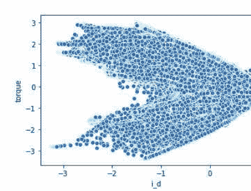
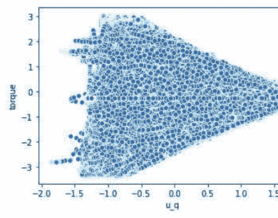
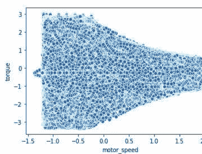
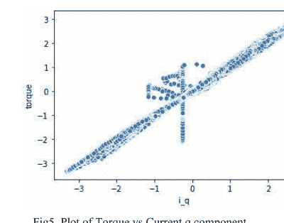
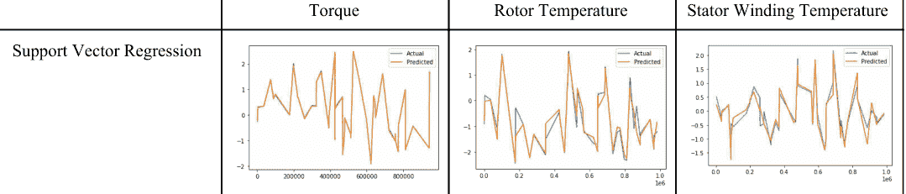
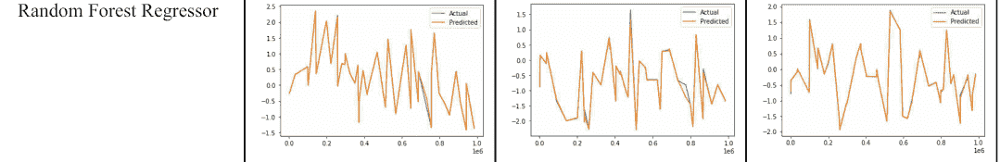
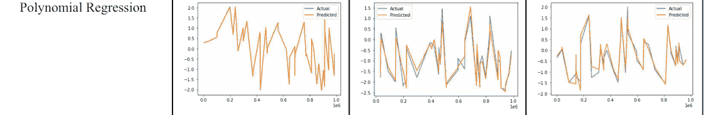

# 2020第三届电子、计算机与通信进展国际会议 (ICAECC)(印度班加罗尔 2020.12.11-2020.12.12) 2020第三届电子、计算机与通信进展国际会议


Rushank Savant
电子工程学院
Vellore理工大学，
Vellore, 印度

Abhiraj Ajith Kumar
电气工程学院
Vellore理工大学，
Vellore, 印度

Aditya Ghatak
电气工程学院
Vellore理工大学，
Vellore, 印度

**摘要—** 永磁同步电机（PMSM）作为电动汽车及其他应用的电机选择被广泛接受，这要求对其进行严格的监测以避免温度升高。温度在特定范围内波动，这可能导致永磁同步电机的运行中出现问题。本文比较了三种不同值的机器学习算法在永磁同步电机参数估计中的性能。使用现有的数据集对以下模型进行了比较：支持向量回归、随机森林回归和多项式回归。通过归纳解释的自变量最高值提供了一种特定的回归模型，从而提高了模型的准确性。

定子有助于在不导致电机故障的情况下最大化输出。

PMSM 的结构与同步电机几乎相同，但有一个关键区别。PMSM 利用磁铁产生磁场极，而传统的同步电机通过绕组实现这一点。根据配置的不同，PMSM 分两类：表面贴装 PMSM 和内置式 PMSM。在两种者中，由于磁铁和气隙的磁导率相似，气隙保持一致。电机不会移动到电抗减少的方向，且转矩能产生更好的性能，尽管缺乏鲁棒性。对于内置式 PMSM，磁铁位于转子内部，而非固定在表面，这使其更加健壮，并能够满足高速度需求。

**关键词—** PMSM；随机森林；多项式回归

# I. 引言

永磁同步电机（PMSM）现今工业领域应用广泛。由于 PMSM 具有广泛的特性，在电机中引入磁铁后效率得到了提高。其他因素如功耗的减少和性能提升使得这些电机应用于电动汽车。PMSM 作为伺服驱动器的替代品已非常流行。

u, d, q 是旋转系中定子电压的分量，而 i, d, q 是静止系中定子的分量。电流和电压参数监测永磁同步电机的功能。电损以热的形式散发，会导致电机老化。监测转子温度旨在利用三种机器学习算法——支持向量回归（SVR）、随机森林和多项式回归来预测永磁同步电机（PMSM）的转矩和转子温度。根据结果和它们的 R 方值 [1]，对这三个模型的性能进行了比较。用于分析和预测的数据包括永磁同步电机（PMSM）的传感器数据。该 PMSM 代表了帕德博恩大学的一个通用 OEM 类型部门。

# II. 相关工作

关于 PMSM 参数估计已开展了大量工作。

[2] 使用增量法来解决预测建模和控制中依赖参数带来的挑战。对传统的预测控制方法进行了初步分析，该方法处理参数不一致导致预测电流值的问题。随后提出了一种增量模型。

[3] 使用预测控制方法来处理 PMSM 伺服系统的速度。在第一个系统中，q 轴被用参考模型。第二个方案也是控制回路。由于 PFC 系统的性能较差，提出了一种改进方法，通过引入扩展状态来最小化扰动的影响。

[4] 提出了一种基于转矩的预测方法来控制三相 PMSM。根据转矩的位置和方向选取电压矢量，以减少谐波的影响。此外，还可以减少用于预测的矢量数量。

[5] 分析了参数误差在 PMSM 特性计算中的影响。提出了预测电抗和电感（d 轴和 q轴）的方法，以及一个研究铁芯影响的预测模型。将提出的模型与传统模型进行了比较。

[6] 评估并比较了不同的机器学习算法，通过在不同运行条件下的测试来识别电机故障。使用朴素贝叶斯进行的测试获得了最佳结果。

[7] 研究了使用深度循环和卷积网络通过序列学习来预测 PMSM 中高度动态参数的可行性。对关键因素定子、绕组、轭部以及转子磁铁的神经分布进行了建模，并结合真值数据进行比较。该方法利用集中参数热网络，不需要昂贵的实验，简化了设计。

[8] 使用加权最小二乘法、SVR、k-最近邻、随机树和神经网络等机器学习模型来预测温度分布，并根据估计准确性测试了它们的性能。论文得出结论：：仅基于收集的数据的模型也达到了基于热力学理论构建的经典模型的估计性能。

[9] 展示了基于电机不同组件电压、电流和温度的各种学习模型的比较。这些结果用于调整电机的输入电流以保持恒转矩。论文得出结论：使用因果树层次结构的决策树方法提供了最优方案。

[10] 比较了使用回归、k-最近邻、随机森林和决策树算法等不同模型的绝对误差。论文指出定子轭表现出良好的性能。

[11] 使用人工神经网络（ANN）进行 PMSM 定子绕组故障检测，其中权重使用粒子群优化进行调整。

[12] 描述了一种用于估计永磁变压器的状态空间模型，该模型使用线性恒等识别控制参数。磁体参数估计通过极大化粒子滤波器同时完成，得到线性模型并将卡尔曼滤波器应用于永磁变压器。

[13] 在多个统计时域的折线中使用随机算法诊断转子故障。随机森林以 98.8% 的准确率对电机故障进行分类。结论该方法可用于故障处理。

[14] 旨在提出一种改进方法，利用定子磁通进行转矩调节的控制。这是通过映射转子-定子磁通幅和相位之间的关系实现的。电压矢量死区补偿通过延迟时间减少了转矩和磁通计算的复杂性。该方法采用代价函数跟踪定子磁通和最优电压矢量，并验证了所提解决方案的性能。

[15] 重点关注控制永磁同步电机（PMSM）中的转矩和转矩波动。这还包括对电磁电机转矩的磁铁扫描分析，是使用有限元技术对具有相同输出频率和输出特性的 20 极三相 PMSM 进行的。

[16] 讨论了一种在有限集模型方法中减少计算并缩短计算时间的方法。该应用扩展到由多个变频器供电的 PMSM 驱动器中，并通过实验验证了结果。


# III. 提出的解决方案

三个目标变量（即转矩、转子温度和定子绕组）均使用机器学习随机森林算法进行预测。在预测过程中，特征选择对最终输出结果和模型的整体精度起了至关重要的作用。以下是使用 Python 散点图进行的数据可视化。

对于转矩，发现与转矩具有某种数学关系的变量有：电压分量(u_q)、电压分量(u_d)、电流分量(i_q)、电流分量(i_d) 以及电机速度(motor_speed)。相应的数据点图所示所示：








图2：转矩与电压 d 分量图

图5：转矩与电流 d 分量图

图3：转矩与电压 q 分量图

图6：转矩与电机速度图



对转子温度和定子温度的预测也进行了类似的分析。对于转子温度，发现“环境温度”、“冷却温度”和“定子温度”对预测模型有贡献。同样对于定子绕组温度，也采用了“环境温度”、“冷却温度”和“定子温度”来进行预测。

在确定预测特征后，将数据集划分为训练集和测试集。其中训练集占总数据的 80%，剩余部分 (20%) 为测试集。

图5：转矩与电流 q 分量图

导入了 sklearn 中的 `train_test_split` 来执行数据划分。
为了对目标变量（转矩、电机转子温度和电机定子温度）进行预测，使用了三种算法，并使用集合上的 r2 值对每种算法的性能进行了分析。R平方值被用作统计衡量标准，以寻找拟合回归线接近已知“决定系数”。

### 总变异

表 I 比较了不同算法的 R2 值。观察到，随机森林回归器（Random Forest regressor）的优于支持机回归器（Support Vector regressor）和多项式回归。图7 显示了三种算法参数的实际值和预测值的图。

### 未解释的变异

生产过程中采用算法为：

- 支持机回归器 (SVR)
- 使用的内核 - 'rbf' (径基函数)
对于两个样本 x 和 x'，r 定义为：
- 具有 n 'estimators'=200 的随机森林回归
- 4 阶多项式回归

```
K(x,x') = exp(-|x-x'|^2/2r)
```

其中 |x-x'| 是两个向量之间的平方欧几得距离，r 是自由参数。

## IV. 结果

| 表 I 所用不同算法的参数 R2 值 | | | |
| 算法 | 转子温度 | 定子绕组温度 | 转矩 |
|---|---|---|---|
| 支持机回归器 | 0.895 | 0.936 | 0.998 |
| 随机森林回归器 | 0.993 | 0.993 | 0.999 |
| 多项式回归 | 0.869 | 0.932 | 0.999 |







图7 转矩、转子温度和定子绕组温度的蓝色实际脉冲和橙色预测脉冲。

## V. 结论

国际电机与驱动器会议 (IEMDC), DC, USA, 2019, pp. 1436-1446, doi: 10.1109/IEMDC.2019.8875109.

本文提出的预测模型展示了低复杂性，允许用于各种实验测试。基于模型的训练，可以预测温度和数值范围，以分析永磁电机 (PMSM) 的性能并采取预防措施。与电机速度相比，永磁电机 (PMSM) 性能缺乏 AC 支持已在工业层面检测。因此，定子温度可以实现对 AC 的估计和控制，从而按比例控制电机速度。

- [8] Kirchgasser, W., Waallscheid, O., & Böcker, J. (2020). Permanent Magnet Temperature Estimation in Synchronous Motors using Deep Learning, arXiv:2006.13366.
- [9] Bilal, A., Waallscheid, O., & Shah, M. H. (2019). A Comparative Study of Learning Algorithms for Controlling Temperature in Synchronous Motors. In System Loop 2019 International Conference on Trends in Electronics and Computing Technologies (IETECT).

## VI. 参考文献

- [10] Anosov, K. (2020). Temperature Estimation in Permanent Magnet Synchronous Motors (PMSM) using Deep Learning. Natural Machines, 5(1), 11-125.
- [1] https://www.kaggle.com/vargas/electric-motor-temperature
- [2] X. Zhang, L. Zhang and Y. Zhang, "Model Predictive Current Control for PMSM Drives with Robustness Improvement," in IEEE Transactions on Power Electronics, vol. 34, no. 2, pp. 891, doi:10.1109/TPE.2018.2835238.
- [12] Feng, G., Lai, C., & Kar, N. C. (2021). Expectation-maximization based observer-based permanent magnet temperature estimation for PMSM condition monitoring using high-frequency signal. IEEE Transactions on Industrial Informatics, 3(3), 120-127.
- [3] H. Liu and S. Li, "Speed Control for PMSM Servo System using Predictive Function Control and Extended Estimator," in IEEE Transactions on Industrial Electronics, vol. 59, no. 2, pp. 1171-1183, Feb. 2012, doi:10.1109/TIE.2011.216217.
- [13] Quiroz, Juan. C., et al., "Fault detection of broken bar in PMSM-using random forests." Measurement frequency: 27 (2018).
- [5] K. Kondubiah, S. Sanchez, and R. C. Kar, "Analytical modelling and parametric sensitivity analysis for the PMSM steady-state performance prediction," IEEE Transactions on Power Electronics, vol. 18, pp. 559-566, 2003.
- [15] Gonzalez, J.A. and Iradagoria, A., Ana Hoy, J.F., & Fernández, P., (2021). Torque Analysis in Permanent Magnet-Synchronous Motors: A Comparative Study, Energy Conversion, IEEE Transactions on. 26, pp. 5569-5574.
- [6] Martin-Diaz, Ignacio, et al., "An experimental evaluation of machine learning techniques for motor fault diagnosis under various operating conditions," IEEE Transactions on Industry Applications, 54.3 (2018): 2215-2224.
- [7] W. Kirchgasser, O. Waallscheid, and J. Böcker, "Deep Convolutional and Recurrent Neural Networks for Temperature Estimation in Permanent Magnet Synchronous Motors," 2019 IEEE
- [16] M. Siamdi, A. Arab Khabani and J. Rodriguez, "Simplified Finite Control Set-Model Predictive Control for Matrix Converter-Fed PMSM Drives," in IEEE Transactions on Power Electronics, vol. 33, no. 4, pp. 2238-2246, March 2018, doi: 10.1109/TPEL.2017.2690692.

