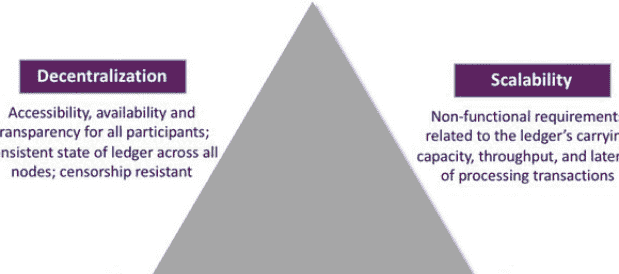
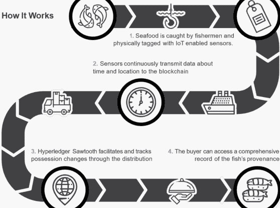

# 2020 冬季模拟会议 (WSC) ｜｜区块链：运营研究人员视角的综述

# 摘要

区块链是一种分布式、仅追加的数字账本（数据库）。自从加密货币出现以来，该技术引起了广泛关注，各业务领域的区块链应用也日益增加。然而，对于模拟和运筹学社区的许多成员来说，这一概念仍然很新。在教程中，我们介绍了区块链技术，并回顾了其前沿的与数据相关的研究。对于模拟、系统分析和数据科学的研究人员来说，这存在着令人兴奋的机遇。

# 1 引言

区块链是比特币和其他加密货币的底层技术。自2017年以来，它引起了公众的关注。当时，比特币作为一种安全的记录共享系统，区块链被其信者视为一种解决方案或“互联网的未来”，也被怀疑者所审视。事实上，区块链技术在许多领域都有广泛的应用，但它并不是所有问题的唯一（更优）解决方案。

区块链从字面上讲是区块的链。这里的区块由一定量的数据以及数据相互连接的链组成。更具体地说，它是一种基于共识的点对点分布式网络，“具有一个不断增长的记录列表（链），称为区块，它们使用密码学进行链接”（维基百科 2020）。每个区块包含一个指定区块顺序的索引；一个记录区块添加近似时间的时间戳；数据；以及当前区块和前一个区块的哈希值（图1）。哈希是加密函数的输出，它将有意义的字符串转换为无意义的固定长度的字母数字字符串。区块 $k$ 的哈希输入包括上述区块、区块 $k$ 的数据以及 $k-1$ 的哈希值。哈希值对输入非常敏感——输入的任何变化都会导致完全不同的哈希值，这使得区块链具有不可验证性。哈希函数是区块链安全的支柱，将在第3节中详细讨论。

与传统的中心化网络不同。首先，数据（区块内）是不可篡变的。具体来说，如果一个区块被更改，其后的所有区块都会失效，因为它们的前一个区块的哈希值将无效。其次，具有共识的分布式网络允许用户（授权用户）相互通信以广播新区块、同步网络状态并下载当前数据库。数据和连接通道的冗余使得区块链对节点故障更具容忍性。凭借这些特性，链越长就越难被攻击以及在不被发现的情况下更改区块，这使得区块链更加可靠（Nakamoto et al. 2008）。为了更好地理解区块链系统，我们鼓励读者在 Blockchain Demo 上探索区块链的交互式演示。

| 区块 59 | 区块 60 | 区块 61 |
| :--- | :--- | :--- |
| 索引: 59 | 索引: 60 | 索引: 61 |
| 时间戳: 12:59 11/09/2019 | 时间戳: 13:10 11/09/2019 | 时间戳: 13:14 11/09/2019 |
| 前一个哈希: 0b54c17c5b5 | 前一个哈希: 0b30c--8f2fd | 前一个哈希: 93274--8d977 |
| 其他信息 | 其他信息 | 其他信息 |
| 哈希: 0b54c17c5b5 | 哈希: 0b30c--8f2fd | 哈希: 93274--8d977 |

图1：区块演示

区块链技术的历史可以追溯到1991年。Haber 和 Stornetta (1990) 引入了时间戳服务。在1995年，他们在纽约时报发表了这种时间戳服务。Nakamoto et al. (2008) 开发了最著名的比特币项目。在区块链领域，许多关于扩展性、容错性的研究。本教程旨在向模拟和运筹学社区介绍这项新技术，回顾相关研究，并引发对研究机遇的讨论。我们首先在第2节描述不同去中心化的区块链。接着在第3节讨论区块链类型。我们在第4节回顾共识机制，并在第5节介绍应用。最后，我们在第6节通过研究机遇总结全文。

## 2 区块链设计

在本节中，我们根据以下标准对区块链进行分类：

- 谁可以访问数据？
- 谁可以验证交易？
- 如何达成共识？

根据这些标准，区块链可分为四类：公共许可、公共许可（联盟）、私有许可和私有许可。

### 2.1 区块链类型

这四种区块链在去中心化和隐私方面有所不同。

- **公共许可**：这些开放网络，任何人都可以加入、读取数据并验证交易。它们高度去中心化，但通常面临扩展性问题。
- **公共许可（联盟）**：在这些网络中，任何人都可以读取数据，但只有选定的小组可以验证交易。这在透明度和性能之间取得了平衡。
- **私有许可**：这些受限的网络，由单一组织控制访问和验证。它们效率极高，但缺乏透明度。
- **私有许可**：这些受限的网络，由单一实体控制访问，但允许任何用户参与共识。

## 2.2 共识机制

共识机制是网络节点对区块链状态达成一致的过程。常见的机制包括：

- **工作量证明 (PoW)**：用于比特币，矿工通过解决复杂的难题来竞争。它非常安全，但耗费能源。
- **权益证明 (PoS)**：验证者根据其持有的和质押的代币数量进行选择。它比 PoW 更节约。
- **实用拜占庭容错 (PBFT)**：用于联盟区块链，在已知节点集之间快速达成协议。

## Wan, Huang, and Li

### B

### 去中心化
所有参与者的访问性、可用性和透明度；所有节点间账本状态一致；抗审查性

### 可扩展性
与账本负载能力、吞吐量和交易处理延迟相关的非功能性需求

### A

### 安全
通过内置机制维护账本完整性的能力

### C

图 2：区块链可扩展性三难题 (ReverseAcid 2018)。

## 2.2 共识机制

共识是一种在分布式系统的不同节点/参与者之间达成一致的算法，用于解决拜庭将军问题 (Lamport et al. 2019)，处理提供虚信息的恶意行为。自比特币发明以来已经有了许多共识机制。其中大多数是基于工作量证明或权益证明的。

- 工作量证明 (PoW) 是包括比特币在内的大多数加密货币采用的共识。在此机制中，参与者（即矿工）相互竞争，通过密码哈希函数进行暴力搜索来解决一个复杂的计算谜题。这是一种概率机制，矿工的获胜概率与其算力成正比。胜利者将获得添加下一个区块并收集交易费的权利，并获得奖励（通常是一定数量的加密货币）。矿工以能量浪费为代价维护系统安全。PoW 是首个为区块链开发的共识，具有公平性和安全性。然而，它既慢又昂贵，而且研究表明该机制无法防止矿工的垄断。
- 权益证明 (PoS) 是另一种广泛使用的共识，与 PoW 互补。下一个区块通过准随机过程选择，该过程取决于参与者持有的权益而非算力。这种机制最早应用于 Peercoin (Hao and Nadal 2012)。PoS 在效率（无论是时间还是能量）上都比 PoW 高得多。然而，基于 PoS 的系统面临“无质风险”（nothing-at-stake）问题，没有任何权益的节点可能会表现出恶意行为，因为她无任何损失。

除了这两个众知的共识之外，最近还提出了许多针对不同信任级别和系统要求的算法 (MingXiao et al. 2017; Banakan et al. 2020)。

# 3 比特币与以太坊：挖矿与智能合约

本节介绍了比特币和以太坊系统，这是最著名的两个公共无许可区块链应用 (Nakamoto et al. 2008; Wood et al. 2014)。这两个平台占据了全球算力的 70% 以上 (Coinmarketcap 2020)，适合作为解释区块链系统和术语的示例。在第 3.1 节中，我们详细介绍了比特币的工作原理和挖矿过程。3.2 节讨论了以太坊，它是一个数字货币平台，还通过智能合约允许各种区块链技术的实现。事实上，以太坊用户已经应用智能合约创建了去中心化自治组织 (DAO)。

## 3.1 比特币与挖矿过程

比特币（以及其他加密货币）与传统货币最大的区别在于前者没有“发行者”（政府或组织）来背书货币价值、验证交易和监管金融系统。因此，加密货币必须具备：(1) 一种保护每个账户的安全算法，使他人无法花费你的资金；以及 (2) 一种维持系统运行并避免恶意行为的自我调节机制。为了安全，比特币使用了公钥加密（或非对称加密）。参见 Huh et al. (2017)。比特币没有物理形式，但有每个账户（节点）的交易和余额记录。每个账户都关联一个公钥和一个私钥，两者的关系类似于电子邮件地址和密码。公钥可以在网络中传播，而私钥允许所有者访问资金。挖矿是一种支持交易日常运行的独特机制，大多数加密货币都需要能够添加区块的权限。当 A 想要支付给 B 时，需要验证 A 的账户有足够的资金，从 A 的账户中扣除一个比特币并添加到 B 的账户。交易费是奖励给 A（或 B）的。创建一个有效的区块，参与者（矿工）需要：

1. 找到一个幸运数字 (nonce)，
2. 将交易列表作为输入字符串进行连接，并
3. 应用 SHA-256 哈希函数生成此输出，

使得 256 位哈希函数落在一个相对于较大输出较小的空间内。在这种情况下，nonce 必须满足以下不等式：

> Hash(nonce)|上一个区块哈希|txn| < 目标值

所有矿工竞争通过暴力搜索来解决 PoW 哈希以达成共识。每个节点的获胜概率与其算力成比。一旦矿工发现奖励，他将将其广播到整个网络进行验证。如果新区块被大多数矿工验证，该区块将被正式添加到区块链中，创建者获得奖励（一定数量的比特币）和交易费。参见 Narayanan et al. (2016) 了解挖矿过程的细节。

## 3.2 以太坊与智能合约

以太坊是一个数字货币平台，还通过智能合约允许各种区块链技术的实现。事实上，以太坊用户已经应用智能合约创建了去中心化自治组织 (DAO)。

## Wan, Huang, and Li

提供了鱼类溯源的不可变记录。结合物联网（IoT）传感器，锯齿湖（Sawtooth Lake）可以管理鱼类从海洋到餐桌的权属和旅程。这些传感器可以在鱼类采集后立即安装在鱼身上，并持续记录数据，例如易腐食品的地点、温度和湿度。此外，锯齿湖平台可以管理托管链，鱼类所有权可以在区块链上进行转让和交易。图3展示了 Hyperledger sawtooth 如何集成到海鲜供应链中。

图 3：使用 Hyperledger Sawtooth 的海鲜供应链流程图（Blummer 等人，2018）。

此外，Tian（2016）提出了一种使用射频识别（RFID）和区块链技术的农产品食品供应链追溯方法。Mao 等人（2018）开发了一个联盟链以消除食品贸易中的信息不对称，从而建立可持续且信誉良好的交易表现，并优化排放水平和运营成本。Manipati 等人（2020）开发了一种基于区块链的同步监控供应链的方法，为可持续供应链提供了最优结果。

在制药行业，该链被用于在改进监管的同时对假药进行计数/清点（Jamil 等人 2019；Tseng 等人 2018）。金融机构使用联盟链来提高国际贸易的效率（Chang 等人 2020）。医疗机构热衷于将区块链用于医疗数据存储和安全（Griggs 等人 2018；Zhang 和 Lin 2018）。有关各个领域的应用请参见 Kang 等人（2017）、Li 等人（2019）以及 Yang 等人（2020）。我们预计在不久的将来看到更多应用。

总结来说，通过物联网和可穿戴传感器等智能设备，联盟链确保了机构与客户之间透明、可追溯且负责的数据存储与共享。联盟链具有高度安全和定制化的数据存储能力，潜力成为大数据的神经网络。

## 5 区块链系统的系统分析

在本节中，我们从系统和数据的角度回顾了最近的区块链研究。我们的讨论重点在三个主题：区块链系统的仿真表征（第5.1 节）、理解不同节点间交互的博弈论方法（第5.2 节）以及用于区块链及区块链中的机器学习（第5.3 节）。

## Wan, Huang, and Li

## 5.1 区块链系统的仿真研究

最近，我们看到许多与仿真相关的区块链研究。目前的研究主要关注加密货币的挖掘以及区块链仿真模型的可扩展性。此外，还提出了许多仿真器作为平台，以评估区块链在不同条件/攻击下的性能。我们在本节中回顾了相关文献。

## 5.1.1 离散事件仿真

Allaby 和 van Moorsel（2019）提出了一个带有交易的事件驱动模型，并强调了通过 Pow 创建区块。Aoki 等人（2019）调用了区块生成、区块传播以及消息收发等事件。Menon 等人（2019）建立了一个队列模型来分析区块链仿真中内存和内存池的真实行为。为了研究大规模区块链网络，Wang 等人（2018）收集并定义了若干指标来量化区块链的质量。Miller 和 Jansen（2015）在他们的工作中实现了单台机器上数千个比特币节点的可扩展执行，并允许拒绝服务攻击以演示该仿真器。Gervais 等人（2016）研究了比特币仿真器的最优对抗策略，以分析不同配置的安全性和性能。Göbel 等人（2016）使用离散事件仿真研究了矿工之间存在通信延迟的网络中的自矿攻击。Fytik 等人（2020）提出了一种区块链仿真器，该器利用共识协议的通用表示，提供了共识协议在各种网络条件下的性能见解。

## 5.1.2 基于代理的仿真

Kaligoda 和 Macac（2018）通过阐述系统的关键方面和功能，提出了建模区块链仿真的通用框架。Coello 和 Marches（2016）通过包含异构代理（包括比特币交易价格）的过程复制了挖掘过程的经济性。Rosa 等人（2019）通过利用具有扩展可扩展性的并行分布式仿真技术开发了一个安全攻击测试框架。受算法交易和强化学习系统设计的启发，Chitra 等人（2019）提出了一种基于代理的仿真，以模拟 PoW 链中的审查属性。他们的结果说明了内生设计选择如何影响实际性能，以及仿真如何与外生数据交互。Brousmiche 等人（2018）建立了一个基于代理的框架，用于模拟集成消费/生产行为并与私有链交互的本地市场。Bottone 等人（2018）开发了一个可扩展的多代理仿真器。

## 5.1.3 其他

（此处：）为了研究大规模区块链网络，Wang 等人（2018）收集并定义了若干指标来量化区块链的质量。Miller 和 Jansen（2015）在他们的工作中实现了单台机器上数千个比特币节点的可扩展执行，并允许拒绝服务攻击以演示该仿真器。Gervais 等人（2016）研究了比特币仿真器的最优对抗策略，以分析不同配置的安全性和性能。Göbel 等人（2016）使用离散事件仿真研究了矿工之间存在通信延迟的网络中的自矿攻击。Fytik 等人（2020）提出了一种区块链仿真器，该器利用共识协议的通用表示，提供了共识协议在各种网络条件下的性能见解。

（注：原文中 5.1.3 之后似乎存在重复或格式断层，已按逻辑翻译）

为了研究大规模区块链网络，Wang 等人（2018）收集并定义了若干指标来量化区块链的质量。Miller 和 Jansen（2015）在他们的工作中实现了单台机器上数千个比特币节点的可扩展执行，并允许拒绝服务攻击以演示该仿真器。

（注：原文中 5.1.3 之后似乎存在重复或格式断层，已按逻辑翻译）

（此处：原文译文：）

## Wan, Huang, and Li

## 5.2 博弈论

作为一种强大的工具，博弈论在决策领域发挥着重要作用。

## 5.2.1 非合作博弈

非合作博弈术语描述了玩家之间竞争的情境。这种博弈论在区块链研究中非常广泛。

（注：原文中 5.2.1 之后似乎存在重复或格式断层，已按逻辑翻译）

## 5.2.2 扩展型博弈

扩展型博弈被描述动态博弈。玩家将根据偏好顺序做出决策。

## 5.2.3 斯普林博弈

斯普林博弈中有两类玩家：领导者和随者。领导者先移动，然后随者根据领导者的移动做出决策。

Wan, Huang, way Li

挖掘。从非合作博弈中，Kroll 等人 (2013) 也采用了随机博弈来决定释放区块的合适时间。Kim (2018) 关注了一种名为“区块链治理”（Blockchain Governance）的新混合模型，该模型为选择区块加入链提供了随机框架。Biais 等人 (2018) 将 PoW 区块链协议建模为随机博弈，并分析了理性策略者的均衡策略。

## 5.3 区块链中的机器学习以及机器学习

机器学习是指教授计算机系统在没有显式编程的情况下根据数据进行预测的科学。其效率很大程度上取决于数据的数量和质量。区块链技术允许在不依赖信任第三方的情况下进行高度定制的数据共享，这吸引了数据科学家的关注。另一方面，机器学习算法是分析和优化区块链的强大工具。这两种技术的结合可能会改变游戏规则。

数据隐私是当前数字社会的一个关键问题，特别是对于医疗保健和金融领域的敏感数据。区块链框架通过加密技术确保数据安全，并允许用户作为第三方对其共享数据拥有完全控制权。Harris 和 Wagner (2019) 提出了一种基于区块链的去中心化协作学习框架。Chen 等人 (2018) 提出了 LearningChain，它应用了带有差分机制的去中心化随机梯度下降算法来保护用户隐私。为了保护联邦学习中的共享数据，Zhu 等人 (2018) 提出了一种基于区块链的隐私保护框架。Li 等人 (2018) 通过以太坊区块链和强化学习建立了一种有效收集数据并安全共享的方案。我们期待未来能出现更多基于区块链的数据共享平台。

机器学习方法在分类比特币交易和预测其价格方面被证明是有效的。Yin 和 Vatraap (2017) 应用了监督学习，Akvera 等人 (2019) 提出了一种数据分析方法，用于分类可能涉及犯罪活动的交易实体。Jourdain 等人 (2019) 使用梯度提升决策算法将交易实体分类为常见类别。分类后的交易实体用于预测 UTXO 的价值，并进一步预测比特币价格。Akbari 等人 (2018) 使用 LSTM 在随机区块链上预测比特币价格。图波波概念（Akbari 等人, 2019）由 Abay 等人 (2019) 引入了一种新的图模型 ChainNet。该模型评估了所有或多个交易的拓扑特征，并由 ChainNet 表征了传输的比特币数量。McNally 等人 (2018) 在预测比特币价格时对循环神经网络和短短期记忆模型进行了比较。Lahmiri 和 Bekiros (2019) 也实现了深度学习模型来预测比特币价格，但应用了混沌时间序列分析。

此外，研究人员正在探索应用机器学习技术解决资源优化问题的可能性。Lueng 等人 (2018) 采用基于深度学习的拍卖算法来优化边缘资源的分配，以支持移动用户。Nguyen 等人 (2020) 应用强化学习，根据区块链交易为移动用户确定最佳卸载决策。他们还利用深度 Q 网络（deep Q-network）开发了深度强化学习算法。为了在不深入了解区块链的情况下找到最优策略，Wang 等人 (2019) 采用了深度多智能体强化学习。除了计算资源外，资本配置也可以通过机器学习解决以构建加密货币组合（Alexandretti 等人 2018；Jiang 和 Liang 2019）。

然而，仔细观察将机器学习与区块链技术相结合的问题，会发现一些担忧。首先，目前的研究集中在金融领域，特别是比特币挖掘和交易。在将区块链与数据科学结合时，目前的研究仅仅是技术对技术的应用。使用区块链的益处并不明确。主要关注的是使用区块链进行数据共享，提高其安全性并增加作弊成本。

## 6 讨论

在本教程中，我们介绍了区块链的概念、其分类、应用以及在仿真领域目前的研究。在本节中，我们将讨论区块链应用的挑战，以及仿真和运筹学学会的研究人员可以如何继续下去。

到目前为止，我们关注了区块链系统的优势及其应用。与传统的中心化系统相比，它有许多缺点。然而，区块链并不是所有场景的通用（更好）解决方案。首先，PoW 区块链的挖掘过程缓慢且耗能。同时，区块链……[此处的 OCR 文本已损坏，我将到最后一个连贯句子停止]。

## Wuan, Huang, and Li

## Wan, Huang, and Li

Linux基金会 2020, "Hyperledger Fabric"。https://www.hyperledger.org/fabric, 访问于8 月 4 日。

Liu, C. H., Q. Lin, and S. Wen. 2018. "基于深度强化学习的工业物联网区块链辅助数据采集与共享"。IEEE Transactions on Industrial Informatics 15(6):3516-3526.

Liu, Z. N., C. Liang, W. Wang, D. Naito, Y.-C. Jiang, and D. I. Kim. 2019. "区块链综述：游戏未来视角"。IEEE Access 7:74715-74728.

Longo, F., I. Nicoletti, A. Padova, and D. M. Forte. 2019. "区块链支持的供应链：一个案例研究"。Computers & Industrial Engineering 136:57-69.

McNally, S., and Q. Xu, 2017. "基于区块链的系统：生产力案例研究"。IEEE Software 34(6):21-27.

Luong, N. C., X. Zhong, P. Wang, and D. Naito. 2018. "移动区块链网络边缘资源管理的优选择：2018年IEEE国际区块链国际会议 (ICC)，1-6。Piscataway: Piscasay, 新泽西: 电气电子工程师学会。

Mancini, V. T., Schoneberg, M. Ramunkar, S. Wagner, S. Bakba, and R. Raj Singh, 2020. "一种多区块链的区块链方法"。International Journal of Public Research 58(7):2220-2221,

Ma, D. J., F. Wang, and H. Li, 2018. "贸易中可持续与绿色经济未来的不可篡改区块链：食品共享链案例研究"。Sustainability 10(3):1009-1019

Martin, York, 2018. "区块链将如何改变资产管理行业"。Ignite Lite; https://github.com/blockchainsasset/blockchain-asset-management, 访问于8 月 4 日。

McNamara, A., and Reese, S. 2019. "使用机器学习预测比特币价格"。在2018 IEEE并行、分布式和基于网络的预测经济国际会议 (PDP) 上，339-343。Piscataway, 新泽西: 电气电子工程师学会。

Miller, A. R., P. J. Li, and J. Ahmed. 2019. "使用查询理论的区块链系统仿真模型"。Electron 82:223-234.

Merkle, R. 1980. "公共加密货币协议"。在1980 IEEE安全与隐私研讨会 上，122–122。Piscataway, 新泽西: 电气电子工程师学会。

Miller, A., and R. James. 2015. "区块链：多线程应用的可扩展仿真与评估"。在第8届软件工程与测试研讨会 (SETest) 上。USENIX协会: Austin。

Ming, D., M. A. Xiao, Z. W., Xijwei, and C. Jiang. 2017. "共识算法综述"。在2017 IEEE软件工程国际会议 (ICSE) 上，2562-2577。Piscataway, 新泽西: 电气电子工程师学会。

Nakamoto, Satoshi 等人, 2008. "比特币：一种点对点现金系统"。

Narayanan, A, J. Boneh, E. Felten, and S. Goldfeder. 2016. "比特币与加密货币：全面综述"。普林斯顿出版社。

Nguyen, D. C., P. Narayanan, M. Mihindra, and G. Senvirato. 2020. "移动区块链深度强化学习中的隐私保护审计"。IEEE Transactions on Network and Management Science.

Platella Garcia and Bianchi Rocha, 2018. "比特币与去中心化网络资产的均衡价值"。https://snrn.com/articles/3134222-04, 访问于8 月 4 日。

Park, J., and S. Dehraanthakul, K. K. 2018. "基于区块链的智能合约实证脆弱性分析"。arxiv preprint:1809.02702.

Parsons, Jackson. 2018. "区块链类型：不仅仅是公有与私有账本"。https://medium.com/159759.16/blockchain-types-its-more-than-public

Popov, Sergey, 2018. "数据网"。https://tangle.com, 访问于8 月 4 日。

Rosa, E., 2019. "区块链支持的供应链：一个案例研究"。Computers & Industrial Engineering 136:57-69.

Reilly, J. 2019. "比特币消耗量"。https://theverge.com, 访问于8 月 4 日。

Winter, James. (2020). "区块链"。https://en.wikipedia.org/wiki/Blockchain

Wang, B., S. Chen, and X. Wang. 2018. "区块链资源管理的扩展"。IEEE International Conference on Communications (ICC), 1-6.

Wang, X., H. Li, and Y. Yu. 2018. "区块链隐私保护深度学习"。International Conference on Information Security and Cryptography, 370–383.

Watanabe, H. (2015). "区块链：白皮书"。Zhen, Y., Y. Chen, J.-Tang, and C. Xin. 2017. "区块链共识算法优化的零数据决定策略"。控制会议 (CCC), 1441–1446。

## 作者简介

**HONG W** 是北卡罗来纳州大学工业电子工程系的副教授。他的研究重点是复杂仿真模型和区块链的实验设计与数据分析。他是 ICE 区块链实验室的主任，《区块链研究》的主编辑以及 ACM TOC 的副编辑。他的电子邮箱为 hwan4@ncsu.edu，个人网站为 https://www.ncsu.edu/people/hwan4/

**YING HUANG** 是北卡罗来纳州大学运筹学项目的博士生。她的研究兴趣包括仿真和区块链技术。她的电子邮箱为 yhuang43@ncsu.edu。

**KEJUN LI** 是北卡罗来纳州大学工业与系统工程系的博士生。他的研究兴趣包括应用概率、仿真、博弈论和区块链技术。他的电子邮箱为 kli15@ncsu.edu。

