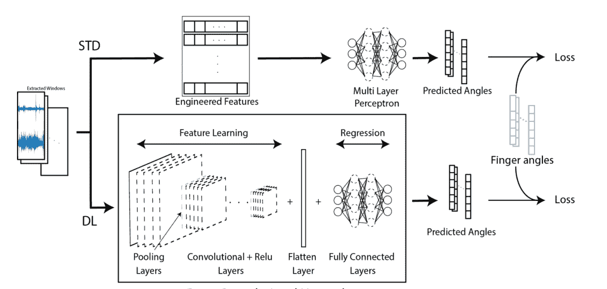
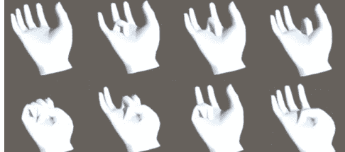
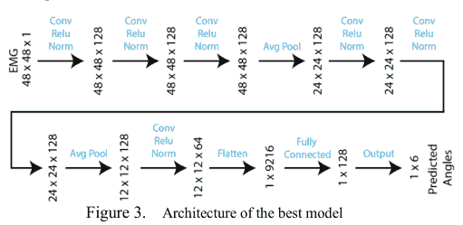
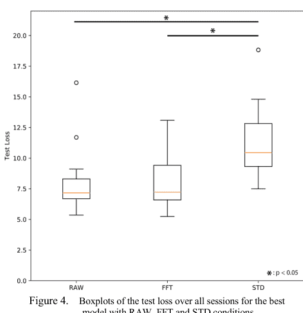
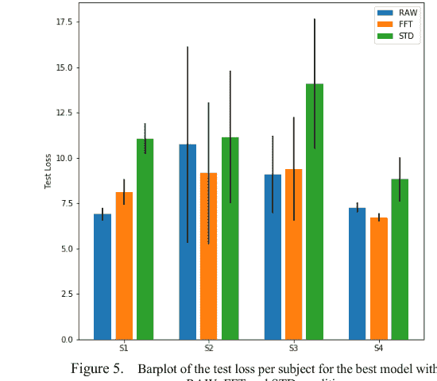
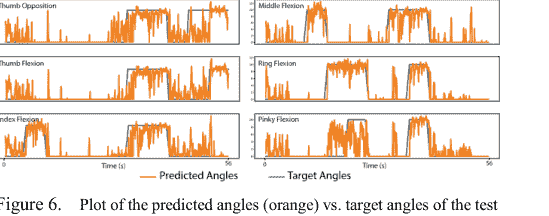

# 2021年第10届IEEE／EMBS神经工程国际会议(NER)(意大利 2021.5.4-2021.5.6) Convo 深度学习

摘要— 对于上肢截肢者，机器人义手（RPH）的控制远未理想。基于肌电信号的机器人义手同时且比例的手指控制仍然具有挑战性。基于受试者遵循预定义的单指和多指动作序列的肌电和运动学记录，我们旨在预测手指屈曲和拇指对阻角度。我们比较了两种基于深度学习（DL）的方法，第一种使用原始肌电信号，第二种使用信号的频谱作为输入，与手指角度回归的标准最先进的解码技术（STD）进行对比。使用遗传算法进行超参数优化，我们在一次记录会话中为每种条件获得了优化的模型架构（以及STD情况下的特征集）。然后，我们在四位受试者可用的十一段肌电和手指运动学记录上评估了每种条件的最佳模型。基于卷积神经网络的两种DL方法以相似的平均平方误差损失预测了手指角度，但两者都优于标准方法，用于同时单指角度的回归。这种拟议的解码策略和超参数优化框架为进一步改善机器人义手的单指比例控制提供了基础。

## I. 引言

控制人手感觉简单直观，但依赖于一种复杂且强大的控制策略，该策略允许灵巧操纵各种物体。手部丧失是一件创伤性事件，不仅带来运动后果，还带来心理后果 [1]，导致执行物体操纵、感觉以及非语言沟通的能力受限。机器人义手（RPH）旨在恢复前臂截肢者的手部功能。为了捕捉用户的意图，这些义手通常依赖于从残肢前臂肌肉活动中记录的肌电图（EMG）信号。商业上可用的义手通常使用放置在剩余拮抗肌肉（通常是手腕屈曲/伸展）上的两个表面肌电（sEMG）电极。这些机器人手的控制依赖于一种简单的阈值策略来控制一个自由度 [2]。握把类型可以通过共收缩在预定义握把之间循环选择。

通过使用更多电极（~6-8），模式识别算法是这种直接控制方法的替代方案。它包括从肌电信号中提取判别特征，以直接解码用户意图的握把类型。在校准阶段后，用户只需想象用其幻肢执行所需握把即可。结果显示4类的准确率为98%，50类的准确率最高可达75% [3][4]。其他研究组展示了单指屈曲和伸展的解码可能性 [5]，单指和多指动作的准确率为99%。

虽然这种方法更直观，但它仍然不同于控制手指的自然方式。确实，为了使手指处于中间位置，用户必须收缩肌肉直到达到所需角度，然后放松以保持机器人义手在相同位置。为了获得更加自然的控制，少数研究组展示了执行角度回归而不是运动分类以进行单指比例控制的可能性 [6]-[8]。

为了从肌电数据中解码有意义的信息，有必要将信号转换为信息丰富、判别性强且独立的特征。研究人员已经致力于设计从肌电信号中解码运动意图的最佳特征数十年了 [9]。自2016年第一个示例 [10] 以来，肌电解码社区已从这种标准特征工程（STD）方法转向使用深度学习（DL）和在大多数情况下使用卷积神经网络（CNN）的特征学习方法。标准深度网络通常由多个卷积层接全连接层组成 [11]。卷积层可以从输入信号中学习判别特征并降低其维度。这些特征随后被用作全连接层的输入，全连接层将进行预测（参见图1）。对于肌电解码，CNN的输入可以是原始信号 [12] 或信号的频谱 [13]。多项研究表明，深度网络可以直接从原始信号中学习更具判别性的特征，以执行握把分类，其准确率高于STD [14]、[15]。少数研究组展示了使用表面肌电进行手臂 [16] 和手腕运动 [17]-[19] 的DL运动意图回归，结果有前景。有关机器人义手的更详细综述，参见 [20]。

完美的运动解码策略可以描述为一种将受试者灵巧度提高到与健康手相当水平的策略。为了尽可能接近手的自然控制，必须连续且同时解码手指角度。由于DL在握把分类中相比STD方法具有更高的性能，我们旨在量化DL与STD方法在单指比例控制中的性能。

图1. STD方法与深度学习之间的训练范式差异（虚线对象表示可调超参数）。

## II. 方法

### A. 肌电数据集及预处理

肌电采集的详细方案来源于Zhuang等人（2019）实验3 [21]。简言之，四名年龄在20至26岁之间的健康受试者参与了此次实验。伦理批准已由沃州 kantonal伦理委员会获得。研究中所有参与者均已签署知情同意书。受试者参加了2或3次校准会话，其中使用Noraxon Delsys系统连接到LabJack数据采集卡记录肌电信号，共六个通道，放置在受试者前臂特定肌肉周围，这些肌肉对应触诊发现的每个手指屈曲和拇指对阻。在本文中，我们仅关注解码模型的离线校准部分。受试者遵循在虚拟环境中屏幕上显示的一系列动作。手部运动学从视频显示的手指角度获得。动作包括单指和多指运动，虚拟环境与肌电采集设备同步。运动序列重复了5次，每次

图2. 肌电记录中存在的动作示意图。包含5秒保持期，视频总时长为4.5分钟（参见图1）。肌电信号以2 kHz采样，运动学以60 Hz采样。

在虚拟环境训练阶段记录的15个关节角度中，选择了六个关节角度：每个手指的掌指关节角度以估计手指屈曲/伸展，以及用于拇指对阻的桡中手关节角度。运动学数据经过线性插值，并以2 kHz过采样以匹配肌电信号采样频率。随后将数据集分为训练集、验证集和测试集，前三次重复用于训练集，一次用于验证集，最后一次用于测试。这种非随机划分是为了考虑机器人义手的实际应用场景。确实，截肢者在校准阶段后将使用他们的机器人义手，因此最后一次重复用于测试是评估实际场景中解码性能最合适的重复。对于每个集，使用了192ms的滑动窗口，移动步长为40ms（152ms重叠），保留每个窗口末端的角度值作为标签，并将角度重新缩放到0（完全张开）和10（完全屈曲）之间。

### B. 学习范式

为了量化DL与STD的性能，比较了三种学习范式：标准特征工程方法（STD）、以原始信号为输入的DL方法（RAW）以及以使用快速傅里叶变换计算的各个窗口频谱（FFT）为输入的DL方法。对于两种DL方法，输入信号窗口被重塑为方形图像，如[22]所示。在STD方法中，肌电信号经过处理，并从每个通道提取特征。我们选择了9个在时间域和频率域中研究较为充分的特征，从每个时间窗口提取 [23]：

- 1. 平均绝对值
- 2. 波长：波形随时间累计长度
- 3. 最大绝对值

- 4. 标准差
- 5. 过零点：信号穿过零点的次数
- 6. 坡度符号变化：EMG信号斜率改变符号的次数
- 7. 均方根
- 8. 对数检测器：\(\frac{1}{e^N} \sum_{i=1}^N log(|x_i|)\) 其中 \(x_i\) 是时间箱 i 处的 EMG 幅度。
- 9. 来自 FFT 结果的 7 至 12 Hz、12-30、30-50、50-100、100-150 和 150-400 Hz 各频率箱内的频谱。

### C. 超参数优化

每种范式都有大量超参数需要优化。其中，基于第一个受试者的第一次会话，我们优化了一组参数，因为对每次记录进行超参数搜索所需的计算能力有限。其假设是每次记录的信息量相对相同，因此数据集的复杂度也相对相同，这意味着一种记录的最佳模型架构也是其他记录的良好模型。

对于两种深度学习方法（RAW 和 FFT），我们以类 VGG 架构 [24] 为起点，优化了网络结构：每个平均池化层之前的卷积层数量（最多 3 层）、池化层数量（最多 5 层）以及每个卷积层的滤波器数量（16、32、64、128）。每个卷积层后都接一个批量归一化层。接着，全连接层数量（最多两层）和每层的节点数（16、32、64）也进行了调优。除架构参数外，还优化了丢弃率（0、0.2、0.5），以及 L2 正则化率（0、1e-3、0.1）、学习率（0.1、0.01、0.001）、x 维度和 y 维度的卷积滤波器大小（1、3、5）以及图像边缘的填充策略（有或无）。CNN 网络采用批量梯度下降进行优化，批量大小为 32 个样本，训练 50 个 epoch，每 10 个 epoch 学习率下降 \(\frac{1}{2}\)，且如果验证损失在超过 13 个 epoch 内未下降，则采用早停策略。

对于 STD 方法，模型为多层感知机（MLP），因此需要调优的参数较少。然而，特征选择是一个重要的过程，以避免对数据过拟合。因此，超参数包括是否选择某个特征、全连接层数量（最多 3 个隐藏层）、每层节点数（16、32、64、128、256）、丢弃率（0、0.2、0.5）、L1 和 L2 正则化项（0、1e-3、0.1）、学习率（0.1、0.01、0.001）以及优化器（Adam、RMSprop、批量梯度下降）。MLP 采用批量梯度下降进行优化，批量大小为 16 个样本，训练 100 个 epoch，同样采用每 10 个 epoch 学习率下降 \(\frac{1}{6}\) 的阶梯式衰减，且如果验证损失在超过 13 个 epoch 内未下降，则采用早停策略。所有模型均使用均方误差损失（MSE）进行训练。

由于超参数空间维度较高，在合理时间内无法进行网格搜索。因此，我们采用基于遗传算法（GA）的参数优化方法 [25]。问题被表述为解域的遗传表示，其中每个超参数被编码为染色体上的基因，可取离散可能值之一。适应度函数被编码为训练模型的验证损失，以评估解域。创建了一个包含 20 个随机个体的种群，并使用基于适应度比例（或轮盘赌）的后代选择方法进行了 200 代训练。突变率设置为 0.1，选择率设置为 0.6。

### D. 每个受试者的性能评估

在对一次会话进行超参数优化后，将对所有可用记录应用相同的预处理步骤，以便对每条可用记录训练一个模型。对于每条记录，模型被训练了十次，并保留验证损失最低的模型。此步骤是必要的，以减少模型陷入局部最小值的可能性。然后，在测试集上评估最佳模型。

## III. 结果

通过遗传算法获得的三种范式的最佳模型为 RAW 条件，其验证损失为 5.34，训练损失为 2.20。模型架构如图 3 所示。该模型训练时丢弃率为 50%，不使用 L2 归一化，学习率为 0.01，卷积掩码形状为 (3, 1)，并使用 0 填充以保持相同的输出维度。

对于 FFT 条件，最小验证损失为 6.41，训练损失为 4.82；对于 STD，最小验证损失为 9.14，训练损失为 9.43。对于 STD 模型，提取了所有通道的特征，最终模型除斜率符号变化外使用了所有特征，总计 46 个特征。

图 4 显示了 11 次会话中各条件的平均测试损失（即未见数据上的性能）。STD 测试损失与另外两种条件存在显著差异（t 检验，p < 0.05），但 FFT 和 RAW 条件之间无差异。

图 5 显示了每个受试者的测试损失，每个受试者记录了 3 次会话，除了 S2 仅进行了两次校准会话。图 6 显示了 RAW 条件下受试者 S1 测试集中预测角度与目标标签的示例。它包含每种动作的一次重复，持续 56 秒。角度对应序列：食指屈曲、中指屈曲、无名指屈曲、尺偏握、张开、三指捏握、力量握、拇指对抗以及拇指对抗 + 屈曲。其对应损失为 7.36。基线损失（即仅输出目标均值的模型）约为 19。

## IV. 讨论

本研究旨在量化深度学习与 STD 特征提取方法相比的性能。结果表明，两种深度学习条件（RAW 和 FFT）均优于 STD。然而，无法得出在 RAW 和 FFT 之间哪种方法更适合单手指比例控制的结论。为求简单，有人可能会主张保留 RAW 条件以避免计算 FFT，从而降低实时应用的计算时间。一种可能的优化是结合时频信息，融合 RAW 和 FFT 方法，增加输入模型的信息量。

然而，这些实验中每次会话的数据量相对较小（训练集为 3 次重复），这在不同模型训练过程中产生不确定性，并导致验证损失与测试损失之间存在较大差异。

另一项需要考虑的局限性是，数据集仅包含保持几秒钟的完全张开和闭合位置，没有真正的“休息/中间”位置或其他任意角度。确实，当用户跟随屏幕上显示的动作时，由于其反应时间存在固有延迟，导致预期动力学与实际手指位置之间出现抖动。在单手指比例控制的情况下，精确的手指位置至关重要。因此，获取同步的中间值具有挑战性，例如可以使用动力学手套来实现。

像 CNN 这样的深度网络需要大量数据才能达到最大精度（例如 ImageNet 挑战 [26]），这意味着增加数据量可能在所获得的性能中发挥重要作用。然而，受试者无法在单次会话中合理地记录几十小时的数据。一种可能的解决方案是利用多个受试者的信息预训练一个通用网络，然后针对受试者特定的 EMG 活动进行微调。多位作者 [13]、[27]、[28] 研究了这种方法，并在握把分类方面取得了有希望的结果，该策略可应用于单手指比例控制。

## V. 结论

总之，我们表明深度学习是比例 EMG 解码的一种有前景的方法。由于电极放置在前臂上，在健康受试者上获得的这些结果可能适用于桡远端截肢者或更远端的截肢情况。在解码方面，我们无法得出原始信号还是频谱图作为输入的最佳深度学习方法，因为两者均优于标准的最先进方法，但在统计上无显著差异。

未来发展方面，增加数据量应是主要目标。利用 NinaPro [29]、[30] 等开放获取 EMG 数据库，以提高深度学习在单手指回归方面的性能。由于所用模型的计算成本高昂，还应解决这种深度学习方法在实时控制真实义肢或任何微处理器方面的可行性。

## 参考文献

- [1] T. M. Meyer, “毁损性手部损伤的心理方面,” Hand Clinics, vol. 19, no. 1, Hand Clin, pp. 41–49, 2003 年 2月.

- [2] P. Geethanjali, “假肢手的肌电控制：最新进展综述,” Med. Devices Evid. Res., vol. 9, pp. 247–255, 2016.

- [3] K. Englehart 和 B. Hudgins, “多功能肌电控制的强健实时控制方案,” IEEE Trans. Biomed. Eng., vol. 50, no. 7, 2003.

- [4] M. Atzori 等, “用于肌电动作分类的基准数据库特征分析,” IEEE Trans. Neural Syst. Rehabil. Eng., vol. 23, no. 1, pp. 73–83, 2015 年 1月.

- [5] S. Bhagwat 和 P. Mukherji, “基于小波包系数稀疏滤波的肌电（EMG）手指运动识别,” Sadhana - Acad. Proc. Eng. Sci., vol. 45, no. 1, pp. 1–11, 2020 年 12月.

- [6] T. Baldacchino, W. R. Jacobs, S. R. Anderson, K. Worden 和 J. Rowson, “基于统一贝叶斯框架的表面肌电手指同时力回归与运动分类,” Front. Bioeng. Biotechnol., vol. 6, p. 13, 2018 年 2月.

- [7] S. Muceli 和 D. Farina, “多自由度镜像运动期间基于肌电的手部运动学同步比例估计,” IEEE Trans. Neural Syst. Rehabil. Eng., vol. 20, no. 3, pp. 371–378, 2012.

- [8] M. Hioki 和 H. Kawasaki, “基于包含时间延迟因子和递归结构的神经网络的 sEMG 手指关节角度估计,” ISRN Rehabil., vol. 2012, pp. 1–13, 2012.

- [9] P. Herberts, C. Almström, R. Kadefors 和 P. D. Lawrence, “通过肌电图案控制手部假肢,” Acta Orthop., vol. 44, no. 4–5, pp. 389–409, 1973.

- [10] K. H. Park 和 S. W. Lee, “基于深度学习的多用户肌电接口运动意图解码,” in 第 4 届国际冬季脑机接口会议, BCI 2016, 2016.

- [11] N. Aloysius 和 M. Geetha, “深度卷积神经网络综述,” in 2017 IEEE 通信与信号处理国际会议论文集, ICCSP 2017, 2018, vol. 2018-January, pp. 588–592.

- [12] M. Atzori, M. Cognolato 和 H. Müller, “应用卷积神经网络深度学习处理肌电数据：一种用于假肢手动作分类的资源,” Front. Neurorobot., vol. 10, p. 9, 2016 年 9月.

- [13] U. C. Allard 等, “基于 sEMG 频率特征的机械臂导航卷积神经网络.”

- [14] A. Phinyomark 和 E. Scheme, “大数据与深度学习时代的 EMG 模式识别,” Big Data Cogn. Comput., vol. 2, no. 3, p. 21, 2018 年 8月.

- [15] Y. Hu, Y. Wong, W. Wei, Y. Du, M. Kankanhalli 和 W. Geng, “一种用于基于 sEMG 的手势识别的新型注意力混合 CNN-RNN 架构,” PLoS One, vol. 13, no. 10, pp. 1–18, 2018.

- [16] P. Xia, J. Hu 和 Y. Peng, “使用带有递归卷积神经网络的深度学习进行基于肌电的肢体运动估计,” Artif. Organs, vol. 42, no. 5, pp. E67–E77, 2018.

- [17] W. Yang, D. Yang, J. Li, Y. Liu 和 H. Liu, “用于提高多自由度腕部运动回归精度和鲁棒性的肌电数据集增强方法,” in 2018 IEEE 机器人与生物仿真国际会议, ROBIO 2018, 2018, pp. 1268–1273.

- [18] X. Zhang, X. Tang, Z. Zhu, X. Gao, X. Chen 和 X. Chen, “一种基于可穿戴传感器联合肌电和惯性数据的肌张力定量评估回归框架,” Front. Neurosci., vol. 13, p. 398, 2019 年 5月.

- [19] A. Ameri, M. A. Akhaee, E. Scheme 和 K. Englehart, “改进同时肌电控制的回归卷积神经网络,” J. Neural Eng., vol. 16, no. 3, p. 036015, 2019 年 6月.

- [20] V. Mendez, F. Ibirte, S. Shokur 和 S. Micera, “机器人假肢手的当前解决方案与未来趋势,” Annu. Rev. Control. Robot. Auton. Syst., vol. 4, no. 1, 2021 年 5月.

- [21] K. Z. Zhuang 等, “灵巧肌电假肢的人机共享比例控制,” Nat. Mach. Intell., vol. 1, no. 9, pp. 400–411, 2019 年 9月.

- [22] A. Ameri, M. A. Akhaee, E. Scheme 和 K. Englehart, “改进同时肌电控制的回归卷积神经网络,” J. Neural Eng., vol. 16, no. 3, 2019 年 4月.

- [23] A. Phinyomark, P. Phukpattaranont 和 C. Limsakul, “EMG 信号分类的特征降维与选择,” Expert Syst. Appl., vol. 39, no. 8, pp. 7420–7431, 2012.

- [24] A. Shrestha 和 A. Mahmood, “深度学习算法和架构综述,” IEEE Access, vol. 7, pp. 53040–53065, 2019.

- [25] F. Johnson, A. Valderrama, C. Valle, B. Crawford, R. Soto 和 R. Nanculef, “使用遗传算法自动配置卷积神经网络超参数,” IEEE Access, vol. 8, pp. 156139–156152, 2020.

- [26] M. Z. Alom 等, “历史始于 AlexNet：关于深度学习方法的全面综述,” 2018 年 3月.

- [27] A. Ameri, M. A. Akhaee, E. Scheme 和 K. Englehart, “一种用于减轻基于 EMG 模式识别控制中电极漂移影响的深度迁移学习方法,” IEEE Trans. Neural Syst. Rehabil. Eng., pp. 1–1, 2019.

- [28] Y. Du, W. Jin, W. Wei, Y. Hu 和 W. Geng, “基于深度域自适应的表面肌电跨会话手势识别,” Sensors (Switzerland), vol. 17, no. 3, pp. 6–9, 2017.

- [29] M. Atzori 等, “用于肌电动作分类的基准数据库特征分析,” IEEE Trans. Neural Syst. Rehabil. Eng., vol. 23, no. 1, pp. 73–83, 2015 年 1月.

- [30] M. Atzori 等, “构建 NinaPro 数据库：一种面向生物机器人社区的资源,” in IEEE RAS 和 EMBS 生物医学机器人与生物机电国际会议论文集, 2012, pp. 1258–1265.

