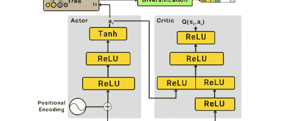
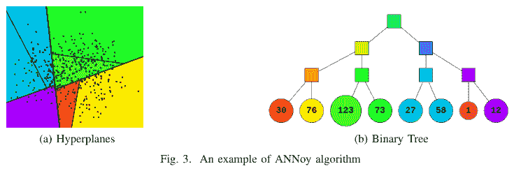
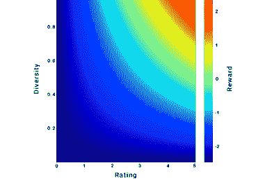

# 2021 第26届国际计算机会议，伊朗计算机学会 (CSICC) (德黑兰 2021.3.3-2021.3.4) 2021 第26届国际计算机会议，伊朗计算机学会 (CSICC) ｜｜ 即兴


第一作者 Vahid Baghi
算法与计算系
德黑兰大学
德黑兰
vahid.baghi@ut.ir

第二作者 Seyed Mohamed Seyed Fateheri
算法与计算系
德黑兰大学
德黑兰
mohtehayer@ut.ir

第三作者 Ali Moeceni
算法与计算系
德黑兰大学
德黑兰
moemeni@ut.ir

第四作者 Roohollah Abedian
算法与计算系
德黑兰大学
德黑兰
rabedian@ut.ir

（等等，我修正了文本流）

**摘要—最近**，研究人员已经开始关注基于强化学习的交互式推荐系统，通过将推荐过程视为一个动态过程，并根据即时用户反馈更新推荐模型，而这在传统方法中是被忽视的。现有工作存在两个显著缺点：首先，需要重新思考排名函数以生成 Top-N 推荐列表；其次，仅关注推荐准确性无法充分评估各项指标。本文提出了一种基于强化学习的系统，通过利用 Actor-Critic 架构对动态用户与推荐系统的交互进行建模，以最大化累积奖励。此外，我们利用 Spotify 的注意力算法寻找由动作历史生成的最相似物品，从而利用总多样性排名（Total Diversity Ranking）来提高相关性和多样性。此外，我们采用个性化方法计算用户交互序列的表示。

**索引—**强化学习，推荐系统，最近邻

用户的兴趣可能会根据其心情或脾气而变化。由于深度强化学习的近期进展以及在玩游戏 [6–8]、机器人技术 [9] 以及其他序列决策问题 [11] 等各种任务中的巨大成功，许多研究专注于基于强化学习的大状态空间系统，这正是推荐系统的本质。过去的强化学习方法如 Q-Learning 和部分可观测马尔可夫决策过程 (POMDP) 是将推荐过程建模为强化学习问题的早期尝试。然而，随着推荐过程中物品数量的增加，这些方法变得不再有效。基于卷积深度 Q 网络 (DQN) 的技术 [14] 利用神经网络估计当前状态下的最佳动作。

# I. 引言

大多数传统系统将推荐过程视为一个静态过程。换句话说，系统无法向用户提供反馈。另一方面，交互式推荐系统可以根据用户反馈动态修改模型。一些工作 [15–17] 证明了用户的偏好可能会改变。然而，现有工作存在两个局限性：

首先，需要重新思考排名函数以生成 Top-N 推荐列表；其次，仅关注推荐准确性无法充分评估各项指标。

本文提出了一种基于强化学习的系统，通过利用 Actor-Critic 架构对动态用户与推荐系统的交互进行建模，以最大化累积奖励。此外，我们利用 Spotify 的注意力算法寻找由动作历史生成的最相似物品，从而利用总多样性排名来提高相关性和多样性。此外，我们采用个性化方法计算用户交互序列的表示。本文的主要贡献如下：

 我们 我们提出的基于深度强化学习的框架，能够同时生成相关性和多样性。
- 为了减少列表中的冗余，我们使用注意力算法来寻找相似物品。
- 我们没有使用 RNN，而是使用位置编码来表示用户的序列。

# II. 相关工作

## A. 强化学习

Sham 等人 [13] 利用马尔可夫决策过程 (MDP) 将推荐过程建模为强化学习问题。Hu 等人 [21] 使用搜索决策方法 (SSMD) 和确定性策略梯度 (DPG) 对序列决策问题建模以学习最优策略。Zheng 等人 [22] 提出了一种基于 DQN 的推荐模型。

## B. 多样性

最大边际增益 (MMG) [23] 是促进多样性的早期工作之一。Ziegler 等人 [24] 提出了一种使用列表内相似性（ILS）增加推荐多样性的方法。Bridge 等人 [25] 使用汉明距离（Hamming Distance）衡量物品之间的距离，增强了推荐的多样性。Lathia 等人 [27] 通过提出衡量协同过滤变化的方法展示了多样性在推荐系统中重要性。Abbasi 等人 [28] 提出了一种矩阵约束方法来增加表示的多样性。Premchaadi 等人 [29] 提出了一种名为总多样性排名（TDE）的方法，增加了每个物品影响的多样性。Lee 等人 [30] 构建了一个没有环的强连通无向图，每条边代表物品之间的正交互。Chang 等人 [31] 将系统的推荐框架修改为监督任务，并将该推荐任务制定为两个优化问题。Wang 等人 [31] 提出了一种名为 DivRec_Ish 的新方法，使用了局部敏感哈希 (LSH)。Lu 等人 [32] 开发了行列点过程 (DPP)来促进推荐的多样性。

# III. 提出的框架



图 1. 所提框架的架构

## A. 问题描述

推荐系统（即智能体）向用户（即……）建议一个兼具相关性和多样性的物品列表，


environment);那么，用户选择其中之一。推荐代理在每个时间步上按顺序执行此过程，以最大化累积奖励。我们将推荐过程建模为马尔可夫决策过程（MDP），这是我们在强化学习中采用的方法。MDP 是如下所示的马尔可夫过程：

- 状态：$s_t$ 定义为时间步 $t$ 之前用户正向偏好的嵌入表示。
- 动作：$a_t \in \mathbb{R}$ 是一个连续参数向量，用于构建多样化的推荐列表。
- 奖励：根据推荐代理在 $s_t$ 中做出的选择 $a_t$，向用户推荐多样化且相关的物品。用户与这些物品进行交互并提供反馈（例如：评分、点击或购买），推荐代理获得即时奖励。
- 转移：当推荐代理在时间步上采取动作 $a_t$ 时，用户的状态从 $s_t$ 变为 $s_{t+1}$。如果用户忽略了推荐列表，则下一个状态保持不变（即 $s_{t+1} = s_t$）。否则，下一个状态 $s_{t+1}$ 根据用户的反馈更新。
- 折扣：$\gamma \in [0,1]$ 是一个决定未来奖励相对于即时奖励重要性的因子。如果 $\gamma=0$，代理将是短视的，只考虑即时奖励。相反，如果 $\gamma=1$，它更倾向于长期奖励。时间步 $t$ 的期望累积奖励表示为 $G_t = \sum_{k=0}^{\infty} \gamma^k R(s_{t+k})$

用户正向交互中 $r_t$ 个物品的奖励。当推荐代理生成物品列表并向用户推荐时，如果用户跳过了某些物品，则下一个状态保持不变，即 $s_{t+1} = s_t$。如果 $p = \{p_i \in \mathbb{R}^m, 1 \leq i \leq n\}$ 是用户给予了正向反馈的推荐物品，则下一个状态更新如下：

```
$s_{t+1} = \{e_i | e_i \in s_t, n+1 \leq i \leq n\} \cup \{p_i | p_i \in p\}$
(1)
```

使得 $s_{t+1}$ 中物品的时间顺序得以保留。由于用户状态中物品的当前表示没有体现物品在时间上的上的排列，我们对每个物品的嵌入使用位置编码（Positional Encoding），以确定每个物品在系统中的位置。位置公式为：

```
$PE(pos, i) = \sin(\frac{pos}{10000^{2i/d_{model}}}})$
$PE(pos, i) = \cos(\frac{pos}{10000^{2i/d_{model}}}})$
(2)
```

例如，如果 $s_t = \{e_1, e_2, \dots, e_n\}$ 是用户的状态，位置编码 $PE \in \mathbb{R}^{d_{model}}$ 的使用方式如下：

```
$PE(pos, i) = pos + \sin(\frac{pos}{10000^{2i/d_{model}}}}), \cos(\frac{pos}{10000^{2i/d_{model}}),$
\dots,$
$\sin(pos, i) = pos + \sin(\frac{pos}{10000^{(2i+1)/d_{model}}}}), \cos(\frac{pos}{10000^{(2i+1)/d_{model}}}})$
(4)
```

位置编码器的输出被馈入两个卷积层和一个 tanh 层，将当前状态映射到原型动作 $a_t$：

```
$f_t(s_t) = a_t$
(5)
```


图 2. 推荐者与用户的交互

MDP 中推荐者与用户交互的通用场景如图 2 所示。在每个状态下，推荐者（代理）根据当前策略 $\pi$ 选择原型动作 $a_t$。该原型动作是一个用于生成物品列表的连续参数向量。然后，用户的反馈根据状态变为 $s_{t+1}$ 更新策略 $\pi$。强化学习的目标是学习一种最大化期望奖励的策略。

## B. Actor 网络（Actor Network）

Actor 网络利用深度神经网络来学习最优策略，为当前状态 $s_t$ 生成最佳动作 $a_t$。状态可以定义为 $s_t = \{e_i | e_i \in \mathbb{R}^m, 1 \leq i \leq n\}$，使得

在本文中，我们使用了概率矩阵分解（PMF）技术

给定 Actor 网络生成的原型动作，向用户推荐物品列表。与通常排序机制 [15]–[17] 不同（这些机制通过计算原型动作到物品空间中物品的距离来寻找相似物品），我们使用近似最近邻算法（ANNOY）[99] 寻找与原型动作相似的物品，该算法在基准测试 [34]–[35] 中表现良好。ANNOY 算法构建一个二叉树结构，通过在空间中选取两点并通过它们之间的等距超平面进行分割来搜索物品。此过程在每个子空间中递归进行，直到每个节点包含

## C. 多样化（Diversification）



$m$ 个用户。Movielens-100K 数据集前 400 个物品如图 3a 所示，并在图 3b 中构建了二叉树。在移除重复候选物品和角距离后，构建了这些树的根

一旦树构建完成，我们通过从根到叶遍历二叉树，为生成的原型动作 $a_i$（即子空间）寻找 $k$-最近邻。由于每个叶子节点 $v \approx a_i$。为了解决这个问题，我们构建了多棵树（即森林）并合并所有树的结果。根存储在优先级队列中，搜索持续直到收集到 $k$ 个候选。为了生成多样化的推荐列表，我们

我们将物品存储在 $C_s$ 中，然后按照如下公式计算 $C_s$ 中每个物品 $c_i$ 的总多样性效应（TDE）：

```
$TDE(c_i) = \sqrt{\sum_{j \in C_s, j \neq i} \frac{\|c_i - c_j\|^2}{\|c_i\|^2 + \|c_j\|^2}}; ; j \neq i \& c_j \in C_s$
```

最后，我们按照 TDE 的降序对物品 $C_s$ 进行排序，并选择 Top-N 物品作为推荐列表。该方法的伪代码所示：

- **算法 1 多样化推荐列表**
**输入**：Actor 网络生成的原型动作 $a_i$
**输出**：推荐列表 $d_i$
1. 在 $C_s$ 中寻找 $a_i$ 的 $k$-相似物品
2. **对于** $i = 1$ 到 $|C_s|$ **执行**
   使用公式 6 计算 $TDE$
   **结束**
3. 按 TDE 降序排序 $C_s$
4. $d_i$ = 选择 Top-N 物品
5. **返回** $d_i$

ANN 算法的复杂度为 $O(\log N)$。最坏情况下，如果每次查询只选择一个物品，查询次数为 $k$，我们的方法复杂度为 $O(k \log N)$。

## D. Critic 网络（Critic Network）

如图 1 所示，Critic 网络接收 $(s_i, action)$ 对并输出动作值 $Q(s, t)$，即表示动作 $a_i$ 的 $Q$ 函数。Critic 使用带有参数 $\theta^Q$ 的 DQN 深度神经网络作为函数近似器。因此，Critic 在遵循策略 $\pi$ 下指定状态 $s_i$ 的期望回报。我们定义奖励如下：

$Q(s_i, a_i) = E_t[r_i + \gamma Q(s_{i+1}, a_{i+1})]$


奖励函数如何变为多样性 Diversity(t) 和评分 Rating(t)。本文的理想目标是到达右上角，即 Diversity(t) = 1 且 Rating(t) = 5，我们的奖励函数平滑地变化以实现这一目标。



$\nabla_{\theta} J(\theta) \approx \frac{1}{N} \sum_{i=1}^{N} \nabla_{\theta} Q(s_i, \mu(s_i))\theta^Q \nabla_{\theta} \mu(s_i)\theta^{\mu}$ (15)

目标网络通过以下更新技术进行：

```
$$\theta^Q \leftarrow \theta^Q + (1-\tau^Q)\theta^{Q}$$
$$\theta^{\mu} \leftarrow \theta^{\mu} + (1-\tau^{\mu})\theta^{\mu}$$
where $\tau \ll 1$ (16)
```

基于 DDPG 的训练算法在算法 2 中描述：

### 算法 2 所提模型的训练

1. 初始化网络 $\theta^F$ 和带有带有参数 $\theta^Q$ 的 critic 网络 $Q(s,a|\theta^Q)$ 以及一个缓冲区 $\theta^D$ 
2. 初始化目标网络 $F'$ 和 $Q'(s,a|\theta^{Q'})$，权重为 $\theta^{F'}=\theta^F$ 和 $\theta^{Q'}=\theta^Q$
3. 初始化回放缓冲区 $r$
4. 对于 $episode = 1$ 到 $E$
5. 初始化状态 $s_0 = (e_1, ..., e_n)$
6. 根据公式 4 添加 $e_i \in s_0$ 中的每个条目
7. 对于 $t = 1$ 到 $D$
8. 根据策略 $\theta$ 生成动作 $f_{\theta}(s_t) = a_t$
9. 根据算法 1 生成多样化列表 $d_t$
10. 向 $d_t$ 推荐列表
11. 根据公式 8 计算奖励 $r_t$
12. 根据公式 1 将状态从 $s_t$ 更新为 $s_{t+1}$
13. 将 $(s_t, a_t, r_t, s_{t+1})$ 存储在 $r$ 中
14. 设置 $s_t \leftarrow s_{t+1}$
15. 从 $r$ 中采样一个转换转换小批量 $(s_t, a_t, r_t, s_{t+1})$
16. 设置 $y_t = r_t + \gamma Q'(s_{t+1}, \mu(s_{t+1}))\theta^{Q'}$
17. 通过小批量更新 critic：$loss = \frac{1}{N} \sum_{i=1}^{N} (y_i - Q(s_i, a_i|\theta^Q))^2$
18. 使用采样的策略 $\theta$ 更新 actor
19. 更新目标网络：
20. 对于每个
21. 结束

### 训练

在本文中，我们使用深度确定性策略梯度（DDPG）算法来训练我们的模型。在 DDPG 中，有四个神经网络如下：1) 带有参数 $\theta^Q$ 的 critic 网络2) 带有参数 $\theta^{\mu}$ 的 actor-网络3) 带有参数 $\theta^{Q'}$ 的目标 critic 网络4) 带有参数 $\theta^{\mu}$ 的目标 actor-网络。在每一步中，给定一个用户的状态，actor-网络在步骤 $t$ 中生成策略 $U$。然后，用户对推荐列表提供反馈，并使用算法 1 构建多样化列表。之后，用户对推荐列表 $d_t$ 提供反馈，推荐系统推荐 $r_t$。之后，$(s_t, a_t, r_t, s_{t+1})$ 被存储在回放缓冲区中。为了更新 critic 网络 $Q(s,a|\theta^Q)$，从经验回放 $r$ 中采样大小为 $N$ 的小批量以计算时序差（TD）目标值：

```
$y_t = r_t + \gamma Q'(s_{t+1}, \mu(s_{t+1}))\theta^{Q'}$ (17)
```

然后，通过以下函数更新网络：

```
$loss = \frac{1}{N} \sum_{i=1}^{N} (y_i - Q(s_i, a_i|\theta^Q))^2$ (20)
```

此外，actor 的目标是最大化期望回报，其定义为：

为了优化此目标，可以使用如下规则获取 $J(\theta)$ 的梯度：

```
$$\nabla_{\theta^{\mu}} J(\theta) \approx E_{\mu}[\nabla_{\theta} Q(s, \mu(s))\theta^Q \nabla_{\theta} \mu(s)\theta^{\mu}]$$ (14)
```

由于 actor-网络是通过从经验回放中采样的大小为 $N$ 的小批量更新的，因此 $N$ 个样本上 $\nabla_{\theta^{\mu}} J(\theta)$ 的均值是：

### 数据集

我们使用 MovieLens 数据集来开发我们提出的框架。MovieLens 数据集包含一组由 MovieLens 网站收集的用户对电影的的评分。在每行 $i$ 中，都有一个元组 $(u_i, m_i, r_i, f_i)$，其中

> https://movielens.org/

## 表 I
主要超参数

| 方法 | 主要超参数 |
|---|---||
| DLRIR | $N = |d_i| = 5, n = |s_i| = 10, |C_u| = 30, T = 5 \theta = 3, \lambda_1 = .60, \lambda_2 = 3, d_{model} = 100$ |
| DRR-ave | $N = |d_i| = 5, n = |s_i| = 10, T = 10$ |
| LIRD | $N = |d_i| = 5, n = |s_i| = 10, T = 7$ |
| D^2 RL | $N = |d_i| = 5, n = |s_i| = 10, T = 10$ |

$r_i$ 是特定 $t_i$ 时用户 $u_i$ 对电影 $m_i$ 的评分（范围 [1-5]）。**Movielens-1m** 包含来自 63706 部电影的 100 万条评分。由于每个用户的 $s_i$ 仅包含正交互，我们从数据中删除了小于 3 的评分。

## B. 方法比较

我们利用以下方法比较我们所提模型的性能：

- **LIRD [16]:** 提出了一种基于深度强化学习的列表推荐模型，actor 网络生成一个权重向量列表，然后使用这些权重对空间中的所有项进行评分。
- **DRR-ave [15]:** 提出了一种状态表示模型，在基于深度学习的推荐系统中显式地对用户交互建模。actor 网络生成的 proto-action 用于推荐系统向用户推荐得分最高的项目。
- **DRL [32]:** 提出了一种快速贪心映射算法，以提高生成推荐结果的多样性。

在每个数据集中，我们考虑 80% 的用户正交互用于训练，20% 用于测试。由于我们使用了预训练模型（其中每个用户和物品都表示为 100 维嵌入），来模拟未知的评分。DRR-ave 方法的评分函数返回得分最高的项目给用户。因此，我们选择得分最高的 N 个项目来生成项目列表。超参数如表所示。我们使用 **NDCG@**、**Diversity@** 和 **Precision@** 来评估我们推荐模型的性能。在本文中，所提的 **Precision@** 如下：

```
Precision@ = \frac{\sum_{i=1}^N r_{ui}}{N}
```

其中 $r_{ui}$ 是用户 $u$ 对推荐列表 $d_i$ 中第 $i$ 个物品的评分，且 $r_{ui} \geq 3$。

## C. 结果

评估结果总结在图5到图8中。结果显示，在我们数据集的90% 情况下，所提模型优于其他模型，在准确率上优于 40%，在 nDCG 上优于 30%。其他情况下，它与其他方法略有不同。图8 表明使用位置编码将多样性提高了 9%，准确率提高了 8%，nDCG 提高了 0.5%。img/293e1bf91565016a8c5cd326223dbb9c_4_0.png

img/293e1bf91565016a8c5cd326223dbb9c_4_0.png

img/293e1bf91565016a8c5cd326223dbb9c_4_0.png

img/293e1bf91565016a8c5cd326223dbb9c_4_0.png

V. 结论

在本文中，我们使用深度确定性策略梯度（DDPG）算法来训练我们的模型。在 DDPG 中，有四个神经网络如下：1) 带有参数 $\theta^Q$ 的 critic 网络2) 带有参数 $\theta^{\mu}$ 的 actor-网络3) 带有参数 $\theta^{Q'}$ 的目标 critic 网络4) 带有参数 $\theta^{\mu}$ 的目标 actor-网络。在每一步中，给定一个用户的状态，actor-网络在步骤 $t$ 中生成策略 $U$。然后，用户对推荐列表提供反馈，并使用算法 1 构建多样化列表。之后，用户对推荐列表 $d_t$ 提供反馈，推荐系统推荐 $r_t$。之后，$(s_t, a_t, r_t, s_{t+1})$ 被存储在回放缓冲区中。为了更新 critic 网络 $Q(s,a|\theta^Q)$，从经验回放 $r$ 中采样大小为 $N$ 的小批量以计算时序差（TD）目标值：

```
$y_t = r_t + \gamma Q'(s_{t+1}, \mu(s_{t+1}))\theta^{Q'}$ (17)
```

然后，通过以下函数更新网络：

```
$loss = \frac{1}{N} \sum_{i=1}^{N} (y_i - Q(s_i, a_i|\theta^Q))^2$ (20)
```

此外，actor 的目标是最大化期望回报，其定义为：

为了优化此目标，可以使用如下规则获取 $J(\theta)$ 的梯度：

```
$$\nabla_{\theta^{\mu}} J(\theta) \approx E_{\mu}[\nabla_{\theta} Q(s, \mu(s))\theta^Q \nabla_{\theta} \mu(s)\theta^{\mu}]$$ (14)
```

由于 actor-网络是通过从经验回放中采样的大小为 $N$ 的小批量更新的，因此 $N$ 个样本上 $\nabla_{\theta^{\mu}} J(\theta)$ 的均值是：

### 数据集

我们使用 MovieLens 数据集来开发我们提出的框架。MovieLens 数据集包含一组由 MovieLens 网站收集的用户对电影的评分。在每行 $i$ 中，都有一个元组 $(u_i, m_i, r_i, f_i)$，其中

> https://movielens.org/

## 表 I
主要超参数

| 方法 | 主要超参数 |
|---|---|
| DLRIR | $N = |d_i| = 5, n = |s_i| = 10, |C_u| = 30, T = 5 \theta = 3, \lambda_1 = .60, \lambda_2 = 3, d_{model} = 100$ |
| DRR-ave | $N = |d_i| = 5, n = |s_i| = 10, T = 10$ |
| LIRD | $N = |d_i| = 5, n = |s_i| = 10, T = 7$ |
| D^2 RL | $N = |d_i| = 5, n = |s_i| = 10, T = 10$ |

$r_i$ 是特定 $t_i$ 时用户 $u_i$ 对电影 $m_i$ 的评分（范围 [1-5]）。**Movielens-1m** 包含来自 63706 部电影的 100 万条评分。由于每个用户的 $s_i$ 仅包含正交互，我们从数据中删除了小于 3 的评分。

## B. 方法比较

我们利用以下方法比较我们所提模型的性能：

- **LIRD [16]:** 提出了一种基于深度强化学习的列表推荐模型，actor 网络生成一个权重向量列表，然后使用这些权重对空间中的所有项进行评分。
- **DRR-ave [15]:** 提出了一种状态表示模型，在基于深度学习的推荐系统中显式地对用户交互建模。actor 网络生成的 proto-action 用于推荐系统向用户推荐得分最高的项目。
- **DRL [32]:** 提出了一种快速贪心映射算法，以提高生成推荐结果的多样性。

在每个数据集中，我们考虑 80% 的用户正交互用于训练，20% 用于测试。由于我们使用了预训练模型（其中每个用户和物品都表示为 100 维嵌入），来模拟未知的评分。DRR-ave 方法的评分函数返回得分最高的项目给用户。因此，我们选择得分最高的 N 个项目来生成项目列表。超参数如表所示。我们使用 **NDCG@**、**Diversity@** 和 **Precision@** 来评估我们推荐模型的性能。在本文中，所提的 **Precision@** 如下：

```
Precision@ = \frac{\sum_{i=1}^N r_{ui}}{N}
```

其中 $r_{ui}$ 是用户 $u$ 对推荐列表 $d_i$ 中第 $i$ 个物品的评分，且 $r_{ui} \geq 3$。

## C. 结果

评估结果总结在图5到图8中。结果显示，在我们数据集的90% 情况下，所提模型优于其他模型，在准确率上优于 40%，在 nDCG 上优于 30%。其他情况下，它与其他方法略有不同。图8 表明使用位置编码将多样性提高了 9%，准确率提高了 8%，nDCG 提高了 0.5%。结构如 CNN 和 RNN 可以被位置编码替换。img/293e1bf91565016a8c5cd326223dbb9c_4_0.png

img/293e1bf91565016a8c5cd326223dbb9c_4_0.png

img/293e1bf91565016a8c5cd326223dbb9c_4_0.png

img/293e1bf91565016a8c5cd326223dbb9c_4_0.png

V. 结论 

在本文中，我们使用深度确定性策略梯度（DDPG）算法来训练我们的模型。在 DDPG 中，有四个神经网络如下：1) 带有参数 $\theta^Q$ 的 critic 网络2) 带有参数 $\theta^{\mu}$ 的 actor-网络3) 带有参数 $\theta^{Q'}$ 的目标 critic 网络4) 带有参数 $\theta^{\mu}$ 的目标 actor-网络。在每一步中，给定一个用户的状态，actor-网络在步骤 $t$ 中生成策略 $U$。然后，用户对推荐列表提供反馈，并使用算法 1 构建多样化列表。之后，用户对推荐列表 $d_t$ 提供反馈，推荐系统推荐 $r_t$。之后，$(s_t, a_t, r_t, s_{t+1})$ 被存储在回放缓冲区中。在本文中，我们提出的强化学习方法平衡了相关性和多样性。与之前的工作不同，我们使用强化学习来*难以遗忘*。

