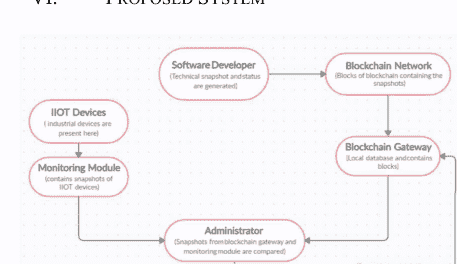

# 2021 第二届智能工程与管理国际会议 (ICIEM) (英国伦敦 2021.4.28-2021.4.30)

## 作者信息

**Rushika Ramane**  
信息技术  
A P Shah 技术学院 (A P Shah Institute of Technology)  
印度，塔内  
`rushikaramane@apsit.edu`

**Rujuta Patole**  
信息技术  
A P Shah 技术学院 (A P Shah Institute of Technology)  
印度，塔内  
`rutajapatole@apsit.edu`

**Soundarya Nevrekar**  
信息技术  
A P Shah 技术学院 (A P Shah Institute of Technology)  
印度，塔内  
`soundaryanevrekar@apsit.edu`

**Aneha Ahar 教授**  
信息技术  
A P Shah 技术学院 (A P Shah Institute of Technology)  
印度，塔内  
`anher@apsit.edu`

**Neha Deshmukh 教授**  
信息技术  
A P Shah 技术学院 (A P Shah Institute of Technology)  
印度，塔内  
`pdeshmukh@apsit.edu`

## 摘要

我们被昂贵的 IoT（物联网）和智能型设备所包围。这些设备旨在让生活更简单、更灵活。区块链创新对于识别和承认营利性项目中的威胁尤为必要。一种共享记录是由每笔交易创建的信息历史，以及在不需要外部监督的情况下管理资源的能力。从集成网络下载设置的设备需要信任电力，并且一旦被识别和保护，就不再需要审计。设备可以直接识别来自外部的威胁。区块链在业务网络中的一个优势是建立可以维护的信任社区，这可以扩展设备维护的效率和安全性。区块链的核心组件——不可篡改性，保护所有内容免受未经授权的更改。设备配置的整个历史都被记录下来，因此经常发生有效检测。监控工作组织设备以及交互的设备网络威胁和访问任务。设备的完整性和安全性应通过对组织状况进行广泛审查来遵循。本文阐述了区块链创新，并通过在区块链中实施设备配置的基于创新的控制网络设备提供数据。我们解决方案的关键性是使用区块链为大型企业网络循环 IoT 设备配置文档。这极大地改进了区块链中配置的安全性和能力方案。

IoT 工具已完全准备支持生产组织（例如，获取产品不同阶段的深度分析，提高性能并获得价格折扣）。IoT 设备的最主要吸引力在于它们提高了安全性、耐用性和能源效率。这些设备通过数据分析和控制收集实时或连续数据。随着设备数量的增加，网络威胁也随之增加。关键基础设施上的网络威胁可以得到有效管理。

在本文，我们提出了一种基于区块链的方案用于监控 IoT 设备的状况。该方法旨在观察 IoT 实现的软件解决方案，以识别和承认未定义的软件操作（例如，漏洞）。软件收集数据并存储在箱和数据库中。为了确保软件运行，我们使用区块链，因为分布式记录保持了供应状态。对安全可用性的评估表明，

**关键词**——区块链、工业物联网、安全、监控

## I. 引言

如今最关注的两个问题是区块链和物联网（IoT）。区块链和物联网的关注点和前景在于在不同领域开发不同的应用。区块链技术在每个网络中维护一个分布式且一致的账本，无需第三方。

## II. 文献综述

### A. BoSMoS

名为《工业物联网中防御未经授权软件更新的基于区块链的状态监控系统》(2020) [3](https://example.com/3) 的论文由 Wei, Wei Jian, Kim-Kwang, Raymond Chao 发表：每个共识证明都需要通过节点验证区块，以确认某些工作已完成并对结果进行说明。该任务通常是复杂的操作，涉及计算以在将区块添加到区块链之前获得正确答案。这实际上由矿工执行，并对权益证明共识中的计算能力有要求，节点要求它们在区块链上持有权益，并明确批准新区块加入区块链。上述内容由区块链内部的权益持有者无意实现，在计算能力方面并不一定是资源密集型的。

- **优点**：账本将作为业务的记录——交易（资产转移）和合约（交易发生的条件）
- **缺点**：整个系统可能会发生故障，通信可能会中断。

### B. Tornado

名为《异构物联网中启用区块链：一种空间结构化方法》(2020) [2](https://example.com/2) 的论文由 Yiniao Liu, Kun Wan, Kai Gao, Miao Du 和 Song Guo 发表。

- **优点**：它通过提供数据共享、隐私保护数据聚合和机密性等优势，有助于增强 IoT 系统的完整性。

物联网在医疗保健、工业制造等知名领域有很多用途。通常，这种技术被用于与安全、授权和认证相关的深度应用。上述中心化方法可能会受到拒绝服务攻击，导致 IoT 网络崩溃。将区块链开发为存储在点对点 (P2P) 网络中的只添加数据库，可以确保数据隐私和可扩展性。即使在 IoT 中使用区块链，仍然有很多无法完全消除的担忧。为了解决这些问题，开发了具有空间账本架构的区块链系统 Tornado 以启用 IoT 中的区块链。我们使用了协作算法以及名为空间结构化和贪婪权重观测子树 (S2Ghost) 的协议。该协议确保数据和设备的唯一性。

- **缺点**：单点故障、女巫攻击和数据篡改。

当区块链继续扩展时，应该讨论多个问题。这将使区块链不仅是可扩展和高效的，而且更加强大。它们包含的特征是可以独立接受的，无论识别这些特征的人多数是谁。尽管如此，所有这些特征的结合使其非常适用于许多人感兴趣的应用。

### C. 迈向安全物联网

名为《迈向安全物联网：基于信誉共识机制的区块链系统》(2019) [3](https://example.com/3) 的论文由 Junjie Huang, Hong Long, Guihai Chen, Min-You Wu, Xue Liu, Peng Zeng 发表。

- **优点**：增强与合作伙伴、客户、供应商的连接。
- **缺点**：不同的方法论，并行工作流。

防御恶意攻击但与隐私和透明度相关的问题是，收集的数据是敏感的，只能由授权用户查看。最近，区块链高并发和低吞吐量的担忧受到各种机制的限制。为了处理所有这些问题，开发了一种基于信誉机制的 IoT 区块链系统。该协议解决了上述三个主要问题，提出了通用、可扩展且安全的基于区块链的 PoW 机制以及适用于功率受限 IoT 设备的足够的访问控制系统。

## III. 目标

### A. 准确性

为了确保监控模块的准确性，错误的负值和正值会对整个网络产生严重影响。

### B. 监控

监控模块旨在识别目标程序当前状态的变化并向终端管理员报警。

### C. 稳健性

为了确保与该节点交互的其他节点是真实的，其他节点确认该节点的请求并对信任区块请求意图。

### D. 可扩展性

为了允许大量节点连接或退出网络，且它们的存在和行为会导致网络内部产生差异。

## IV. 现有系统

部署物联网（IoT）的企业所采取的现有安全措施包括：

### A. 风险评估模型

在安装和运行物联网系统之前，应该采用风险评估模型来识别所有需要保护的数字和物理组件。通过漏洞和风险评估，所有组件都应被发现并被归类为可接受或不可接受。风险评估应每年进行一次，并进行定期审查。

### B. 分段

物联网系统应被分为具有共同安全要求的子系统，并相互隔离。通过防火墙、访问控制列表（ACL）等限制并保护信息流和访问。

### C. 设备完整性与可用性

使用 CIA 模型，对分类为关键的设备和组件通过提供为其支持的机制进行保护。

### D. 加密

物联网系统必须采用加密协议和高级加密形式。目前使用的许多工业协议在设计时并未考虑安全性，且缺乏授权和加密功能。数据在静态存储和传输过程中均面临风险。

### E. 隐私

需要通过广泛使用的安全协议确保机密数据的加密，以确保传输和存储过程中的隐私性。

## V. 问题陈述

导致敏感数据或资金的损失。由于物联网网络的复杂性，目前采取的安全措施并不十分有效。

工业物联网（IIoT）遭受网络攻击的威胁并非假设，因为黑客已经部署了恶意软件来利用连接的传感器并获取网络访问权限。在全球范围内，工业面临着基础设施的关键威胁，因为存在未经授权的破坏、损坏或破坏系统的意图。工业运营被迫关闭。使用了名为木马的恶意软件，这是一种新型木马。Powdos 攻击来自俄罗斯、美国、伊朗、朝鲜和以色列组织。根据 FBI 和美国国土安全部（DHS）的说法，来自水务、航空和制造业的许多行业面临着数据被盗窃的风险。

尽管如此，思科传感器、IBM 公司、英特尔公司等市场上的许多公司希望连接数百万物联网设备以分析和运营业务流程。通过利用物联网设备，可以提供作为服务的产品。然而，要实现这一目标，必须消除所有威胁和漏洞，创建一个不可破解的敏捷网络。

我们打算通过创建一个使用区块链技术的可靠产品来实现此。我们的目标是通过持续监控活动并确保程序按预期执行，保护小型行业在常规计划操作中遭遇灾难。

## VI. 提议系统

通过观察其状态，该产品具有应用价值。程序状态包含计算机程序判断数据以及对程序至关重要的数据。通过比较可靠的程序状态，设备可以判断程序状态并在状态变化时向管理员发出报警。该项目的基本组件将是：

### A. 软件开发者

软件开发者创建可靠的程序化状态快照，每个都维护一个区块链。如果出现未授权的版本或程序更改，则必须获取状态快照。快照连同包和发布密钥应通过开发者的私钥广播在区块链组织上。

### B. 区块链网络

用于将程序特定的状态快照存储为受信任的去中心化分布式数据库。它集成了所有网关和区块链节点。网络由全节点管理，并通过 P2P 连接通信。快照在区块链组织内不会被更改，并遵循相应的源。

### C. 区块链网关

对于物联网设备，它们提供信息并对区块做出响应。它们支持物联网设备从区块链获取可靠信息。它们不创建新区块，而是进行激活、检查和处理。

### D. IIoT 设备

关键跟踪使得 IIoT 成为所有设备（包括区块链门户和节点）观察模块。在任何情况下，物联网设备都不会通过其他节点连接到区块链网络。它们不持有区块链记录，但共享相同的哈希值。信息从区块链网关获取。

### E. 监控模块

通过比较网关预测和网络变化记录来选择程序状态。结果将由管理员终端提交，它将阻止匿名程序。

### F. 管理员

管理员数据获取所有物联网设备、区块链网关和总节点的实时状态信息。

## VII. 结论与未来工作

该项目旨在为物联网设备开辟道路，利用区块链技术实现从远程传感到 AI 系统信息传输的工业级准确性。通过利用已知数据的稳定可靠性，物联网网络可以在应用层面得到解决。因此，开发了一种支持区块链的轻量且有效的通信协议。本文讨论了区块链应用中的挑战，以及研究区块链如何改进物联网的最合适方法。

未来的扩展包括计划为该方案设计共识算法并部署增强型框架。研究了基于区块链的框架中的传感器数据质量控制点。为物联网设备（特别是足够的机器）实施激励机制将有助于增强账本管理的效能。预见了一个可以处理大量数据的大规模协作世界。

## 参考文献

- [1] S. He, W. R., T. Zhan and K. R., “IoTMS: A Blockchain-Based System Monitoring for Device Authentication Upgrading and Implementation in IoT Things,” IEEE Journal of IoT Things, Feb 2020
- [2] Y. Liu, J. Qin, M. Du and S. Guo, "Tornado Blockchain in Heterogeneous of IoT Things Through a Structured Approach," in IEEE Journal of IoT Things, Feb 2020
- [3] J. Huang, K. Gong, G. Chen, M. Wei and Y. Zhao, “Secure Blockchain System with Credit-Based Consensus,” in IEEE International Conference on Information Technology, Informatics, 2019
- [4] M. Thompson, E. Fisher, and F. Richard, “History of Industrial Control System Cyber Incidents. United States: N. p., 2018
- [5] A. Zamani, M. Bakri, S. Zakari, M. Zaki and Zulkifli, M. Hamid, Norouhei and and Radical, (2019). Technical Development: Prospect and Implementation for Cybersecurity. International Journal of Computer Science and Engineering, 7(11)
- [14] H. Feng, Fu, 物联网隐私与安全的近期发展研究，收录于2010年国际网络信息系统与挖掘国际会议 (WISM)，三亚, 2010
- [15] R.H. Weber, 物联网 - 新的安保与隐私挑战，Comput. Law Secur. Rev. 26 (1) (2010)
- [16] R. Roman, J. Zhou, J. Lopez, 分布式物联网安全与隐私的特征及挑战，Comput. Networks 57 (10) (2013)
