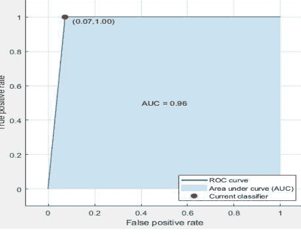
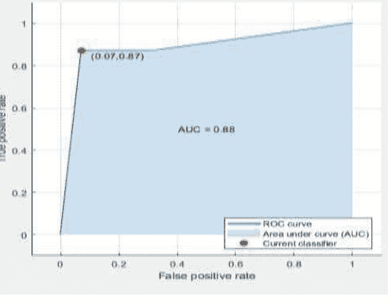
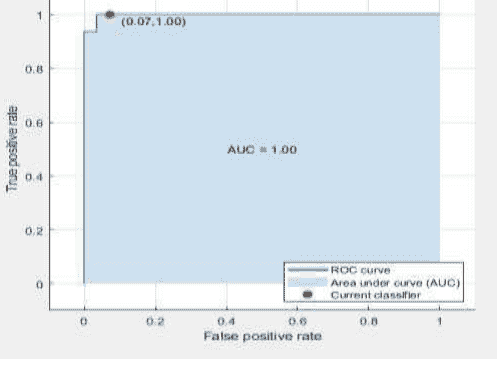
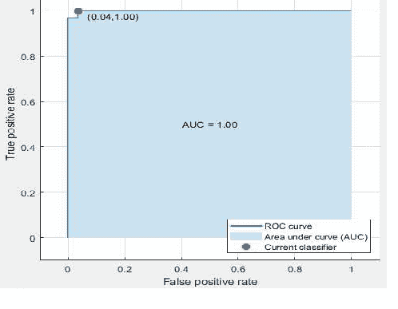
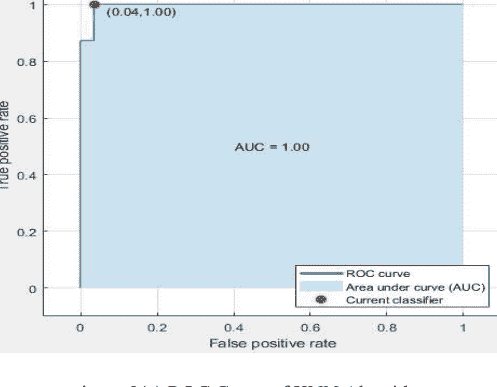
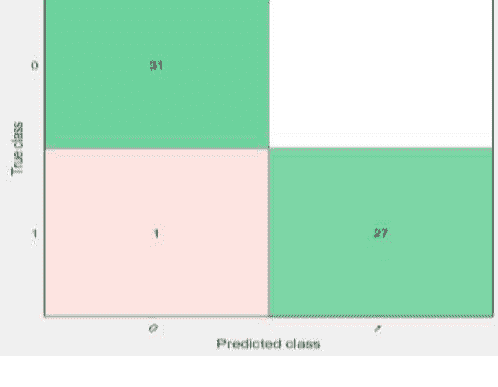
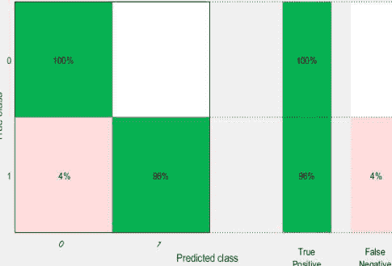
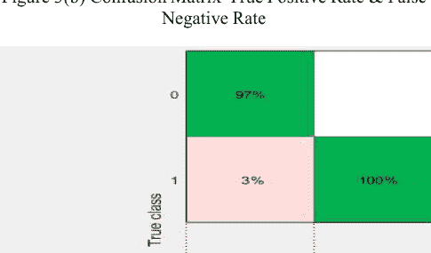

# 2021 第三届国际信号处理与通信会议 (ICPSC) (印度哥大培尔 2021.5.13-2021.5.14)

**Senthil Kumar K**  
电子与通信系  
Rajalakshmi 理工学院，泰米纳德邦，印度  
`senthil.kumar.k2@ritchenmai.edu`

**Kavethanjali V**  
电子与通信系  
Rajalakshmi 理工学院，泰米纳德邦，印度  
`kavethanjali.v.2017@ritchenmai.edu`

**Preethi S**  
电子与通信系  
Rajalakshmi 理工学院，泰米纳德邦，印度  
`preethi.s.2017@ritchenmai.edu`

**Vasanthriya V**  
电子与通信系  
Rajalakshmi 理工学院，泰米纳德邦，印度  
`vasanthriya.v.2017@ritchenmai.edu`

## 摘要

本研究展示了准确率达 98.30% 的胸膜分类识别。为了评估机器学习算法的有效性，将其分为来自肺癌诊断数据集中患者的临床和健康数据。我们根据患者健康数据开发并测试了多种与肺疾病相关的机器学习算法，旨在引导患者进行早期或早期检测方案。在不同参数下进行操作并实现了相应的成功水平。测试了多种算法以实现约 98.30 的成功率。在所认可的算法中，`线性判别分析`（Linear Discriminant Analysis）提供了最有效的隔离过程。

**关键词：** 胸膜检测，机器学习与对比分析。

## I. 引言

肺癌是由人体内正常细胞的异常生长引起的。癌细胞在肺组织内不正常生长，它们会破裂并迅速生长在肌肉中。随着肿瘤生长并损伤向血液供应氧气的组织，它似乎并没有扩散。胸膜属于淋巴系统，通过淋巴结和胸腔释放淋巴液。肺部的正常淋巴结位于胸部中心，肺癌经常扩散至此。肺癌分为两大类：非小细胞癌和小细胞癌。根据其特征，它们被分为特定类型的肺癌。根据分类，肺癌有四种：I、II、III 和 IV。肿瘤的大小、位置和方位被用于评估测量。最具致命性的危险组织通过血液或淋巴系统扩散全身。

- 约 235,700 例肺癌病例（男性 119,600 例，女性 116,660 例）
- 约肺癌死亡人数（男性 69,410 人，女性 62,470 人）

这些数据基于 2016 年至 2021 年间诊断为 NSCLC 的人群。

### 非小细胞肺癌 5 年相对生存率表

| SEER 阶段 | 5 年相对生存率 |
| :--- | :--- |
| 局部 | 63% |
| 区域 | 35% |

## II. 数据集

本研究使用了一组肺癌数据。在数据集中，使用参数来定义输入数据。预期结果（如释放）可能预测输入数据的肺-胸膜癌，并以不同程度的精度进行估计。预测值为：年龄、吸烟、区域、酒精。这些值通过预处理获得，数据被分为训练和测试集。

## III. 提出的方法

本文所提方法的主要目的是通过机器学习算法提高肺-胸膜癌分期的准确性。

1.  `逻辑回归算法`
2.  `支持向量机算法`
3.  `决策树分类器`
4.  `K-近邻算法`
5.  `线性判别分析`

### A. 逻辑回归算法

逻辑回归理论可用于解决二分类问题。`Sigmoid 函数`（也称为激活函数）是一个 S 型曲线，它可以根据实值在 0 到 1 之间变化，但并不直接限于这些范围。逻辑函数有助于我们确定对数几率（log or issues），被用于衡量概率。逻辑回归对默认类的概率（即输入 `X` 属于默认类的概率）`$P(X) = P(Y = 1 | X)$`。将逻辑回归应用于研究的数据，准确率为 96.61%。

### B. 支持向量机

`支持向量机`（SVM）是一种快速且可靠的分类算法，在有限数据量的情况下优于其他算法。此外，损失是一种可以寻找分割点的方法。SVM 的学习问题对应于高维输入和标量输出 `y` 的某些未知且非线性依赖（映射函数）`$y=f(x)$`。由于没有关于概率函数的信息，因此可以学习一种特征分布。`$D(x,y) = X^T Y$`，其中 `t` 代表训练数据对，且等于训练数据大小 `D`，此外，它被添加到 `d_i` 中，其中 `d_i` 代表（目标）值。支持向量机应用于研究的数据，准确率为 96.61%。

### C. 决策树分类器

决策树的目的是通过基于一组数据表示决策规则，来测试一组数据规则或问题以预测目标变量的值。决策树的目的是提取信息。通过条件 4 中的 `H` 方法计算熵。`$Entropy(H)$` 是数据集 `S` 内的不确定性程度，`S` 是正在计算熵的当前集合；`$C:[Gini]$` 是 `S` 中的类集合。work 是 `C` 中组件数量的结束。

张道青等人通过基于 [2] 的机器学习方法，从网络构建、特征学习和分类方法方面为疾病诊断提供了重要指导。

### D. K-近邻算法

`K-近邻算法`在数据上的成功率取决于其 `K` 个最近邻点。在认可的算法中，其实现了成功率约为 88.30。

### E. 线性判别分析

`线性判别分析`应用于研究的数据，准确率为 98.30。

## 结果分析

### 逻辑回归分类

### 决策树分类

### 支持向量机分类

### 线性判别分析

### KNN 分类器

### 线性判别分析的混淆矩阵

在分类中，首选 `线性判别分析`，因为它是一种降维技术。LDA 的作用是将特征投影到高维空间，以避免维度灾难和维度成本。此任务可以扩展到使用具有不同特征的大量数据提高各种机器学习算法的性能。

## 所提方法的准确率对比分析

| 方法 | 准确率 |
| :--- | :--- |
| 逻辑回归 | 96.61% |
| 支持向量机 | 96.61% |
| 决策树 | 89.93% |
| K近邻算法 | 88.30% |
| 线性判别分析 | 98.30% |

*图 4 所提方法的准确率对比分析*

## IV. 结论

本工作使用了特征选择分离的机器学习算法。该方法能够以 98.30% 的准确率完全消除癌症诊断误差。根据工作...

## 参考文献

- [1] Z. Pan, J. Zhang, S. Yan, “Machine learning methods for classification for TCM clinical data,” *Computer Engineering & Applications*, 2017; https://doi.org/10.1149/3297516.32997274.
- [2] D. Zhang, B. Jie, “Machine-learning based brain network analysis: method and application [J],” *Journal of Data*, 2018; 10(4): 1742-1769.
- [3] S. Singh, R. Vijay and Y. Singh, “Artificial Neural Network and Cancer Detection, National Conference on Advances in Engineering, Technology & Management [AETM],” pp. 24-25, 2018.
- [4] Kashmir Prasad and Priyanka Chawla, “Medical insights of using machine learning algorithms for cancer detection,” doi: 10.1080/23370202.2020.1812789.
- [5] B. Mani, V. Athira, Adil Rajendra, “Efficient multi-level cancer lung prediction model using support vector machine classifier,” doi: 10.1088/1757-899X/012/1/0121104.
- [6] Gustavo Perez and Pablo Arbelaz, “Automated lung cancer diagnosis using three-dimensional convolutional neural networks,” doi: 10.1109/ICCA75515.2019.8811552.
- [7] L. Tafadrez et al., “Deep learning classification of lung cancer histology using CT images,” doi: 10.1038/s41598-018-24460-6.
- [8] Joseph A. Criz, S. David, “Applications of Machine Learning in Cancer Detection and Prediction,” *IEM*, 1948: 5537-5548.
- [9] M. Sangeetha, S. Mith own, “Detection and classification of Lung Tumor by Convolutional Neural Network,” 10.1016/j.joccs.2017.01.004.
- [10] Tanaka S, “Recent advances in cancer detection using machine learning: Systematic review of datasets, challenges, and prospects,” doi: 10.1016/j.asoc.2020.06.033.
- [11] Ajay Keto, Ramnath Sethi, Feiraj, Sonyarajan, Seth, Kumar, et al., Lyon, France: International Association for Cancer Research and Science, 2013; Global IARC 2012: 1-6.
- [12] W.D. Sunil, Indian Council of Medical Research; National Cancer Registry, Year 3 Report of Population Based Registries 2009-2011; available from: http://www.ncrindia.org
- [13] Dev Neuisari et al., “Application of Recurrent Neural Network for Cancer Classification,” *Methods in Molecular Biology*, 2021.
- [14] F. Smith, “World Health Organization, The Global Burden of Disease, Global Health Organization, 2018.
- [15] S. Kalisani, Pramit Chatterjee, “Cancer Detection using Digital Image Processing and Artificial Neural Network,”
- [16] Marwal, 2017, “Analysis of machine learning methods in Using Convolutional Neural Network,” W-IMCK Workshop Mahabharata, India.
- [17] R. Pooja, Richard D and Anuradha Thakur, 2017, “Detection of Lung Cancer Stages using Image Processing and Data Classification,”
