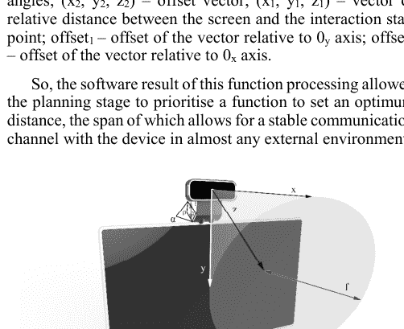
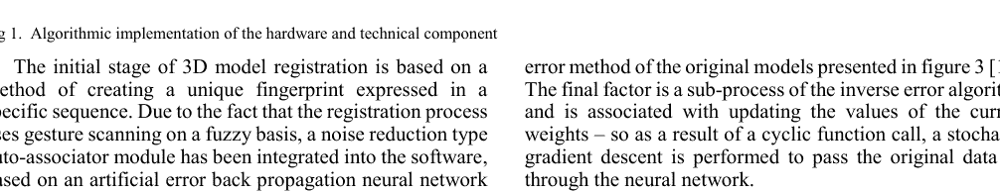
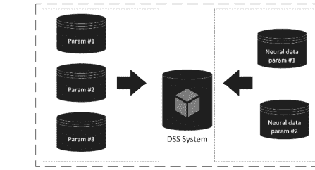
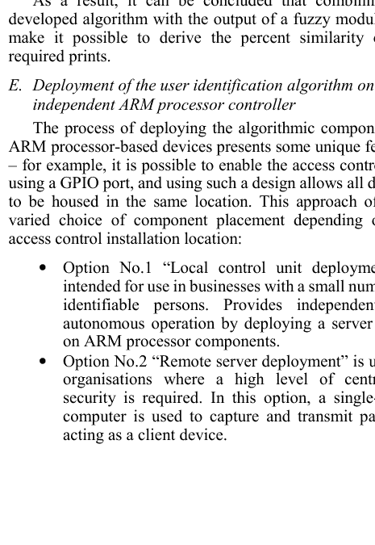
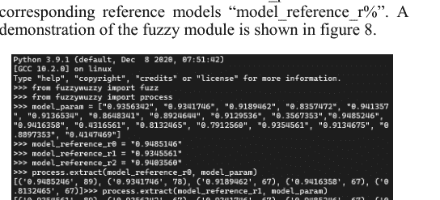

# 2021第三届国际无线电子、电气与电力工程青年会议 (REEPE) (俄罗斯莫斯科 2021.3.11-2021.3.13) 2021第三届国际无线电子


**摘要 —** 本文介绍了一种通过 Leap Motion 控制和神经网络模块实现非接触式识别的软件产品，旨在提高关键地点的安全性。作者展示了用于双因素身份认证识别的数值序列生成研究，以及用于识别模式的预测性手部模型。可识别指纹的过程基于一种支持系统——通过模糊规则，识别的可访问百分比系数经过优化以适用于基于 ARM 处理器的设备——该设备在远程进行按需认证，从而服务于多种身份验证工作和离线模式。

这允许第三方未经授权访问系统 [3]。在研究中小企业全功能访问控制不当的问题时，发现另一个替代问题通常是缺乏准备的。在考虑基于生物识别数据验证方法的访问控制系统时，可以发现类似的问题：在没有支持系统的情况下进行生物识别数据的初始注册。

**关键词 —** 访问控制系统、身份验证算法、自关联器、数据集、深度学习神经网络、安全

# I. 引言

信息安全（INFO）是关键设施的优先考虑事项。信息安全的本质是一个复杂的层次系统，涉及对研究过程的益处以及进一步保护潜在漏洞地点的流程的考虑。组织可以通过集成生物识别认证和访问管理系统（ACS）来实施安全流程。基于主体身份验证验证和身份验证应用的访问控制系统，可以基于光学检查或密码检查方法，也可以基于用户的生物识别数据——[1]。可以集成到 ACS 中的主要功能包括：

因此，在计划实施的系统期间，满足了系统应具备的主要标准。系统应根据授予一次性访问的益处，为组织成员等人员提供授权访问，而软件提供了对系统中所有主体的完整控制。系统实施中的一个重要因素是长时间内（可能随后的活动状态）的自主性。该软件解决方案提供了一种通过动态序列进行认证的方法，该方法通过 Leap Motion 控制以非接触方式执行。因此，该实施降低了组织安全的身份验证系统风险。同时，身份验证方法的控制增加了安全性。
- 基于专门算法的有序模块中管理执行的设备；
- 支持照片和视频录制并具有将图像广播到目标网络的能力；
- 控制主体身份验证，并根据相关模型的益处进行决策。

现有的身份验证解决方案基于组织单元的注册。此类系统的主要问题是对于临时主体的访问方法效率低下。其他方面，基于 PIN 的识别系统使用与特定账户关联的静态密码，但

# II. 主要算法

根据本节提出的任务，定义了软件主要的硬件和软件需求。使用基于 ARM 处理器的设备来提供硬件支持，以降低产品发布和软件的成本，并配有 LCD 显示模块和用于应用程序的专用手部识别控制 [4–6]——使用树莓派板作为底层硬件设备。

图 1 所示的算法实现通常分为主模块，这些模块处理复杂系统中技术组件的并行顺序。所实现的算法由以下模块的顺序执行表示：
- 识别原始数据并精炼参数——通过自关联器将精炼过程中的模型输入参数注册为结构化序列；
- • “生成中间序列并执行 I/O 工具”——通过与神经网络生成的时间序列交互，执行神经网络输出参数的转换；
- • “验证可识别指纹”是一个决策支持系统（DSS）模块，负责执行序列与生成序列之间一致性的性能分析；
- • “预测性身份验证方法”是一种在系统开发期间基于输入样本展示来扩展功能的方法。

“LeapInterpolate(frame)”。此函数允许在两个连续的可变帧之间固定一帧，额外的时同步算法允许更平滑的插值。因此，该函数执行单幅图像，并作为神经网络的输入值。

此外，Leap API 包含一个模块，将 32 位 64x64 网格映射到由 [x, y] 坐标表示的输入像素亮度，但其使用均在 ARM 处理器上处理。

软件实现中插值的通用算法如下：
1. 应用程序与 Leap 时钟之间的时间同步。
2. 将目标帧翻译为 Leap 时间戳。
3. 分配所需的内存来存储当前时间的帧。
4. 请求当前时间的帧。

鉴于预测模型识别的存在，该模块的算法实现被实现为沿每个中间序列模块（编号 2）的并行处理过程——

## A. 编码和定义 3D 模型参数的模型

初始参数注册基于在体积空间对手部模型进行建模。作为该项目实施的一部分，该函数使用手部模型作为触发器来激活特定函数，例如输入或确认。该系统的另一个特征通常依赖于硬件，通过手势通过 Leap Motion 追踪层接口实现。使用适当函数通过 Leap 获取手部的单色图像。输入控制器与专用设置库（SDK）、Leap 库通信。

数据跟踪通过捕获 Leap 服务的单帧进行。序列分析每一帧，然后确定“目标对象”、取向和运动的存在。软件实现基于多个模型的比较分析——前一帧和用于生成的受限模型。结构执行当前时间跟踪数据的快照。每个后续帧的合成过程基于插值 [1]。如果两帧之间的时间最小，则将两帧数据插值为单帧；否则，如果时间差超过有效值，则对可用帧进行外推插值。外推减少了插值过程中帧变化的延迟，避免了处理过程中的伪影。因此，分析确认在相关函数中集成神经网络将提高自关联外推的准确百分比。

```
((cos*y + offset, sin*y + cos*x + offset) - x)^2 +
F = ((sin*y + offset, cos*y + cos*x + offset) - y)^2
((sin*beta + offset) - y)^2
```

软件开发中使用的“LEAP TRACKING EVENT”结构的主要功能是



图 2. 三维空间中的算法计算


### 模块«3D 模型输入参数的识别与精炼»

### 模块«中间序列的生成与输入输出设施的处理»

- 识别区域的优化
- 模式主数组的确定
- 多种神经网络输出参数的适配
- 通过 CNN 获取唯一模式
- 通过自关联器进行模式识别
- 3D 模型作为神经网络的输入参数

### 子模块«唯一标识符的生成»

- 基于静态指标生成动态 2FA 标识符
- 汇总为单一序列

### 模块«预测识别与自动识别方法»

### 模块«通过 DSS 进行可识别指纹验证»

- 将标识符样本注册为唯一标识符
- 与现有样本进行标识符验证
- 定义 CNN 系统输出通道并呈现为动态 2FA 统计比较
- 在模糊模块中处理 3D 模型
- 3D 初始注册
- 通过模糊模型对指纹精度进行分析比较
- 注册录入 ID
- 在技术模块中得出结果
- 调用 2 号模块
- 调用 2 号模块
- 数据库注册



3D 模型注册的初始阶段基于一种在特定序列中表示唯一指纹的方法。由于注册过程使用了基于模糊基础的手势扫描，软件中集成了基于人工误差反传播神经网络的降噪自关联模型 [10–11]。如图 3 所示，一组并非基于神经网络的手势并基于神经网络进行了精炼。

图 3 所示的原始模型的误差方法 [12]。最终因子是反反向误差算法的子逆，并根据当前循环函数的值进行更新——作为循环函数的结果，随机梯度下降执行以使原始数据集通过神经网络。

```
h = f(W * b),
```

其中 h 为待编码输入；W 为输入权重；b 为偏移参数。可积自关联器通过在输入中引入噪声，具有去处基础层原始数据噪声的可能，使得基本误差计算函数由公式 3 表示，该函数作为基于交叉熵损失的位向量应用（公式 4）。

```
L = x' - f(m(x)),
```

L–目标误差；x–输入数据；m(x)–的函数。

```
L = x'log(m(x)) + (1-x)log(m(x)),
```


在这种情况下，自关联器通过在输入中引入噪声，具有去处基础层原始数据噪声的可能，使得基本误差计算函数由公式 3 表示，该函数作为基于交叉熵损失的位向量应用（公式 4）。

3D 模型注册的初始阶段基于一种在特定序列中表示唯一指纹的方法。由于注册过程使用了基于模糊基础的手势扫描，软件中集成了基于人工误差反传播神经网络的降噪自关联模型 [10–11]。如图 3 所示，一组并非基于神经网络的手势并基于神经网络进行了精炼。

图 3 所示的原始模型的误差方法 [12]。最终因子是反反向误差算法的子逆，并根据当前循环函数的值进行更新——作为循环函数的结果，随机梯度下降执行以使原始数据集通过神经网络。

| 模型: 输出 | 大小 |
| :--- | :--- |
| 输入 (类型) | 无 |
| 输入 (无) | 无, 64 |
| 解码器 (无) | 无, 64 |
| 总参数 | 0 |

3D 模型注册的初始阶段基于一种在特定序列中表示唯一指纹的方法。由于注册过程使用了基于模糊基础的手势扫描，软件中集成了基于人工误差反传播神经网络的降噪自关联模型 [10–11]。如图 3 所示，一组并非基于神经网络的手势并基于神经网络进行了精炼。

图 3 所示的原始模型的误差方法 [12]。最终因子是反反向误差算法的子逆，并根据当前循环函数的值进行更新——作为循环函数的结果，随机梯度下降执行以使原始数据集通过神经网络。

3D 模型注册的初始阶段基于一种在特定序列中表示唯一指纹的方法。由于注册过程使用了基于模糊基础的手势扫描，软件中集成了基于人工误差反传播神经网络的降噪自关联模型 [10–11]。如图 3 所示，一组并非基于神经网络的手势并基于神经网络进行了精炼。

3D 模型注册的初始阶段基于一种在特定序列中表示唯一指纹的方法。由于注册过程使用了基于模糊基础的手势扫描，软件中集成了基于人工误差反传播神经网络的降噪自关联模型 [10–11]。如图 3 所示，一组并非基于神经网络的手势并基于神经网络进行了精炼。

3D 模型注册的初始阶段基于一种在特定序列中表示唯一指纹的方法。由于注册过程使用了基于模糊基础的手势扫描，软件中集成了基于人工误差反传播神经网络的降噪自关联模型 [10–11]。如图 3 所示，一组并非基于神经网络的手势并基于神经网络进行了精炼。

3D 模型注册的初始阶段基于一种在特定序列中表示唯一指纹的方法。由于注册过程使用了基于模糊基础的手势扫描，软件中集成了基于人工误差反传播神经网络的降噪自关联模型 [10–11]。如图 3 所示，一组并非基于神经网络的手势并基于神经网络进行了精炼。

```
void getFingerOffset(float *param_offset[]) {
  if (hand.getHandIsed()) {
    int PVectorIndex = 0;
    hand.getRawPositionOffset(
      param_offset[0] = textIndex(tipIndex, 0, 1, 20);
      param_offset[1] = textIndex(tipIndex, 0, 1, 60);
      param_offset[2] = textIndex(tipIndex, 0, 1, 80);
    );
    hand.draw();
  }
}
```

3D 模型注册的初始阶段基于一种在特定序列中表示唯一指纹的方法。由于注册过程使用了基于模糊基础的手势扫描，软件中集成了基于人工误差反传播神经网络的降噪自关联模型 [10–11]。如图 3 所示，一组并非基于神经网络的手势并基于神经网络进行了精炼。

3D 模型注册的初始阶段基于一种在特定序列中表示唯一指纹的方法。由于注册过程使用了基于模糊基础的手势扫描，软件中集成了基于人工误差反传播神经网络的降噪自关联模型 [10–11]。如图 3 所示，一组并非基于神经网络的手势并基于神经网络进行了精炼。


识别网络。此功能使用额外的条件操作符，允许您定义什么是捕帧的触发器。

生成唯一标识符的子模块表示生成动态序列的过程，其长度限制在 [30, 55]。生成标识符的主要方法基于静态系统指示器的使用，它在第一台设备上作为发射器，以及根据 UTC 参考时间索引计算的动态 UTC。该方法实现的方案提供了在排除第三方冲突的情况下生成唯一序列的能力 [17]，作为设备服务器组件的唯一 ID。因此，下面的公式表示了唯一标识符的计算（公式 6）。

```
$T_i - T_j$
$MD_{5,ID_{sender}}$
```

TWO – FA($ID_{sender}$) = TIMEOUT (6)

其中 FA：上述函数生成的当前序列的唯一标识符；TIMEOUT：根据当前 UTC 时间索引计算的索引，作为 UTC 中的起始点；MD5：静态系统加密保护内容的哈希函数；ID:sender：用于获取设备服务器端唯一静态标识符的函数。

其中任一都是受限于静态 TIMEOUT 的 PIN，密钥的主要注册过程由服务器侧执行，通过输入 10 位序列或提供类似功能的二维码 来传输标识符。这种方法通过动态序列为身份验证提供了安全保障。

## C. 已识别指纹的验证模块

已识别指纹验证的软件模块通过生成的动态序列与参考当前时间之间的比较来实现。2FA 实现是 DSS 系统的单元部分，它将输出传递到双因子认证模块生成序列函数和参考时间。DSS 模块由块 3 和块 4 中的两个并行过程生成（图 6）。指纹验证通过对输入值进行验证产生，通过逐步检查神经网络序列的每个输出完成。另一个模块包含重构当前序列指纹的功能，用于模块 4。

决策块（模块 3）是一个根据 DSS 输出返回固定布尔值的函数，它负责执行后续操作——拒绝对目标对象的访问。因此，最终结果被用作程序未来工作的统计指标，并输入数据库中相应的表中。



## D. 预测识别与自动认证模块

预测识别模块是一个独立的功能，允许对指纹扫描的分析数据进行进一步处理，而无需输入 2fa 序列。该功能是一个额外模块，基于过程 2 和 4 的并行化——初始阶段的预测识别功能。在目标模型达到 95% 准确率之前，会识别最小数量的指纹。该功能的安全性基于待处理模式的准确性。

数据识别过程是基于定义一组手势进行的过程。在这种情况下，手势是唯一的，由于单个手势的序列代表一种模式，随后基于这些指纹进行比较和识别。

根据自动编码器的值，通过转换 DSS 的输入层来构建序列。使用神经网络输出的识别过程通过定义一组独立的手势完成。因此，作为网络的输出，在下游序列子模块中找到了一个唯一标识，从而导致模式的识别。如图 3 和图 4 所示。模式的捕捉使用“LeapInterpolate”帧位置完成——插值过程中的单帧是对象的单个模式。该模块的输出被重构并进入...

预测识别模块的软件模块与 Leap Motion 控制器的手势识别密切相关。该模块还基于手势识别激活函数“getPalmPosition”，该函数根据向量使用当前手部位置。因此，确定当前位置的过程是根据当前索引引用和手部位置向量长度执行的。在多值帧上确定手势的过程是在执行当前位置检查值的条件语句上完成的。如果位置发生变化，则记录当前位置和向量速度函数的前一个结果，当用于个性化手势检测函数时，它是基于 LCD 上的向量运动的。在多值帧上确定手势的过程是在执行当前位置检查值的条件语句上完成的。如果位置发生变化，则记录当前位置和向量速度函数的前一个结果，当用于个性化手势检测函数时，它是基于 LCD 上的向量运动的。...

数据识别过程是基于定义一组手势进行的过程。在这种情况下，手势是唯一的，由于单个手势的序列代表一种模式，随后基于这些指纹进行比较和识别。

[注：提供的源码 OCR 文本似乎存在重复/中断，我已遵循所提供的原始文本流进行处理。]

## E. 用户识别算法在 ARM 处理器上的部署

在基于 ARM 的处理器上开发算法呈现出一些独特特征——例如，可以使用 GPIO 启用访问，这种设计允许所有设备处于相同状态。这种方法根据...提供了多种选择。



图 7 使用应用程序的交互过程

# III. 结果与讨论

如图所示，方案 1 是完全自主的，而方案 2 需要通过接口与 x-86 设备进行额外的控制和通信。使用 22v 继系统控制输入——控制信号通过该模块传输到目标控制器。

结果表明，安全实现系统的构建提供了灵活的硬件和软件，从而增加了安全性因素。

用于训练网络的神经网络基于 Core i7-10510 处理器和 Nvidia GTX 1650 Max-Q 设备。神经网络训练通过两个参数进行监控——准确率和损失率。神经网络的训练基于单手模型的模式，如表 1“准确率”训练实例所示。共提交了 100 秒作为训练样本。

| | 10 | 20 | 30 | 40 | 50 |
|---|---|---|---|---|---|
| 准确率, % | 0,862 | 0,878 | 0,878 | 0,884 | 0,891 |
| 模式, n | 60 | 70 | 90 | 100 | |
| 准确率, % | 0,905 | 0,912 | 0,923 | 0,935 | 0,942 |

表 I. 神经网络训练




图 8 模糊系统测试。

从这张图片中我们可以，使用“extractone”功能允许我们确定匹配与最佳模型的优劣程度；在出现显著偏差的情况下，百分比为 67% - 71%，而 78% 的设备显示百分比低于 87%。“extractone”功能允许我们选择匹配程度最高的单一模型。

因此，可以说，这种方法的集成通过大幅改变与参考模型相比的成功百分比，并据此做出决策，提升了性能。

# IV. 结论

文章介绍的软件产品使得识别主要安全系统的不足成为可能，并实现了系统的算法和软版本，在该系统中，身份验证通过 2FA 技术和基于算法的生物识别数据识别子模块共同完成。所实现的方法已显示出优于市场上现有系统的优势：能够进行真实学习，并通过预测性模式识别算法进行进一步的验证。

作者的模糊规则模型通过实施 DSS（决策支持系统）模块，实现了对缓存模式处理的集中管理：包括客户端/服务器模式的操作以及在远程服务器上处理数据的模式操作。

# 致谢

本报告的研究由 RFBR 根据研究项目 No.20-37-90062 资助。

- [1] L. Norman, Electronic Access Control, 2nd Ed., Oxford: Butterworth-Heinmann, 2017, pp. 17–46.
- [2] D. Duarte, J. P. Pimenho, G. Sousa and S. Onifo, "Biometric access control: on technologies to improve their efficiency," IEEE International Forum on Electronics and Control Conference (VCEC), 2016, pp. 795–800.
- [3] J. Smith, Transactive Cybersecurity Design Right The First Time, First Ed., New York: McGraw-Hill, 2018, pp. 225–233.
- [4] M. Hartley, Raspberry Pi: Gateway to the World with Embedded Linux, Hoboken: Wiley, 2016.
- [5] S. Stephens, Raspberry Pi Application Language Programming: A Reference Coding, 1st Ed, New York: 2019.
- [6] G. Davis, Deep Learning for Beginners: A Comprehensive Guide for Beginners and Intermediates to Master the Craft with Practical Projects, Independent Publishing, 2020.
- [7] S. Brandhurst, Learning Motion Capture, Kindle Ed., Birmingham: Pack Publishing, 2017.
- [8] S. Steig, Gesture Recognition using Leap Motion: A Machine-Learning Controller Interface, 2017.
- [9] H. T. Panduraya, Biometric Face Recognition Using Neural Networks, IEEE Conference on Research in Computing Applications (CIRCA), 2014.
- [10] N. Vahovský, G. Kovač, "Noise reduction by using acoustic networks," IEEE 13th Symposium on Neural Networks and Applications (Belgrade), 2012.
- [11] W. Zhou, Y. Chen, T. Yang, Deep Learning of Neural Networks (Systems in Computer Architecture, A.), Computer Science, 2008.
- [12] Y. Goldberg, G. Hirst, Neural Networks in Natural Language Processing (Systems on Human Languages and Machine Learning), Morgan Kaufmann, 2017.
- [13] J. Min, M. Ishaq, D. Bobkov, W. Xu, and J. El-Sheikh, "A Data Scientist's Guide to Machine Learning with Python," O'Reilly Media, 2019.
- [14] S. Vinta, Deep Learning using TensorFlow 2: Neural Development with Python, New York: Academic Press, 2020.
- [15] E. Kennedy, S. Foley, J. Horn, W. Vahovský, D. Mackin, and U. Smithlin, Introduction to Artificial Intelligence (5th Ed.), Wiley-Wesley, 2012, pp. 985–992.
- [16] M. Meerbeum, M. Ael, A Comparative Study Between Decision Support and Decision Support Systems, 2019.
- [17] M. Merritz, The Linux Programming Framework: A C and Command Handbook, 1st Ed., Sta No Press, 2015, pp. 18–53.
- [18] J. Taylor, Operating Systems Foundations with the Raspberry Pi, 1st Ed., US-American Media, 2019.
- [19] T. Cox, S. Raspberry Pi Cookbook: Hardware and Solutions, 3rd Ed, CA: O'Reilly Media, 2019, pp. 271–299.
- [20] T. Cox, Getting Started with Python for the Inventor: Leverage the full potential of Python to explore and build IoT projects with the Raspberry Pi, 1st Ed., UK: Packt Publishing, 2019.

