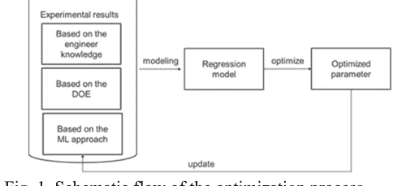
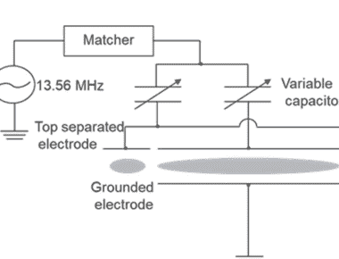
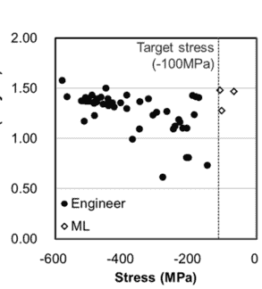
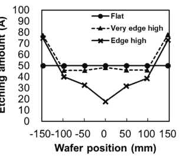
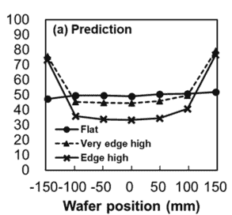
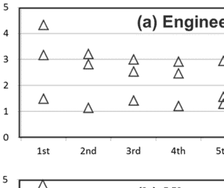
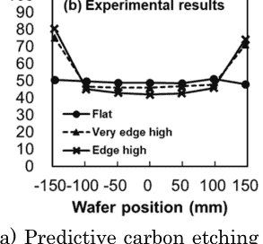

# 2021 第五届 IEEE 电子器件技术与制造会议 (EDTM) (中国成都 2021.4.8-2021.4.11)

**Tsuyoshi Moriya**  
东京电子有限公司，日本东京，`tsuyoshi.moriya@tel.com`

## 摘要

本研究旨在通过基于回归算法的机器学习（ML）优化半导体制造工艺。本文展示了通过对等离子体增强原子层沉积（PEALD）薄膜厚度不均匀性、PEALD 薄膜应力以及刻蚀轮廓进行优化，成功实现了其目标。

**关键词**：机器学习、等离子体处理、材料信息学

## 引言

在半导体制造中，多种调节控制手段用于控制工艺。由于这些工艺具有相关的复杂性以及调节参数之间的相关性，这些工艺的优化是一项严峻的挑战。机器学习作为参数优化的强大工具，其前景良好的特性近年来引起了工程师的关注 [1–6]。

所使用的机器学习技术基于用于优化的回归算法，特别是针对沉积工艺和等离子体分布控制旋钮，后者与晶圆内膜厚度的均匀性和刻蚀速率有关，这些都是半导体制造中的重要属性。

## 实验

本文采用的机器学习方法通过构建回归模型的算法来实现，将参数作为解释变量，将膜厚均匀性和刻蚀速率作为目标变量。模型的实验流程通过以下步骤实现：

1. 使用回归算法，通过数据集构建模型。初始数据集由实验设计（DOE）给出。
2. 找到满足目标变量输入目标值的参数组合，并将其模型输入优化算法中。
3. 优化参数组合输出，并将实验结果与优化值进行比较。
4. 将实验结果注册为新的学习数据集。

重复步骤 1–4 直到获得所需结果，如图 1 所示。通常情况下，优化过程从较小的数据集开始并随着数据的增加而改进。

这种机器学习方法实现了三个不同工艺的优化：PEALD SiO₂ 的膜厚不均匀性、PEALD SiO₂ 的膜应力以及调节分布的参数。

根据定义，膜厚不均匀性是指晶圆内 49 个点厚度的标准差（lr）。不均匀性旨在实现零目标值。基础工艺见文献 [7]。在实验中，在 Ar/O₂ 混合气体中以 450Hz 点燃了电容耦合等离子体（CCPs），并使用了 RF 功率持续时间和四种气体速率。

工艺优化由工程师和通过机器学习算法分别执行。在第四次迭代后，评估了均匀性和收敛程度。工程师在整个实验过程中没有参考机器学习方法，也没有机器学习数据库。在 PEALD SiO₂ 的膜应力优化期间，使用了 RF 功率、持续时间和四种气体速率，随后也使用了其他参数。在本研究中，膜应力范围从 –100 MPa 到零。

对控制工艺的工艺旋钮进行了优化。在这里，对轮廓进行了剖面分析，以控制厚度轮廓的起始取点，这是传统优化方法无法实现的。图 3 显示了目标轮廓，可以描述为平坦、极边缘高和边缘高。这些工艺通过制备的等离子体电极控制。图 2 显示了制备等离子体电极的实验装置。在 Ar/O₂ 混合气体中，频率为 13.56 MHz。此外，通过调整中心和外部（环形）电极各自电容来控制等离子体分布。

进行了两项实验以评估机器学习在工艺调节中的适用性：(a) 碳膜的等离子体刻蚀和 (b) SiO₂ 薄膜的 PEALD。在晶圆内的 49 个点测量了厚度轮廓，并对每个电极的 RF 功率、压力、气体流量和电容进行了调节。

在某些情况下，机器学习方法可以作为补充。例如，工程师可以参考机器学习方法的结果进行实验。一旦通过机器学习建议了关键参数，通过人类判断即可实现外推区域所需的目标。

## 结果

从根本上说，当工艺条件相似时，学习是可以转移的。因此，可以使用较容易获得的数据构建数据库。

### A. 膜厚不均匀性的优化

如前所述，晶圆内的 PEALD 膜厚不均匀性是由工程师和机器学习方法分别进行的。每种不均匀性的变化都归因于 DOE 的初始条件。机器学习方法每次尝试的不均匀性如图 4 所示。

PEALD 膜厚和应力的不均匀性、碳刻蚀和 PEALD 厚度轮廓通过机器学习方法得到了优化，并成功实现了其目标。即使数据库没有涵盖该目标，机器学习方法仍然有用，因为它探索了新工艺。工程师在五次尝试后未能解决不均匀性，而这些被机器学习方法有效地解决了。此外，机器学习方法在第二次尝试中的不均匀性范围为 0.7%。这些结果表明机器学习方法可以找到最佳条件并解决偏差。

### B. 应力优化

同样，应力优化也由工程师和机器学习方法执行，结果如图 5 所示。在 TiO₂ 均匀性优化中通过机器学习方法获得的条件被转移到这里。在根据工程师的知识对工艺进行 5 次优化后，工程师能够实现 -100 MPa 的目标应力。相比之下，机器学习方法创建的条件达到了目标应力。

### C. 轮廓优化

图 6 显示了碳刻蚀轮廓的结果，定义为等离子体刻蚀前后的膜厚度差异，具有三种轮廓。图 6 (a) 显示了通过学习模型预测的轮廓，(b) 显示了通过机器学习优化的实验结果。

这种趋势表明了工艺分布对 O₂ 流量的敏感性。机器学习方法将 O₂ 流量建议为调节起始位置的关键参数。图 7 显示了碳刻蚀工艺对 O₂ 流量的依赖性。

## 结论

## 参考文献

- [1] Y. Mo, S.-P. Ong, and G. Ceder, Chem. Mat., 24, no. 1, p. 15, 2012.
- [2] Y. Hinata, H. Hatakeyama, Y. Kumagai, L. Burton, H. Sano, Y. Muraba, H. Hiramatsu, I. Tanaka, and F. Oba, Nat. Commun., 7, 1192-1, 2016.
- [3] O. Sasai, C. Oses, T. Coher, E. Gossett, S. Sartalo, and A. Trohaft, Nat. Commun., 8, 1567, 2017.
- [4] C. Toher, C. Oses, and S. Sartalo, arXiv:1805.03509, 2018.
- [5] B. Sanchez-Lelneg and A. Aspuri-Guzik, Science, vol. 361, no. 6440, p. 360, 2018.
- [6] M. Chopra, Z. Zhang, J. Eker, and Roger T Bonner, in Proceedings of the SPIE 9781, 111, 2016.
- [7] S. Iwashita, N. Moriya, T. Tokuchi, M. Kagaya, N. Nero, and T. Hasegawa, J. Sci. Technol. A 36, p. 02155, 2018.
