# 2021 第5届国际计算方法论与通信会议 (ICCMC)

**M Arunadevi**  
机械工程教授  
DSCE, 班加罗  
arunadevi@gmail.com

**Praveen J Jadhav**  
机械工程博士读研究生  
DSCE, 班加罗  
praveenjadhav@gmail.com

**Ruchik, M.A**  
机械工程学生  
DSCE, 班加罗  
ruchik_m@yahoo.com

**Kishore Ghandhi, P**  
机械工程学生  
DSCE, 班加罗  
p.kishoreghandhi@gmail.com

**Siddhu, K.V**  
机械工程学生  
DSCE, 班加罗  
siddhuster100@gmail.com

**Vishnu Prasad, S**  
机械工程学生  
DSCE, 班加罗  
vishnuprasad@vinfmail.com

**摘要—** 机器人手臂的主要目标是实现预设任务的取向和终点。`Pioneer 2` 机械臂通过逆运动学分析获取设计手臂的解决方案。本文介绍了一种紧凑、轻量且低成本的 5 自由度机械臂。当机器人自由度（`DOF`）增加时，相同位置的逆运动学变得更加复杂且难以求解。这使得此类问题的标准解决方案变得棘手。为了克服 `Pioneer 2` 机器人逆运动学分析的复杂性，我们使用了机器学习技术（包括线性回归、`R`回归和 `KNN`）进行逆运动学计算。通过比较三种算法的 `R` 方值和 `RMSE`，发现 `KNN` 比其他算法能以更快的速度和更高的精度解决逆运动学问题。通过三次样条插值实现了平滑轨迹。

**关键词—** 运动学、`KNN`、`ANN`、回归、`Pioneer` 机械臂、机器学习、三次样条插值。

# I. 引言

工业机器人或自动化机器用于工业中需要高精度、灵活性和重复性的工艺，而人工劳动无法提供。机器人控制是机器人学的主要领域。对于正运动学，运动结果取决于使用三次插值方程的关节参数特定值。逆运动学则利用笛卡尔空间中的取向和关节变量来寻找关节空间中的关节值。

在论文 [1] 中，作者探索了用于六轴伺服且无法人工作业的机械臂。许多研究人员提出消除不同自由度中的误差。作者使用了 `ANFIS`、`PSO` 或 `DE` 技术来解决这些误差。通过优化机器人的工作函数使机器人做出更准确的决策。在 [2] 中，由于其具有高精度和良好的预测性，这些机器人被应用于军事和工业应用等主要领域。本文讨论了机器人运动学和动力学的改进。所提的研究区分了机器人运动中的关节空间和笛卡尔空间。在 [3] 中提到了使用优化算法来表示种群元素。因此，本文针对 `BGA` 中的问题提出了一种改进方案。在 [4] 中，作者提出了一种基于机器学习的轨迹规划方法，并展示了关于机器人架构、机器人运动生成、遗传算法和优化过程的结果。在论文 [5] 中，他们展示了关于反馈回路的结果和讨论。在 [6] 中，利用神经网络使用了机器人最佳关节角度的精度。使用 `KUKA` 实施的实验详细介绍了工业实现、机器人机械臂以及神经网络的预测器。在 [7] 中，主要目标是使用遗传算法（`GA`）减少基于网络的解决方案的均方误差。求解了 6 `PUMA` 机器人的正向和逆运动学。在 [8] 中，作者描述了机器人领域算法和场景的优化，并将方法与结果进行了比较。在 [9] 中解释了 5 自由度 `Pioneer` 的工作函数，其中包含了正运动学辅助运动学。在 [10] 中，作者证明了通过对逆运动学运动检测和引导可以求解正确的逆运动学。推出了机器人手臂逆运动学的解析解。在 [11] 中，由于不确定性、时间变化和超越方程，5 自由度冗余机械器的逆运动学方程求解存在困难。在 [12] 中，讨论了 `Pioneer 2` 机械臂的建模以及高自由度机械器的低效解决方案。在 [13] 中，通过迭代方法和平移旋转求解逆运动学。在 [14] 中，使用线性回归、人工神经网络和 `K` 近邻算法等机器学习技术进行属性预测。在 [15] 中，解释了设计用于各种应用的机器人运动学分析。5 自由度 `Pioneer` 机器人具有可调节轴、紧凑体积等优势，本文中对同一机器人机械臂进行了运动学分析。在 [17,18] 中，讨论了汽车制造工业中机器人机械臂的不同应用，包括：关节旋转、底座旋转、肩膀旋转、肘部旋转、腕部旋转、夹爪安装以及伺服电机驱动所有关节。

# II. 目标

为了克服 `Pioneer 2` 机器人运动学分析的计算复杂性，本文的目标是通过线性回归、`K` 近邻和人工神经网络等机器学习算法执行逆运动学的智能计算。

# III. 方法论

本文考虑了一种 5 自由度的 `Pioneer 2` 机械臂，当自由度为 3（高）或冗余时，逆运动学解将变得复杂。在本研究中，使用正运动学生成数据，通过机器学习模型预测关节变量，最后比较算法精度并选择最佳算法。

## A. 工作环境

图 1 显示了 5 自由度 `Pioneer 2` 机械臂的结构。图 2 是主要用于抓取和操作重量限制为 150 克轻物体（如易拉罐）的方法流程。

### 使用正运动学生成的数据

|  | $\theta_1(deg)$ | $\theta_2(deg)$ | $\theta_3(deg)$ | $\theta_4(deg)$ | $\theta_5(deg)$ | X(m) | Y(m) | Z(m) |
| :--- | :--- | :--- | :--- | :--- | :--- | :--- | :--- | :--- |
| 1 | -180 | -180 | -180 | -180 | -190 | 9.188E-15 | 150 | |
| 2 | -179.64 | -179.64 | -179.64 | -179.64 | -190.0011518 | 0.4768383 | 150.9110546 | |
| 3 | -179.28 | -179.28 | -179.28 | -179.28 | -190.004476 | 0.96039826 | 151.822059 | |

定义了不同的关节范围和常量以寻找逆运动学。

### 表 II. Pioneer 机器人的关节变量

| 关节 | $\theta_i(deg)$ | $d_i(mm)$ | $a_i(mm)$ | $\alpha_i(deg)$ |
| :--- | :--- | :--- | :--- | :--- |
| 0 | $\theta_1=180$ | $d_1=150$ | 0 | -90 |
| 2 | $\theta_2=180$ | | $a_2=145$ | 0 |
| 3 | $\theta_3=180$ | $d_3=125$ | 0 | -90 |
| 4 | $\theta_4=180$ | $d_5=130$ | 0 | 0 |

用于算法的数据集使用以下正运动学方程生成：

```
X = -c_1c_2 - s_1c_2c_3 - s_1s_2s_3c_4 - s_1s_2s_3c_4c_5 + c_2c_3 + c_2c_4 + c_1c_5
Y = -s_1c_2 + c_1c_2c_3 + c_1s_2s_3c_4 + c_1s_2s_3c_4c_5 - s_2c_3 - s_2c_4 - s_1c_5
Z = d_1 + d_2s_2 + d_3s_2s_3 - d_4s_2s_3c_4 - d_5s_2s_3c_4c_5 - a_2 - a_3
```

其中：
- $a_i$：长度
- $d_i$：关节距离
- $c_i$：$\cos(\theta_i, i=1,2,3,n)$
- $s_i$：$\sin(\theta_i, i=1,2,3,n)$

## B. 机器学习算法

### 1. KNN

### 2. ANN

### 3. 线性回归

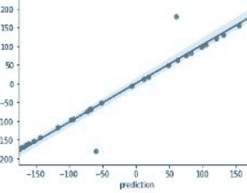
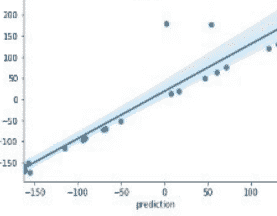
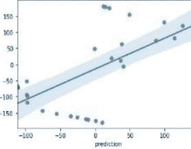

### Theta 1

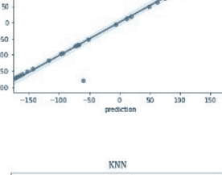
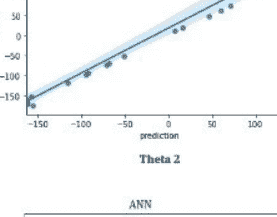
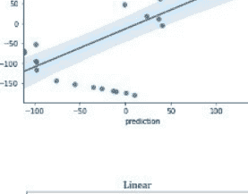

### Theta 2

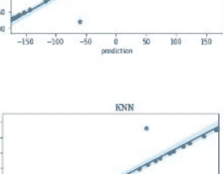
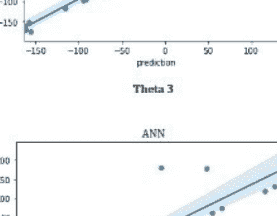
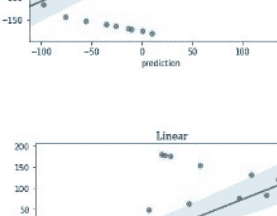

### Theta 3

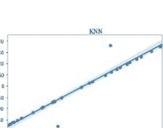
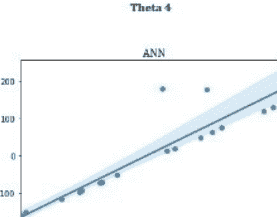
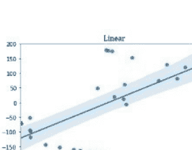

### Theta 4

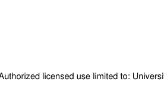


**图 3.** 使用 `KNN`、`ANN` 和线性回归预测的 Theta 值与实际值的对比

### Theta 5

### 3) 人工神经网络

网络中排列了多层神经元，如输入层、隐藏层和输出层。每个神经元接收输入并赋予某些权重或通过函数输出输出。激活函数是权重和输入的函数。合适的激活函数可以提供更好的输出预测。模型的准确性仅取决于权重值。

## C. 模型验证

验证是检查创建数据准确性的过程。在每个数据科学中，细节都将构建在测试集中，用于测试创建的模型，而训练集将用于训练模型。

# IV. 结果与讨论

算法的模型构建、训练和测试均使用 `python3` 完成。线性回归、`KNN` 和 `ANN` 算法工具被用于建模和测试。在这项工作中，我们的数据集是使用正向运动学生成的。首先针对以 `mm` 为单位控制的关节和输入变量 `X`、`Y` 和 `Z` 生成了数千个样本。在不同机器学习技术的训练、测试和验证中，使用了这些生成的数据。

图 3 显示了针对每个关节变量与预测 `Theta` 值进行验证的三种算法。通过对上述图的观察可以发现，与 `ANN` 和线性属性相比，使用 `KNN` 实现了更好的拟合效果，属性 `R=91.85` 清楚地显示出只有 `KNN` 算法具有更好的特性。在 `KNN` 中，点均匀分布在零线周围且具有非常高的 `R` 方值，证明了 `KNN` 算法提供了更好的结果。

### 关节变量的 R 方值

| 技术 | R 方值 |
| --- | --- |
| LR | 91.3% |
| KNN | 99.4% |
| ANN | 60.5% |

使用 `k-NN` 算法得到的 `R` 方值为 (90.4%)。使用 `ANN` 和线性回归得到的 `R` 方值分别为 (91.3%) 和 (60.5%)，如表 3 所示。

`RMSE` 值通过改变数据集训练大小的百分比（60% 到 90%）计算得出，并绘制在图 4 中，这再次证明了 `KNN` 算法在不同百分比训练数据集下的 `RMSE` 值。

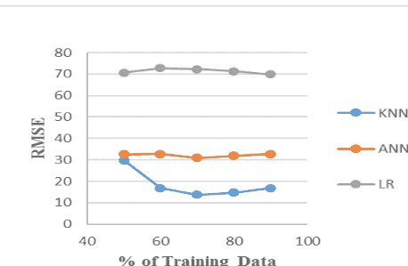

**图 4.** `LR`、`KNN` 和 `ANN` 的 `RMSE` 比较

### 表 IV 控制点

| 序号 | X(mm) | Y(mm) | Z(mm) |
| --- | --- | --- | --- |
| 1 | 200 | 150 | 400 |
| 2 | 180 | 180 | 150 |
| 3 | 240 | 210 | 500 |
| 4 | 160 | 240 | 700 |
| 5 | 280 | 270 | 650 |
| 6 | 400 | 300 | 500 |

验证后，使用模型预测了三个角，笛卡尔空间中的六个控制点使用三次样条得到的路径所示。

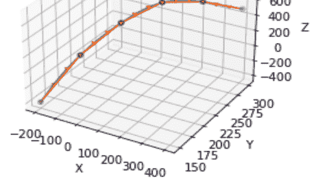

**图 5.** 三次样条插值

使用 `KNN` 算法预测的关节变量见表 5。

### 表 V 获得的角度

| 编号 | θ1 (deg) | θ2 (deg) | θ3 (deg) | θ4 (deg) |
| --- | --- | --- | --- | --- |
| 1 | -70 | 130 | 105 | 27 |
| 2 | 40 | 90 | 45 | -120 |
| 3 | 40 | -46 | | |
| 4 | 20 | -90 | -96 | 47 |
| 5 | 70 | | 71 | |
| 6 | 37 | -40 | 25 | 60 |

三次样条得到的路径 [9]。通过改变参数 $u$ 从 0 到 3 从路径获得速度、加速度和加加速度；通过改变 $k$ 值从 0 到 12 可以获得值。

**角位移**

$P(k) = \theta_0(1-u)^4 + \theta_1(7u-18u^2+12u^3) + \theta_2(-11u^3+18u^2) + \theta_3(u^4)$

**角速度**

$V(k) = \theta_0(3-u)^4 + \theta_1(21u-36u^2+12u) + \theta_2(-33u^3+36u^2) + \theta_3(u^3)$

**加速度**

$A(k) = \theta_0(6-u) + \theta_1(42u-36) + \theta_2(-42u+54) + \theta_3(6u)$

**加加速度**

$J(k) = \theta_0(0) + \theta_1(10.5) + \theta_2(-5.5) + \theta_3(1)$

当 $(1 \le u \le 2)$ 时

**角位移**

$\theta_0(u-2)^4 + \theta_1(-8u^3+27u^2-27u+9) + \theta_2(u-1)^4$

当 $(2 \le u \le 3)$ 时

**角位移**

$\theta_0(3u^2-18u+18) + \theta_1(-u^3+27u^2) + \theta_2(-7u^3+45u-2) + \theta_3(63)$

**角速度**

$\theta_0(-3u^2+21u-36) + \theta_1(-24u+54) + \theta_2(12u) + \theta_3(3(u-1)^2)$

### 表 VII 三次轨迹的时间和加加速度

| 样条轨迹 | 时间 (sec) | 加加速度 (rad/s) |
| --- | --- | --- |
| | 4.09 | 27.8 |

# V. 结论

本文中，线性回归和人工神经网络用于获取机器人的逆运动学。正向运动学方程用于训练机器学习数据集。与 `ANN` 相比，线性回归提供了更好的结果。然后可以使用 `KNN` 快速获得逆运动学的更好解决方案。准确性取决于数据质量，这需要更多的空间和相关特征。相同的方法适用于具有不同学习算法的不同机器人。

# 参考文献

[1] Kamar, A., Banga, V., Kumar, D. and Yagishwarth, T., Using Genetic Algorithms Method In International Conference on Signal Processing and Information-Based Systems (ICSP), pp. 1-12.

[2] Mir, H., Talqi A., and Abbas H., Inverse kinematics for robot using logic and PD-Sudawal International Conference on Multidisciplinary in Tech., 2019.

[3] Xu, J. and Zhao, M., A Comparative Study of Inverse Kinematics Solution of 2-DOF, 3-DOF and 5-DOF Redundant Manipulators by ANN, International Conference on Robotics and Mechatronics (ICRC-2014), Volume 3, Issue 5 - 5-7 Technical Report No CSM-414,2014.

[4] Yin, J., Shi, W. and Wang, L., A machine learning based trajectory planning for industrial robots, Neural Computing, 2019.

[5] Fang, Y., Hu, J., Wang, S., Nonlinear and optimal-time planning for 5-DOF robot, Applied Soft Computing, 29,715-735.

[6] Guo-Shiang Huang, Po-Hao Teng, Development and Analysis of 5-DOF Manipulator Kinematics, National Chi Nan University, 7-9,2016.

[7] M. A. Devi, C. P. S. Prakash, An Informatic Approach to Predict the Mechanical Properties of Aluminum Alloys using Machine kinematics techniques, Journal of Materials Science, 21,91-104


## 参考文献

[8] Emys, S., and G. Ranganathan. "Robot assisted sensing and control of robotic industrial arms." *Journal of Robotics*, no. 03 (2019): 180-187.

[9] Ranganathan, G. "An Economic Analysis of Robotic Arm Playing Chess Using Visual Industry." *Journal of Innovative Imaging (HIP)*, no. 03 (2020): 141-146.
