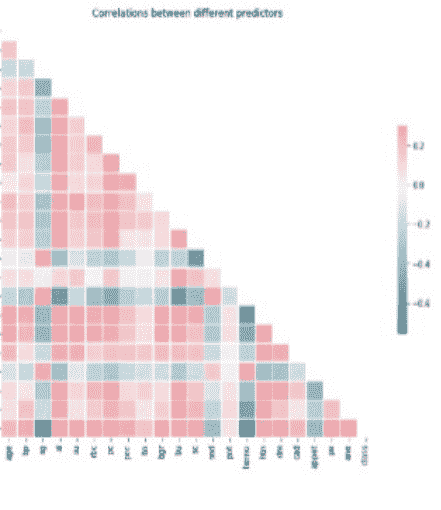
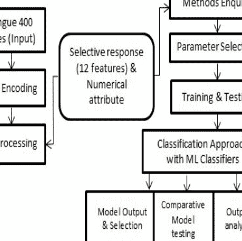

# 2021 第五届智能计算与控制系统国际会议 (ICICCS) (印度马杜莱 2021.5.6-2021.5.8)

**摘要—** 2019 年的登热爆发是孟加拉的一个重大高峰，特别是全国范围内发现了约 179 人和 101,354 例确诊病例。孟加拉等发展中国在控制登热的医疗和人员资源方面存在局限。尽管如此，本工作研究了根据发热、疼痛、畏光、头痛等某些外部因素预测感染登热的机会。本文在接受检测前排除发热。因此，患者可能会因其变化出现一些初期症状，并对获取初步治疗的检测产生依赖。使用了不同的机器学习模型来预测概率，并实现了接近 100% 的准确率。

亚洲地区，但通过早期的预防性措施来减少病例数量 [11]。经济赤字会导致任何国家在资金问题、治疗成本高昂等问题上遭受家庭层面的经济损失，除非他们在早期阶段保持健康 [12-13]。由于孟加拉国这种不稳定的状态，在检测前应该对登热采取措施。通过代表某些外部因素的预测监测系统可以实现有效控制。登热病毒包括在极早期出现某些非特异性症状，并通常从高热开始。由于登热最初的高热造成了巨大负担，目前还没有成熟的登热疫苗。

**关键词** 机器学习模型、登热病、解剖症状。

## I. 引言

登热（DF）和登革出血性发热（DHF）是高风险的蚊传播疾病，伴有严重症状的急性发热 [1]。当登热通过蚊子叮咬传播时，会表现出严重症状 [2]。这种公共流行病遍布热带和亚热带地区。19 世纪 1850 年代，菲律宾发现并已知登热。多年来，登热一直是南亚地区的主要健康问题，由相关形式引起 [4]。登热影响了 128 个国家，占一半的人口，大多数人都会经历一次 [3]。1964 年，孟加拉国首次被识别为“达卡热”，后来可能是由于达卡的情况可能规模。首份官方报告显示 2000 年死亡人数较高，约 600 例病例和低于 100 人死亡 [6-7]，2010 年至 2011 年该疾病反复发 [8]。2020 年的现状显示登热也影响了多达 300 万人。

为了减轻登热负担，重点关注了达卡中心现有 400 例登热病例。约 70 人呈阳性，约 30% 的登热报告。包括根据其行为处于发热阳性或阴性的 10 至 12 级患者。所提系统提到了孟加拉国的公共卫生，因为近年来我们的方法与人相当不同。该预测可以轻松预测严重和非严重的住院情况。在农村地区，它使得诊断更加方便。机器学习的反思在每个领域都有广泛的反响。其中生物医学领域也涵盖了 ML 分析。在开始处理之前。

## III. 方法论

方法论部分使用了模型规格的统计和分析分析相结合。因此，在本节中说明了从数据开始到处理机器学习模型的工作方法，并简要介绍了适当的 ML 分类器，所提出的“登热阳性及预测”具有必要步骤如下。

### A. 研究目标

预测研究主题有助于更好地理解发展、未来趋势和创新。研究转型的摘要显示了数据处理的属性响应并非研究刻意意图的终点，而是在处理我们的登热病例发生情况后，通过多种 ML 学习分类进行预测。

### B. 数据收集

由于对登热未来概率的研究需要登热病的相关数据。因此，预测相当能捕捉外部症状。这就是为什么必须创建一个包含两类患者（如登热阳性）的数据集。因此，我们准备了一个包含 40 个病例的数据集，其中 70% 的数据由阳性病例组成，其他 30% 的数据为孟加国的阴性病例。根据对阳性和阴性病例的分析以获得良好的准确率，确定哪些病例的症状未被分类用于登热预测。

Nazim Karim 等人 [16] 介绍了孟加拉国达卡市 2000 年至 2008 年的 8 年数据生产，机器学习算法是线性回归。登热病的特征通过气候变化的验证对引起病例的情况有很大影响。

Benjamin M. Alexander 等人 [17] 展示了曼谷和单一地区超出登热病例的逻辑回归和 SVM 线性及二分类。登热数据集的结果用于预测目的的初始模型。通过二分类进行登热事件几乎花费了 5 年的感染，生成了 95% 级别的准确率。

Jonas Perez [15] 解释了双峰登热研究，这需要机器学习分类。超过 100 个国家受到登热的影响，通过这种一致性，在感染后 72 小时内识别出双极峰值。

Ahmed 等人 [19] 通过 ARIMA 模型和 K-H 模型分析对登热和 DHF 情况进行了预测。登热感染数据集数据集为 2001 年至 2006 年，这意味着 6 年的数据集，声称 2007 年至 2008 年 6 月阳性病例减少。尽管 K-H 模型和 ARIMA 的说明暴露了 ARIMA 时间序列模型的困境，但与成功的序列不同，其原因是 MAPE 分数为 9.6。K-Held(K-H) 模型结合敏感性分析的 MAPE 值为 17.21。该部分显示了按周的明显差异。

Hani M Abbas 等人 [14] 通过 ANN 估计识别了确诊病例的登热预测分析。马来西亚自 2007 年受到该疾病的巨大影响。马来西亚登热病例需要高系数 0.96。神经网络需要输入序列，数据检测为 70% 和 30%。4 个特征如温度、湿度等指数产生相关性和 RMSE 误差。

Nangeetha 等人 [18] 揭示了 SVM 机器学习算法在泰国四个地区降水、温度和密度方面的有效性。变量分析显示登热情况显示是否是发热或。增加了 SVM 机器学习算法在系数和 RMSE 分数上的 77% 准确率转折点。在四个地区预测期间，温度和密度与登热分离，而非降水可能引起登热，为了进一步检查，我们使用了 10 折验证。

| 序号. | 特征名称 | 数据类型 | 限制 |
| :--- | :--- | :--- | :--- |
| 1 | 高温（发热） | 数型 | <160° F |
| 2 | 脱水 | 二元值 | 是/否 |
| 3 | 血浆率低 | 数型 | 1.5-(4.5(Lump/mm)) |
| 4 | 头痛 | 二元值 | 是/否 |
| 5 | 淋巴结肿大 | 二元值 | 是/否 |
| 6 | 皮疹 | 二元值 | 是/否 |
| 7 | 呕吐 | 二元值 | 是/否 |
| 8 | 出血症状 | 二元值 | 是/否 |
| 9 | 情绪波动 | 二元值 | 是/否 |
| 10 | 疼痛 | 二元值 | 是/否 |
| 11 | 白细胞计数 (WBC) | 数型 | 4000-11000(累计) |
| 12 | 血红蛋白 | 数型 | 12.0-17.6 (g/dL) |
| | 预测登热 | 二元值 | 阳性/阴性 |

图2：机器学习分类器之间的相关性

表1：登热病的临床参数

### C. 数据预处理与模型

数值表示需要通过从登热病例收集数据进行预处理。根据病例，我们在训练集中收集了超过 70% 的阴性登热病例。我们的结果数据集存在来自测试集的缺失值。在分析开始时，有一些必要的步骤，第一步是预处理数据。通过划分数据并将编码数据传输到新数据，训练数据能够准确地运行到模型中。用于 DP 预测的数据案例现在可以准确地分类登热病例并合并输出分类。

病例在标签编码下进行预处理，并根据下一个病例是否匹配相似性通过预测进行一个真或假的陈述述。当该方法采用 CSV 部分的数值统计时，机器学习分类程序通过对登热数据集的登热预测卓越地执行，分类器的准确率具有最佳性能。根据输出，优化模型的关键方面是混淆矩阵、精确率和其他结果。由于我们使用不同的分类器来评估登热预测的性能，分类器结果将在下一节显示。通过监督学习和无监督学习应用多变量分类，健康是为人知的。结合登热数据的背景研究，支持基于 RF [24]、DT [25]、NB [26]、LR [27]、ANN [28] 的数据馈送过滤器。机器学习分类器高度推荐用于任何登热预测，因为对这些分类器的研究非常丰富。

## IV. 实验与讨论

### A. 模型训练

机器学习分类器保持着特定的卓越性，因为为了获得实验结果进行了描述性分析。数据被分为训练集和测试集两部分，登热病例分析涉及 400 多个病例中的 12 个特征，这些特征由几个分类器覆盖。在登热数据集的使用过程中，使用 Python 库获取值，通过每个序列到另一个参数的数字来探索分类，这

图1：登热病例预测模型

### 分类器

| 分类器 | 准确率 |
| :--- | :--- |
| KNN | 71% |
| SVM | 98% |
| 朴素贝叶斯 | 100% |
| 逻辑回归 | 98% |
| 随机森林 | 99% |
| ANN | 65% |
| 决策树 | 100% |

表2：不同分类器在登热病中的模型差异显示了实际预测和最高输出生成。基于 400 个病例的 12 个登热特征选择，我们操作模型的比例为 5:1。从孟加拉公共卫生收集的四个部分包含训练集和测试集中的 80 个数据具有阳性和负性病例。机器学习算法具有抽象输入并生成每个分类输出。同样，测试集 320 个数据具有高达到率，两个分类器进行分类。如果是 RF、DT、LR，对于阳性的敏感性和特异性是真实的。

### B. 不同分类器的实验结果

在登热预测中，机器学习分类器在训练集和测试集上运行。结果性能衡量值为准确率、精确率、特异性，混淆矩阵表3，DT 和朴素贝叶斯在这些准确率 100% 上表现最佳，NB 和 DT 预测相同值的混淆矩阵为 (07) (01), (51)，用于训练集和 Y 测试集。敏感性和特异性得分准确率为 0.96，两种病例的相关系数为 1。另一个分类器表3，SVM 和逻辑回归在高准确率 97.50% 上表现最佳，SVM、NB 和 DT 预测相同值的混淆矩阵为 (07) (01), (51)，用于训练集和 Y 测试集。敏感性和特异性得分准确率为 0.96，两种病例的相关系数为 1。RF 和 LR 同样提供了接近 98% 的登热人类元素准确率。至少两个分类器当 ANN 和 KNN 在 400 个病例上准确预测时，准确率低于 80%，且准确率为 65% 和 71.25%，置信水平低，特异性得分为 0.85 和 0.56，KNN 此外 ANN 0 和 0.65。KNN 拟合 (22) (06) (17) (35)，ANN 拟合 (00) (28)。

## V. 结论

孟加拉登热病爆发的研究影响了大型部门。在没有登热的城市地区，从儿童到老年人的所有病例每天感染。公共医疗每天建立阳性登热病例治疗。许多病例恢复良好，其他病例可能不需要住院。在本研究中，尝试使用基于分类系统的方法，我们识别登热是阳性还是阴性。我们的结果显示登热在孟加拉很流行，大多数病例为阳性，少数为阴性。清理数据集后，机器学习分类器应用于这些病例上，性能非常幸运，例如 100% 和 99% 的准确率。同样，SVM 和 LR 也提供了准确率。根据分析，此处机器学习分类预测中只有 ANN 和 KNN 两个模型预测准确，准确率为 65% 和 71%。在，阳性病例的登热病预测可以准确预测 ANN、DT、RF、SVM、LR 等五个模型。

## VI. 致谢

DIU. NLP & Machine Lab 慷慨支持我们。我们感谢计算机科学与工程系。

## 参考文献

[1] Morens DM, Fauci AS, "Dengue and hemorrhagic fever: a potential threat to public health in the United States", AMA 299: 214–216, 2018

[12] Haibid, S., "Prediction of dengue challenges to molecular biology," Science 279(5356):476–481, 1998.

[13] Rosario Zaparit, Imelda A. Luna, Emily Bomansang, Sacurpo Lucian, Jane Kim, Rem Foranti, Anwar Mohammad, Denis Cret, "A-levenu, attenuated dengue vaccine in children and a dengue cycle. Randomized control trial in the Philippines," volume 29, 22, pages 3663–3872, 2011.

[16] MD Nazim Karim, Saifullah Munshi, Nasir Anwar, Md Alam, "Climatic factors influencing dengue cases in Dhaka: A model for prediction," Indian Journal of Medical Research, 136(6):526–532, 2012.

[14] World Health Organization, "Comprehensive guidelines for the prevention and control of dengue and hemorrhagic fever," 2009.

[15] Russell PK, Bester EL, McColwan JM, Ordonez J., "Prediction of dengue victims from incidents in Puerto Rico and East," 573–579, 1996.

[17] J. Bin Althouse, Yihb Ng, Derek A., "Prediction of Dengue Index Using Wave Surveillance," 2011.

[16] Shimona Babu, 机器学习（注：此处原文编号重复，译文保持样），孟加拉登热的影响，2018。

[19] 机器学习（注：此处原文编号重复），2018。

[20] 机器学习（注：此处原文编号重复），2018。
