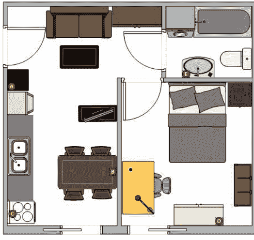
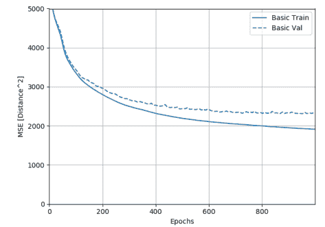
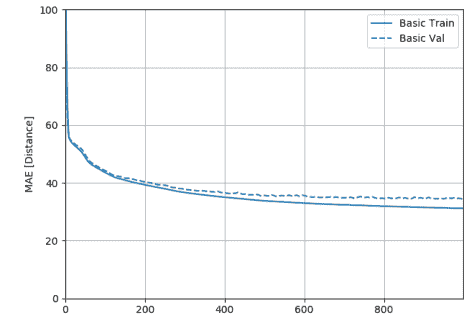
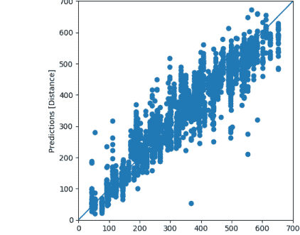
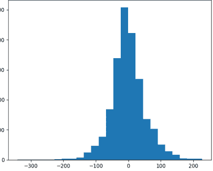
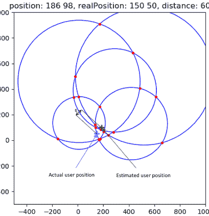
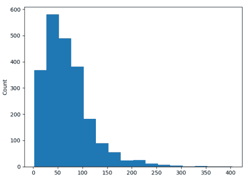

# [2021年第七届自动化、机器人与应用国际会议（ICARA）（捷克布拉格，2021年2月4日至6日）] 2021年第七届自动化、机器人与应用国际会议


*摘要*—在本工作中，我们提出了一种利用智能手机作为位置信息来源的室内定位方法。所提方法利用散布于室内空间的蓝牙低能耗信标（Bluetooth Low Energy Beacons）的接收信号强度指示器（RSSI）值。我们展示了基于机器学习模型的结果，该模型基于在占地31平方米的实验室环境中从信标获取的RSSI值测量结果开发而成。测量数据被输入开源TensorFlow框架，以开发手机与信标之间距离的估计器。接下来，基于以信标位置为中心、预测距离为半径的外围线交叉截面，我们计算所有圆的交点，并将位置估计基于交点的几何中位数。通过实验，我们表明该系统的平均精度为69.58厘米，在80%的情况下可实现小于一米的定位精度。

*关键词-室内定位、蓝牙、信标、机器学习*

# I. 引言

室内定位系统正在成为所谓的物联网（IoT）[1]的重要组成部分，以及用于估算购物中心、机场、图书馆、医院等区域中对象位置的应用，这些应用使基于上下文的广告、室内导航、机器人应用、紧急响应、辅助生活等服务成为可能。

有许多户外定位系统可用，如GPS、A-GPS、Galileo等。然而，它们仅适用于室外，无法提供室内定位应用所需的精度。例如，GPS可提供最大5米的精度。这种精度不适合室内区域。

已开发出许多基于不同技术的技术来估算室内环境中的位置，例如UWB信号[2]、超声波[3]、RFID[4]、WiFi网络中的信道状态信息（CSI）[5]、[6]等。但所有这些方法都需要专用硬件，因此在我们的情况中无法用于智能手机，我们希望开发一种不使用任何特殊硬件的系统。

基于WiFi和蓝牙[7]等无线信号RSSI测量的室内定位方法是最流行的，因为其基础设施成本低、可在所有智能手机上使用且潜在精度高。当今大多数方法基于Wi-Fi信号来估算室内位置。此外，它们通常使用算法来估算从已知位置的距离。

本文剩余部分的组织安排如下。在第II节中，我们回顾了文献中的相关最新工作。在第III节中，我们总结了定位模型方法的基础知识。第IV节描述了开发和训练机器学习模型的数据收集过程。在第V节中，我们详细介绍了模型。最后，本文在第VI节中呈现结果，并在第VII节中进行讨论和得出结论。

# II. 相关工作

室内定位和精确位置追踪是近年来吸引众多研究人员关注的开放性研究问题[7]、[8]，这些研究人员采用了基于不同技术并利用不同方法的各种方法来解决这些问题。室内定位方法通常基于监测无线电信号强度，即所谓的来自WiFi和蓝牙[9]等无线信号的接收信号强度指示器（RSSI）值。来自无线信号，特别是信标（基于蓝牙低能耗的低成本发射器，向附近移动设备广播其标识符）的RSSI是最流行的方法，近年来许多研究人员使用此方法作为解决方案。

[10]的作者提出了一种基于BLE RSSI的迭代加权K近邻（IW-KNN）方法。他们提出了三项主要改进。首先，结合欧氏距离和余弦相似度来测量两个RSSI向量的相似性，从而同时考虑向量的长度和方向。其次，与传统的k-NN（通过邻居多数投票来估计位置）不同，对邻居应用加权因子用于定位。第三，IW-KNN在每次迭代中选择不同的iBeacon来获取RSSI，并在多次迭代后计算平均位置作为最终结果。他们能够有效地估计位置，并在将室内空间划分为60厘米大小的密集网格的实验环境中将平均误差降低1.5至2.7米。在[11]中，提出了一种基于蓝牙指纹库定位方法的k-NN算法，同样将室内空间划分为1米大小的网格。k-NN算法处理测量的RSSI值与指纹库中最接近值的匹配。定位精度控制在1米以内，基本控制在设计的网格之内，从而实现了定位要求。

# III. 我们的模型

我们的定位模型介绍了一种利用智能手机获取的蓝牙RSSI值实现高精度实时室内位置查找的系统。我们选择使用蓝牙信标，因为它们相对于其他室内定位技术具有多方面的优势。这种方法的主要优势是所需基础设施成本低，因为它只需要在预定义且已知的位置（例如墙壁、天花板等）[10]、[11]、[14]、[15]周围散布一定数量的蓝牙信标（我们在每约6平方米内部空间部署1个信标的比例下进行了实验，以实现最佳覆盖且无盲区）。此外，智能手机被认为是无处不在的设备，可以成为使能人类（或任何其他配备此类传感器的用于追踪“物品”的嵌入式蓝牙设备）内部位置追踪的最佳设备。

[12]中提出的三边测量算法由于复杂度低，是一种易于实现的解决方案，并且独立于任何预定义网格运行。平均而言，该系统的误差约为1米。在[13]中，作者尝试了数学滤波函数以平滑RSSI并提高精度。他们使用中位数、众数、单向异常值去除、移位和反馈滤波等函数。对于位置计算，他们使用三边测量算法，并实现了约1-2米的精度。

我们可以将内部位置估计方法分为三个阶段。

- 在第一阶段，我们的系统使用一组机器学习模型（室内空间中部署的每个信标一个模型）。这些模型用于基于当前RSSI电平测量值及其与训练阶段收集和使用的过去测量值的对比，来预测智能手机与特定信标之间的距离。

近年来，许多研究致力于利用机器学习算法用于室内定位系统。在[14]中，提出了一种基于BLE信号的移动目标室内定位机器学习方法。[14]的作者为位置预测设计了特征向量，并使用著名的基于决策树的算法进行机器学习，结果显示可实现小于一米的预测精度。在[15]中，提出了一种用于室内定位的基于BLE的机器学习定位与追踪系统，并给出了实验结果，表明该方法的平均估计误差为50厘米。

- 在第二阶段，我们的系统以第一阶段来自信标的距离为输入，计算以信标位置为中心、以第一阶段找到的距离为半径的圆周。之后，我们找到所有圆的交点。

根据上述进展，我们一直在探索利用最新强大的机器学习技术来解决室内定位问题的方法，基于低成本方案，精度远低于1米。机器学习正在变得无处不在，硬件成本迅速降低，新方法和新工具为传感器和物联网网络信号处理相关的大量问题提供了高效解决方案，从而实现智能应用并迈向真正的人工智能。因此，在[16]中，我们提出了一种系统，利用智能手机通过使用从蓝牙信标测得的RSSI值结合其他智能手机传感器的测量值并将其输入机器学习模型来查找位置。我们在[16]中过往工作的方法基于对室内空间网格布局的选择，用户定位是基于从安装在固定位置的信标接收到的信号来尝试的，即类似于[10]和[11]遵循的方法，但精度更高，即在不到一米的范围内进行精确用户定位。

- 在第三阶段也是最后阶段，我们的系统以第二阶段的交点为输入，从交点中找到几何中位数。这个几何中位数点被定义为估计位置。

在本工作中，我们提出了一种改进方法，该方法可以利用强大的机器学习（如[14]、[15]和[16]中），同时也能实现改进的性能，并且在实时运行且独立于任何室内网格布局。在本工作中，我们开发了一个机器学习模型来解决回归问题。这样我们就克服了选择预定义网格的需求，如[15]和[16]中所做，这也简化了模型训练过程并提高了精度。此外，我们证明了平均精度为69.58厘米，并且在所有情况中80%可以实现小于一米的定位精度。重要的是要强调，我们的方法可以实时运行，而[15]中提出的基于网格的方法可以通过在每个位置重复RSSI测量来实现可比结果，但这仅适用于半静态用户，不适用于实际移动用户。

# IV. 数据收集

开发我们系统的第一步是建立数据收集程序，以训练和评估我们的神经网络模型，用于第一阶段预测信标距离。

为了创建数据收集，我们使用了来自Accent Systems的五个iBKs105蓝牙信标，将其放置在31平方米公寓（“图1”）周围的不同位置。信标的位置是固定的，我们知道每个信标距离公寓左下角的距离（x和y）。

然后，使用我们在Android上为商用智能手机开发的应用程序，我们开始在公寓空间中移动并进行测量。对于每次测量，我们记录移动设备的当前位置（距离上墙和左墙的x和y距离）、所有五个信标的RSSI值、距离每个信标的距离以及进行测量的时间戳。我们用于收集数据的手机是小米Mi A1。


总共，我们收集了11110个测量值来训练和验证我们的模型。



图1. 带有信标位置的公寓地图。

# V. 我们的机器学习模型的开发与训练

## A. 第一阶段

对于我们系统的第一阶段，我们使用TensorFlow框架开发了一个机器学习系统，以预测手机位置与特定信标之间的距离。总共，我们开发了五个不同的模型。对于每个模型，输入是来自所有蓝牙信标的RSSI值，目标是特定信标的距离预测。

我们将11110个测量值分为两组，一组用于训练，一组用于验证。对于模型训练，我们使用80%的测量值，即总共11110个中的8888个，用于验证则使用剩余的2222个。测量值分为两组的过程是随机的。

我们的神经网络模型是带有两个密集连接隐藏层的序贯模型，以及一个返回单个连续值的输出层“图2”。

```
def build_model():
    model = keras.Sequential([
        layers.Dense(64, activation='relu',
        input_shape=[len(train_dataset.keys())]),
        layers.Dense(64, activation='relu'),
        layers.Dense(1)
    ])

    optimizer = tf.keras.optimizers.RMSprop(0.001)

    model.compile(loss='mse', optimizer=optimizer,
                  metrics=['mae', 'mse'])
    return model
```

图2. TensorFlow框架中的我们的神经网络模型

然后我们使用保留用于训练的8888个测量值训练了我们的模型，并将训练设置为经过1000个时代。在“图3”中，我们可以看到我们的模型如何在计算实际用户位置与每个信标之间的距离时（在训练和验证阶段与训练时代相比）降低总均方误差（MSE）。



图3. 与时代演变相比的均方误差减少（总体）。



图4. 每个信标的平均距离误差减少。

在“图4”中，我们分别展示了距离估计中的平均绝对误差如何为每个信标减少。



图5. 针对2222个测量值集，我们的模型预测的距离与用户与信标A实际距离的对比图

为了评估我们的模型，我们使用了保留用于测试的那组数据（2222个测量值）。在“图5”中，我们为每个测量值在X-Y图上绘制点。每个点的坐标代表X轴上用户与信标A的实际距离和Y轴上我们的模型预测值。

在“图6”中，我们展示了我们的模型在每个测试测量值上的预测误差（\(\epsilon\)）分布。



图6. 预测误差（\(\epsilon\)）分布

## B. 第二阶段

在第二阶段，我们使用第一阶段中对应模型估计的每个信标的预测距离。利用这些预测距离，我们创建以信标已知位置为圆心、以模型预测距离为半径的圆。之后，我们找到所有圆的交点“图7”。在“图7”中，用蓝色显示以五个信标为圆心、以第一阶段的预测距离为半径的圆，而红点是交点。



图7. 第二阶段和第三阶段的点计算

## C. 第三阶段

在最后一个阶段，我们将第二阶段的交点作为输入，并从交点中找到几何中位数。几何中位数点被定义为预测位置。

在“图7”中，我们用绿色十字标记计算出的几何中位数点，它代表我们的位置估计，而青色十字代表实际位置。

# VI. 结果

从本节展示的结果来看，我们可以得出结论，我们的系统能够在预测用户实际位置方面取得良好的准确性。在“图8”中，我们展示了实际位置和预测位置之间距离误差（用\(\epsilon\)表示，在“图7”中）的分布直方图。在随后的“表I”中，我们展示了误差分布的值。误差计算基于用于测试模型估计与实际用户位置的2222个测量值集合。

我们观察到，我们的系统平均准确度为69.58厘米，在80.55%的所有案例中可以达到小于1米的位置预测准确度，在93.92%的案例中可以达到小于1.5米的准确度。



图8. 距离误差（\(\epsilon\)）分布

表I. 距离误差（E）分布

| | 0-25 | 25-50 | 50-75 | 75-100 | 100-125 | 125-150 | >150 |
|---|---|---|---|---|---|---|---|
| 计数 | 324 | 570 | 488 | 408 | 200 | 97 | 135 |
| 百分比 | 14.58 | 25.65 | 21.96 | 18.36 | 9.01 | 4.37 | 6.08 |

# VII. 结论

开发一种能够在建筑规模的真实世界环境中使用低成本和普遍的技术（如智能手机和蓝牙设备中可用的技术）来实现高精度定位系统是至关重要的。在本文中，我们考虑了采用机器学习方法使用蓝牙信标的RSSI开发系统所面临的挑战。我们创建了一个包含蓝牙RSSI值的数据集，并训练神经网络模型来预测特定信标的距离。之后，我们使用预测距离来找到交点，并将这些点的几何中位数作为最终位置估计。我们的系统不需要室内空间布局中的任何类型网格，并已显示能够实现69.58厘米的平均误差。总体而言，在80.55%的所有案例中，用户位置的估计定位误差低于1米。

# VIII. 未来工作

我们的下一步将是在更大的区域、更复杂的环境以及更多蓝牙信标的情况下测试我们的模型。提高可扩展性的一个潜在方法是在第一阶段之前添加一个阶段来扩展我们的系统。在这个新阶段（零阶段）中，系统将读取所有蓝牙信标的RSSI值，并决定在第一阶段中使用哪些信标。

# 致谢

本工作在“多服务智能交通系统（MANTIS）项目”的背景下开展，该项目由欧洲联盟和希腊国家资金通过竞争力、创业精神和创新运营计划共同融资，旨在响应研究–创造–创新呼吁（项目代码：T1EDK-04612）。

# 参考文献

- [1] R. Want, W. Wang, and S. Chesnutt, “Accurate Indoor Location for the IoT,” Computer (Long. Beach. Calif.), vol. 51, no. 8, pp. 66–70, 2018.

- [2] S. Gezici, S. Member, Z. Tian, G. B. Giannakis, H. V. Poor, and Z. Sahinoglu, “Localization via Ultra-Wideband Radios,” IEEE Signal Process. Mag., pp. 70–84, 2005.

- [3] P. Lazik, N. Rajagopal, O. Shih, B. Sinopoli, and A. Rowe, “Alps: A Bluetooth and Ultrasound Platform for Mapping and Localization,” Proc. 13th ACM Conf. Embed. Networked Sens. Syst. - SenSys ’15, pp. 73–84, 2015.

- [4] J. Wang and D. Katabi, “Dude, where’s my card? RFID Positioning That Works with Multipath and Non-Line of Sight,” ACM SIGCOMM Comput. Commun. Rev., vol. 43, no. 4, pp. 51–62, 2013.

- [5] Z. Yang, Z. Zhou, and Y. Liu, “From RSSI to CSI: Indoor Localization via Channel Response,” ACM Comput. Surv., vol. 46, no. 2, pp. 1–32, 2013.

- [6] D. Vasisht, S. Kumar, and D. Katabi, “Decimeter-Level Localization with a Single WiFi Access Point,” in 13th USENIX Symposium on Networked Systems Design and Implementation, 2016, pp. 165–178.

- [7] P. Davidson and R. Piché, “A Survey of Selected Indoor Positioning Methods for Smartphones,” IEEE Commun. Surv. Tutorials, vol. 19, no. 2, pp. 1347–1370, 2017.

- [8] H. M. Hussien, Y. N. Shiferaw, and N. B. Teshalle, “Survey on indoor positioning techniques and systems,” Lect. Notes Inst. Comput. Sci. Soc. Telecommun. Eng. LNICST, vol. 244, no. 6, pp. 46–55, 2018.

- [9] P. Kriz, F. Maly, and T. Kozel, “Improving Indoor Localization Using Bluetooth Low Energy Beacons,” Mob. Inf. Syst., vol. 2016, 2016.

- [10] Y. Peng, W. Fan, X. Dong, and X. Zhang, “An Iterative Weighted KNN (IW-KNN) Based Indoor Localization Method in Bluetooth Low Energy (BLE) Environment,” Proc. - 13th IEEE Int. Conf. Ubiquitous Intell. Comput. 13th IEEE Int. Conf. Adv. Trust. Comput. 16th IEEE Int. Conf. Scalable Comput. Commun. IEEE Int., pp. 794–800, 2017.

- [11] S. Wang, R. Ma, Y. Li, and Q. Wang, “A bluetooth location method based on kNN algorithm,” ICENCO 2019 - 2019 15th Int. Comput. Eng. Conf. Util. Mach. Intell. a Better World, pp. 83–86, 2019.

- [12] M. Er Rida, F. Liu, Y. Jadi, A. A. Alghawari, and A. Askourih, “Indoor location positioning based on bluetooth signal strength,” Proc. - 2015 2nd Int. Conf. Inf. Sci. Control Eng. ICISCE 2015, pp. 769–773, 2015.

- [13] A. Mussina and S. Aubakirov, “RSSI Based Bluetooth Low Energy Indoor Positioning,” IEEE 12th Int. Conf. Appl. Inf. Commun. Technol. AICT 2018 - Proc., pp. 1–4, 2018.

- [14] A. Sashida, Di. P. Moussa, M. Nakamura, and H. Kinjo, “A Machine Learning Approach to Indoor Positioning for Mobile Targets using BLE Signals,” 34th Int. Tech. Conf. Circuits/Systems, Comput. Commun. ITC-CSCC 2019, pp. 2–5, 2019.

- [15] P. Stapił, H. S. Gang, and J. Y. Pyurr, “Bluetooth Based Indoor Positioning Using Machine Learning Algorithms,” 2018 IEEE Int. Conf. Consum. Electron. - Asia, ICCE-Asia 2018, pp. 3–6, 2018.

- [16] K. Konstantinos and T. Orphanoudakis, “Bluetooth beacon based accurate indoor positioning using machine learning,” 2019 4th South-East Eur. Des. Autom. Comput. Eng. Comput. Networks Soc. Media Conf. SEEDA-CECNSM 2019, 2019.

