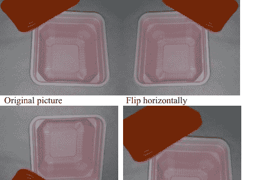

# 2021年亚太通信技术与计算机科学会议 (ACCTCS)(中国沈阳 2021.1.22-2021.1.24) 2021年亚太通信技术与计算机科学会议


郭强 (Qiang Guo)
软件工程学院
信息学院
理工大学
中国北京

石玉良 (Yuliang Shi)
软件工程学院
信息学院
理工大学
中国北京

王世凯 (Shikai Wang)
软件工程学院
信息学院
理工大学
中国北京

*通讯作者邮箱：
qbj2013@email.bjut.edu.cn

邮箱: shlj@bjut.edu.cn

邮箱: skwang@email.bjut.edu.cn

**摘要—**随着工业的快速发展，人们的日常生活变得比以往任何时候都要丰富，同时也带来了大量的垃圾。各种类型的垃圾不断产生，人们缺乏垃圾分类的相关知识，导致人工或机器人分类的困难。本文引入了一种基于深度学习卷积网络的算法来帮助垃圾分类。在图像识别任务中，为了解决数据量小和物体尺寸不一的问题，利用特征提取器提取物体特征。为了避免对小批次数据产生明显影响，我们将 BN 替换为 GN（组归一化）。为了强调目标物体的重要性，引入了注意力机制。在模型输出后，我们添加了注意力机制来增强目标物体的重要信息，使模型专注于关键特征并更好地识别图像；根据上述过程，我们将垃圾分为四类（可回收物、厨余垃圾、有害垃圾）。其他结果显示，模型可以有效分类和识别垃圾类型。实验结果表明，该算法精度较高，具有良好的性能和鲁棒性。在研究实践意义上，这种可靠的方法可以帮助人们了解垃圾类型并供机器人进行分类，因此具有非常重要的应用场景和意义，适用于解决和消除垃圾问题。我们需要准确地分类垃圾，然后进行不同种类的垃圾分类，这将影响垃圾收集效率和进行分类的人员。

然而，从目前垃圾分类和处理的效率来看，人们对垃圾类型的认知非常匮。当人们将垃圾放入错误的桶中时，系统首先识别垃圾，但识别效果并不如人意。垃圾分类在排序方面面临困难。

传统的垃圾分类主要由研究人员进行。由于缺乏垃圾分类的意识和知识，很容易发生错误分类。这些目标检测方法的模型较为复杂，鲁棒性较差。例如，图像分析应用于计算机视觉。在黄玲关于局部特征提取和构建的研究中，该方法被用于改进垃圾收集，工作耗时为 1.17[3]。如今，人们越来越关注深度学习在人类和图像识别中的作用。深度学习是构建各种有效网络的强大方法，极大地提高了图像识别的准确性，非常有用。

**关键词—**垃圾分类，卷积神经网络，图像处理技术，垃圾分类

# I. 引言

随着工业的发展，人们的日常生活变得丰富，每天都使用和消费生活品，生活垃圾和工业垃圾中产生了大量垃圾。这些类型的垃圾种类复杂、难以区分且难以分类，属于劳动密集型工作。因此，在处理这些垃圾问题时，一些人会将垃圾填埋或焚烧，这会对环境造成巨大危害，且这种方法产生的有害物质是不可

# II. 实验过程及相关概念

## B. 组归一化 (Group Normalization)

针对上述垃圾分类和识别问题，我们设计并实施了这一实验，实验的整体流程如图11所示。

图像归一化是通过一系列变换将图像转换为相应的标准形式，以便找到图像中的不变性，使得这些图像原本是相同或系列，从而使图像能够抵抗噪声的攻击，加速梯度下降寻找最优解，加速训练网络的收敛，并防止交换方差的影响[7]。归一化对于维持数据在 0 到 1 之间的统计分布是必要的。

现在常用的归一化方法是组归一化（GN）算法，它可以将批次数据完全拉回到均值 0 和方差 1，从而不仅能稳定而且加速网络的训练。它的缺点是对于小批次大小的效果较差；会导致性能下降和错误率增加。组归一化在 [9] 中提出，它将通道进行分组并计算每组内的均值和方差。GN 的计算与批次大小无关，其准确性在不同批量大小下都是稳定的，与 BN 相比减少了误差。

在实验过程中，我们希望优化和改进神经网络的训练。首先，我们将理解相关概念。

### A. 数据增强

在神经网络训练中，我们增加深度和宽度，以增强神经网络的能力并促进数据分布的拟合。同时我们也遇到了一个问题，随着神经网络参数的增加，模型会出现过拟合，导致过拟合，即对数据高度拟合，但测试准确率非常低，特别是在数据集较小时泛化性差！

在实验过程中，我们使用数据增强的方法来防止过拟合问题。数据增强包括裁剪、颜色抖动、图像水平和垂直翻转等方法，增加了数据量。卷积神经网络对物体的位移、视角、尺寸和光照是不变的，也就是说数据增强不会影响神经网络的训练，但会增强模型的泛化能力并提高准确率[6]。图2了数据增强的一个示例。

当我们使用数据增强时，通常使用公式：

```
$$\hat{x}_i = \frac{x_i - \mu_i}{\sigma_i}$$
```

其中 x 是某层特征图中特定位置的点；i 是 N、C、H 和 W 四个维度的坐标；C 是通道轴，H 和 W 是高度和宽度轴。

在公式中，$\mu$ 是均值，$\sigma$ 是标准差。它们的计算如公式2所示，这是一个小的常数值：

```
$$\mu_i = \frac{1}{G}\sum_{j \in G_i} x_j, \\ \sigma_i = \sqrt{\frac{1}{G}\sum_{j \in G_i} (x_j - \mu_i)^2 + \epsilon}$$
```

在公式2中，G 是在拟合 k 条件后计算均值的点集区域，m 是该集合的大小。因此我们关注组归一化中 k 条件的定义，如公式3所示：

```
$S_i = \{k | k \in L_i, [\frac{c}{G}] = [\frac{c}{G}]$
```

C 是每组的通道数；$\frac{c}{G}$ 意味着 i 和 k 在同一组通道中，也就是说，组归一化意味着方向分组、对每组进行归一化并计算均值。

在本次实验中，我们将组归一化应用于图像处理，并替换高效网络中的 BN 以改进由你引起的影响



原始图片

水平翻转

顺时针旋转180度

放大10%

图2. 数据增强示例


### C. 深度卷积神经网络

在计算机视觉领域，深度卷积神经网络是一个不可忽视的重要部分。它是一种前馈神经网络，包含卷积操作并具有深层结构。在图像处理方面，它比 BP 神经网络具有更好的能力。许多研究人员致力于卷积网络的研究，并取得了许多显著成果，开发了如 VGG(16)、ResNet(11)、Exception(12) 等模型，这些模型提高了应用于我们日常生活中的识别率，例如人脸识别、场景图像识别、车辆识别等。在分类这一研究课题上，我们在现阶段取得了良好的效果，具有改进潜力。

这是一种由 Google 深度学习团队开发的高效神经网络。Google 在 ICML 上发表的方法显示这项工作的效果非常好 [13]。传统的研究受限于有限的计算能力。通过扩展网络，只扩展了一个维度的图像分辨率，就实现了更高的准确率，例如 ResNet-18 和 ResNet-50！另一方面，每个元素的模型并不是完全独立的，而是通过复合模型缩放算法相互作用以平衡三种操作，实现了与现有分类网络相似的精度指数，并大幅减少了参数和计算量。

表示高效表达的网络计算公式为公式 4：

```
$N = \prod_{i=1}^{n} \Phi_{i}^{\gamma}(X, w_{i}, c_{i})$
```

其中 n 是基础层，i 是阶段，Li 是输入 $L_{i}$ 是 i 阶段中特征结构的表示。模型缩放算法的目标是在满足约束条件的情况下使约束最大化，如公式 5 所示。需要优化的参数是网络深度 (d)、网络宽度 (w) 和分辨率 (r)。

```
$maxAccuracy(d, w, r) \quad (5)$
```

```
$Memory(N) \leq target memory\nFLOPS(N) \leq target flops$
```

我们用 $\phi$-索引表示待优化的参数，如公式 6。同时，我们对 $\alpha$、$\beta$ 和 $\gamma$ 做了许多限制。我们可以将 $\phi$ 固定为 1，然后得到满足公式的参数，即 $\alpha = 1.2$，$\beta = 1.1$，$\gamma = 1$。

```
$depth: d = a^{\alpha} \quad (6)$
```

width：$w = b^{\beta}$

$resolution: r = y^{\gamma}$
$s \cdot a \cdot y^{2} = 2$
$a \geq 1, y \geq 1, \gamma \geq 1$

然后我们使用 Efficientnet 来提取多维融合的特征。

### D. 注意力机制

垃圾信息中存在大量无关信息，这些信息可能对我们的决策产生影响，导致背景信息变得混乱。注意力机制可以模拟人类注意力，并从人类注意力机制和注意力中学习 [17]。我们可以利用从注意力机制提取的特征来关注处理对象的重要部分，使模型能够关注关键特征并识别出正确的图像 [18]。

在使用注意力时，将 F 的输出图作为输入 U，然后进入注意力模块，该模块包含三种操作：

- 1. 通过池化值将每个通道的二维压缩 (H*W) 压缩为数值 z [19]。参见公式 7。这是一种在空间维度上具有全局感受野的特征，操作后通道数保持不变，为 1 * C。

```
$Z_{c} = E_{fc}(U) = \frac{1}{H \times W} \sum_{i=1}^{H} \sum_{j=1}^{W} U_{(i,j)} \quad (7)$
```

- 2. 激励：这主要是为每个通道参数生成一个权重值，使用两个全连接层形成瓶颈以建立通道之间的相关性，并输出一维注意力权重 $s$，激活每个层通道，其数量与通道数相同 [22]。

```
$s = F_{exc}(X, W) = \sigma(g(X, W)) \quad (8)$
```

其中 $\sigma$ 是规则和激活函数。
- 3. 注意力：将上一步操作获得的权重值与 U 中对应的通道相乘，如公式 9 所示，我们可以增强关键通道的注意连接，并通过它们各自的权重进行衡量。

```
$\hat{F}_{c} = F_{exc}(U_{c}) = s_{c} \cdot U_{c} \quad (9)$
```

# III. 实验环境与实现

本实验的硬件环境如下：
配备配备 Intel Core i7-3.2GHz CPU 的服务器、64GB 内存、NVIDIA GTX 1080Ti 显卡、Ubuntu 16.04 系统和 PyTorch 深度学习框架。

研究中使用的数据是人工智能垃圾分类项目的 1735 张图像。垃圾类别已标记了每个名称和类别。共有 40 种物品，如箱子、电池、水果和果肉，分为 4 类垃圾：有害垃圾、厨余垃圾、可回收物和其他垃圾；算法中的垃圾类型名称进行了如下设置；例如：一次性快餐。数据中的 13000 张图像用于训练集，6735 张用于测试集。分布如表 I 和 II 所示。

## 表 I 训练集

| 垃圾类别 |  | 数量 |
| :--- | :--- | :--- |
| 可回收物 | 23 | 7475 |
| 厨余垃圾 | 8 | 2600 |
| 有害垃圾 | 3 | 975 |
| 其他垃圾 | 6 | 1950 |

## 表 II 测试集

| 垃圾 | 图片数量 |
| :--- | :--- |
| 可回收物 | 1872 |
| 厨余垃圾 | 1347 |
| 有害垃圾 | 505 |
| 其他垃圾 | 1110 |

在实验的第一阶段，对图像数据进行处理包括两个部分：数据增强和归一化。图像大小限制在 45 像素。数据被输入网络进行训练。在每个 epoch 中测试模型，并记录准确率和损失率。在此实验之后，基于有害垃圾、厨余垃圾、可回收物识别并预测了 40 种图像。经过 30 个 epoch 的训练，准确率达到了 93.7%，损失在 0.81-0.83 之间。损失率问题线图显示在 epoch 开始时，损失率约为 0.3。

# IV. 实验结果


图 4. 损失率线图

# V. 结论

鉴于垃圾分类的困难性，本研究使用卷积神经网络方法解决问题。同时，我们改进了网络并优化了过程。结果达到了预期目标，识别率令人满意，垃圾分类效果良好。该方法可以应用于许多分类场景，如垃圾分类处理厂、移动 App，既又方便。

然而，在实验室条件下，准确率可能会进一步提高。我们可以在未来继续解决这些问题。未来，我们需要更好地改进和优化模型，满足分类范围的需求，例如在后期阶段学习和其他识别。这是我们未来的研究成果。

# 参考文献


- [1] S Cider, C McCullen, J A. 减少垃圾袋损坏的 Applet 方法建议[I]. ASTM 特别技术,1997,6(25):13.
- [2] Wu Jian, Chen Hao, Fei Wang. 基于深度学习的垃圾分类识别系统[J]. 信息处理与,2014;10(8):81-83.
- [3] Huang Li, Ling Huang, Wen Fei, 等. 垃圾分类的颜色特征提取与识别[J]. 光电子技术,2018;2(3):53-58.
- [4] Ali H, Demir R, Kaya M, 等. 基于深度学习的测试数据集分类[C]. 2018 IEEE 大数据国际会议 (Big Data). IEEE,2018.
- [5] 数据增强. Springer NY,2017. gamlearning.2018:33-22 https://body.csceedings.org/id/96853
- [6] La F, Shi S, 等. 基于背景预测和组归一化的单阶段检测器算法[J]. 应用科学,2020;10(17):5755.
- [7] Confined Little, Anthony-2019-04-16. 归一化方法。2020;10(19):7920. https://body.csceedings.org/id/97052


[11] Zhiong C, Hebin Z, Yabo W, et al. 基于深度学习的垃圾分类机器人收集系统[C]/ 2017年第36次中国控制会议 (CCC). IEEE, 2017.

[12] Ying, Wang, Xu, et al. 智能城市环境的自动垃圾检测[J]. 2018.

[13] MoonSmile, 2019-02-12. 惊叹的高效与高效Dt https://zhihu.com/question/390677

[14] Dante P, Lima F, Kara O. 使用深度学习架构进行皮肤癌的早期检测：resnet-101和 inception[C]/ 2019医学技术大会 (TIPTEK), 2019.

[15] Kong J, Li J, Li, et al. 基于深度学习的自动垃圾分类系统[J]. IEEE Access, 2020, PP(09):1-1.

[16] Grose V J, Nister JG. 垃圾回收虚拟机中未来内存溢出异常的自动预测[J]. 2007.

[17] Wang Juntin (2017-11-23). 注意力机制的基本思想与实现原理 https://blog.csdn.net/helppublic/article/details/30448570

[18] Leonard U, Sunart S, Van Hecke P, et al. 视觉科学中的注意力机制：研究. Journal of Cognitive Neuroscience, 2000, 12(supplement) 61-75.

[19] Lu Z, Li Q, Dosher B A. 用于多尺度一阶运动感知的注意力机制[J]. Vision Research, 2000, 40(2):173-186.

[20] Tian F, Cho K, Bengio Y, Ma W. 基于多头神经机器翻译器的注意力机制[J]. 2016.

[21] Wang, Yuchuan. 基于注意力机制的小目标预检测[J]. 光学工程, 2002, 41(4):872-885.

