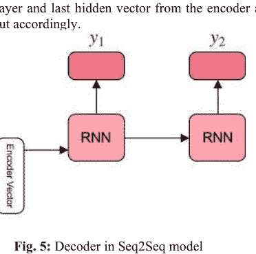

# 2021第四届国际计算智能与通信技术会议 (CCICT)(印度索内帕特 2021.7.3-2021.7.3) 2021第四届国际计算智能

Manoj Kumar 博士
计算机科学与工程系
德里理工大学
印度新德里
mankumar@dtu.ac.in

Abhishek Singh
计算机科学与工程系
德里理工大学
印度新德里
abhishekkams26@gmail.com

Anrav Kumar
计算机科学与工程系
德里理工大学
印度新德里
arnavkumar1999@gmail.com

Ankit Kumar
计算机科学与工程系
德里理工大学
印度新德里
ankitukumar50417@gmail.com

摘要——能够与人类对话的聊天机器在消息平台中日益增加。其目标是改进和增强深度学习技术，以构建高效的聊天机器人。目前的机器人是通过基于规则的技术、机器学习算法或基于检索的机器人开发的，后者无法生成响应。在本文中我们将使用 RNN、RNN 和 LSTM 评估三种机器人的性能。不同的公司、组织和方法使用了这些聊天机器人；其中有些是 AI 方法，有些是非 AI 方法。在本文我们将讨论 AI 方法，即检索式模型和生成式模型。除非这些模型不可靠，否则它们在头部是是有效的。

## I. 引言

文本生成是将我们的句子作为输入并从机器/计算机获取响应的过程。它是使用深度学习算法实现的，这些算法是神经网络的子集，并以自然语言处理的形式提供结果和准确的输出。我们使用了监督学习进行文本生成，该文本存在于 RNN 的序列模型中。该项目旨在分析每种类型的序列模型以生成文本，这些文本对用户来说是有意义的（而不是随机的）。我们发现了性能上的差异；我们也查看了其他关于基础 RNN 和 LSTM 性能的论文；我们使用了语料数据集（Corpus Dataset）。我们尝试通过使用现有的学习算法（如 GRU）来修复，以改进并达到 LSTM 的便捷效果。

## B. 智能模型

- 1) 检索型（Retrieved Base）：检索型聊天机器人从响应集中获取最佳响应。在这一模型中，所有的响应都是常规的。它不生成任何新新响应，因此我们不需要担心准确性。它拥有一个有限的响应集，对于非人类输入倾向于产生僵化的响应。其基本工作是从响应集中选择最优的响应。

- 2) 生成型（Generative Model）：该模型没有预定义的响应，它会逐字自地生成，这容易导致语法错误。这种方法用于生成更像人类的聊天机器人，这些机器人在自然表达上相当充分。它们的响应质量不可预测且相当复杂，我们将在文中进一步比较生成式模型算法的性能。

## II. 相关工作

互联网上有许多开源 API，提供了开发聊天机器人的各种方法。但像 Mitsuko 那些只是模式匹配器，而不是最智能的聊天机器人。但在本项目中，我们编写了一种模式，当匹配时它会以其中一种类型做出响应。基础规则让每个人都能轻松创建机器人，但如何让聊天机器人回答复杂查询并不方便。有很多这种情况。

## C. 相关工作

此前，所有的 Seq2Seq 聊天机器人都是使用编码器-解码器架构开发的。编码器-解码器使用长短期记忆神经网络构建，因为它的单元状态由单元更新，而无需考虑它可能会说“我不知道你在说什么”，这在这些问题中也会遇到类似的问题。深度强化学习超出了本文的讨论范围。我们使用了 Adam 优化器，它为梯度的一阶和二阶矩的不同参数计算归纳性自适应学习率。它被选中是因为 AdaRad 和 RProp 属性的结合 [8]。在编码器之前还使用了双向 LSTM（Bidirectional LSTM），并在解码器侧使用了注意力机制来提高模型性能。双向 LSTM 的优势在于它将两个独立的循环网络结合在一起工作，使得网络在单词生成的每一步中都拥有序列的正向信息 [10]；它可以从未来向过去传递信息，就像它反向运行一样保留来自未来的信息，通过使用两个隐藏状态，你可以在任何时间点保留来自过去和未来的信息。

## III. 基础知识

在这里我们将讨论一些用于嵌入（embeddings）的深度学习技术。

### A. 文本生成

文本生成属于自然语言处理分支，我们在其中使用了不同的学习算法和方法，如带有循环网络的序列到序列模型、门控循环单元（GRU）和长短期记忆技术 [1]。我们也可以使用深度学习技术对单词进行分类，并像朴素贝叶斯一样生成句子。

### B. 循环神经网络

专为自然语言处理设计的特殊神经网络。在这里，当循环网络产生输出（在本例中为文本生成）时，我们使用我们的嵌入或词袋模型。此类网络的架构看起来非常复杂，因为当我们有不同的上下文时，它并不理想；通常它没有内存来存储句子的形式。

### C. 短记忆记忆

短期、长期记忆是类型循环网络（RNN）。LSTM（Hochreiter 等 [4]）专为学习和分类序列而设计。网络旨在通过门控来选择要更新的信息并遗忘不相关的细节，以解决梯度消失问题 [3]。对时间的高度敏感性使得 LSTM 网络在数据任务上比 RNN 更好。架构：LSTM 的架构（Hochreiter 等 [4]）如下所示。一个 LSTM 单元除了 RNN 的状态外，还有一个单元状态、输入门和旁路。。入口门（entry gates）和偏移量（offsets）控制新值的进入方式。同样，输出门的权重和偏移量控制该值在单元中保留的程度，并用于计算输出 [4]。LSTM 的重要部分是它的单元状态。穿过所有 LSTM 单元的线条充当内存，用于携带某些方面 [3]，而基础 RNN 不受此困扰。

$i_t = \sigma(W_{ix}x_t + h_{t-1} + b_i)$

$f_t = \sigma(W_{fx}x_t + h_{t-1} + b_f)$

$g_t = \tanh(W_{gx}x_t + h_{t-1} + b_g)$

$o_t = \sigma(W_{ox}x_t + h_{t-1} + b_o)$

$c_t = f_t \odot c_{t-1} + i_t \odot g_t$

$h_t = o_t \odot c_t$

其中 $\sigma$ 是 sigmoid 函数，$\odot$ 是哈玛尔积。其中 $\delta^{(l)}$ 是第 $l$ 层，$\delta^{(l-1)}$ 是第 $l-1$ 层。

### D. 门控循环单元

门控循环单元（GRU）通过使用门控来选择更新和来自未来的信息，并使用两个隐藏状态，你可以在任何时间点保留来自过去和未来的信息。这在第 $l$ 层是，第 $l-1$ 层是。

GRU 这种门控循环单元与 LSTM 类似，通过使用门控来解决梯度消失问题，这在循环网络中发生。

2. 局部注意力层：全局注意力有一些缺点，例如它对所有目标词都会考虑编码器端的所有词，这可能导致计算开销巨大。在这里，当每个目标词仅对应一小部分源位置集合时 [2]，局部注意力可能会出现在任何地方。注意力向量的公式引用了 Minh-Thang Luong 等人 [2]。

## VI. 模型训练

我们按照上述讨论的2 种配置对模型进行了训练，使用了 Adam 优化器，该优化器可以通过学习衰减技术调整学习率 [8]。在分词后，我们在 Cornell 数据集中拥有了大约 82000 句子。我们在编码器端使用了双向 GRU，解码器是在 Luong 注意力层的帮助构建的 [2]。

3. 解码器在 Seq2Seq 中用于生成文本，它从注意力层获取上下文向量，从编码器获取最后一个隐藏向量，并据此给出输出。

## VII. 硬件规格

在 google colab 上对 GRU 和 RNN 基础 Seq2seq 进行训练，我的本地机器配置如下：

### 表 II：规格表

| 硬件 | 规格 |
| --- | --- |
| 处理器 | Core-i5 6400 @3.3 GHz |
| 内存 | DDR4 16GB @2400MHz |
| GPU | Radeon RX 5700 XT 8GB |

## IV. 方法论

我们将评估上述算法的性能，并在混合中也使用我们的模型。

## VIII. 比较

算法：深度神经网络、循环神经网络。

我们选择了一篇基于 LSTM 的研究论文 [9] 用于项目，以便将该模型的性能与基于 LSTM 的实现进行比较，以判断我们的模型是否良好。由于我们看到的其他 GRU 实现都是基础实现，因此对我们的工作来说将不是公平的比较。总而言之，我们将我们的模型与基础 GRU 实现进行了对比，通过观察结果发现有所改进；由于资源限制，我们未能包含所有对比。我们在本文的配置部分列出了获得获得结果所需的所有参数。

核心技术：本文使用了带有注意力层 [2] 的 GRU Seq2Seq 模型，我们将我们的输出与另一篇在数据集上 LSTM 实现相同模型的论文进行对比。

使用的框架：我们使用了 PyTorch 深度学习框架进行各自的实现。

优化技术：对于本文，我们使用了 Adam 优化技术以尽可能获得最好的结果。

## V. 配置

我们我们使用了 3 种不同的算法，其中 2 种是由于根据论文实现的。

### 表 I：配置表

| 参数 | LSTM | RNN | GRU |
| --- | --- | --- | --- |
| 尺寸 | 32 | 64 | 128 |
| 嵌入尺寸 | 1024 | 1024 | 1024 |
| RNN 尺寸 | 1024 | 1000 | 1250 |
| 学习率 | 0.001 | 0.001 | 0.0001 |
| 迭代次数 (epochs) | 50 | 35 | 46 |
| 中期学习率 | 0.0001 | 0.00001 | 0.00001 |
| 学习衰减率 | 0.9 | 0.9 | 0.9 |

## IX. 结果

这里是所有三个模型在训练时间后的测试和响应。GRU 是该数据集创建聊天机器人的最佳选择；如果数据集比 LSTM 更复杂，则 LSTM 是最佳选择，目前仍在 GRU 上进行，它还有进一步改进的空间。

- [1] Peng H., Parikh A., Farqi M., Dhingra B., and Das D. (2019) "Text generation with exemplar-based adaptive decoding," arxiv preprint:1904.04428.

- [2] Luong M.-T., Phan H., and Manning C D. (2015). "Effective attention-based neural machine translation," arxiv preprint arXiv:1508.04025.

- 人类在此处
  机器人 (Bot) hi
> : here
Human what doing
> : Bot
Bot what doing
> : what you doing
Human when will you okay with me?
> : Bot
Bot just few days
> : still tell you okay
Human when you are from
> : I sorry
Human from California
> : sorry
Human want to come with me?
> : you want to come with me
Human how much do you like me
> : how much do you like me
Human you are not cold today
> : I sorry
Bot doctor Livingston
> : you are not
Human what's your hobby
> : about weather in NV
Bot eat
> : right here
Human wore you are best
> : your hobby
Human really well
> : I sorry

- [3] Sherostinsky A. (2020). "Functional architectures of recurrent neural network and long-term memory (lstm) network."

- [4] Hochreiter S. and Schmiduber J. (1997). "Long-term memory," neural computation, vol. 9, no. 8, pp.1735–1780.

- [5] Chen J., Guillemot C., Cho K., and Bengio Y. (2014). "Learning phrase representations using recurrent networks."

- [6] Sunmer, V., Vinyals O., and Lee Q. (2014). "Sequence to sequence learning with neural."

### 图 6 所有三种算法

#### (a) LSTM [09] 对话

#### (b) RNN Seq2Seq

- > : hey
Bot : hey
> : what you doing
Bot I am going to see
> : where you are from
Bot you to come with me
> : goth
Bot I don't know
> : how much do you like me
Bot gosh
> : about weather in NY
Bot right here
> : your's hobby
Bot gosh
> : are you happy
Bot I not sure
> : Oh yeah
Bot right here
> : bye
Bot : bye

- [7] Cho, K., Van Merwe, R., Bengue C., Bahdanau A., Bougares G., Schmidhuber H., and attention.

- [8] Kingma D. P. and Ba J. (2014). "Adam: A method for stochastic optimization."

- [9] Soisajar A. (2020). "Seq2Seq ai chatbot with attention."

- [10] Graves A., fenner S., and Schmidhuber J. (2005). "Bidirectional lstm networks for improved phrase classification and recognition."

- [11] Hochreiter M., Muller A., and Newman Y (2012). "LSTM Neural Networks for Language Modeling."

- [12] Bengio Y., Duchample Rejan, Vincent Pascal, and Pavlou J (2000). "A probabilistic language model."

- [13] Bengio Y., Boulanger-Lewandowski N., and Pascua R. (2013). "Advanced recurrent networks."

- [14] Casky R. (2019). "Deep learning based chatbot models."

