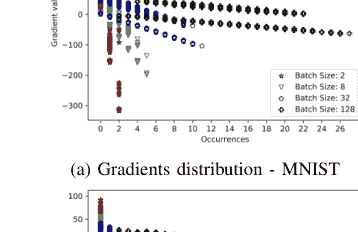
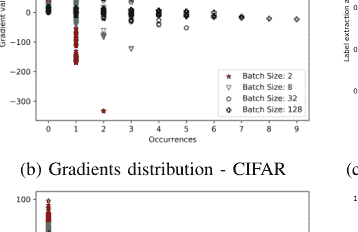
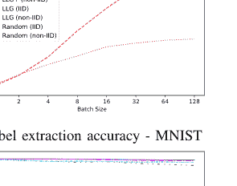
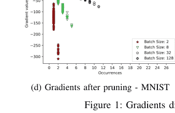
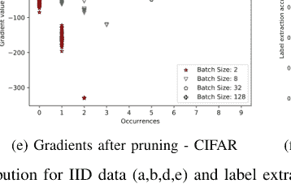
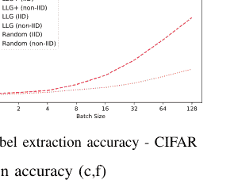

# 2021 IEEE 第18届年度消费者通信与网络会议（CCNC）


摘要——当今世界中多种设备的高度互联使得分布式机器学习能够让多个分布式用户通过共享梯度在网络中构建联合模型。在本文中，我们通过提出LLG算法揭示了共享梯度的隐私风险，该算法能够从用户共享的梯度中披露其训练数据的标签。我们在两个数据集上进行了实证分析，以证明我们算法的有效性。结果表明，我们的方法在不同场景下都能以高准确率有效地提取标签。

关键词——分布式机器学习，隐私，梯度泄露

## I. 引言与动机

互联网的出现使得许多服务（例如在线购物和社交网络）得以简化和丰富每个人的生活。许多服务提供商采用机器学习（ML）模型来进一步改进其服务，例如实现各种个性化。这些模型大多以集中方式训练，即用户数据被收集并在中央服务器上进行处理。这些发展以及人们对潜在威胁认识的提高，导致许多用户对个人数据的使用及随之而来的隐私问题产生了担忧。在此背景下，谷歌等公司引入了分布式机器学习设置，例如新兴的联邦学习（FL）[5]。这一趋势也得益于当前雾计算和边缘计算的进步。

联邦学习使服务提供商和用户能够在不需要在集中场所收集个人信息的情况下利用机器学习的力量。这样，用户以分布式方式协作训练ML模型。然后收集并聚合每个用户的个体模型，以建立与传统集中训练的ML模型具有相似性质的联合模型。这减轻了隐私担忧带来的一些压力，因为个人信息永远不会离开用户的设备。然而，为了聚合各个用户的模型，他们需要共享其模型的梯度，即共享模型更新。共享梯度曾被认为是安全且私密的，因为梯度被认为不会泄露用户训练数据集的相关信息[7]。

近期，Zhu等人[7]提出了一种攻击方法，即深度梯度泄露（DLG），该方法可以从共享梯度中重建训练数据和标签。在他们的攻击中，他们考虑了分类任务，其中标签指的是输入数据的类别，这可能是高度敏感的信息，例如在癌症分类模型中。然而，DLG并不能可靠地提取真实标签[6]。Zhao等人[6]提出了改进的深度梯度泄露（iDLG），这是一种基于神经网络最后一层权重梯度的符号来提取真实标签的简单方法。虽然他们的方法可靠且能100%准确地检测出正确标签，但它仅适用于由单个数据样本生成的梯度。这一局限性使得所提出的方法在现实场景中无法应用，因为现实场景中通常是在对一批样本训练模型后才共享梯度。

在本文中，我们提出了一种从共享梯度中提取真实标签的算法——标签梯度泄露（LLG）。与iDLG [6]不同，LLG被设计用于处理通过一批样本训练模型所产生的梯度。我们的算法基于最后一层梯度值的两个性质，这些性质揭示了标签与最终梯度值之间的关系。我们通过对梯度及其在模型训练过程中的变化进行实证分析，推导出了这些性质。我们在MNIST和CIFAR-100数据集上评估了我们的算法。初步结果表明，LLG能够以非常高的准确率提取真实标签。

本文其余部分的结构如下。在第二部分，我们将介绍梯度和信息泄露的相关背景及工作。我们在第三部分详细阐述我们的方法。然后，在第四部分我们展示分析的中期结果。最后，我们在第五部分总结本文并介绍未来的研究方向。

训练一个神经网络包括优化网络权重W以最小化损失函数l。梯度∇W是损失函数l关于权重W的导数。梯度∇W代表用于沿正确方向更新权重的方向和大小。

## II. 背景与相关工作

训练一个神经网络包括优化网络权重W以最小化损失函数l。梯度∇W是损失函数l关于权重W的导数。梯度∇W代表用于沿正确方向更新权重的方向和大小。

Zhu等人[7]提出了一种利用分布式学习中的共享梯度来重建训练数据的攻击方法。作者生成虚拟输入数据和输出标签，然后尝试优化它们以生成与共享梯度匹配的虚拟梯度。这样一来，虚拟数据和标签将收敛到参与者在训练过程中使用的真实数据和标签。然而，人们观察到他们生成正确标签的方法并不是最优的[6]。

Zhao等人[6]通过提出一种从共享梯度中提取真实标签的分析方法解决了这个问题。作者证明，对于正确的标签，分类（交叉熵）损失关于最后一层权重的梯度值为负。因此，检测负梯度就足以提取正确的标签。然而，他们的方法仅适用于从单个样本生成的梯度情况。这意味着参与者训练中使用的批次必须只包含一个样本。使用大小为1的批次在现实应用中是非常不可能的场景。参与者通常会有多个样本，并且他们会在与其它方共享梯度之前在这些样本（至少是一批）上训练模型。在我们的工作中，我们考虑到了这个问题，并提出了一种适用于任意批次大小的算法。

## III. 方法论

在本节中，我们首先介绍我们的问题设置，然后详细阐述我们算法所基于的两个梯度性质。根据这些性质，我们定义了两个参数：影响（impact）和偏移（offset）。然后，我们描述了我们用于从共享梯度中提取真实标签的算法LLG。

### A. 问题设置

我们考虑一个分布式机器学习场景，其中参与者在一批数据样本上对一个神经网络进行一次迭代训练（特别地，我们假设批次中包含多于一个数据样本）。然后，参与者将训练过程产生的梯度与其它方（例如服务提供商）共享。我们假设神经网络模型由L层组成，并使用交叉熵损失在分类任务的一次性（one-hot）标签上进行训练。

对于我们的算法，我们考虑关于最后一层权重W_L的梯度∇W_L（在输出层和前一层的权重之间）。梯度向量∇W_i^L代表输出层上连接到标签i的梯度。我们用g_i表示∇W_i^L所有元素的总和。

g_i = 1/|T| · ∇W_i^L

为了简化，在本文其余部分中我们将g_i称为标签i的梯度。

### B. 梯度性质

我们通过实证分析推导出梯度的两个性质。在第四部分中，我们提供额外的证据来支持这些性质。

- 性质1：梯度g_i的负值表明标签i出现在训练数据批次中。
- 我们的实证分析表明，负梯度的出现对应于训练数据批次中的一个标签。
- 性质2：梯度g_i的大小是标签i在训练数据批次中出现次数的指示指标。
- 在我们的分析中，我们发现了一些指标表明梯度值与出现次数相关。例如，标签i在训练数据批次中出现一次会导致梯度值为−x，而标签j出现两次会导致梯度值为−2x。

### C. 影响与偏移参数

根据我们的观察，我们将影响m定义为批次中一个标签出现一次所导致的梯度值的变化。该值总是负数（见性质1）。由于梯度值的变化无论对应哪个标签都是相同的，我们假设影响m与标签无关。

我们还注意到，在某些情况下，梯度值会偏移一个未知的正值。我们称这个值为偏移s。基于我们的观察，我们推测偏移s是由于权重优化过程中的误分类惩罚而产生的。也就是说，如果标签i的一个样本被错误分类为标签j，优化算法会向标签j的梯度添加一个惩罚（即正值）。由于这个偏移值可能因标签而异，我们认为它是一个特定于标签的值。

如方程(2)所总结的，出现次数c_i乘以影响m再经过偏移s_i修正，可以作为标签i梯度值的估计量。

c_i * m + s_i ≈ g_i

从方程(2)很容易得出，标签i的出现次数c_i可以从参数m、s_i和g_i中导出。接下来，我们讨论我们提出的估计影响m和偏移s_i的方法。

### D. 参数估计

我们提出两种场景，使我们能够同时估计影响m和偏移s_i。

- 共享梯度 在这种场景中，攻击者可以访问共享梯度。如前所述，影响是指与标签出现一次相对应的梯度值的变化。因此，变化量的平均值似乎是一个很好的估计。根据性质1，我们知道所有负梯度都表示训练数据批次中存在的标签。因此，我们提出将负梯度值之和除以批次大小b来得到估计的影响值。然而，经验上我们注意到乘以因子(1+1/n)可以提高提取标签的准确率，其中n是标签总数。

m = ∑_{i; gi<0} (g_i) / b * (1 + 1/n)

在这种场景中，偏移s_i无法被估计，因此被忽略。我们的结果表明，准确率仍然足够高，可以进行成功的攻击。

- 辅助知识 在第二种场景中，攻击者可以访问共享梯度以及一个包含所有标签的数据集样本。利用这个样本，攻击者可以训练模型并分析得到的梯度值，通过多次本地运行来估计影响m和偏移s_i。

对于影响，我们使用类似于方程(3)的公式，只不过我们对所有梯度求和，而不仅仅是负梯度。这源于对所用批次的了解……


训练数据以及对手选择数据到批次以微调其参数的能力。

$$m = \frac{\sum_{i=1}^{n}(g_i)}{b} \ast \left(1 + \frac{1}{n}\right) \tag{4}$$

为了估计标签 $i$ 的偏移量，我们传递仅包含其他标签的批次 $\forall j \in [1,n] : j \ne i$，每个批次仅包含一个标签，每个运行一个批次。我们对各种批次大小重复此操作。总运行次数为 $t$。在这些运行中，标签 $i$ 的梯度在一定程度上反映了模型错误预测该标签时标签 $i$ 受到的惩罚。因此，我们计算这些梯度的均值作为我们估计的偏移量。

$$s_i = \frac{\sum_{k=1}^{t}(g_{ik})}{t} \tag{5}$$

### E. 来自梯度的标签泄露算法

基于属性 1 和 2 以及估计的影响 $m$ 和偏移 $s_i$，我们提出了 LLG，其在算法 1 中进行了说明。(1) 我们首先基于梯度的负值提取标签。因此，每个负值的标签都会被添加到提取的标签列表中。(2) 我们通过从梯度中减去它来消除偏移。在没有辅助知识的情况下，偏移被假定为零。(3) 我们选择梯度中的最小值并将对应的标签添加到提取的标签列表中。我们重复步骤 (3)，直到提取的标签列表的大小与批次大小匹配。每次在步骤 (1) 和 (3) 中将标签添加到提取的标签中时，我们都会从相应的梯度中减去影响。算法的输出是提取的标签列表，其中包含批次中每个数据样本的对应标签。

```
**Algorithm 1** Label Leakage from Gradients (LLG)

**Require:** $G = \{g_1, \ldots, g_n\}$: set of gradients, $m$: impact,
$S = \{s_1, \ldots, s_n\}$: set of offsets, $b$: batch size

**Ensure:** $lbls$: empty list for extracted labels

1: **for all** $g_i \in G$ **do**
2: &nbsp;&nbsp;&nbsp;&nbsp;**if** $g_i < 0$ **then**
3: &nbsp;&nbsp;&nbsp;&nbsp;&nbsp;&nbsp;&nbsp;&nbsp;append $i$ to $lbls$
4: &nbsp;&nbsp;&nbsp;&nbsp;&nbsp;&nbsp;&nbsp;&nbsp;$g_i \leftarrow g_i - m$
5: &nbsp;&nbsp;&nbsp;&nbsp;**end if**
6: **end for**
7: $G \leftarrow G - S$
8: **while** $|lbls| < b$ **do**
9: &nbsp;&nbsp;&nbsp;&nbsp;Find $g_i : g_i = \min(G)$
10: &nbsp;&nbsp;&nbsp;&nbsp;append $i$ to $lbls$
11: &nbsp;&nbsp;&nbsp;&nbsp;$g_i \leftarrow g_i - m$
12: **end while**
13: **return** $lbls$
```

## IV. 实验

本节报告了对梯度值的实证分析，以证明属性 1 和 2 的有效性，并评估 LLG 算法在有无辅助知识情况下的准确性。

我们在两个数据集 MNIST [3] 和 CIFAR-100 [2] 上的分类任务上运行实验。为了与之前的工作进行适当的未来比较，我们复制了 [6] 中使用的设置。因此，我们使用 LeNet [3] 结构作为神经网络。作为优化器，我们使用学习率为 1 的 L-BFGS。我们在大小为 $2^k$ 的批次上训练神经网络，其中 $k \in [0,7]$。在分布式学习中，参与者的数据可以是 *独立同分布* (IID) 或 *非独立同分布* (non-IID)。我们在实验中考虑了两者。对于 IID 数据，批次的样本是从数据集中随机选择的。对于非 IID 数据，我们从一个随机标签 $i$ 中选择 50% 的批次样本，从另一个标签 $j$ 中选择 25%。剩余的 25% 批次随机选择。我们使用随机初始化的网络重复所有实验 1,000 次并报告平均值。

### A. 梯度分析

在我们的分析中，我们关注梯度 $G = \{g_1, \ldots, g_n\}$，其中 $g_i$ 如公式 (1) 所定义。我们研究的梯度数量对应于标签的数量。对于 MNIST，我们有 $n = 10$ 个值，而在 CIFAR-100 中，我们检查 $n = 100$ 个值。考虑到实验设置的多种多样性和重复性，我们总共分析了 1,760,000 个梯度。

为了证明属性 1 的有效性，我们审计了梯度的符号。我们发现 100% 的负梯度对应于批次中存在的标签，如表 I、关系 1 所示，这与属性 1 相符。因此，所有不存在的标签都对应于正值。然而，我们也在关系 2 中注意到 6%-18% 的现有标签具有正梯度。我们假设这是我们在第 III-B 节中引入的偏移参数造成的。

为了更详细地说明影响和偏移参数，我们绘制了 IID 数据的梯度值分布，如图 1.(a,b) 所示。x 轴表示批次中标签 $i : \forall i \in [1,n]$ 出现的次数，而 y 轴表示相应梯度 $g_i$ 的值。对于所有批次大小，我们可以看到梯度的值随着出现次数的增加而持续下降（以大致恒定的步长）。这反过来符合属性 2 和我们对影响参数的定义。我们还观察到，不同出现次数之间梯度值的下降在标签之间大致恒定，因为图包含所有标签。这证实了我们之前讨论的假设，即影响是不依赖于标签的。此外，我们注意到影响的幅度与批次大小负相关。也就是说，批次中样本越多，不同出现次数的梯度变化越小。

我们看到梯度在负值和正值之间的分布。如前所述，偏移到正值的值使得标签提取更加困难。因此，我们在算法 1 中通过从梯度中减去偏移来修剪梯度。我们按第 III-D 节解释的方式估计偏移值。在图 1.(d,e) 中，我们可以看到修剪后的梯度，以及它们如何变得主要为负值。修剪过程消除了偏移的影响，使值更加一致，从而更容易用于提取标签。





(a) 梯度分布 - MNIST
(b) 梯度分布 - CIFAR
(c) 标签提取准确率 - MNIST





(d) 修剪后的梯度 - MNIST
(e) 修剪后的梯度 - CIFAR
(f) 标签提取准确率 - CIFAR

图 1：IID 数据的梯度分布 (a,b,d,e) 和标签提取准确率 (c,f)

表 I：梯度符号与真实标签之间的关系。

| 关系 | MNIST IID | MNIST non-IID | CIFAR-100 IID | CIFAR-100 non-IID |
|---|---|---|---|---|
| (1) 负值 ⟹ 存在 | 100% | 100% | 100% | 100% |
| (2) 存在 ⟹ 正值 | 18% | 16% | 6% | 7% |

### B. 标签提取准确率

准确率表示正确提取的标签数量除以提取的标签总数。我们在上述所有实验中应用我们的算法并评估其在有无辅助知识情况下的准确性。我们将具有辅助知识的算法称为 LLG+。我们将准确率与随机猜测作为基线进行比较。图 1.(c) 显示了 MNIST 的准确率。我们可以看到 LLG+ 成功检测到批次大小 ≤ 128 时 > 98% 的真实标签。LLG 在 IID 和非 IID 数据上的准确率分别为 > 80% 和 > 85%。我们注意到，对于增加的批次大小（> 64）和 IID 数据，LLG 的表现与随机猜测相似。有趣的是，如图 1.(f) 所示，LLG 在 CIFAR-100 数据集上的表现几乎与 LLG+ 相同。LLG 和 LLG+ 在 IID 和非 IID 数据上的准确率均 > 96%。与 MNIST 相比，随机猜测在 CIFAR-100 上的表现较差，因为 CIFAR-100 中的标签数量远大于 MNIST。

## V. 结论与未来工作

我们提出了 Label Leakage from Gradients (LLG)，一种从分布式机器学习中共享的梯度中提取真实标签的算法。我们通过初步实证分析证明了我们方法的有效性。作为下一步，我们将使用神经网络的各种超参数、其结构和额外数据集进行更广泛的实验。我们将评估 DLG 攻击 [7] 与我们算法结合的保真度。最后，我们目前正在研究能够减轻 LLG 风险的防御机制。

## 致谢

由德国研究基金会 (DFG, German Research Foundation) 资助 - 251805230/GRK 2050。

## 参考文献

[1] Yoshinori Aono, Takuya Hayashi, Lihua Wang, Shiho Mori, 等. 隐私保护深度学习：重新审视与增强。载于 International Conference on Applications and Techniques in Information Security, 页码 100–110。Springer, 2017。
[2] Alex Krizhevsky, Geoffrey Hinton, 等. 从微小图像中学习多层特征。2009。
[3] Yann LeCun, Léon Bottou, Yoshua Bengio, 和 Patrick Haffner. 应用于文档识别的基于梯度的学习。Proceedings of the IEEE, 86(11):2278–2324, 1998。
[4] Dong C Liu 和 Jorge Nocedal. 关于大规模优化的有限内存 BFGS 方法。Mathematical programming, 45(1-3):503–528, 1989。
[5] H Brendan McMahan, Eider Moore, Daniel Ramage, Seth Hampson, 等. 从去中心化数据中高效通信地学习深度网络。arXiv preprint arXiv:1602.05629, 2016。
[6] Bo Zhao, Konda Reddy Mopuri, 和 Hakan Bilen. idlg: 从梯度改进的深度泄露。arXiv preprint arXiv:2001.02610, 2020。
[7] Ligeng Zhu, Zhijian Liu, 和 Song Han. 来自梯度的深度泄露。载于 Advances in Neural Information Processing Systems, 页码 14747–14756, 2019。
