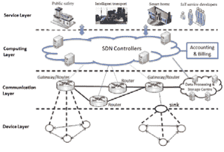

# 2021 IEEE 第18届国际软件架构大会 伴刊

摘要——当今物联网网络因其广泛的攻击面而在其基础设施中面临众多安全漏洞。大规模网络正越来越多地采用软件定义网络（SDN）方法，通过网络虚拟化实现简化的网络控制和管理。由于传统安全机制无法处理虚拟化环境，软件定义安全（SDSec）被引入作为支持虚拟化基础设施的解决方案，专门旨在为SDN框架提供安全解决方案。为了进一步支持SDN框架的大规模设计和开发，模型驱动工程（MDE）被提议在设计阶段使用，因为抽象、自动化和分析本质上是MDE的关键方面。这提供了一种通过模型来简化大型问题的有效方法，这些模型抽象掉了整个系统复杂的技术细节。对这些模型进行适应性调整以解决物联网网络中面临的安全问题，可大幅降低成本并提高效率。这些模型可以被模拟、分析，并支持架构模型自适应；模型变更随后会反映回真实系统。我们提出了一种用于SDSec网络的模型驱动安全方法，该方法可利用机器学习进行自适应以缓解安全威胁。整体设计时的变更可以在运行时通过机器学习技术（例如深度学习和强化学习）进行监控，以进行实时分析。这种方法可以在物联网模拟环境中进行测试，例如使用CAPS物联网建模与仿真框架。利用模型的自适应和先进的数据分析机器学习技术，将确保SDSec架构随着时间的推移不断适应和改进。这大大减少了整体攻击面，从而在物联网环境中实现更高的端到端安全性。索引术语——模型驱动工程、SDN、SDSec、物联网、自适应、机器学习、安全

# I. 动机

世界上有许多行业和组织将物联网用于其软件服务和应用程序。因此，针对这些服务存在许多平台实现[8]。这样一个动态且异构的环境是黑客的主要目标。

物联网参考架构通常包含以下层——感知层、网络层和应用层[8]。安全漏洞可能出现在上述任何物联网层中。物联网基础设施中的许多安全威胁是由于在物联网系统早期设计阶段对安全需求考虑不足而产生的。设计决策更侧重于整个系统的功能性和非功能性需求[16]。物联网面临的安全问题可分为以下两类——通用威胁和架构层威胁。

通用威胁如下：硬件漏洞[2]、社会工程/用户意识[14]、立法变更[17][4]以及拒绝服务/分布式拒绝服务（DoS/DDoS）攻击[6]。

架构层威胁简要列举如下[8]：

- 物理/感知层——窃听、电池耗尽攻击、硬件故障、恶意数据注入、节点克隆等。
- 网络层——碰撞攻击、信道拥塞攻击、电池耗尽攻击、DoS攻击、中间人攻击（MITM）等。
- 应用层——跨站脚本（XSS）攻击、应用程序安全薄弱引发的威胁、注入攻击等。

由于物联网系统中的大多数攻击是利用受感染的物联网设备进行的DDoS攻击[1]，我们主要关注物联网网络层中的安全漏洞。物联网网络必须能够自我保护和自适应以缓解安全威胁。使用机器学习实现大规模系统的自适应因其复杂性和规模而受到广泛研究[15]。这些解决方案也被提议用于复杂系统中的网络控制，因为它们通过抽象底层网络架构而具有可管理性、动态性、成本效益和适应性等固有特性[5]。

# II. 背景

软件定义网络（SDN）通过使底层网络控制可编程，为物联网中的网络管理提供了编排能力。SDN的工作原理是将控制平面与数据平面分离，以利用软件程序促进网络的高效管理和运营[3]。SDN架构的概述[11]如图1所示。随后，SDSec作为SDN网络的安全支持解决方案被引入，其工作方式与SDN类似，通过将转发和处理平面[9]与安全控制回路分离，提供一种设计、部署和管理安全机制的新方式，以实现自适应。

图1. 基于SDN的分层物联网架构——（Y. Li 2016）

传统安全机制无法检测虚拟化环境内部的活动，也无法处理来自新虚拟网络拓扑的威胁。这些新威胁包括来自虚拟机监控程序的威胁以及SDN控制器的单点故障。此类SDN框架的开发高度复杂，需要工具和方法论来充分探索SDN的抽象能力[7]。

抽象此类复杂系统是模型驱动工程（MDE）最强大的方面之一。MDE是一种侧重于创建大型系统概念模型的方法，这些模型可用于生成流程、结构、代码等。该领域的进展表明，目前已有研究旨在使用MDA和MDN范式为SDN应用的开发创建基于模型的设计方法[7]、[11]。然而，据我们所知，针对SDN框架的基于模型的设计，尤其是强调物联网网络安全方面的研究还不多。当前存在的开放问题在于开发能够对虚拟化安全威胁进行运行时自适应的大规模SDsec框架。

我们提出了一种基于模型的SDsec框架设计方法，该方法可利用机器学习进行自适应。使用基于模型的方法允许我们在设计时对模型进行更改，并在运行时将这些更改反映回SDsec架构以缓解安全威胁。这种方法使我们能够在SDN/SDSys框架的设计阶段提高抽象级别，从而获得在此背景下采用MDE带来的诸多优势[10]。

我们旨在通过首先唯一地识别SDN网络中传统威胁与虚拟化威胁来实现上述方法。然后可以分析现有的SDN网络，以识别被利用来危害系统的攻击向量。底层网络拓扑的变化通常需要手动重新配置和响应底层网络控制器的操作。这可以通过使用机器学习的自适应模型来自动化。机器学习技术（例如深度学习）被用于监控网络流量和进行数据分析以检测异常[13]。此类分析的结果可被SDsec模型用于相应地适应，遵循MAPE-K

这种自适应SDsec模型在实际部署中的实现将用于展示其效率。CAPS是一种基于架构的网络物理系统建模工具，用于开发CPS生态系统[12]。将SDsec框架添加到该仿真工具中，可用于测试和模拟大规模物联网网络。总体而言，我们的方法将确保SDsec框架随着时间的推移而改进，并适应动态网络拓扑。

# 参考文献

- [1] Mahmoud Al-Ayyoub, Yaser Jararweh, Elhadj Benkhelifa, Mladen Vouk, Andy Rindos, et al. Sdsecurity: A software defined security experimental framework. In *2015 IEEE international conference on communication workshop (ICCW)*, pages 1871–1876. IEEE, 2015.
- [2] Pooja Anand, Yashwant Singh, and Arvind Selwal. Internet of things (iot): Vulnerabilities and remediation strategies. In *The International Conference on Recent Innovations in Computing*, pages 265–273. Springer, 2020.
- [3] Kamal Benzekki, Abdelsam El Fergougui, and Abdelkik Elbelrhiti Elalaoui. Software-defined networking (sdn): a survey. *Security and communication networks*, 9(18):5803–5833, 2016.
- [4] Peter Edemekong, Pavan Annamaraju, and Micelle Haydel. Health insurance portability and accountability act. *StatPearls*, 2020.
- [5] Open Networking Foundation. Software-defined networking: The new norm for networks. *ONF White Paper*, 2(2-6):11, 2012.
- [6] Hamidreza Ghorbani, M Saeed Mohammadzahed, and M Hossein Ahmadzadegan. Ddos attacks on the iot network with the emergence of 5g. In *2020 International Conference on Technology and Entrepreneurship-Virtual (ICTE-V)*, pages 1–5. IEEE, 2020.
- [7] Adra Hammoud, Mohamed Lahmer, Samir Mbarki, and Fatima Sifou. The contribution of mda in software-defined network: A survey. In *Advancements in Model-Driven Architecture in Software Engineering*, pages 118–134. IGI Global, 2020.
- [8] W. Iqbal, H. Abbas, M. Daneshmand, B. Rauf, and Y. A. Bangash. An in-depth analysis of iot security requirements, challenges, and their countermeasures via software-defined security. *IEEE Internet of Things Journal*, 7(10):10250–10276, 2020.
- [9] Yaser Jararweh, Mahmoud Al-Ayyoub, Ala Darabseh, Elhadj Benkhelifa, Mladen Vouk, and Andrew Rindos. Software defined cloud: Survey, system and evaluation. *Future Generation Computer Systems*, 58, 10 2015.
- [10] Anneke G Kleppe, Jos Warmer, Jos B Warmer, and Wim Bast. *MDA explained: the model driven architecture: practice and promise*. Addison-Wesley Professional, 2003.
- [11] Yuhong Li, Xiang Su, Jukka Riekki, Theo Kanter, and Rahim Rahmani. A sdn-based architecture for horizontal internet of things services. In *2016 IEEE International Conference on Communications (ICC)*, pages 1–7. IEEE, 2016.
- [12] H. Muccini and M. Sharaf. Caps: Architecture description of situational aware cyber physical systems. In *2017 IEEE International Conference on Software Architecture (ICSA)*, pages 211–220, 2017.
- [13] G. Nguyen, S. Dlugolinsky, V. Tran, and Á. López García. Deep learning for proactive network monitoring and security protection. *IEEE Access*, 8:19696–19716, 2020.
- [14] Pendukeni Phalaagae, Adamu Murtala Zungeru, Boyce Sigweni, Joseph M Chuma, and Thabo Semong. Iot sensor networks security mechanisms/techniques. In *Green Internet of Things Sensor Networks*, pages 97–117. Springer, 2020.
- [15] F. Quin, D. Weyns, T. Bamelis, S. Singh Buttar, and S. Michiels. Efficient analysis of large adaptation spaces in self-adaptive systems using machine learning. In *2019 IEEE/ACM 14th International Symposium on Software Engineering for Adaptive and Self-Managing Systems (SEAMS)*, pages 1–12, 2019.
- [16] Jonathan Tournier, François Lesueur, Frédéric Le Mouël, Laurent Guyon, and Hicham Ben-Hassine. A survey of iot protocols and their security issues through the lens of a generic iot stack. *Internet of Things*, page 100264, 2020.
- [17] Paul Voigt and Axel Von dem Bussche. The eu general data protection regulation (gdpr). *A Practical Guide, 1st Ed., Cham: Springer International Publishing*, 2017.

