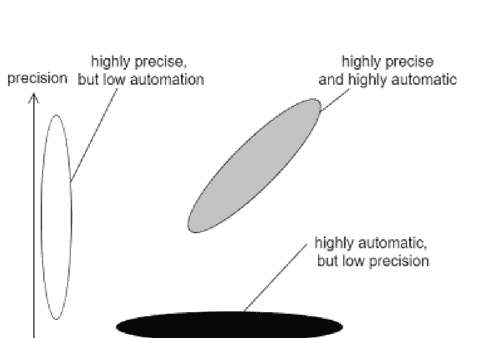

# 2021 IEEE 第19届世界应用机器智能与信息学研讨会 (SAMI)(斯洛伐克，赫尔尼亚 2021.1.21-2021.1.23) 应用机器智能与信息学

第一作者 Norbert Somogyi
自动化与应用信息系
布达佩斯理工大学
匈牙利，布达佩斯
somogyi@edu.bme.hu

第二作者 Gábor Kövesdán
自动化与应用信息系
布达佩斯理工大学
匈牙利，布达佩斯
kovesdan@vik.bme.hu

**摘要**——随着软件工程技术和实践的不断演进，使用旧版技术栈创建的程序通常被称为遗留代码（legacy code）。自然地，利用新型且更有效的技术使遗留代码更易维护和运行变得至关重要。目前已有许多方法被提出，并试图通过半自动将遗留系统转换为更现代的架构来降低实现成本。然而，这些努力的结果在范围和质量上往往非常有限。

**索引词**——代码现代化，分析，机器学习

维护过时的软件始终需要开发者投入巨大的精力。随着软件的增长和时间的推移，维护这些软件变得越来越困难。随着时间的推移，软件工程技术不断进步。新的实践和范式可能受益于应用开发，这对于遗留系统可能很有用处 [1]。当人们自然需要使用新工具重新实现这些系统时，一种更现代的方法应运而生，但在实践中这是极其困难的。首先，新的实现必须与原程序实质等效。

项目编号 FIEK_16-1-2016-0007 在匈牙利国家研究发展基金的支持下实施，该资金来自高等教育与工业运营中心 - 研究基础设施开发（FIEK_16）资助计划。

现代化的重新实现本身上是一个耗时且昂贵的过程。

为了使这些困难更易处理，将遗留代码辅助转换为更具优势的环境是理想的。根据所要翻译的具体软件，例如，许多工具侧重于架构转换，这是两种语言之间最常见且必要的转变。将范式转换为面向对象或函数范式是一项任务。然而，源语言和目标语言之间的语言差异导致遗留系统的某些结构可能不受目标语言的支持。在某些情况下，需要消除此类结构。

在本文中，我们展示了机器学习在软件现代化中的应用。我们介绍了遗留代码转换过程中出现的一个分类问题研究。我们的目标是首先通过静态分析来解决这个问题。最后，我们比较了结果，以查看机器学习可以在经典静态分析的基础上改进多少。我们基于AI的方法是全自动且高精度的，正如我们所看到的，这是一个稀有但理想的结果。

本文的结构如下：第2节通过与之相关的问题和解决方案介绍了维护和分析的困难。第3节，我们探索了自动化和精确化的方法。第4节，我们展示了指针转换的案例研究。第5节我们介绍了使用机器学习分析的问题的解决方案。最后，第6节总结了全文并强调了某些必须在目标语言中的内容。例如，C语言的指针算术无法转换为Java，后者没有等效的转换。

遗留软件的维护一直是一个难题。研究人员努力确定维护软件的困难。Harrington和 Walton [2] 断言，对于许多组织而言，维护遗留软件意义重大。一项为期三年的研究发现，在某些情况下，维护这些系统占据了所有成本的大部分。他们还确定最复杂的系统并不是成本最高的，因此否定了LOC（代码行数）作为维护指标的有效性。

在其他情况下，静态代码分析证明无法提供可靠的、全自动的解决方案。在这些场景中，人们必须在关注力和无错误生成之间进行权衡。如前所述，这通常表现为多选题问题，其中必须选择正确的方法来转换源代码。例如，Systems [9] 开发的代码是全自动翻译。然而，在某些情况下，生成的代码感觉并不像程序员从零创建的东西那样自然。例如，在将C程序转换为Java时，转换是一项挑战。

Huijgens、Duversen和Van Jong [3] 深入研究了各种案例研究中的遗留软件维护。作者们描述了一个案例，在该案例中，采用迭代敏捷方法处理遗留系统使利益相关者认为该系统质量堪疑。他们识别了有助于遗留系统成功维护的7个关键因素。这些因素列在表1中。因此，我们可以说敏捷方法通常可以改进这些系统的成功管理。

Sneed和Snowbo [5] 分析了面向对象系统的复杂性。他们得出结论，即使这样的系统也可以被认为“至少在形式上，它们被正确建模，且系统有工具支持”。作者还声称，实际上逆向工程系统可能还不够，但对于执行维护任务已经足够了。他们声称，架构理解需要使用人工智能。

他们通过使用生成的源类模拟指针函数来转换它们。然而，全自动地，这是维护主要功能的代码以及生成的代码。另一方面，人们可能会想出其他解决该问题的方法以产生更多结果。例如，使用静态代码分析无法估计系统的状况并对其进行相应转换。显然，静态分析可以引导转换。

存在其他方法可以帮助软件版本控制系统包含用于软件维护的有用信息。他们引入了这些信息，可以与开发者活动使用。信息的可视化有助于开发者学习和理解系统，并可能提高可维护性和逆向工程过程。

另一方面，自动转换影响转换的目标。例如，如果转换的目标是创建源代码的面向对象设计，那么通过全自动方式恢复的内容是有限的，工具实现了从PL/I代码的自动转换。然而，结果的设计有其缺陷，感觉并不像程序员想要的。尽管如此，如果人们想保持过程全自动，那么什么是

软件维护以及机器学习技术的应用，用以分析遗留系统过去的维护历史。作者得出结论，通过分析过去的维护记录，可以使用机器学习预测源文件的更改是否可能包含另一个源文件的更改。例如，它可以用于检测潜在的错误并从总体上改进留留软件的维护。

最近，有一些成功的工作是自动化的。这可能包括用户交互，例如让用户选择正确的代码或识别编辑生成的代码。

达到尽可能高仍然是软件现代化的目标。存在某些局限性，研究表明完全自动转换无法完全实现。我们和Verhof [88] 强调了超出语法翻译的自动化源代码现代化的困难。如前所述，目标语言可能看起来具有某些源语言的特征。

另一种流行的方法是额外信息——代码，或者以正则表达式和图表的形式从某个角度描述系统 [11] [12]。

结论是，维护遗留代码是软件工程中复杂且重要的一部分。为了降低风险，将遗留系统转换为另一种理想的解决方案。应该努力使这些转换尽可能自动化。然而，全自动转换有其局限性，且往往不可靠。此时人们必须进行更好的权衡。

更自然的生成代码和自动化的行为。因此，同时具有这两个属性的解决方案非常罕见，但在软件现代化的背景下提供了最大的价值。

- 高精确度但低自动化
- 高精确度且高自动化
- 高自动化但低精确度

→ 自动化

如前所述，软件现代化工具（或具体的转换技术）力求最大化的两个属性是自动化和精确度。我们已经看到，这两者往往互斥，必须在它们之间进行权衡。转换越自动化，开发者需要处理的转换后工作就越少。另一方面，较高程度的自动化通常意味着精确度的下降。这可能导致两种结果：转换在多项选择决策可能会产生许多假阴性，这取决于所处理问题的复杂性；或者，转换虽然成功了，但更自动化的解决方案可能会降低生成代码的质量；遗留系统就是如此，插入指针功能导致了我们质量导向的代码，但该过程变成了全自动。

图 1. 现代化中精确度与自动化之间的关系。属于灰色地带的方法非常罕见，因此违背了代码现代化的努力。

图1描述了自动化与精确度之间的基本关系，并说明了机器学习技术在此背景下的位置。

总的来说，我们可以说一种技术的精确度和自动化成反比的。自动化程度越高，准确率越低。相比之下，机器学习技术可能同时具有高精确度（如果使用得当）和自动化，这使得它们在代码现代化中极其有用。然而，它也有一个明显的缺点：机器学习比静态代码分析方法需要更多的精力和更多的分配资源。对于任何想要执行转换的可能决策，使用机器学习通常看起来是过度设计的。因此，我们建议仅在其他更传统、更简单的方法无法产生满意结果时才使用它。在这些情况下，我们认为机器学习的优点远大于缺点。

在源代码中遇到时，必须处理它是一个 Java 数组（如果它指向数组开头）还是普通的 Java 变量（如果不是的话）。

为了解决这一静态分析，我们提出了以下解决方案：让我们默认指针不是数组，并在源代码中寻找与此矛盾的迹象。我们寻找索引运算符。对源代码的静态分析显示在变量上使用了索引操作；因此更改了变量类型，将其转换为数组。

然而，尽管使用了静态分析方法，但它仍然缺乏在实践中保持真实所需的精确度。我们在若干实验细节（见下一节）中衡量了这种方法的成功率，成功率为 58%。在这种情况下，我们从 2 个中捕获了 1 个正确的，这比使用的随机指针仅好一点。一个更有效的解决方案是要求这种方法具有全自动的特性。

在本节中，我们展示了在代码现代化中使用机器学习的案例研究。该过程出现在从 C 指针转换为 Java 变量的过程中。正如我们所看到的，该问题可以通过嵌入指针功能、使用不同的技术（如容器）来解决。如果我们使用静态代码分析，我们需要判断指针是否为数组。这在编译器层面并不是一个简单的多项选择问题，编译器看到的是指针类型。此外，应该注意，这是我们之前讨论过的典型选择问题。对于每一个：

- 是否使用索引运算符 (0 / 1)
- 是否使用指针算术 (0 / 1)
- 是否使用星号运算符 (0 / 1)
- 指针是否为参数 (0 / 1)
- 指针是否为返回值 (0 / 1)

如果答案为“否”，则每个属性赋值为 0；如果答案为“是”，则赋值为 1。指针由这六个属性组成。图2展示了一些适用于训练神经网络的示例向量。例如，第一行意味着使用了索引运算符，没有使用算术，没有使用运算符，指针不是参数，没有返回值，最后，它应该转换为数组。

## 表 I 训练期间使用的参数

| 参数 | 数值 |
| :--- | :--- |
| 输入节点 | 5 |
| 输出节点 | 1 |
| 隐藏节点 | 1 |
| 学习率 | 0.01 |
| 批大小 (Batch size) | 50 |
| 迭代次数 (Epochs) | 30 |

## 表 II 验证结果

| 参数 | 数值 |
| :--- | :--- |
| 准确率 (Accuracy) | 0.7456 |
| 精确度 (Precision) | 0.8279 |
| 回召率 (Recall) | 0.6432 |
| F1 分数 (F1 score) | 0.8343 |

维护的复杂性。我们研究了自动化此类转换的问题。在从过程化到面向对象的转换案例中，可能存在各种问题，其复杂程度使得在保持完全自动化的情况下难以准确解决。我们还分析了自动化与精确性之间的关系。在此过程中，我们发现既自动又精确的转换是最理想的。

我们还展示了将 C 指针转换为对象的案例研究。这是一个复杂的问题，现有文献尚未对该问题提供自动且高精度的文献解决方案。我们提出了一种结合静态分析和机器学习的解决方案。我们评估认为，深度学习方法在各个方面都产生了远为优越的结果。因此，我们在代码现代化中发现了日益实用的学习方法。

在未来的工作方面，我们计划收集更多样本数据，从而进一步改进我们的概念验证。我们的目标是使用机器学习解决代码现代化的其他困难案例，使 F1 分数至少达到 0.9，进一步证明这种方法优于以往的方法。

- 1. M. Feathers, Working Effectively with Legacy Code. USA: Prentice Hall PTR, 2004.
- 2. M. S. Harrison and G. H. Walton, "Identifying high maintenance legacy software," Journal of Software Maintenance, vol.14, no. 6, p. 429–446, Nov. 2011.
- 3. H. Huijgens, A. Van Boer, and R. Vanlingen, "Success factors in managing legacy system evolution: A case study," in 2016 IEEE/ACM International Conference on Software and Systems Engineering (ICSS), 2016, pp. 96–105.
- 4. A. Cockburn, Agile Software Development: The Competitive Game (2nd International Software Workshop). Addison-Wesley Professional, 2006.
- 5. H. Müller and N. T. Dohmart, "Comprehending a complex, distributed, object-oriented software system: a report from the field," in Proceedings International Workshop on Software Modernization, 1999, pp. 218–225.
- 6. Xiaoxin Wu, M. Murray, S. Story, and R. Lintern, "A reverse engineering approach to software maintenance, version control knowledge acquisition," in 11th Working Conference on Reverse Engineering, 2004, pp. 90–99.
- 7. Jeff James, Robert Paul, T. C. Lebrith, and S. Martin, "The maintenance history of a legacy software system," International Conference on Software Maintenance, 2003. ICSM 2003. Proceedings., pp. 63–70.
- 8. A. Terokhov and C. Beshov, "The realities of legacy code," IEEE Soft., vol.17, no. 7, pp. 11–23, 2000.
- 9. mySystems, "mysystems management," https://www.mysystems.com/, 2022, accessed: 2023-06-10.
- 10. M. Martin, Maintaining legacy code to java, in 2011th European Conference on Software Maintenance and Reengineering, 2011, pp. 287–292.
- 11. P. Newcomb and G. Kotik, "Reengineering procedural in object-oriented systems," in Proceedings of 29th Working Conference on Software Engineering, 1996, pp. 37–48.
- 12. H. Gall and R. Kock, "Program transformation to enhance the reuse potential of legacy software," in Proceedings of the 1994 ACM Symposium on Applied Computing, set SAC . New York, NY, USA: Association for Computing Machinery, 1994, p. 99–104.
- 13. X. Chen and Liu, "Understanding the fidelity of training deep feedforward neural networks," Journal of Machine Learning Research - Proceedings Track, vol. 9, pp. 249–256, 2010.

00365

