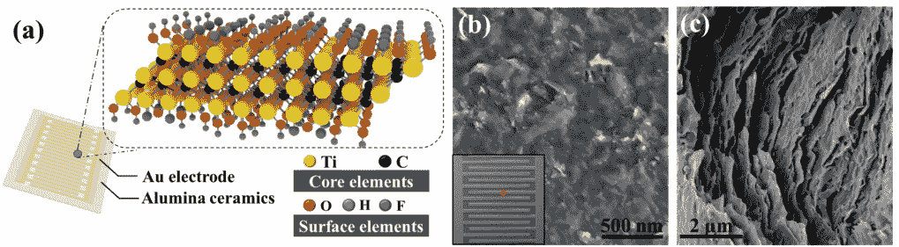
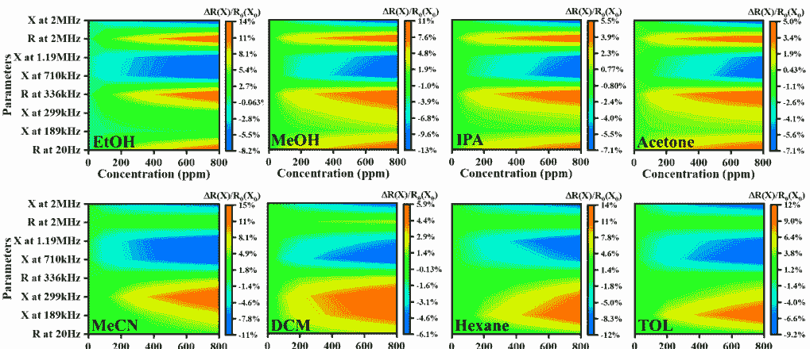
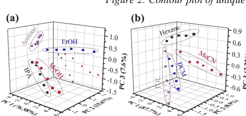
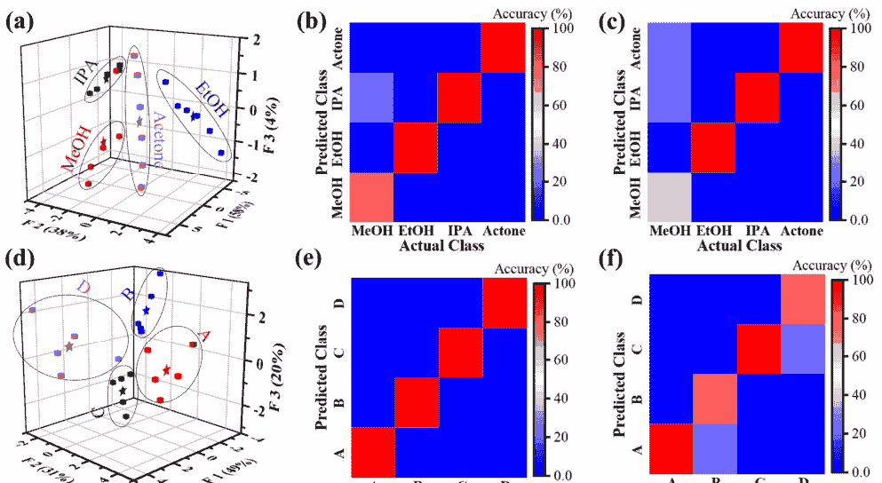
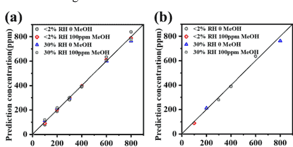

# [2021 IEEE 第34届国际微机电系统会议 (MEMS)(美国佛罗里达州盖恩斯维尔 2021.1.25-2021.1.29)] 2021 IEEE 第34届国际微机电系统会议

## 摘要

二维过渡金属碳化物/氮化物，即MXene，最近在气体传感应用方面受到了广泛关注。然而，MXene对多种挥发性有机化合物（VOCs）具有强吸附性，因此基于MXene的气体传感器通常选择性较差。在此，我们开发了一种基于Ti3C2Tx的多变量传感器，可用于识别不同的VOCs，并在可变背景下预测目标VOC的浓度。传感器从宽带阻抗谱中获得的响应为每种VOC创建了独特的指纹。基于主成分分析和线性判别分析的方法，我们利用这种多变量传感器对不同类型的VOCs及其混合物进行了高精度识别。此外，我们证明在存在不同浓度的水和甲醇时，乙醇浓度预测的准确率为93.2%。较高的识别水平和浓度估计表明，基于MXene的多变量传感器在已知和未知干扰存在下检测目标VOCs方面具有巨大潜力。

## 关键词

MXene；2D材料；选择性；多变量VOC感应；宽带阻抗谱。

## 引言

气体传感在近年来引起了相当大的研究兴趣 [1, 2]。特别是，呼出气体中挥发性有机化合物（VOCs）的检测被视为早期疾病诊断的一种有前景的方法 [3]。在人类呼出气体中已检测出约200种VOCs，这些VOCs的含量反映了一个人的身体状况 [4]。因此，气体传感器不仅需要灵敏地检测单个VOC，还需要在复杂背景下有效地区分不同的VOCs并定量特定的目标VOC。

二维（2D）材料是气体传感应用中最有前途的材料之一，因为它们具有大比表面积、多样的表面化学性质以及在室温下进行灵敏检测的能力 [5]。最近，基于一种称为MXene的新型二维材料家族的气体传感器也显示出有前途的性能 [6]。作为二维过渡金属碳化物/氮化物之一，MXene具有金属导电性，而其表面覆盖有官能团。这种良好的组合使得基于MXene的气体传感器相比其他二维材料基传感器具有超高信噪比和低检测限。

然而，MXene对多种VOCs具有强吸附性。这些基于MXene的VOC传感器的选择性仍然是一个关键挑战。可以通过将传感器组合成阵列来缓解选择性差的问题 [7]。然而，传感器阵列中传感器数量的增加会增加故障的可能性。最近的突破来自多变量传感器 [8]，其中单个传感器可以产生类似于传感器阵列所产生的多维信号。这些多变量传感器大多依赖于改变感应元件的温度，以克服基于电阻（或电容）测量的传感器的交叉敏感性 [9]。然而，当应用温度循环时，感应层的材料特性可能会发生永久性变化。

在此，我们提出了一种基于Ti3C2Tx的多变量传感器，可用于识别不同类型的VOCs，并估计多VOCs混合物中单个VOC的浓度。在此方法中，我们将Ti3C2Tx薄膜沉积在指间电极（IDE）表面上以形成多变量传感器，然后将其暴露于不同浓度的一系列不同VOCs中。在各种条件下获得了基于Ti3C2Tx的传感器的宽带阻抗谱。然后将其作为有监督和无监督机器学习的输入，并系统地分析了在不同频率下获得的阻抗响应。据我们所知，这是首次报道基于MXene和宽带阻抗谱的多变量传感器。

## 实验部分

### 基于MXene的多变量传感器的制备

制备的基于Ti3C2Tx的传感器的示意图如图1a所示。传感器是通过在制备的IDE上覆盖一层Ti3C2Tx制备的。在Ti3C2Tx结构中，两层碳原子夹在三层钛原子之间。采用典型的合成方法，我们预期Ti3C2Tx的表面会随机终止于羟基（-OH）、氧（-O）和氟（-F）基团。IDE在Al2O3陶瓷基底（5 mm × 5 mm）上制备，具有11对指间Au/Ni/Cu电极（厚度分别为10 μm / 4 μm / 1 μm）。Au条之间的距离及其宽度均为100 μm。将浓度为0.05 mg/mL的Ti3C2Tx去离子水分散液滴加到制备好的IDE上，并在真空室中干燥，从而形成感应层。

### 基于Ti3C2Tx传感器数据的分析

通过将基于Ti3C2Tx的多变量传感器暴露于不同浓度的不同VOCs来研究其感应性能。宽带阻抗谱（频率范围从20 Hz到2 MHz）

图1：（a）基于Ti3C2Tx薄膜传感器的示意图。（b）基于Ti3C2Tx传感器表面的SEM图像。（c）Ti3C2Tx薄膜的横截面图。

图2：不同VOCs的独特指纹图案的等高线图。

图3：含氧（a）和非含氧（b）VOCs的前3个主成分的3D图。

的传感器进行了测量。响应定义为传感器暴露于VOCs后相对于基线阻抗的阻抗相对变化（ΔR(X)/R0(X0) (%)）。利用从宽带阻抗谱中获得的八个代表性参数开发了预测模型，即使用20 Hz、336 kHz、2 MHz处的电阻值，以及189 kHz、299 kHz、710 kHz、1.19 MHz、2 MHz处的电抗值。首先，应用主成分分析（PCA）对多变量数据进行分类并降低原始数据集的维度。PCA是一种强大的无监督分析工具，允许对传感器的区分能力进行定性调查 [10]。线性判别分析（LDA）作为一种有监督的模式识别工具进行，这意味着每个对象的正确分类是已知的。PCA中得到的主成分被用作LDA的输入变量，以定量识别不同的测试物质 [11]。采用交叉验证方法来估计识别结果。为了量化混合物中单个蒸气的浓度，我们应用了带有五个潜在变量（LVs）的偏最小二乘法（PLS）[8]。在本研究中，多变量数据处理（PCA、LDA和PLS）是在MATLAB程序中进行的。

## 结果与讨论

基于Ti3C2Tx传感器的表面形貌如图1b所示，揭示了Ti3C2Tx薄膜的均匀沉积。图1c显示了Ti3C2Tx薄膜的横截面SEM图像，该图像是通过真空过滤用于传感器制备的相同Ti3C2Tx溶液产生的。观察到的层状结构是由于单个Ti3C2Tx层的有序堆叠造成的，这导致比表面积增加，可能有助于产生较大的传感响应。基于Ti3C2Tx的传感器暴露于八种不同的VOCs（即甲醇（MeOH）、乙醇（EtOH）、丙酮、异丙醇（IPA）、乙腈（MeCN）、二氯甲烷（DCM）、正己烷和甲苯（TOL）），浓度范围从100 ppm到800 ppm，并测量了宽带阻抗谱。基于获得的阻抗谱，我们选择了上述八个代表性参数作为VOC

图 4：含氧 VOCs（a）和 VOC 混合物（d）的 LDA 结果的 3D 图。含氧 VOCs（b）和 VOC 混合物（e）的 LDA 结果。含氧 VOCs（c）和 VOC 混合物（f）的交叉验证结果。

特性。不同 VOC 浓度下不同特性参数的变化以等高线图形式描绘，如图 2 所示。在 20 Hz、336 kHz、2 MHz 处的电阻值以及在 189 kHz、299 kHz 处的电抗值表现出正响应，而在 710 kHz、1.19 MHz、2 MHz 处的电抗值在接触不同 VOCs 时表现出负响应。显然，如图 2 所示，不同 VOCs 的响应模式之间存在可辨别的差异。这表明，通过收集不同 VOC 浓度下八个参数的变化，阻抗响应数据集可用作 VOC 的独特指纹。因此，我们证明多参数传感响应为每种 VOC 创建了独特的指纹，随后可用于识别 VOC 的类型。

### 主成分分析

我们进行了 PCA 以区分具有相似响应的 VOCs，并确定多参数传感响应所得数据集的维度。两组 VOCs（即含氧 VOCs 和非含氧 VOCs）的响应分别通过 PCA 进行了分析。前三个主成分（PCs）的贡献率较高：即，PC1、PC2、PC3 分别为 76.58%、15.67% 和 7.6%（含氧 VOCs）；87.7%、8.9% 和 3.2%（非含氧 VOCs）。这表明，传感器在仅接触四种蒸气时即可获得高数据维度。

图 3 显示了前 3 个主成分的 3D 图，保留了大部分信息（总计占 99.8%）。每个点对应于特定浓度下 VOC 的完整指纹（由八个参数组成），并根据其代表的 VOC 进行着色。如图 3 所示，属于不同 VOCs 的点在空间中分离良好，表明传感器可以很好地区分 VOCs。属于同一 VOC 但浓度不同（从 100 ppm 到 800 ppm）的点大约位于同一条线上。这些结果表明，该传感器具有高数据维度，并有潜力区分不同 VOCs 并定量各个蒸气的浓度。

### 线性判别分析

为了定量识别各种 VOCs 的类型，对含氧 VOCs 进行了 LDA。图 4a 显示了 LDA 结果的 3D 图。每个点根据 VOC 类型着色，五角星表示每组点的质心。图 4a 所示结果清楚地表明，每种 VOC 都可以被很好地确定。含氧 VOCs 的 LDA 结果如图 4b 所示。达到了 95.4% 的 LDA 识别准确率，对应于 22 个总样本中 1 个误分类。交叉验证是验证所得结果的有效方法，留一法交叉验证（LOOCV）常被用作验证算法 [11]。交叉验证结果如图 4c 所示，表明达到了 90.9% 的交叉验证率。

此外，为了对传感器进行更严格的测试，已调查了其对类似 VOC 混合物的识别能力。我们使用 LDA 来区分 EtOH 和丙酮（A）、EtOH 和异丙醇（B）、丙酮和二氯甲烷（C），以及丙酮和甲腈（D）的混合物。图 4d 显示了 VOC 混合物 LDA 结果的 3D 图。从不同视角看，四种 VOC 混合物在 3D 特征空间中分离良好。如图 4e 所示，达到了 100% 的正确分类率。混合物的交叉验证结果如图 4f 所示，表明已达到 90% 的正确交叉验证率。这些结果表明，利用基于 Ti3C2Tx 的多变量传感器是识别纯 VOCs 和类似复杂混合物的一种有前途的方法。

### 偏最小二乘回归分析

我们进一步使用 PLS 来定量不同湿度水平和甲醇浓度背景下的乙醇浓度。图 5a 以简单的可视化方式展示了在变化背景存在下乙醇蒸气的定量预测。每个点的位置由其实际浓度（x 轴）和预测浓度（y 轴）给出。完美的预测将落在对角线上（即，预测与实际气体浓度相匹配）。所有 VOC 浓度都被预测得相当好，因为所有点都靠近对角线位置。使用 5 个潜变量（LVs）时，平均准确率为 93.4%。

图 5：（a）在变化背景存在下的乙醇浓度预测。（b）第二组数据集的浓度预测。

随后，使用第二次测量的数据集来研究所确定模型的鲁棒性。图 5b 展示了使用训练集获得的 PLS 系数对第二组数据集进行的浓度预测。如图 5b 所示，所有 VOC 浓度都被预测得相当好，表明基于 Ti3C2Tx 的多变量传感器是变化背景下单个 VOC 浓度预测的一种优秀方法。

## 结论

总之，我们开发了一种基于 Ti3C2Tx 的多变量传感器，用于选择性 VOC 检测。该传感器通过在 IDE 表面沉积一层薄薄的 Ti3C2Tx 薄膜制备而成。所提传感器的八个代表性参数被选为 VOC 特征，多参数传感响应为每种 VOC 创建了独特的指纹。多变量传感器在 PCA 中表现出高数据维度。在 LDA 中，分别对含氧 VOCs 和 VOC 混合物的识别达到了 90.9% 和 90% 的正确率。基于所提传感器，乙醇浓度估计准确率高达 93.4%。较高的识别水平和浓度预测真正表明了 MXene 基多变量传感器在已知和未知干扰存在下检测感兴趣 VOCs 方面的潜力。我们预期，本工作解决气体传感器交叉敏感性的策略可以轻松适应其他气体传感器，并应用于一系列新兴应用，包括农业、污染监测、食品质量保证和医疗诊断。

## 致谢

本工作得到“浙江省自然科学基金（LZ19E050002）”、“国家自然科学基金（51875521）”和“国家自然科学基金创新研究群体基金（51821093）”的支持。

## 参考文献

- [1] S. Cui 等, "基于磷烯的气体传感器的超高灵敏度和层依赖性感应性能", Nat. Commun., vol. 6, no. 1, 2015.
- [2] J. van den Broek, S. Abegg, S. E. Pratsinis, A. T. Günther, "手持式气体传感器对甲醇相对于乙醇的高选择性检测", Nat. Commun., vol. 10, no. 1, 2019.
- [3] N. Shehada, G. Brönstrup, K. Funka, S. Christiansen, M. Leja, H. Haick, "用于实世界气体感应的超灵敏硅纳米线：来自呼气挥发物组的癌症非侵入性诊断", Nano Lett., vol. 15, no. 2, pp. 1288-1295, 2014.
- [4] E. Lee, A. VahidMohammadi, B. C. Prorok, Y. S. Yoon, M. Beidaghi, D.-J. Kim, "二维碳化钛（MXene）的室温气体感应", ACS Appl. Mater. Interfaces, vol. 9, no. 42, pp. 37184-37190, 2017.
- [5] X. Liu, T. Ma, N. Pinna, J. Zhang, "用于气体感应的二维纳米结构材料", Adv. Funct. Mater., vol. 27, no. 37, 2017.
- [6] M. Wu 等, "用于室温 NH3 检测的高选择性基于 Ti3C2 MXene 的传感器", ACS Sens., vol. 4, no. 10, pp. 2763-2770, 2019.
- [7] Lichtenstein 等, "通过化学改性纳米传感器阵列对炸药进行超灵敏指纹识别", Nat. Commun., vol. 5, no. 1, 2014.
- [8] R. A. Potyrailo 等, "向着借助模仿 Morpho 蝴蝶制造的单个光电蒸气传感器超越常规传感器阵列迈进", Nat. Commun., vol. 6, no. 1, 2015.
- [9] M. Tonezzer, "基于单根 SnO2 纳米线的选择性气体传感器", Sens. Actuators, B, vol. 288, pp. 53-59, 2019.
- [10] N. C. Speller, N. Siraj, B. P. Regmi, H. Marzoughi, C. Neal, I. M. Warner, "基于膜厚、粘弹性和谐波的用于蒸气鉴别的 QCM-D 虚拟传感器阵列的合理设计", Anal. Chem., vol. 87, no. 10, pp. 5156-5166, 2015.
- [11] H. Liu 等, "通过从温度调制 p-type NiO 传感器中提取隐藏特征来鉴别 VOCs 分子", Sens. Actuators, B, vol. 293, pp. 342-349, 2019.

## 联系方式

- 谢健，电话：+86-(0) 571-87951271；xiejin@zju.edu.cn

