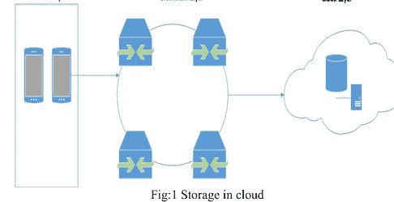
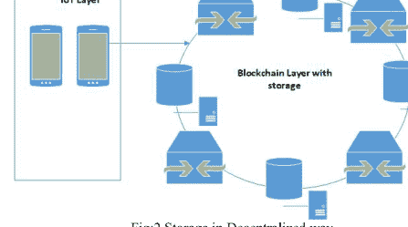
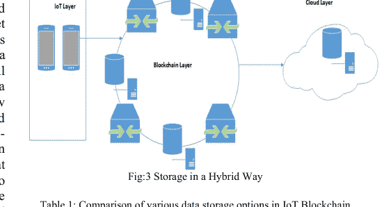

# 2021 IEEE 国际物联网、电子与机电一体化会议 (IEMTRONICS) (多伦多, 安大略省, 加拿大 2021.4.21-2021.4.24)

**Abstract—** 物联网系统中的数据存储描述了数据如何从传感器推送以及将存储在何处。在比特币中，区块中可存储的交易数量存在限制，同样在以太坊中，其受区块中的 gas 限制所限。物联网基础设施具有多个应用，其中包括从物理环境收集数据的传感器。在区块链中存储大量数据面临若干挑战，原因在于区块链的分布式特性、较高的交易处理时间和降低的可扩展性。因此，识别应存储哪些数据以及如何以安全方式存储至关重要。在本文中，我们提供了数据在各种基于区块链的物联网应用中是如何被存储的，并提供了在区块链环境中处理物联网数据的数据存储合规性。

**Keywords—** 区块链，物联网，数据存储，传感器，数据合规，云。

## I. 引言

区块链是一种近期技术，可为物联网系统提供数据安全和隐私。它使用分布式账本设计，将数据存储在网络中的多个节点中。在去中心化系统中，计算和存储任务是冗余的，这意味着去中心化网络中的每个节点都必须存储所有数据的完整副本并执行相同的数据操作。这就是区块链在节点之间维护信任并为数据提供安全性的方式。然而，当参与节点的数量增加或待存储的数据量很高时，将整个数据复制到所有参与节点并对其进行并发计算将不切实际。

现有的物联网系统使用离线或基于云的信息共享技术。它存在若干缺点，包括维护成本高、效率低，以及缺乏有效机制来确保不同系统中物联网设备身份、信息有效性、真实性、一致性和信息完整性 [1]。

区块链系统不依赖可信第三方。所有节点共同决策以验证交易的合法性。即使某些节点被攻击或被摧毁，也不会对整个区块链系统造成损害。

## II. 背景

### A. 区块链

区块链是一个分布式账本，其中区块通过加密哈希连接并分布在系统中的所有节点上。一般来说，区块链有两种类型：公有和许可制。在公有区块链中，任何人都可以加入网络或参与共识机制。比特币是公有区块链的一个例子。在许可制或私有区块链中，只有特定实体才能参与区块链流程。这通常用于涉及多个实体受限方式的应用。它会对谁可以访问数据以及谁可以参与共识进行一定控制。共识是对如何以及什么数据添加到区块链上的协议。

### B. 物联网

如 [2] 中所定义，物联网（IoT）是一种新兴的全球基于互联网的信息架构，促进全球供应链网络中商品和服务的交换。物联网数据来自大量设备，产生数十亿个数据对象。物联网网络必须与不同设备协作以采样、处理并使这些数据对分析和决策有用。实现物联网的全部潜力尚未实现。这是因为缺乏标准、设备的异构性、多样化的通信协议和安全问题 [3]。

## III. 基于区块链的物联网用例中的数据存储

大多数基于区块链的物联网应用领域包括医疗保健、智能家居、智慧城市、工业物联网和农业应用。

### A. 采用区块链的物联网设备

物联网数据存储的基于区块链的设计采用分布式访问控制和数据管理方法。在此场景中，数据所有权转移给用户，而不是遵循基于信任建模的传统集中式访问控制系统。利用基于区块链的功能，在存储层上具有可验证的分布式访问控制层的可靠且防故障的数据管理得以实践。时间关键型物联网数据的存储通过基于位置的去中心化存储系统在网络边缘得到促进，而该系统又由区块链技术管理 [4]。Quanqing Xu [5] 建议大型存储系统的并行性以缩短许多基本数据分析任务的执行时间，其中区块链可作为智能合约用于促进物联网中的合同谈判并执行它。采用基于 OSD 的智能合约（OSC）方法，其中物联网设备与此类区块链交互。对于数据分析应用，物联网设备处理器执行特定于应用的操作。这样，只将结果返回给客户端，而不是它们读取的数据文件 [5]。

### B. 医疗保健

随着智能物联网设备在医疗保健行业的出现，云计算、环境辅助生活、大数据和可穿戴设备等有前景的技术正被应用于医疗保健内的各种平台 [6]。与数据和政策相关的电子健康法规在全球范围内也在不断发展，以确定它们如何协助物联网和云计算在医疗保健行业的可持续发展，同时所有这些平台的数据也在蓬勃发展 [6]。患者的医疗数据被视为极其重要且保密。因此，医疗保健系统中的物联网设备旨在确保患者医疗数据的安全，实现正常和紧急情况下的访问控制，并支持智能去重以节省大数据存储系统中的存储空间。由医疗保健物联网网络生成的医疗文件通常会被加密并传输到存储系统，可利用跨域访问控制策略在不同医疗领域的医疗人员之间安全共享。可以遵循 Tang 等人 [7] 提出的一种智能安全去重方法，以确保在去重后所有数据用户都可以访问医疗文件或数据，并由不同的原始访问策略授权。

### C. 工业物联网(IIoT)

工业物联网的主要目标是通过产品定制、机器状况以智能方式监控、生产车间智能监控应用以及工业设备的预测性和预防性维护来提高运营效率、扩大生产规模并更好地管理工业组件和流程 [8]。在物联网设备的工业使用中，存储和检索通过集成雾计算和云计算 [9] 实现，作者还建立了一个灵活且经济的数据处理框架。这些设备中的数据在边缘服务器中进行预处理并添加时间戳后本地存储。剩余数据被发送到外部存储介质并远离本地存储以供信息检索和数据挖掘 [9]。这组数据不是时间敏感的。

### D. 智慧城市/智能家居

智能手机应用程序使用无线通信技术来控制和监控家庭功能。Domb 在 [10] 中研究了智能家居的概念及其相关数据，纳入了物联网服务和云计算。它还讨论了在传感器和执行器中嵌入智能、使用适当技术联网智能设备、节省存储空间和提高数据交换效率，以及利用云计算和存储促进与智能物体的交互，以便在不同地点轻松访问。精确、快速、开放和共享的信息系统是智慧城市应用的基础。鉴于这种庞大、分布式、异构和复杂的状态数据，传统数据的存储和管理将遇到很大困难。传统基础设施采用集中式方法，使用昂贵的服务器、大型硬盘存储硬件和关系数据库管理系统。这导致系统可扩展性差、成本更高，并且在很大程度上难以适应智慧城市应用对实时状态数据更高可靠性的需求 [11]。

### E. 农业应用

一些基于物联网的智能农业监控系统采用两层数据存储方法来存储和保护来自任何物联网设备的海量数据。Tier-1 专注于从各种传感器收集数据并使用 SD 卡本地存储。Tier-2 使用云服务器存储大量物联网传感器数据 [12]。Gill 等人 [13] 解释了使用云和大数据技术交付农业即服务（AaaS）的基于云的自主信息系统的好处。据此，AaaS 系统通过预配置设备和物联网传感器从各种用户收集信息，并在云中借助大数据分析进行处理，并自动为用户提供必要信息。

## IV. 物联网区块链中的数据存储架构

### A. 云存储

许可区块链使用云服务器存储加密的数据块。所有交易在不同的区块中并使用 Merkle Tree 创建每个区块的组合哈希并将其传输到分布式网络。这样，云数据的任何更改都可以轻松检测到。以这种方式进行存储也在一定程度上保留了去中心化 [14]。图1显示了基于区块链的物联网架构，其中云存储被用于存储物联网数据。云存储将用户数据用于相同的组。存储在云中的数据的哈希被发送到覆盖网络。将区块链的大部分存储在云中的分层存储结构有助于更快地将一天的区块链上传到云中，它在区块链覆盖网络中维护最近创建的区块。区块链连接器和云连接器是定义的两个软件接口，用于创建区块并与云协调，但这种方法的一个缺点是需要在更真实的物联网应用中实施，以确定该技术是否可靠 [15]。

### B. 以去中心化方式存储

这是一种完全去中心化的数据存储方式。Liu et al. [16] 将去中心化区块链网络和分布式存储网络集成在一起。IoT 设备产生的数据存储在点对点网络中的分布式存储节点中，而作为标识符的数据引用则存储在区块链中。区块链仅存储数据的摘要而不存储数据本身。因此，区块链上的数据量大大减少。在存储数据中使用区块链技术以及使用管理中心（包括物联网与区块链去中心化访问控制的集成）解决了管理多个受控物联网设备的难题，能够应对不同的物联网场景，但由于物联网不再是区块链技术的一部分，因此物联网中存在威胁和漏洞的可能性 [17]。图 2 显示了一种使用去中心化存储来存储物联网数据的区块链架构。使用了去中心化的云架构，其中小型数据中心满足低延迟和高带宽的要求，因为这些数据中心位于更靠近用户的位置。具有位置感知的存储和处理开发在去中心化访问控制层下发挥了其全部潜力。以预定义长度分块的数据流显示出合理的结果，但这仍处于初始阶段，需要改进 [4]。Sapphire 系统是一种用于物联网数据分析的大规模区块链存储系统，它使用基于对象的存储接口，为存储对象提供更丰富的语义信息，从而比其他存储系统更有效地优化其性能 [5]。基于区块链技术并结合边缘计算的物联网数据存储和保护的安全结构有助于管理数据存储并协助小型物联网设备完成计算。认证系统采用了无证书密码学，但需要改进区块链系统的认证方案 [18]。物联网、区块链和云技术的集成允许以受保护的方式观察患者的生命体征。区块链技术数据共享中使用的数据存储和访问显著提高了整体吞吐量，但需要使用各种物联网框架进行测试 [19]。区块链技术解决了物联网信息共享安全问题，但在应用于特定行业时性能需要增强 [1]。

图:2 以去中心化方式存储

### C. 以混合方式存储

在此方法中，数据将以混合方式存储，其中传感器处理的或原始数据存储在云服务器中，而数据的引用将存储在区块链中。Si et al. [1] 提出了一种结合数据区块链和交易区块链的双链模型。物联网数据分为轻量级数据和多媒体数据，其中多媒体数据被压缩和整合以减少数据容量并提高数据质量。处理后的数据分为账本数据和外包存储数据（多媒体数据），存储在雾节点中，可轻松下载。图 3 显示了使用混合存储的区块链架构。表 1 提供了物联网区块链架构中各种存储选项的比较。

图:3 以混合方式存储

表 1：物联网区块链中各种数据存储选项的比较

| 类型 | 存储设计 | 优点 | 缺点 | 参考论文 |
|---|---|---|---|---|
| 云 | 分层存储结构 | • 更快地将一天的区块链上传到云端 | • 尚未在更真实的物联网应用中实现 | [15] |
| 去中心化 | 具有管理中心的区块链系统 | • 在使用管理中心节点时性能最佳 | • 由于物联网不再是区块链技术的一部分，可能面临不同的威胁和漏洞 | [20] |
| 去中心化 | 数据流按预定义长度分块 | • 初始结果显示合理的开销 | • 仍处于初始阶段，需要改进 | [4] |
| 去中心化 | 基于对象的存储接口 | • 具有更丰富的语义信息，可更有效地优化存储对象的性能，优于其他存储系统 |  | [5] |
| 去中心化 | 与边缘计算相结合的区块链系统 | • 物联网数据存储和保护的安全方案 | • 需要改进基于区块链系统的认证方案 | [18] |
| 去中心化 | 使用区块链技术的数据共享 | • 整体吞吐量显著增加 | • 需要使用各种物联网框架进行测试 | [19] |
| 去中心化 | 区块链技术 | • 解决物联网信息共享安全问题 | • 应用于特定行业时性能需要增强。 | [1] |

合规性基于行业最佳实践或法规以及美国国家标准局（NIST）、ISO、HIPAA、SEC、欧洲 GDPR 等机构。由此产生的架构或程序变更是作为架构的一部分需要解决的类型。合规并不容易，也不是免费的。成本取决于许多因素，但在架构规划和构建后强行实施合规性总是比提前实施成本高得多。

#### 去中心化
使用区块链的主要好处是没有任何单一机构控制物联网设备生成的数据。这样就诞生了一个分布式点对点网络，允许彼此不认识或不信任的各方更顺畅地协作。这种类型的网络还将使统一物联网设备并简化网络中更新的分布成为可能。

#### 安全
物联网当前的安全架构存在不足。当数据由中央机构管理时，系统更容易受到单点故障的影响。区块链的独特安全协议通常被描述为透明和不可变，是物联网开发最大问题的良好解决方案。区块链将存储不可更改的数据历史，可为每个唯一地址查询。这为物联网提供改进的识别和身份验证奠定了基础。区块链保证的强大加密级别不会让黑客覆盖数据记录。

#### 透明度
任何获得授权的人都可以跟踪网络上的交易并跟进过去发生的事情。此功能有助于识别任何泄漏并采取行动。

#### 自主性
区块链将通过提供安全的方式在不同交易上存储信息来加强物联网所基于的机器对机器经济。这样，服务和数据的微支付就可以以直接的方式处理。依赖区块链的物联网设备可以在满足条件时自动执行数字协议。自动化设备之间的交易改善了机器对机器通信。

#### 降低成本
将区块链集成到组织流程中将使物联网公司能够降低成本。消除与物联网网关相关的庞大间接成本将有助于他们减轻公司预算的压力。

在定义合规要求时，应着眼于未来而不是现在，因为事后强行加入事物的成本和挑战。 这意味着有人需要持续研究组织所属行业的合规要求以及最佳实践。 数据在未来只会变得更加重要，我们需要迎接这一挑战。

## V. 数据存储合规性

首先要了解组织的宗旨。这意味着要了解哪些法规将直接适用于组织，与区域法律和监管要求相关，以及预期管理或不管理哪些类型的数据，应保留多长时间以及如何保护它。在组织中，合规官可以提供信息。

组织需要关注数据分类和数据映射。数据分类和数据映射对于发现存储系统中所持有的信息类型以及它们如何在网络中移动至关重要。它们不仅是确定受监管信息如何存储的重要因素，也是建立合规政策的坚实一步。

### 持续监控
存储合规性不是一劳永逸的事情。持续监控是确保受监管数据在其生命周期内得到妥善照料的关键。必须制定程序以确保定期进行此监控。

### 不止于安全
安全和存储通常是相辅相成的，但存储合规性将其提升到另一个层次。加密会有帮助，许多存储解决方案都支持增强安全的技术，使存储和安全专业人员少了一件需要担心的事情。

### 关键
测试和审计将确保政策和 IT 机制符合要求。最好现在就解决缺陷，以免日后向调查人员解释为何寻求的电子邮件或交易记录不翼而飞。要求取决于组织所拥有的信息和数据类型。有些可能涉及使用所谓的 DAR（静态数据加密），它会加密存储设备，以便从系统中移除后，数据几乎或完全无法访问（难度取决于加密算法以及设备密钥或密钥的大小、复杂性和熵）。

了解从治理角度来看组织数据或由此产生的信息所需的条件

## VI. 结论

由于应用的异构性，物联网生成的数据量各不相同。确定将哪些数据添加到区块链是主要任务。医疗保健数据应以保密方式处理，因此应给予极大的关注

需要考虑数据共享和存储。IIoT 数据使用远离本地存储的外部存储介质进行信息检索和数据挖掘。这是通过 Edge/Fog 计算实现的。农业应用要么将数据存储在本地，要么如果生成的数据量较大则存储到云端。区块链的去中心化特性要求数据存储在多个位置。存储数据的最常见方法仍然是云存储。然而，去中心化方式将区块链与分布式存储网络集成。混合存储变得越来越流行，它将数据分为两部分，一部分添加到区块链网络，另一部分存储到云数据存储中。这是一种更经济的方式，在保持网络延迟的同时实现了区块链的概念。物联网将使电子对象能够交换海量数据；以可靠的方式存储数据将具有挑战性。组织合规部门最清楚数据或信息需要保存多长时间，但仍有许多其他要求需要解决，以确保在性能、可用性和数据完整性方面的业务目标，所有这些都需要在数据和信息的生命周期内得到解决。

## 参考文献

[1] H. Si, C. Sun, Y. Li, H. Qiao, and L. Shi, “IoT information sharing security mechanism based on blockchain technology,” Futur. Gener. Comput. Syst., vol. 101, pp. 1028–1040, 2019, doi: 10.1016/j.future.2019.07.036.
[2] R. H. Weber, “Internet of Things - New security and privacy challenges,” Comput. Law Secur. Rev., vol. 26, no. 1, pp. 23–30, 2010, doi: 10.1016/j.clsr.2009.11.008.
[3] S. A. Bragadeesh and A. Umamakeswari, “Role of blockchain in the Internet-of-Things (IoT),” Int. J. Eng. Technol., vol. 7, no. 2, pp. 109–112, 2018, doi: 10.14419/ijet.v7i2.24.12011.
[4] H. Shafagh, L. Burkhalter, A. Hithnawi, and S. Duquennoy, “Towards blockchain-based auditable storage and sharing of iot data,” CCSW 2017 - Proc. 2017 Cloud Comput. Secur. Work. co-located with CCS 2017, pp. 45–50, 2017, doi: 10.1145/3140649.3140656.
[5] Q. Xu, K. Mi, M. Aung, Y. Zhu, and K. L. Yong, “A Blockchain-Based Storage System for Data Analytics in the Internet of Things Quanqing,” New Adv. Internet Things, vol. 715, pp. 119–138, 2018, doi: 10.1007/978-3-319-58190-3.
[6] L. Minh Dang, M. J. Piran, D. Han, K. Min, and H. Moon, “A survey on internet of things and cloud computing for healthcare,” Electron., vol. 8, no. 7, pp. 1–49, 2019, doi: 10.3390/electronics8070768.
[7] Y. Yang, X. Zheng, W. Guo, X. Liu, and V. Chang, “Privacy-preserving smart IoT-based healthcare big data storage and self-adaptive access control system,” Inf. Sci. (Ny.), vol. 479, pp. 567–592, 2019, doi: 10.1016/j.ins.2018.02.005.
[8] W. Z. Khan, M. H. Rehman, H. M. Zangoti, M. K. Afzal, N. Armi, and K. Salah, “Industrial internet of things: Recent advances, enabling technologies and open challenges,” Comput. Electr. Eng., vol. 81, p. 106522, 2020, doi: 10.1016/j.compeleceng.2019.106522.
[9] J. S. Fu, Y. Liu, H. C. Chao, B. K. Bhargava, and Z. J. Zhang, “Secure Data Storage and Searching for Industrial IoT by Integrating Fog Computing and Cloud Computing,” IEEE Trans. Ind. Informatics, vol. 14, no. 10, pp. 4519–4528, 2018, doi: 10.1109/TII.2018.2793350.
[10] M. Domb, “Smart Home Systems Based on Internet of Things,” Internet Things Autom. Smart Appl., vol. 11, no. 2, pp. 260–267, 2020.
[11] H. Y. Shwe, T. K. Jet, and P. H. J. Chong, “An IoT-oriented data storage framework in smart city applications,” 2016 Int. Conf. Inf. Commun. Technol. Converge. ICTC 2016, pp. 106–108, 2016, doi: 10.1109/ICTC.2016.7763446.
[12] M. S. Ahmad and A. U. Zaman, “IoT-Based Smart Agriculture Monitoring System with Double-Tier Data Storage Facility,” pp. 99–109, 2020, doi: 10.1007/978-981-15-3607-6 8.
[13] S. S. Gill, R. Buyya, and I. Chana, “IoT based agriculture as a cloud and big data service: The beginning of digital India,” J. Organ. End User Comput., vol. 29, no. 4, pp. 1–23, 2017, doi: 10.4018/JOEUC.2017100101.
[14] A. D. Dwivedi, G. Srivastava, S. Dhar, and R. Singh, “A decentralized privacy-preserving healthcare blockchain for IoT,” Sensors (Switzerland), vol. 19, no. 2, pp. 1–17, 2019, doi: 10.3390/s19020326.
[15] G. Wang, Z. Shi, M. Nixon, and S. Han, “ChainSplitter: Towards blockchain-based industrial IoT architecture for supporting hierarchical storage,” Proc. - 2019 2nd IEEE Int. Conf. Blockchain, Blockchain 2019, pp. 166–175, 2019, doi: 10.1109/Blockchain.2019.00030.
[16] S. Liu, J. Wu, and C. Long, “IoT Meets Blockchain: Parallel Distributed Architecture for Data Storage and Sharing,” Proc. - IEEE 2018 Int. Congr. Cybermatics 2018 IEEE Conf. Internet Things, Green Comput. Commun. Cyber. Phys. Soc. Comput. Smart Data, Blockchain, Comput. Inf. Technol. iThings/Gree, pp. 1355–1360, 2018, doi: 10.1109/Cybermatics_2018.2018.00233.
[17] O. Novo, “Blockchain Meets IoT: An Architecture for Scalable Access Management in IoT,” IEEE Internet Things J., vol. 5, no. 2, pp. 1184–1195, 2018, doi: 10.1109/JIOT.2018.2812239.
[18] R. Li, T. Song, B. Mei, H. Li, X. Cheng, and L. Sun, “Blockchain for Large-Scale Internet of Things Data Storage and Protection,” IEEE Trans. Serv. Comput., vol. 12, no. 5, pp. 762–771, 2019, doi: 10.1109/TSC.2018.2853167.
[19] D. H. Wang, “IoT based Clinical Sensor Data Management and Transfer using Blockchain Technology,” J. ISMAC, vol. 2, no. 3, pp. 154–159, 2020, doi: 10.36548/jismac.2020.3.003.
[20] O. Novo, “Blockchain Meets IoT: An Architecture for Scalable Access Management in IoT,” IEEE Internet Things J., vol. 5, no. 2, pp. 1184–1195, 2018, doi: 10.1109/JIOT.2018.2812239.
