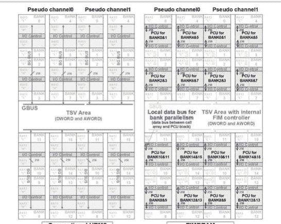
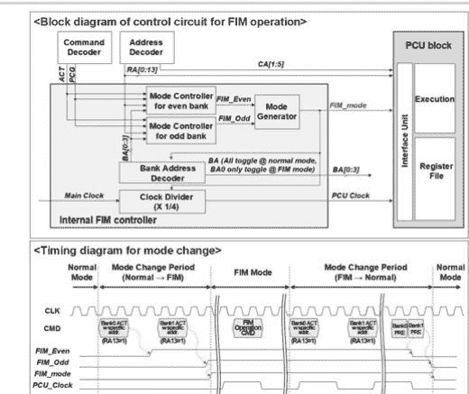
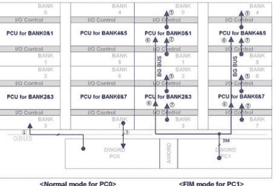
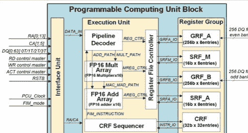
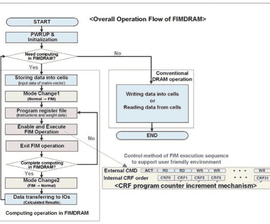
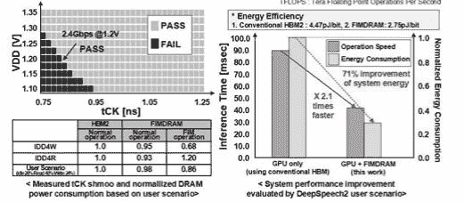
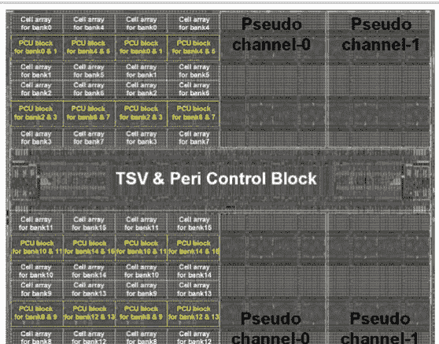

# 2021 IEEE 固态电路国际会议（ISSCC）（美国旧金山，2021年2月13日-2021年2月22日）

## 25.4 一种基于 HBM2 的 20nm 6GB 功能内存 DRAM，采用具有银行级并行性的 1.2TFLOPS 可编程计算单元，用于机器学习应用

Young-Cheon Kwon¹, Suk Han Lee², Jaehoon Lee³, Sang-Hyuk Kwon⁴, Je Min Ryu⁵, Jong-Pil Son⁶, Seongil O⁷, Hak-Soo Yu⁸, Haeseok Lee⁹, Soo Young Kim¹⁰, Youngmin Choi¹¹, Jin Guk Kim¹², Jongyoon Choi¹³, Hyun-Sung Shin¹⁴, Jin Kim¹⁵, BengSeng Phuah¹⁶, HyoungMin Kim¹⁷, Myeong Jun Song¹⁸, Ahn Choi¹⁹, Daeho Kim²⁰, SooYoung Kim²¹, Eun-Bong Kim²², David Wang²³, Shinhaeng Kang²⁴, Yuhwan Ro²⁵, Seungwoo Seo²⁶, JoonHo Song²⁷, Jaeyoun Youn²⁸, Kyomin Sohn²⁹, Nam Sung Kim³⁰

¹Samsung Electronics, Hwaseong, Korea ²Samsung Electronics, San Jose, CA ³Samsung Electronics, Suwon, Korea

In recent years, artificial intelligence (AI) technology has proliferated rapidly and widely into application areas such as speech recognition, health care, and autonomous driving. To increase the capabilities of AI more powerful systems are needed to process a larger amount of data. This requirement has made domain-specific accelerators, such as GPUs and TPUs, popular, as they can provide orders of magnitude higher performance than state-of-the-art CPUs. However, these accelerators can only operate at their peak performance when they get the necessary data from memory as quickly as it is processed: requiring off-chip memory with a high bandwidth and a large capacity [1]. HBM has thus far met the bandwidth and capacity requirement [2–6], but recent AI technologies such as recurrent neural networks require an even higher bandwidth than HBM [7–8]. While a further increase in off-chip bandwidth can be accomplished by various techniques, it is often limited by power constraints at the chip or system level [9]. Hence, it is essential to decrease demand for off-chip bandwidth with unconventional architectures: such as processing-in-memory. In this paper, we present function-In-memory DRAM (FIMDRAM) that integrates a 16-wide single-instruction multiple-data engine within the memory banks and that exploits bank-level parallelism to provide 4× higher processing bandwidth than an off-chip memory solution. Second, we show techniques that do not require any modification to conventional memory controllers and their command protocols, which make FIMDRAM more practical for quick industry adoption. Finally, we conclude this paper with circuit- and system-level evaluations of our fabricated FIMDRAM.

Figure 25.4.1 shows the architecture of a conventional HBM2 and FIMDRAM. To maintain the same physical dimension as HBM2 and preserve mechanical compatibility with the existing 2.5D system-in-package, half of the cell array in each bank was removed and replaced with the programmable computing unit (PCU). Additionally, two banks share one PCU, and there are 8 PCUs per pseudo-channel: the location and the number of PCUs are optimized by considering the area overhead of a PCU and the number of simultaneous operation banks is considered the reduction of peak noise. By locating the PCU adjacent to the cell array, the FIMDRAM is able to utilize bank-level parallelism; the number of simultaneously internal operations is maximized, and the overhead due to the data bus connected between the cell array and PCU is minimized. To support concurrent multi-bank operations a special FIM mode for FIMDRAM is added. During FIM mode, all PCUs are turned on simultaneously and multiple banks execute the same command from the host, while normal mode supports basic operation of the HBM2.

To control FIM operations without modification of the memory controller, an internal FIM controller was designed as shown in Fig. 25.4.2. The internal FIM controller consists of a mode generator to manage FIM mode entry and exit, and a clock divider to enable direct control the PCUs. FIM mode entry can be initiated by a row activate (ACT) command, and exit can be performed by ACT and precharge (PRE) commands. When the host wants to change the operation mode, it can do so by conventional row commands with a specific address: including setting the 13th row-address (RA) bit high. The most significant bit is used to switch in and out of FIM mode: this is to ensure safe operation by applying a high address bit to the memory region where the cell array was removed in FIMDRAM. Additionally, read (RD) and write (WR) commands, and the 13 RA are used to control the three types of data movement between cell array and PCU during FIM mode, as shown in Fig. 25.4.3. In addition, a multi-bank operation can be directed according to the bank address (BA): ACT/PRE/RD/WR commands can simultaneously control all even banks or all odd banks depending on BA0. Concurrent operations on multiple banks increases performance during FIM mode of operation without DRAM read/write latency, because the data bus for normal operations is same as the conventional one, and a local data bus for FIM operations is isolated to prevent any change to normal operations. Additionally, a data bus control scheme is adopted to reduce power consumption: for data movement between the cell array and PCUs the local data bus is active and the global one is not, since there is no need to move data to the external bus. Thus, power impact is reduced due to processing operations in DRAM.

Figure 25.4.4 shows the PCU block diagram and its instruction set. The PCU is divided into a register group, an execution unit, and an interface unit. To support universal and programmable FIM operations, the register group consists of a command-register file (CRF) for instruction memory, a general-purpose register file (GRF) for weight and accumulation, and a scalar register file (SRF) to store constants for MAC operations. Additionally, the PCU contains execution units, a decoding unit for parsing instructions needed to perform operations, and interface units to control data flow. The PCU is controlled by conventional memory commands from the host via the newly implemented control paths to enable in-DRAM computations. The input signals to the PCU are divided into two groups. (1) Conventional signals for DRAM (internal read/write master signal, addresses, and DQs), and (2) generated signals to control PCUs: such as mode control signal and a generated clock for FIM operations. These signals control the instruction sequences for floating point matrix-vector calculations in the register group. The execution unit in the PCU uses a variable four-stage pipeline operation; depending on the decoded source operands, the stored data from the register files or cell data from the bank array, and are used as inputs for the execution unit by the decoded opcode. Additionally, the execution unit has a one stage pipeline for the JUMP instruction, which supports looping. Computed results from the execution units are directed by the destination operand and stored in the GRF. The updated GRF data can be moved into a target bank with a MOVE instruction.

Figure 25.4.5 shows FIMDRAM operation flow in normal and FIM mode; it is set to normal mode after initialization. During normal mode, the host can access each bank as a regular DRAM; it is used to set up input vectors for FIM mode. In order to operate PCUs, the host must send a command to change to FIM mode. After which, even or odd banks receive commands as a group and the PCU is ready to calculate in FIM mode. After that, the host issues a programming sequence and sends the weights for matrix-vector calculation via the DQ interface. The PCU can save 32 instructions in the CRF, and the instructions are sequentially read by CRF program counter. Upon completion of the computation phase, the results of the register files are transferred from PCU to memory cell arrays by multi-bank operations. To read the results from each bank, the host must switch back to normal mode, and then the stored data in each bank can be read.

The FIMDRAM was fabricated using a 20nm DRAM process. Figure 25.4.6 shows a key feature summary and the measurement results. These show that the FIMDRAM achieves 2.4Gbps/pin operation without increasing power consumption, and that the PCU can operate at 300MHz. In addition, an FPGA-based platform and an emulation environment based on an application model was developed to confirm system performance improvements by FIMDRAM. The evaluation results show a 2.1x improvement in performance with a 71% system energy reduction compared to a typical GPU system using HBM2. The chip micrograph is shown in Fig. 25.4.7.

# References

- [1] N. Jouppi et al., “In-Datacenter Performance Analysis of a Tensor Processing Unit,” ISCA, pp. 1–12, June 2017.
- [2] D. Lee et al., “A 1.2V 8Gb 8-Channel 128Gb/s High-Bandwidth Memory (HBM) Stacked DRAM with Effective Microbump I/O Test Methods Using 29nm Process and TSV,” ISSCC, pp. 432–433, 2014.
- [3] K. Sohn et al., “A 1.2V 20nm 307Gb/s HBM DRAM with At-Speed Wafer-Level I/O Test Scheme and Adaptive Refresh Considering Temperature Distribution,” ISSCC, pp. 316-317, 2016.
- [4] J. H. Cho et al., “A 1.2V 64Gb 341Gb/s HBM2 Stacked DRAM with Spiral Point-to-Point TSV Structure and Improved Bank Group Data Control,” ISSCC, pp. 208-209, 2018.
- [5] C.-S. Oh et al., “A 1.1V 16GB 640GB/s HBM2E DRAM with a Data-Bus Window-Extension Technique and a Synergetic On-Die ECC Scheme,” ISSCC, pp. 330-331, 2020.
- [6] D. Lee et al., “A 128Gb 8-High 512Gb/s HBM2E DRAM with a Pseudo Quicker Bank Structure, Power Dispersion and an Instruction-Based At-Speed PMBIST,” ISSCC, pp. 334-335, 2020.
- [7] H. Shin et al., “McDRAM: Low Latency and Energy-Efficient Matrix Computations in DRAM,” IEEE TCADICS, vol. 37, no. 11, pp. 2613–2622, Nov. 2018.
- [8] F. Devaux, “The True Processing in Memory Accelerator,” IEEE Hot Chips Symp., pp. 1–24, 2019.
- [9] S. Kim et al., “Charge-Aware DRAM Refresh Reduction with Value Transformation,” IEEE HPCA, pp. 663–676, 2020.

### 图 25.4.1: 基于 HBM2 的 FIMDRAM 架构与常规 1Ch HBM2 的对比

### 图 25.4.2: FIMDRAM 操作的模式切换方法和时序图

| 索引 | 模式 | 命令 | RA13 | 数据移动 |
| :--- | :--- | :--- | :--- | :--- |
| 1 | 普通 | WR | L | 数据写入单元阵列 |
| 2 | | WR | H | 不可用 |
| 3 | | RD | L | 从单元阵列读取数据 |
| 4 | | RD | H | 不可用 |
| 5 | FIM | WR | L | 从 PCU 块到单元阵列的数据移动 |
| 6 | | WR | H | 不可用 |
| 7 | | RD | L | 从单元阵列到 PCU 块的数据移动 |
| 8 | | RD | H | 从阵列到 PCU 块不可用 |
| 9 | | RD | H | 不可用 |

| 类型 | 命令 | 描述 |
| :--- | :--- | :--- |
| 浮点数 | ADD | FP16 加法 |
| | MUL | FP16 乘法 |
| | MAC | FP16 乘累加 |
| | MAD | FP16 乘加 |
| 数据通路 | MOVE | 加载或存储数据 |
| | FILL | 从 bank 复制数据到 GRFs |
| 控制通路 | NOP | 什么都不做 |
| | JUMP | 跳转指令 |
| | EXIT | 退出指令 |

### 图 25.4.3: 符合 FIM 模式的数据移动和多 bank 操作

### 图 25.4.4: PCU 块的框图和可用指令列表

### 图 25.4.5: FIMDRAM 数据计算的操作流程

| | [3] | [7] | [8] | FIMDRAM (本文) | HBM2 |
| :--- | :--- | :--- | :--- | :--- | :--- |
| DRAM 类型 | HBM2 | LPDDR4 | DDR4 | (本文) | HBM2 |
| 工艺 | 20 nm | 20 nm | 20 nm | 20 nm | 20 nm |
| 存储密度 | 8Gb/cube (2Hi 4Gb-die) | 8Gb/chip (16Gb-die) | 8Gb/DIMM | 8Gb/cube (4Hi 2Gb-die PCU + 4Gb-core-die) | 20Gb/cube (4Hi 4Gb-die) |
| 数据速率 | 2.4Gbps | 3.2Gbps | 2.4Gbps | 2.4Gbps | 2.4Gbps |
| 带宽 | 每芯片 307.2Gb | 每芯片 25.6Gb | 每 DIMM 19.2Gb/s | 每 cube 307.2Gb | 每 cube 307.2Gb |
| 单元数量 | 每 cube 6 Gb | 每 chip 2.4Gb | 每 DIMM 128 | 每 cube 128 | 每 cube 128 |
| 处理单元数量 | 无 | 无 | 每 chip 256 | 每个处理单元 1 | 每 chip 1 |
| 运算速度 | - | - | 1624 MHz (测量值) | 500 MHz (测量值) | 1000 MHz (测量值) |
| 峰值吞吐量 | - | - | 每芯片 0.3 TOPS (128bit * 1GHz) | 每 DIMM 0.1 TOPS (128bit * 1GHz) | 每 cube 128 GOPS (128bit * 1GHz) |
| 运算精度 | - | - | INT8 | INT8 | FP16 |

### 图 25.4.6: 基于应用基准测试的测量结果和系统性能改进

### 图 25.4.7: 在 20 nm DRAM 工艺中制造的带有 PCU 块的 FIMDRAM 芯片微照片

